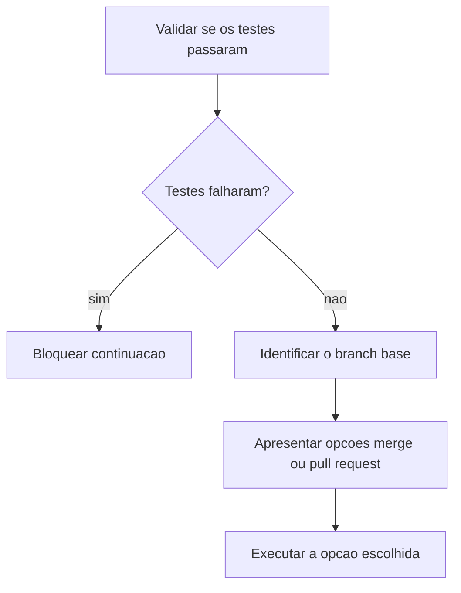

# Ecossistema de Skills

> [!summary] TL;DR
> - Agent Skills foi criado pela Anthropic e hoje é padrão aberto, suportado por praticamente todos os agentes; especificação em agentskills.io.
> - Repositório oficial da Anthropic traz skills prontas além de código (DOCX, PDF, PowerPoint, Excel, branding, Canvas) e skills meta (MCP Builder, Skill Creator).
> - skills.sh é o diretório instalável (Vercel Labs), com busca, rankings e CLI `npx skills add`.
> - Superpowers mostra skills compondo um workflow inteiro, do brainstorming ao fechamento da branch.
> - Navegar diretórios para não reinventar a roda: adaptar, não copiar cegamente.

## Conceitos-chave

- **Repositório oficial da Anthropic**: catálogo reutilizável de skills prontas. PDF/DOCX geram respostas inconsistentes quando a IA improvisa scripts, bibliotecas e parsing; a skill concentra o caminho certo. Skills podem ser carregadas também em apps conversacionais (Claude), não só IDEs.
- **MCP Builder**: skill para criar servidores MCP (modos HTTP Streamable e STDIO, cuja documentação é dispersa); exemplo de uso em [[Criando Skills]].
- **Skill Creator**: skill que orienta a criação de novas skills fazendo perguntas, dando guidelines e gerando os arquivos finais.
- **Skill de PDF**: SKILL.md com quick start e operações básicas (leitura, extração, split, merge, rotação), referências para processos avançados e script `checkFillableFields` para formulários.
- **skills.sh (Agent Skills Directory, Vercel Labs)**: diretório instalável consumível por vários agentes/IDEs (Cursor, Codex e outros compatíveis); padroniza descoberta, instalação e reuso. Busca e rankings (comando findSkills, leaderboards com tendências e mais usados); popularidade não é qualidade.
- **Seção "quando aplicar"**: gatilhos que justificam carregar a skill. Ex React/Next.js: criação de componentes, páginas, data fetching client-side, revisão de performance, refatoração, otimização de bundle/load time. Evita ativação genérica demais.
- **Regras + referências anexadas**: ex React: waterfall, bundle size, server-side performance, client-side data fetching, rerender optimization.
- **Skills pequenas**: também mudam comportamento só por serem carregadas; o que importa é orientar decisões recorrentes com precisão.
- **Skill de TDD**: primeiro um teste que falha, respeitar exceções explícitas, ciclo red-green-refactor; aplicada em features, bug fixes, refactorings e mudanças de comportamento. Variantes por stack: TDD Workflow, Laravel TDD, Django TDD (ver [[TDD com IA]]).
- **SKILL.md como núcleo**: quando a skill cresce, vira núcleo resumido e documentos auxiliares são referências carregadas on-demand (ver [[Fundamentos de Skills]]).
- **Superpowers (obra)**: workflow reutilizável em Claude Code, Codex e OpenCode: brainstorming, isolamento com Git worktrees, criação e execução de planos, TDD, code review, fechamento da branch. Cada etapa com instruções especializadas.
- **Decomposição**: várias skills com objetivo claro, não uma skill genérica "programar melhor". Skill mínima pode ser um único arquivo; complexidade cresce conforme a necessidade.
- **Anatomia vista no Superpowers**: front matter (camada declarativa: quando usar) + overview (comportamento esperado) + seções common mistakes, red flags, itens obrigatórios e integration; a skill vira checklist executável.
- **Skills moldadas ao workflow de quem criou**: e skills específicas de metodologia do projeto, ex: [[Spec Driven Development]]; o mesmo raciocínio sustenta o [[Workflow RPI Research Plan Implement]].
- **agentskills.io**: manual universal com o que é uma skill, especificação, integração, exemplos, biblioteca de referência, campos do front matter e metadata (autor, licença). A especificação é o núcleo comum; plataformas e autores criam extensões criativas por cima. Primeiro dominar criação e uso, depois refinar metadados.
- **Skill como "arroz e feijão"**: transformar trabalhos repetitivos que você explica o tempo todo em skill; uso tão natural quanto saber o que é if/else. O conceito independe de ferramenta.
- **Repositório skills-mba (Full Cycle)**: 3 skills da disciplina. `nextjs-bootstrap` (ver [[Bootstrap de Projetos Greenfield]]), `e2e-nav-test` (SKILL.md + `references/common-pitfalls.md` + `references/framework-discovery.md`, ver [[Testes E2E com Playwright CLI]]) e `test-guide` (ver [[Edge Cases e Test Guidelines]]).

## Fluxograma / Processo

**Skill de finalizar branch (Superpowers)**



## Erros comuns / Cuidados

- Popularidade no leaderboard do skills.sh não garante qualidade.
- Adaptar skills de terceiros ao próprio workflow em vez de copiar cegamente.

## Materiais complementares

### Prompts

**README do repositório skills-mba (literal)**
```text
# Skills

Skills based on examples from the **MBA in Software Engineering with AI** by Full Cycle. Each skill extends the AI agent's capabilities with specialized workflows and domain knowledge.

---

## nextjs-bootstrap

Bootstraps a new Next.js project with standard architecture: App Router, TypeScript strict, Prisma 7, PostgreSQL, NextAuth v5, and Tailwind CSS 4. Generates a complete CLAUDE.md, operational scripts (init, down, check, watch, tmux, deploy), and project structure ready for AI-assisted development.

**When to use:** "new project", "bootstrap", "scaffold", "setup nextjs", "create app from scratch".

---

## e2e-nav-test

Generates and executes E2E test cases for any web application (SPA, server-rendered, or hybrid). Analyzes the codebase to discover routes, components, auth flows, forms, modals, roles/permissions, and navigation patterns, producing a structured test-cases document with dependency trees and checklists. Works with any framework: Next.js, React, Vue, Angular, Django, Laravel, Rails, Flask, Go, and more.

**When to use:** "test navigation", "generate e2e tests", "test user flows", "create test cases", "map user journeys".

---

## test-guide

Guide for writing and auditing tests across all layers (unit, integration, and E2E). Defines what is worth testing and what is not, mock health criteria, and the purpose of each layer. Use when writing new tests, deciding what to test at each layer, choosing between unit vs integration vs E2E, auditing existing tests, cleaning up redundant tests, or identifying missing coverage.

**When to use:** "write tests", "add tests", "create unit/integration/e2e tests", "audit tests", "review test quality".
```

### Conteúdo extra

- skills.sh: https://skills.sh/
- Skills oficiais da Anthropic: https://github.com/anthropics/skills/tree/main/skills
- Superpowers: https://github.com/obra/superpowers/tree/main/skills
- Especificação Agent Skills: https://agentskills.io/home
- Código-fonte das skills da disciplina: https://github.com/devfullcycle/skills-mba

## Tags de busca

`#dev-software-ia` `#skills` `#agent-skills` `#skills-sh` `#superpowers`
