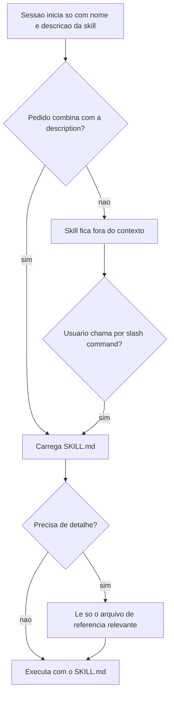

# Fundamentos de Skills

> [!summary] TL;DR
> - Skill especializa o agente numa tarefa ou domínio bem definido e é carregada on-demand: no início da sessão só entram nome e descrição.
> - O front matter (principalmente a `description`) decide se a skill será acionada ou ignorada.
> - SKILL.md curto (abaixo de 500 linhas, idealmente perto de 300) como camada de alto nível; detalhes em arquivos de referência lidos só quando relevantes.
> - Progressive Disclosure em 3 patterns: High-Level Guide, Domain-Specific Organization e Conditional Details.
> - Skill pode ser carregada pelo modelo ou chamada pelo usuário como slash command; `user-invocable` e `disable-model-invocation` controlam isso.

## Conceitos-chave

- **Skill**: mecanismo para especializar o agente em tarefa ou capacidade bem definida (codar ou executar ações num domínio), seguindo padrões do projeto, empresa ou função técnica (ex: code reviewer, boas práticas Next.js, componentes React). Virou padrão de mercado e é, na prática, um prompt especializado e executável.
- **Carregamento on-demand**: comportamento padrão; o conteúdo só entra quando há necessidade concreta. Não ocupa continuamente a janela de contexto.
- **Problema que resolve**: a janela já começa ocupada por system prompt, memory, [[CLAUDE.md e AGENTS.md (Instruções de Projeto)]], descrições de servidores MCP, lista de agentes e descrições de skills; perto do limite o agente reserva tokens para compactar histórico, reduzindo área útil e encurtando a sessão. Carregar code review + React + Python de uma vez faria o contexto nascer inflado (ver [[Context Window em LLMs]]).
- **Front matter**: cabeçalho YAML da skill (também de agentes e comandos); permite ao agente decidir quando usar sem ler o conteúdo completo. Skill útil fica invisível se o front matter não comunicar a finalidade.
- **description**: a "venda" da skill para o agente; define se será acionada ou ignorada. Investir tempo nela é parte do desenvolvimento da skill. Descrição eficaz = o que faz + quando usar + como ajuda; descrição genérica enfraquece o trigger.
- **Skill Trigger**: condição textual de ativação, com padrões "use when" e "trigger when user...". O trigger funciona por proximidade semântica (pedido em português aciona skill escrita em inglês).
- **Keywords no front matter**: campo extra que aumenta a atenção da IA para a skill (usado na skill de design system da Full Cycle, ver [[Criando Skills]]).
- **SKILL.md**: arquivo mínimo e principal, é o que o agente carrega. Deve ficar abaixo de 500 linhas, idealmente perto de 300, com fluxo, critérios e decisões essenciais.
- **Pasta reference**: documentos especializados lidos só quando relevantes. No MCP Builder há guias de Python ou TypeScript, convenções, estrutura de projeto e implementação de tools; projeto TS não carrega o guia Python.
- **Redundância intencional**: o SKILL.md repete de forma condensada partes das referências.
- **Níveis de granularidade**: alto nível no SKILL.md; baixo nível (npm run build, convenções de nome, estrutura exata de tool) nas referências.
- **Scripts dentro da skill**: executáveis que a skill manda rodar (conectar ao servidor MCP, rodar avaliação, `requirements.txt`; na skill de PDF, `checkFillableFields` para formulários).
- **Skill como pacote**: reutilizável e instalável no projeto, no ambiente do usuário ou na ferramenta; não é lógica de negócio.
- **Progressive Disclosure**: o agente lê arquivos conforme precisa em vez de tudo de uma vez (menos tokens, menos ruído, mais precisão). Carregamento em camadas: front matter (descrição), depois conteúdo principal, depois arquivos complementares.
- **Pattern 1, High-Level Guide com referências**: SKILL.md como índice operacional ("para layout de página veja arquivo X; para states/model veja arquivo Y"), ex: design system.
- **Pattern 2, Domain-Specific Organization**: uma skill com múltiplos domínios, SKILL.md como catálogo/roteador. Ex: "Full Cycle Domain Rules" com seção Available Business Rules and Technical Rules apontando docs de billing (process payment, invoices, gateway integration, payment methods), CRM, Student Certificates, Sales. Domínio pode ser área do sistema ou parte de monorepo; skills de domínio são compartilháveis entre projetos.
- **Pattern 3, Conditional Details**: a skill explicita condições para decidir que arquivo ler ou caminho seguir (árvore de decisão no texto). Ex: maturidade da codebase em Greenfield (do zero), Emerging (poucos componentes), Established (bastante componente, padrões claros), Mature (brownfield forte), detectada por arquivo de CodeBase Exploration ou análise arquitetural (contagem de componentes, acoplamento médio, integração), apontando para `greenfield.md`, `emerging.md`, `established.md`, `mature.md`.
- **Skill de assunto único vs skill roteadora**: na primeira o SKILL.md é entrada de referências; na segunda o SKILL.md decide para onde seguir.
- **Comandos de localização na skill**: incluir pseudocódigo ou comandos como `grep -i billing` para achar documentos; a própria skill gera o filtro antes de ler, evitando a sequência exploratória ls, cat, grep, read (menos tool calls e tokens).
- **Table of Contents**: em skill perto de 500 linhas, incluir sumário (ex: seção "Greenfield Projects" com subtópicos) para o agente pular direto à seção; categorizar conteúdo extenso por domínio de decisão (API/endpoints, autenticação, regras de negócio).
- **AGENTS.md/CLAUDE.md vs Skills**: AGENTS.md, CLAUDE.md e GEMINI.md entram no contexto no momento zero da sessão. Podem apontar para documentação complementar, mas a leitura depende do agente (zero garantia). Skills fazem Progressive Disclosure estruturado: começam com pouco contexto, decidem o que ler, buscam só os arquivos certos, param quando têm o suficiente. Ambos dependem de trigger, mas após o trigger da skill o carregamento é visível e previsível. Skills são distribuíveis e reutilizáveis; CLAUDE.md fica preso ao repositório.
- **Referência com `@caminho`**: import imediato (como link simbólico + append), todo o conteúdo entra de uma vez; não economiza contexto, só organiza fisicamente. Referência sem `@` = leitura sob demanda, não garantida.
- **Papel do arquivo de inicialização**: contexto-base e gotchas locais do repositório onde a IA emperra e que não justificam skill (ver [[Arquivos de Inicialização do Agente]]).
- **Skill como slash command**: no Claude Code a skill pode ser chamada por `/nome-da-skill` (execução forçada/manual). Comando e skill convergem: comandos tendem a virar skills, comandos isolados só para casos muito específicos.
- **`user-invocable`**: controla se a skill aparece/executa como slash command (desabilitado: só o modelo usa).
- **`disable-model-invocation`**: impede o modelo de carregar automaticamente (só uso manual).
- **Matriz de invocação**: só modelo, só usuário, ambos ou nenhum; útil para skills sensíveis e ambientes com múltiplos usuários.
- **Argumentos**: posicionais como CLI, `/skill A B C` mapeia índice 0 = A, 1 = B, 2 = C (`$ARGUMENTS`/`$0`, `$1`...). `argument-hint` e type hint no front matter orientam preenchimento e sugestões da interface (ergonomia, não mudam a lógica).

## Fluxograma / Processo



## Erros comuns / Cuidados

- Validar empiricamente o front matter: se a skill não carrega nos cenários certos, ajustar termos, exemplos de uso e gatilhos no cabeçalho. Escrever partindo de skills conhecidas como referência (reaproveitar o padrão de formulação, não copiar).
- Se a skill não carregar automaticamente: pedir explicitamente para carregá-la ou usar no pedido as palavras-chave do front matter (ex: "criar uma proposta", "escrever documentação", "draft de spec").
- Agentes personalizados cujo prompt não usa termos compatíveis com o front matter das skills deixam de acioná-las; escrever agentes e front matters isoladamente reduz a taxa de ativação correta (ver [[Subagentes e Tasks Ad Hoc]]).
- Dosar comandos e pseudocódigo: excesso transforma a skill em if-else, "programando em português"; manter a maior parte em linguagem natural.
- Skill densa demais faz o agente pular partes, se confundir ou querer ler tudo. Iniciar sessão com 20% da janela já usada é frustrante; mesmo com custo de token caindo, a janela continua limite prático.
- CLAUDE.md de 100 a 200 linhas com vários `@` para arquivos de 500 a 700 linhas importa tudo para a janela: "pensar dez vezes" antes de usar `@`.
- Criar skill não é só escrever SKILL.md: é decisão de arquitetura de particionamento, descoberta e carregamento (ver [[Mapeamento de Skills em Projetos]]).

## Materiais complementares

### Prompts

**Instrução para induzir a leitura de referências no CLAUDE.md/AGENTS.md (narrado na aula)**
```text
Important: before starting any activity, understand what docs below are relevant for your task and read them first.
```

**Front matter real com description de trigger amplo (e2e-nav-test, repositório skills-mba)**
```text
---
name: e2e-nav-test
description: >
  Generate and execute E2E test cases for any web application - SPA, server-rendered,
  or hybrid. Analyzes the codebase to discover routes, components, auth flows, forms,
  modals, roles/permissions, and navigation patterns, then produces a structured
  test-cases document with dependency trees and todo checklists. Works with any
  framework: Next.js, React, Vue, Angular, Django, Laravel, Rails, Flask, Go,
  Symfony, Spring, ASP.NET, PHP, and more. Use this skill whenever the user asks to
  "test navigation", "generate e2e tests", "test user flows", "create test cases",
  "run navigation tests", "e2e test plan", "check all flows", "test my app flows",
  "map user journeys", "test my app", or anything related to end-to-end flow testing.
  Also trigger when the user mentions "test-cases.md", "flow coverage", or
  "navigation coverage". Even if they just say "test my app" or "run e2e",
  this skill is likely what they need.
---
```

**Front matter real com lista "Triggers on" (test-guide, repositório skills-mba)**
```text
---
name: test-guide
description: >
  Guide for writing and auditing tests across all layers - unit, integration, and E2E.
  Use this skill when writing new tests, creating test files, deciding what to test at each layer,
  choosing between unit vs integration vs E2E, and also when auditing existing tests, cleaning up
  redundant tests, or finding missing coverage. Triggers on: "write tests", "add tests for",
  "create unit tests", "create integration tests", "create e2e tests", "should I test this",
  "what layer should this test be", "audit tests", "test cleanup", "which tests can I delete",
  "what tests am I missing", "review test quality".
---
```

## Tags de busca

`#dev-software-ia` `#skills` `#progressive-disclosure` `#front-matter` `#context-window`
