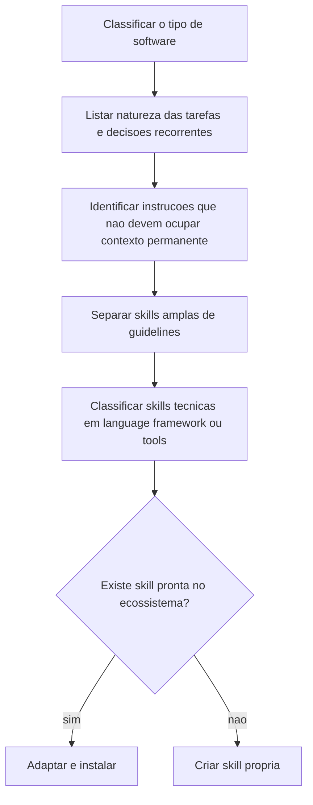

# Mapeamento de Skills em Projetos

> [!summary] TL;DR
> - Skills são decisão de arquitetura do projeto: organizam conhecimento operacional que não precisa estar sempre no contexto.
> - Mapear parte do software (tipo de sistema, tarefas, decisões recorrentes), não da ferramenta.
> - Separar conscientemente skills de habilidades amplas (conceitos) de guidelines (regras prescritivas).
> - Skills técnicas se dividem em Language Oriented, Framework Oriented e Tools Oriented.
> - IA fazendo fetching na web para pedido técnico recorrente é sinal de lacuna de skill.

## Conceitos-chave

- **Skill como decisão de arquitetura**: definir skills faz parte da preparação do projeto (Project Skills). [[CLAUDE.md e AGENTS.md (Instruções de Projeto)]] continuam úteis para instruções gerais e comportamento base, mas tudo neles entra no início da sessão.
- **Custo de não mapear**: desperdício de tokens e respostas mais genéricas e menos precisas.
- **Critério de existência**: não criar skills artificialmente para detalhe irrelevante, mas praticamente todo projeto tem áreas que se beneficiam; se nenhuma skill foi mapeada, provavelmente as oportunidades não foram identificadas.
- **Tipo de projeto**: back-end, front-end, mobile, full-stack, híbrido (Next.js), monorepo com camadas que pedem skills diferentes.
- **Skills de habilidades amplas**: orientadas por conceitos, não por framework. Ex: front-end design sem ensinar React/Vue/Tailwind (organização da interface, clareza visual); engenharia/arquitetura (boas práticas, SOLID, aderência a arquitetura conhecida, padronização de nomes, presença de testes). Funcionam como filtro de qualidade que sugere e questiona.
- **Guidelines**: instruções afirmativas e prescritivas que dizem como fazer para seguir convenção (ex: Web Design Guidelines, Go Development Guidelines, Python Development Guidelines, Next.js Guidelines).
- **Guidance**: efeito prático da guideline no comportamento do agente.
- **Guidelines específicas do projeto**: padrões de arquivo, convenções internas, restrições de legado, decisões históricas (legado com partes modernizadas convivendo com antigas).
- **Conceito vs regra**: a diferença é o grau de liberdade. Skill ampla dá repertório para avaliar qualidade; guideline restringe a execução às convenções. As duas se complementam.
- **Origem das skills**: muitas surgem da necessidade real do projeto ou empresa, não precisam existir no [[Ecossistema de Skills]]. Objetivo: transformar expectativas implícitas da equipe em instruções especializadas.
- **Skills Language Oriented**: tópicos profundos demais para guideline geral (ex: otimização de performance em Python, advanced types em TypeScript); boas práticas gerais ficam na guideline.
- **Skills Framework Oriented**: convenções do framework (Django: pastas, templates, modelagem, APIs, admin; React com Vercel; Spring Boot); reduzem improviso e busca de documentação.
- **Skills Tools Oriented**: tooling encapsulado (GitHub Actions com templates para CI, CD, push, Docker, automação de code review; Playwright para navegação e automação front-end, ver [[Testes E2E com Playwright CLI]]).
- **Aplicação no projeto prático**: a fundação de IA do StreamTube mapeou skills de boas práticas NestJS, TypeORM e Test Guide (ver [[Curadoria de Skills]]).

## Fluxograma / Processo

## Erros comuns / Cuidados

- Mapear partindo da ferramenta em vez do software leva a skills sem aderência ao projeto.
- IA fazendo fetching na web para pedido técnico recorrente é sinal de lacuna de skill: verificar se há skill pronta ou criar uma (economiza tokens, execução mais estável).
- Skill de Playwright pode reduzir o uso do servidor MCP correspondente.

## Tags de busca

`#dev-software-ia` `#skills` `#mapeamento-de-skills` `#guidelines` `#arquitetura`
