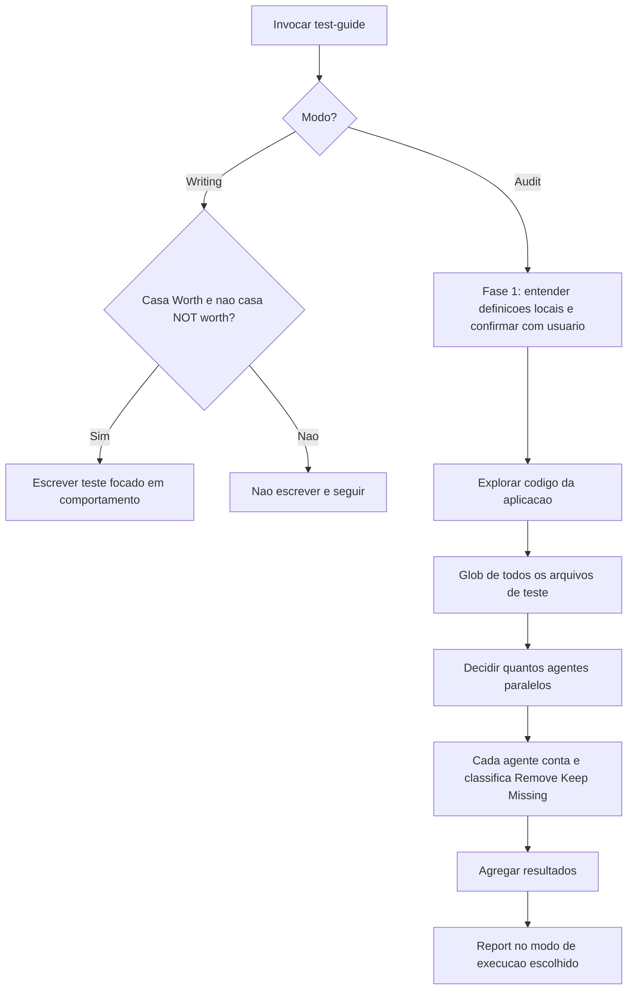

# Edge Cases e Test Guidelines

> [!summary] TL;DR
> - A IA tende ao happy path; bugs graves nascem em sad paths e edge cases, que não aparecem no volume da suíte.
> - Auditoria de ausência mapeia o que existe e o que falta, por categoria, com justificativa e estimativa; vira backlog priorizável.
> - A skill test-guide transforma o julgamento manual em regra reutilizável: critérios Worth / NOT worth testing, mock health e propósito de cada camada.
> - Dois modos na mesma skill (Writing Tests e Audit) porque compartilham a mesma política de decisão.
> - Escopo delimitado e saída report only controlam custo e separam diagnóstico de ação.

## Conceitos-chave

### Happy path, sad path e edge cases

- **Happy path**: tendência natural da IA (fluxo mais explícito e fácil de inferir); a suíte parece produtiva mas cobre só quando tudo dá certo.
- **Sad path**: cenários em que o sistema falha, rejeita entrada ou interrompe o fluxo.
- **Edge cases**: casos de borda plausíveis (combinações raras, estados incompletos, entradas fora do padrão), foco prioritário de auditoria.
- **Error handling é comportamento testável**: resposta produzida, consistência, comunicação do erro, falha controlada.
- **Testes ausentes não aparecem no volume**: muitos testes de "email tem arroba" e nenhum de quebra de fluxo ou efeito colateral; "80% de cobertura" sem sad path é confiança enganosa (ver [[Testes Automatizados vs IA]]).
- **Teste como ativo de longo prazo**: deve continuar valendo daqui a 15 ou 20 anos.

### Auditoria de ausência

- **Duas auditorias complementares**: remover excesso (ver [[Testes Automatizados vs IA]]) e revelar ausência, ambas na aplicação atual; a de ausência roda em sessão limpa e em [[Plan Mode]], pedindo análise de edge cases não implementados, não "mais testes".
- **Caso Video Transcriber** (87 arquivos de teste front, 30 back, boa cobertura de happy path), achados do report:
  - Segurança back: usuário suspenso recebe token válido; token em query param do stream exposto em logs; brute force sem rate limit separado; X-Forwarded-For spoofing sem proxy confiável; unicidade de email case-sensitive gera contas duplicadas; tag cross-user assignment.
  - Segurança front: public routes com `startsWith('/')` tornam tudo público; tokens no localStorage sem limpeza em erro; token persistente após logout falho; JWT na URL do WebSocket.
  - Error handling: erro de DB deixa vídeo preso em transação com status que nunca sai de failed; FFprobe ausente ou em timeout sem erro; network failure sem tratar promise rejection; PATCH não testado; funções de auth sem cobertura; `handleDeleteVideo` usa alert em vez de toast; falha de thumbnail no VideoCard.
  - Race conditions: upload simultâneo, concorrência no SQLite, gravação por chunks.
  - Estimativa: 88 novos testes priorizados entre alta e baixa.
- **Report é hipótese**: pode ter falso positivo; a camada certa (unit, integração, E2E) se decide por custo-benefício de diagnóstico.
- **Modelo**: Sonnet provavelmente bastaria; Opus com effort alto queimou tokens.

### Skill test-guide

- **Propósito**: transformar julgamento manual em regra reutilizável; work in progress, ajustada por projeto e modelo; disponível no repositório skills-mba.
- **Skill em vez de comando**: pode ser disparada indiretamente durante análises de teste (ver [[Fundamentos de Skills]]).
- **Linha de raciocínio, não tutorial de Jest/Go**: agnóstica de stack; padrões de escrita vêm de outras skills ou prompts.
- **Ferramentas com subagentes** (Codex, Gemini, Claude Code, Copilot) aplicam a skill nas investigações.
- **Granularidade de skill**: uma skill pode ter mais de um modo se compartilham a mesma política de decisão (o autor discorda de skills de responsabilidade única); ver [[Criando Skills]].
- **Worth testing**: business logic com branching, security boundaries (XSS, CSRF, SQL injection), data integrity (JSON para DTO, XML, gRPC), error handling, critical user flows (CRUD cheio de regras não se trata igual a CRUD bobo), race conditions (lock otimista/pessimista, filas; em Go, race conditions e deadlocks), boundary/edge cases e external integrations (as duas últimas adicionadas depois).
- **NOT worth testing**: comportamento de framework (cuidado com mockar ORM por purismo), validation passthrough, mirror tests, cobertura duplicada entre camadas, wiring tests, static structure, output shape sem comportamento, repetição de variantes sem branching, utilitários de caminho único; CRUD simples já coberto por integração é zona cinzenta.
- **Teste vale a pena** quando reduz incerteza relevante; não vale quando repete cobertura de outra camada ou verifica trivialidade.
- **Mock health**: no máximo 3 mocks por teste; com 4 ou mais, reescrever como integração ou remover (teste com muito mock "está gritando" para ser integração); over-mocking é típico no front.
- **Cada camada tem propósito**: unit prova lógica isolada e localiza a quebra (sem ele, a integração falha e não se sabe onde); integration pega mismatches entre pedaços; E2E valida a cadeia inteira e é a menor quantidade de testes; back-end E2E pode ser curl no endpoint; não criar vários scripts E2E para o que integração já cobre.
- **Modo Writing Tests é um "if"**: casou com Worth e não com NOT worth, escreve; senão segue sem escrever; um conceito por teste (se precisa de "and" no nome, dividir); dependências reais quando viável; em projeto não greenfield, seguir as convenções existentes.
- **Modo Audit**: entende a definição local de unit/integration/E2E (termos ambíguos) e confirma com o usuário antes de julgar; explora o código da aplicação, não só os testes; lança agentes paralelos por escopo; conta com precisão, sem sampling.
- **Princípios**: ler o conteúdo real do teste, não o nome; ser conservador na remoção (na dúvida, manter); a pirâmide é guideline, não lei (regra de negócio no controller vira teste de integração).

### Executando a skill

- **Escopo é controle de custo**: auditar 100% de 2000 testes por curiosidade gasta tokens e tempo; limitar por front, back, módulo ou diretório; se o resultado não vira refatoração, remoção ou backlog, o escopo está grande demais.
- **A skill pergunta** o modo (writing ou audit), a saída e o escopo (projeto inteiro, front, back, módulo).
- **Agentes paralelos por área**: no exemplo, 2 de back + 4 de front = 6 simultâneos, cada um com prompt especializado; a janela do agente principal cresce ao receber resultados (59% para 67%), ver [[Gestão de Context Window em Prompts]].
- **Resume de subagente interrompido**: o principal retoma o subagente de onde parou (o Backend Integration Agent devolveu só autenticação).
- **Report final do exemplo**: 2.250 testes, 763 a remover, 1.480 após limpeza (redução de 34%); categorias de remoção: static structure, variant repetition without branching, wiring and mirror tests, validation pass-through, framework behavior, duplicate coverage across layers, output shape without behavior; inclui worst offenders, arquivos deletáveis integralmente, testes faltantes por prioridade e mock health (testes com 5 e 9 mocks com sugestão de refazer).
- **Próximo passo**: pedir um plano e depois implementar; o mesmo critério é reaplicado após TDD em [[TDD com IA]].

## Fluxograma / Processo



## Erros comuns / Cuidados

- Pedir informação que não vai usar gasta tempo, tokens e pode confundir.
- O agente principal pode não ter recebido tudo de um subagente: mandar "keep going, waiting for all agents to finish".
- Tratar o report de edge cases como verdade: pode haver falso positivo.

## Materiais complementares

### Prompts

**Auditoria de edge cases ausentes em plan mode, sessão limpa (narrado na aula)**
```text
Avalie todos os testes do sistema, incluindo front-end e back-end. Identifique os testes automatizados e os principais aspectos que esses testes estão cobrindo. Porém, baseado nesse mapeamento, verifique testes de edge cases, ou seja, testes que tragam um possível caminho triste, que não estão cobertos pelos testes atuais, como Error Handling, Rate Limiting, Segurança, fluxos principais que podem ter exceções não tratadas, entre outros. Explore o código, entenda seus principais fluxos, comportamentos e possíveis problemas que podem acontecer e que não estão previstos no código, validações ou mesmo a nível de feature. Categorize esses tipos de teste, incluindo os de back-end e front-end, e traga exatamente o que não está coberto e o motivo pelo qual deveríamos implementar. No final, faça um resumo e traga a quantidade esperada de novos testes que deverão ser criados apenas nesses tipos de situação.
```

**Prompt gerado pela skill para o subagente de unit tests do back-end (narrado parcialmente na aula, o original é maior)**
```text
You are a test quality auditor. Read every test file in backend/tests/unit and classify each individual test as KEEP, REMOVE, or note as MISSING TESTS. Removal criteria: framework/ORM persistence tests, validation pass-through, ...
```

**Skill test-guide (literal do repositório, `skills-mba/test-guide/SKILL.md`)**
````markdown
---
name: test-guide
description: >
  Guide for writing and auditing tests across all layers - unit, integration, and E2E.
  Use this skill when writing new tests, creating test files, deciding what to test at each layer,
  choosing between unit vs integration vs E2E, and also when auditing existing tests, cleaning up
  redundant tests, or finding missing coverage. Triggers on: "write tests", "add tests for",
  "create unit tests", "create integration tests", "create e2e tests", "should I test this",
  "what layer should this test be", "audit tests", "test cleanup", "which tests can I delete",
  "what tests am I missing", "review test quality".
---

# Test Guide

Write tests that verify the system behaves correctly at each layer. Each test must have a clear purpose - what behavior it proves and at which boundary. Go beyond happy paths: test edge cases, error scenarios, and boundary conditions where bugs actually hide.

---

## The Criteria

These rules apply whether you're writing new tests or auditing existing ones.

### Worth testing

- **Business logic with branching** - conditionals, state machines, permission checks, domain rules
- **Security boundaries** - auth, authorization, rate limiting, input sanitization, xss, csrf, sql injection, etc.
- **Data integrity** - transformations, serialization, migrations, calculations where wrong output = corrupt data
- **Error handling** - what happens when external services fail, database is down, user is unauthorized
- **Critical user flows** - auth, payment, upload, core CRUD that users depend on
- **Race conditions** - concurrent operations, optimistic locking, queue processing
- **Boundary/edge cases** - null, empty, max values, off-by-one, overflow conditions
- **External integrations** - webhooks, unexpected API responses, timeouts, contract mismatches

### NOT worth testing

- **Framework behavior** - Trust what the framework guarantees: rendering, routing, request handling, ORM persistence, loading states. If the framework works, these work. Test your logic on top of it.
- **Validation passthrough** - Validation libraries already enforce their rules. One test proving the validator is wired is enough - not one per rule on the same code path. Keep one happy-path test per validator to prove valid input passes, but don't duplicate every rejection rule.
- **Mirror tests** - When the assertion copies the return value of the implementation. The test can never catch a bug - it can only break when you intentionally change the code.
- **Duplicate coverage across layers** - Each test must catch a bug no other test catches. If a behavior is verified at a higher layer, a lower-layer test for the same path adds nothing unless the logic is complex enough to need fault isolation. This includes: functions re-tested by their callers.
- **Wiring tests** - Tests that only verify a side-effect call was made with the right arguments. These test glue, not logic. They break on refactors, not on bugs. Only test wiring when there's transformation, conditional logic, or error handling between caller and callee.
- **Static structure assertions** - Field existence, column types, initial state values, default config, type checks. If the structure is wrong, every other test that depends on it already fails.
- **Output shape without behavior** - Tests that verify static output (rendered text, response field presence, visual properties, source file contents) without exercising any logic. If a behavioral test in the same file already produces the same output, the shape-only test is redundant.
- **Variant repetition without branching** - Multiple tests exercising the same code path with different inputs. If the logic doesn't branch, one representative test (or one parameterized test) is enough.
- **Single-path utilities** - Functions with no conditionals, no error handling, no edge cases. Simple getters, setters, one-liner delegations. If the function branches, it's worth testing.

### Mock health

- **Max 3 mocks per test.** More than that means you're testing wiring, not behavior.
- If a test needs 4+ mocks, rewrite it as an integration test or remove it.
- Frontend tests are especially prone to over-mocking. A component test with mocked router, mocked context, mocked API, and mocked hooks tests nothing real.

### Each layer has a purpose

**Unit tests** prove isolated logic works - branching, calculations, domain rules. They're fast and pinpoint exactly what broke. Write them for functions with complex conditionals where fault isolation matters. Not every behavior needs a unit test - if the logic is simple and an integration test already covers it, the unit test is duplicate coverage.

**Integration tests** prove pieces work together - API + DB, service + repository, component + context. They catch contract mismatches and wiring bugs that unit tests can't see.

**E2E tests** prove a complete flow works end-to-end - a full API call traversing all layers (request → middleware → service → DB → response), a browser-driven test that triggers backend calls, or a flow that includes external services. They validate that the entire chain works together, not just individual pieces.

| Layer | Test | Skip |
|-------|------|------|
| **Unit** | Functions with conditionals, calculations, domain rules, state machines | Getters, trivial utils, config, schema validation |
| **Integration** | API endpoints (auth, permissions, errors), services + DB, component + context | Simple CRUD already covered by E2E, static rendering |
| **E2E** | Critical user flows (auth, upload, core workflows), full API traversals | Flows already well-covered by integration tests |

---

## Mode: Writing Tests

When creating new tests, apply the criteria above before writing anything.

1. Check the code against the **"Worth testing"** and **"NOT worth testing"** categories above.
2. If it matches "Worth testing" and not "NOT worth testing" → write it. Focus assertions on behavior, not only granular implementation details.
3. Otherwise → don't write the test. Move on.

When writing:
- Test behavior and outcomes, not a very granular implementation details.
- One concept per test - if you need `and` in the test name, split it
- Name tests after what they verify: `test_locked_account_returns_403`, not `test_login_3`
- Prefer real dependencies over mocks **when feasible** (in-memory DB over mocked repository). If its not a greenfield project, follow the project's conventions.

---

## Mode: Audit

When auditing existing tests, use the same criteria to classify each test.

### Phase 1: Understand the project's test definitions

Before judging, understand what unit/integration/E2E mean **in this specific project** - these terms are ambiguous:

- Read project docs, test configs, CI pipeline, directory structure
- Confirm your understanding with the user before proceeding

### Phase 2: Explore, Count & Classify

- **Step 1**: Explore the application code (not just tests) - understand modules, business logic, critical flows, and what each area of the codebase does. This context is essential to judge whether a test is worth keeping.
- **Step 2**: Find all test files (Glob) to know the total scale.
- **Step 3**: Based on the number of test files/dirs/modules and the app structure, decide how many parallel agents to launch. Each agent gets a specific scope (files, dirs, or modules - match the project's organization). Each agent also receives context about the production code its tests relate to.
- **Step 4**: Each agent, in a single pass per file, does:
  - Count every individual test case precisely (read each file, count exact declarations - no estimates, no sampling). Maximum precision on test counts is required.
  - Classify each test: **Remove** / **Keep** / **Missing** - using knowledge of the production code to judge worthiness against the criteria above.
- **Step 5**: Aggregate all agent results - total counts + classifications.

### Phase 3: Report

```
# Test Audit Report

## Test Count Overview
| Metric | Count |
|--------|-------|
| **Total tests in system** | X |
| **Tests to remove** | Y |
| **Projected count after cleanup** | Z |

## Project Test Definitions
[What each category means in this project]

## Summary
- Test files analyzed: X
- Remove: X | Keep: X | Missing critical: X | Missing edge cases: X

## Tests to Remove
### [filename:test_name]
- **Category**: [matching category from NOT worth testing list above]
- **Why**: [1-2 sentences]

## Missing Tests (Priority Order)
### Critical
[What to test and why it matters]

### Edge Cases
[Scenario descriptions]

## Mock Health
[Files with excessive mocking and suggested refactors]
```

### Execution modes

Ask the user which mode they want:

- **Report only** (default) - generate report, make no changes
- **Report + Delete** - report, then remove confirmed tests one at a time
- **Report + Scaffold** - report, then scaffold missing tests with TODO placeholders
- **Full automation** - report, delete confirmed tests, scaffold missing tests with TODO placeholders

---

## Principles

- Read the actual test code - don't judge by name alone
- Apply the criteria consistently - if a test matches NOT worth testing and doesn't match Worth testing, remove it
- Respect project conventions (test configs)
- The test pyramid is a guideline, not a law - if logic lives in API handlers, integration tests may matter more than unit tests
````

### Conteúdo extra

- Repositório das skills da disciplina: https://github.com/devfullcycle/skills-mba (pasta `test-guide`).

## Tags de busca

`#dev-software-ia` `#edge-cases` `#test-guide` `#mock-health` `#auditoria-de-testes`
