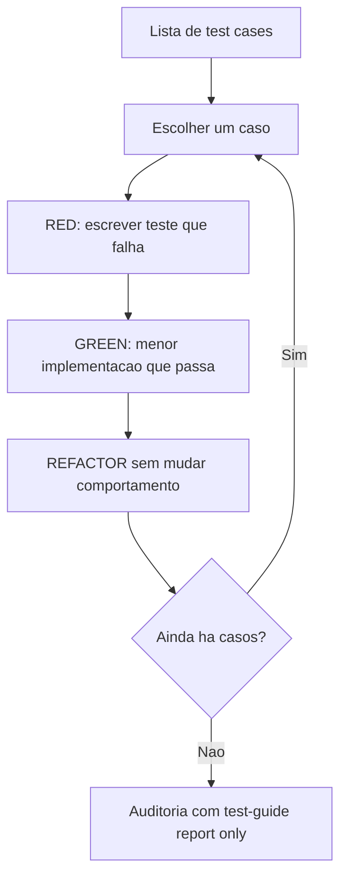
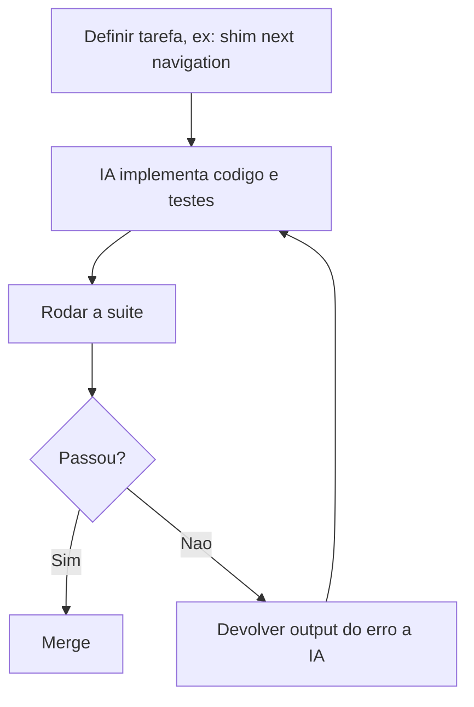

# TDD com IA

> [!summary] TL;DR
> - Com IA, o teste é restrição explícita: um contrato executável que reduz código excessivo ou genérico ("faça este teste passar sem violar os anteriores").
> - Vertical slices (um teste, uma implementação, um refactor por vez) em vez de horizontal slices; refactor é incremental a cada green, não uma fase no fim.
> - Mesmo seguindo TDD a IA fez muito happy path: a auditoria pós-TDD com test-guide achou 11 testes críticos e 4 edge cases faltando.
> - Caso vNext: o Next.js foi reescrito com IA em uma semana porque milhares de testes E2E existentes viraram a especificação.
> - Testes fortes dão opcionalidade arquitetural; não existe desenvolvimento com IA sem testes.

## Conceitos-chave

### Ciclo TDD

- **TDD**: testes dirigem a implementação; ciclo baseado no post de Martin Fowler: lista de test cases, escolher um, escrever o teste, fazê-lo passar, refatorar, pegar o próximo.
- **Red / green / refactor**: red é o teste falhando sem implementação; green é a menor implementação que passa; refactor melhora a estrutura sem mudar comportamento.
- **Teste como contrato com a IA**: restrição executável que segura a tendência a código genérico.
- **Vertical slices**: teste 1, impl 1, refactor 1; teste 2, impl 2...; cada teste escrito informa os próximos.
- **Horizontal slices (anti-pattern)**: RED escreve todos os testes, GREEN escreve todo o código.
- **Alternativa válida**: gerar primeiro todos os testes iniciais dos casos definidos e implementar um a um, desde que haja clareza dos test cases.
- **Tamanho do passo**: nem tão pequeno (teste idiota) nem tão grande (perde controle).
- **Skill externa de TDD do Matt Pocock**: filosofia, core principles, good vs bad tests, anti-patterns e workflow (confirmar interface pública que muda, confirmar behaviors esperados, identificar oportunidades de teste, decidir o que testar porque não dá para testar tudo, loop red-green, refactor); repositório "Everything Claude Code" também recomendado (ver [[Ecossistema de Skills]]).

### TDD na prática

- **Domínio**: gerenciamento de prompts de IA com máquina de estados draft, review, published, archived; draft não vai direto a published; review pode voltar a draft por rejeição.
- **Clean Architecture**: regras autocontidas na entidade de domínio; métodos expressivos na entidade Prompt: create, reconstruct, update, submitForReview, publish, reject, archive ("expressividade no código").
- **Plano TDD por fases**: 1 entidade (unit, lógica pura sem banco e sem mocks); 2 validações (Zod, apenas um teste por schema provando que está "wired"); 3 API/integração (Prisma + PostgreSQL); 4 revisão final. A IA pôs refactor como fase no fim e o autor corrigiu no plano (ver [[Plan Mode]]).
- **IA "perfeita demais" no começo**: só fica realista quando aparecem conflitos com mocks.
- **Resultado**: 25 testes passando.
- **Auditoria pós-TDD** com test-guide (report only, só back-end de prompts), critério de [[Edge Cases e Test Guidelines]]: 12 testes, 3 a remover (validações já cobertas por Zod), 11 missing criticals e 4 missing edge cases; mock health ok.
  - Integração faltando: 401 sem sessão, 422 invalid body, ownership (quem é o dono), 404 after soft delete.
  - Unit faltando: `Prompt.update` só com título preserva conteúdo (partial update); `submitForReview` a partir de published (transição inválida não testada); archive a partir de draft/review (só published pode arquivar).

### Caso vNext: reescrita do Next.js através de testes

- **O caso**: um engenheiro da Cloudflare reescreveu o Next.js com IA em uma semana, ~800 sessões no OpenCode com Claude por baixo, ~US$ 1.100 em tokens.
- **vNext**: roda sobre Vite para deploy em Cloudflare Workers (reduzir dependência da Vercel); build com Vite 7/Rollup ~1,6x mais rápido que Next.js 16.1.6 com Turbopack, com Vite 8/Rolldown ~4x mais rápido; bundle gzip ~56% menor.
- **Por que foi viável**: Next.js é muito bem especificado (documentação extensa, anos de Stack Overflow, API presente no treinamento, o modelo não alucina getServerSideProps nem router) e, principalmente, já tinha milhares de testes E2E cobrindo features e edge cases.
- **Testes como especificação**: "a documentação era fazer os testes passarem"; a suíte herdada mede equivalência comportamental (se todos os testes do Next passam no vNext, o comportamento coberto é o mesmo); IA é acelerador, a fonte de verdade é a suíte (ver [[Spec Driven Development]]).
- **Lição**: construir testes fortes o suficiente para permitir mudanças radicais (opcionalidade arquitetural); não existe desenvolvimento com IA sem testes, sem a IA subir o próprio ambiente, sem skills, comandos e agentes.

## Fluxograma / Processo



Workflow do vNext:



## Erros comuns / Cuidados

- Verificar se a skill de TDD foi de fato carregada (trigger pelo frontmatter); se não, invocar com `/`, registrar no CLAUDE.md ou interromper e perguntar "Você está usando a skill de TDD?".
- Aceitar plano que deixa refactor para o fim.
- Supor que TDD elimina o viés de happy path: auditar edge cases depois.

## Materiais complementares

### Prompts

**Prompt inicial em plan mode (narrado na aula)**
```text
Desejo criar um sistema de gerenciamento de prompts de IA. Esse sistema deverá ter opções para eu cadastrar, editar, deletar meus prompts. A visualização dele poderá ser via markdown, mas nesse momento faremos apenas o back-end. Quero utilizar Clean Architecture, onde as regras de negócio devem ser autocontidas dentro de uma entidade de domínio. Por exemplo, um prompt pode ter status diferentes, como draft, revisão, publicado, mas, por exemplo, eu não posso publicar um prompt diretamente de draft para publicado. Ele deve ser revisado antes. Logo, isso são regras de negócio que precisamos testar. Quero utilizar TDD para fazer todo esse processo. Utilizaremos o banco de dados PostgreSQL e você utilizará o codebase atual para programar. Monte um plano de implementação para fazermos isso usando TDD.
```

**Crítica ao plano sobre o momento do refactor (narrado na aula)**
```text
Você fará a refatoração depois de tudo implementado ou vai seguir o TDD e refatorar a cada implementação de um teste que já passou?
```

**Auditoria pós-TDD (narrado na aula)**
```text
/test-guide Auditing. Report only. Apenas na parte back-end referente ao gerenciamento de prompts e suas APIs. Nada de front-end.
```

### Conteúdo extra

- Skill tdd de Matt Pocock: github.com/mattpocock/skills (citada na aula).
- Repositório everything-claude-code (citado na aula).
- Artigo do blog da Cloudflare sobre o vNext (citado na aula).
- https://opencode.ai

## Tags de busca

`#dev-software-ia` `#tdd` `#red-green-refactor` `#vertical-slices` `#testes-como-especificacao`
