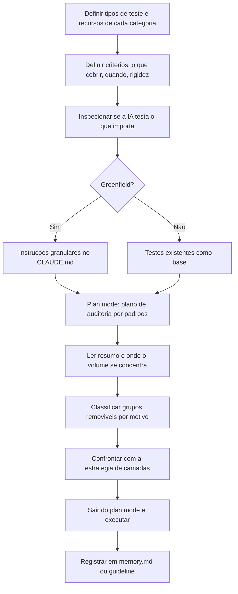

# Testes Automatizados vs IA

> [!summary] TL;DR
> - O projeto nasce com infraestrutura e critérios de teste definidos (dia zero); sem isso a IA preenche lacunas com suposições e gera testes demais, de menos ou desalinhados.
> - Volume e cobertura não são proteção: "quero 80% de cobertura" faz a IA otimizar o número com testes fáceis, e teste enganoso é pior que ausência de teste.
> - Fronteiras entre unidade, integração e E2E não são universais: a equipe precisa formalizar a definição do seu contexto antes da geração automática.
> - Auditoria em plan mode com subagentes paralelos mapeia testes sem valor; o relatório é hipótese, a decisão final é humana.
> - Limpeza pontual vira regra reutilizável (guideline, memory.md, skill), senão a IA remove hoje e recria amanhã.

## Conceitos-chave

### Testes no dia zero

- **Testes no dia zero**: o projeto nasce com a infraestrutura mínima de testes pronta para que os testes certos existam desde o início.
- **Framework de testes como contrato operacional**: delimita ambiente, estilo esperado e grau de detalhamento; sem ele a IA trabalha por suposição.
- **Instruções claras**: explicitar intenção, limites e critérios; "crie testes" delega à IA uma decisão estratégica.
- **Granularidade**: detalhe demais faz a IA explodir em centenas ou milhares de testes de baixo valor; amplo demais deixa comportamento crítico sem cobertura.
- **Estratégia contextual**: o rigor depende de domínio, risco, existência de QA e momento do projeto (sistema simples vs banco).

### Falsa sensação de segurança

- **Cobertura ilusória**: a suíte cresce e os relatórios ficam bons enquanto comportamentos importantes seguem desprotegidos; pedir testes de front pode render 2000 casos, e 10 testes também podem ser pouco.
- **Teste enganoso pior que ausência**: ausência deixa lacuna visível, teste ruim esconde a lacuna.
- **IA responde ao grau de definição**: sem comportamentos críticos, limites, exceções e critérios de aceitação, preenche com o mais provável, não com o mais arriscado, e gera testes fáceis e superficiais.
- **Critério de autonomia**: "a IA, recebendo a tarefa sem intervenção adicional, conseguiria testar de fato o que foi desenvolvido?" Se não, faltam definições de escopo, prioridade, comportamento esperado ou observabilidade.
- **Testes de UI**: zona de maior risco (custo alto, fragilidade, muitos tokens navegando fluxos); tratados em [[Testes E2E com Playwright CLI]].
- **Loop infinito em teste de UI**: a IA fica presa repetindo ações sem convergir por falta de limites de fluxo, critério de sucesso e pontos de parada.
- **Definição prévia**: o que é crítico, o que é acessório, quais cenários merecem profundidade e o que não pode regredir.

### Categorização de testes

- **Definição útil**: a formalizada para o contexto, não a "correta"; o risco real é a equipe assumir uma definição implícita e a IA outra.
- **Unidade**: classe, método ou componente com dependências substituídas; a IA tende a criar mocks e fakes, gerando testes granulares demais e arquivos auxiliares que aumentam manutenção.
- **Front-end amplifica granularidade**: unitários de componentes React sem critério explodem, até para um Hello World.
- **Integração tem leituras concorrentes**: classes internas sem mocks; só com banco, mensageria ou serviços reais; front + back.
- **Fidelidade do banco**: SQLite em memória é mais rápido mas não reproduz tipos, índices e semântica do PostgreSQL; se a regra local diz que integração usa o mesmo engine de produção, a IA não troca Postgres por conveniência.
- **Integrações externas** (gateway de pagamento): instabilidade de rede, custo e credenciais; explicitar quando usar mock e quando usar serviço real.
- **E2E sem UI**: chamada completa à API rodando (ex: curl); definir onde o fluxo começa, onde termina e se vai até o terceiro ou para na borda do sistema.

### Cobertura como vilã

- **Cobertura mede linhas executadas**, não proteção de comportamento; 80% ou 90% pode deixar de fora cenários críticos.
- **Meta cega**: instrução quantitativa faz a IA priorizar caminhos fáceis.
- **Testes bobos**: validam trivialidades ou o que o framework já garante e inflam a cobertura (comum em front com unitários irrelevantes); custam tempo de CI/CD.
- **O que importa**: edge cases e caminhos tristes (entradas inesperadas, combinações raras, estados inválidos, falhas de integração), detalhados em [[Edge Cases e Test Guidelines]].
- **Redefinir cobertura**: comportamentos, riscos, fronteiras e exceções a proteger; auditar valor, não volume.

### Testes desnecessários e auditoria

- **Greenfield vs Brownfield**: sem testes de referência a IA precisa de instruções explícitas (prescrever); com testes e convenções existentes eles viram trilho (calibrar).
- **CLAUDE.md / agents.md como guia operacional de teste**: dinâmico, com regras fortes no início (testes, estrutura de pastas, critérios) removidas quando o padrão já está no código; instruções antigas ocupam [[Context Window em LLMs]] (ver [[CLAUDE.md e AGENTS.md (Instruções de Projeto)]]).
- **IA reproduz o padrão local**: suíte com testes inúteis gera mais testes inúteis; auditar impede a multiplicação do erro.
- **memory.md**: registra aprendizados e padrões indesejados que o agente consulta sob demanda.
- **Caso Video Transcriber** (back + front, complexidade média): 958 testes back-end e 1.834 front-end em 88 arquivos, 2.792 no total, gerados após "quero tanto de cobertura, faça todos os testes".
- **Teste valioso**: detecta regressão que importa (fluxo de negócio, feature, consistência de estado, erro, regra).
- **Garantias de biblioteca**: retestar o que Zod já valida (email, required, tipos) é custo sem confiança; o limite depende do nível de "purismo" e da dependência aceita da lib.
- **Subagentes Explore em paralelo**: cada um com janela própria, devolvem só o resultado consolidado e preservam o contexto do agente principal (evita compactação); subagente que falha é relançado (ver [[Subagentes e Tasks Ad Hoc]]). No exemplo foram 3 em paralelo com Sonnet 4.6.
- **Custo**: auditoria consome muitos tokens com effort alto + Opus.

### Leitura do relatório de remoção

- **Relatório é hipótese de auditoria**, não ordem.
- **Achados típicos**: testes de Pydantic, Zod, SQLAlchemy, mocks excessivos de APIs nativas, overtesting de front-end.
- **Pirâmide de testes**: base unidade (rápido, barato, isola, diagnóstico preciso), meio integração (colaboração entre componentes), topo E2E (lento, caro, fluxos críticos); distribui confiança de forma economicamente sustentável, não é dogma.
- **Integração não substitui unidade automaticamente**: perde o diagnóstico fino de regra, branch e edge case; remover duplicação de função, não diversidade legítima de camadas.
- **Candidatos à remoção**: validação pura de Pydantic/Zod, checks de infraestrutura do PyTest, schema já garantido por migrations, mocks completos só para provar API nativa, cards/toggles/status testados por render estático, classes CSS, labels, wrappers sem lógica, hooks sem risco, clients redundantes.
- **Devem ficar**: segurança (JWT, Bcrypt, tokens), validação real de áudio e magic bytes, chunking, parsing, cloud response, segmentação de transcrição, regras de negócio e efeitos colaterais.
- **Overtesting de front-end**: valida detalhe de implementação ou visual trivial; a correção é reposicionar (poucos testes representativos para componente simples, comportamento para fluxos relevantes).

## Fluxograma / Processo



## Erros comuns / Cuidados

- Categorias mal definidas geram builds lentos, CI/CD congestionado, testes de UI desnecessários, uso excessivo de browsers, mais tokens e chamadas a serviços externos não desejadas.
- Pedir meta de cobertura em vez de comportamentos a proteger.
- Auditar só uma lista de arquivos em vez de padrões (ver [[Plan Mode]]).
- Executar a remoção sugerida sem confrontar com a estratégia de camadas.

## Materiais complementares

### Prompts

**Plano de auditoria de testes sem valor, escrito em plan mode (narrado na aula)**
```text
Quero que você mapeie todos os testes back-end e front-end, avalie quais testes realmente geram valor para a aplicação e cobrem fluxos importantes de negócio, de feature, que garantem realmente problemas de regressão. Baseado nisso, entenda quais são os testes considerados desnecessários, redundantes, inúteis, que não geram valor para aplicação e que não deveriam existir. Obviamente, se há regras de negócio e componentes que precisam manter a consistência e estado do projeto, esses testes deverão existir. Traga para mim a quantidade aproximada de testes que eu poderia remover e que não geraria um impacto negativo no projeto, principalmente referente a regressões. Evite totalmente testes que já, em tese, são cobertos pelas próprias bibliotecas. Exemplo, o Zod. Traga para mim a quantidade de testes separado entre back-end e front-end.
```

**Prompt que o Claude Code gerou para o subagente Explore MapFrontEndTestInventory (narrado na aula, parafraseado)**
```text
Do a thorough investigation of all front-end tests in <pasta>. First, list directories and files. Use glob pattern *.test.* or *.spec.* in this folder. Then read all tests and categorize each test call:
- Valuable: multi-behavior, user interactions, state logic, error handling, business rules
- Zod library validation: tests that just justify Zod schema validation, required fields, type checking, things that Zod already guarantees
- Render smoke: only "renders without crashing", no meaningful assertion
- Trivial: static display elements, CSS classes, anything that does not bring regression problems
- Redundant: duplicated logic already tested elsewhere
For each file, bring the path, total tests, count per category and specific examples of tests that can be removed. Be very thorough, read all cases.
```

## Tags de busca

`#dev-software-ia` `#testes` `#cobertura` `#auditoria-de-testes` `#piramide-de-testes`
