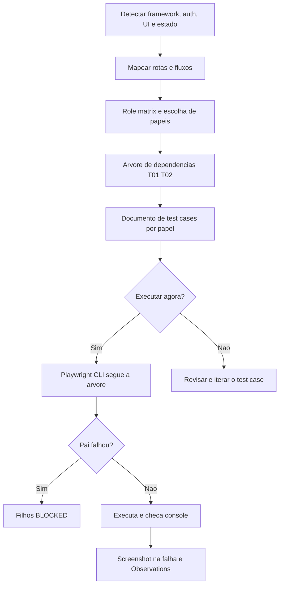

# Testes E2E com Playwright CLI

> [!summary] TL;DR
> - Em testes de browser, indicar exatamente quais fluxos testar; sem isso a IA recomeça do zero e ~70% dos testes rodam de forma redundante.
> - Playwright CLI + skill economiza tokens frente ao Playwright MCP, porque a skill só carrega quando precisa; o autor usa o CLI em 99% dos testes.
> - O valor está em como os test cases são gerados: a skill e2e-nav-test modela rotas, papéis e uma árvore de dependências antes de testar.
> - O autor prefere "use case de testes" (checklist de fluxos validada pelo agente) a gerar arquivos de teste da navegação, porque a UI muda o tempo todo.
> - No workflow do Streamtube, a skill plan-test-specs deriva specs E2E legíveis do plano da fase, consumidas depois pelo /implement.

## Conceitos-chave

### Playwright, MCP e CLI

- **Fluxos explícitos**: a IA tende a iniciar sempre do zero (login repetido em "criar cliente" e "alterar cliente"); aproveitar sessões e cookies.
- **Headless vs headed**: headless (browser em processo, sem janela, menos memória) é o padrão; headed serve para observar e depurar. As guidelines do autor mandam headless por padrão, então `--headed` é pedido explicitamente.
- **Playwright** (Microsoft): das ferramentas mais usadas para E2E; pode gerar arquivos de teste a partir da navegação.
- **Playwright + MCP**: recursos ricos, mas cada MCP carregado aumenta a janela de contexto e o custo de tokens já na inicialização (descrições e tools); a Anthropic criou estratégia de lazy-loading para MCP (ver [[MCP no Claude Code]]).
- **Playwright CLI + skill**: o agente roda comandos no terminal e a skill carrega só quando precisa; mais rápido e mais barato. O Playwright clássico é mais acurado em casos complexos.
- **Pacotes diferentes**: a página "Command Line" do Playwright Test não é o Playwright CLI; a IA às vezes diz que vai rodar o CLI e roda só `playwright`.
- **Comandos do CLI**: open, type, press, screenshot; modos headed/headless; sessions mantêm cookies separados por fluxo.
- **Skill playwright-cli** da Microsoft: disponível em skills.sh, instalada como user skill (vale para todos os projetos); a instalação de skill pelo executável instala para Claude Code, Copilot e outros (ver [[Ecossistema de Skills]]).

### Teste ad hoc

- **Pedido em linguagem natural** ("faça login e crie X") prova capacidade, mas não define cobertura, independência entre cenários nem prioridade.
- **Comportamento observado**: o agente carregou a skill playwright-cli automaticamente, buscou usuário e senha padrão numa fixture, ajustou largura, lidou com overlay, abriu sidebar e modal e tirou screenshots para decidir o próximo passo; ao fim fechou o browser e limpou as screenshots.
- **Validar mensagens e estado final**: o agente leu a restrição "only letters, numbers, spaces, hyphens, underscores allowed" e o nome com acento falhou.
- **Para escalar**: processo que evite testes redundantes, cubra fluxos com sentido, mantenha testes independentes entre si e baseados em permissões; a skill não é obrigatória, ela materializa esse processo.

### Skill e2e-nav-test

- **O que faz**: analisa app web SPA, server-rendered ou híbrida, gera plano de teste estruturado com consciência de dependências e, opcionalmente, executa via automação de browser; o núcleo é modelar a navegação antes de escrever testes.
- **SPA vs server-rendered**: SPA usa client-side routing; em server-rendered cada clique é uma HTTP request (navegação de página completa).
- **Progressive disclosure**: `references/framework-discovery.md` (checklists de 18 frameworks: Next.js App/Pages Router, React Router, Vue Router, SvelteKit, Angular, Nuxt, Astro, Remix, Django, Laravel, Rails, Go html/template, Symfony/Twig, Flask/Jinja2, Express com EJS/Pug/HBS, Spring, PHP puro, ASP.NET Razor, HTML puro) e `references/common-pitfalls.md` (organizado por fase: persistência de sessão, login com provider externo como GitHub, JWT expirando, CSRF, debounce, animações, WebSocket, PRG, flash messages, dados de seed colidindo) são lidos só quando necessários.
- **Fase 1, discovery**: detectar framework, auth, UI library e estado; mapear rotas; mapear fluxos interativos (formulários, CRUD, modals, drag and drop, bulk); identificar papéis e permissões numa role matrix e perguntar para quais papéis gerar.
- **Fase 2, árvore de dependências**: quando um nó falha, os descendentes ficam BLOCKED; fluxos independentes continuam; login testado uma vez e referenciado.
- **Fase 3, documento**: autocontido (como subir o sistema, usuário de teste, stack, árvore, fluxos Txx com checklist de 3 a 8 passos binários começando por verbo).
- **Fase 4, execução opcional**: screenshot na falha, console do browser checado após cada navegação; status passed, not executed, failed (com motivo) e blocked.

### Execução com test case gerado

- **Discovery no projeto Video Transcriber**: Next.js 16, App Router, auth custom JWT com Local Storage, refresh token em HTTP Only cookie, custom components, roles User, Admin, Support, Analyst e Guest (Guest só landing, login, register); gerado só para User em `docs/e2e-navigation-tests-role-user.md`.
- **Árvore gerada**: landing, register, login, forgot password, reset password, dashboard, empty state, upload, detalhe, editar, remover vídeo, folder management, tags, profile, change password, admin com access denied, logout.
- **Execução**: o agente subiu o Playwright CLI headed, criou conta, testou senha inválida, foi ao banco/seeds descobrir usuário válido, gerou um mp4 sintético para o upload em drag-and-drop; a transcrição falhou (vídeo sem áudio) e foi registrada como passou com observação; o botão de editar só aparece com hover e o agente chamou a API direto (anotado).
- **Sem skill**, a IA leva meia hora "apanhando" para navegar e abre várias janelas do Chrome.
- **"Não tem almoço grátis"**: revisar sempre e iterar no arquivo de test case (ex: anotar que o botão exige hover).

### Specs E2E no workflow (plan-test-specs)

- **Gatilho**: recebe o mesmo slug da fase; só roda com `test_specs_aware: true` no frontmatter do plano (a aula chama de `testSpecsAware`), senão faz skip ou aborta como legacy.
- **Foco**: SIs terminados em `b` (lógica e wiring da tela), controllers de backend e SIs cross-layer; cria `specs/` em cada subprojeto com `.plan.md` de cenários, ligados ao SI no lugar do marcador `_pending_` (ver [[Planejamento de Fases com plan-phase]]).
- **Ciclo de vida por cenário**: NEW, PRESERVED, MANUAL, UPDATED, DELETED, ORPHAN; o plano é a fonte de verdade.
- **Specs legíveis por não técnicos**: cada cenário referencia o AC coberto, `Source: auto` ou `manual` e a data da última sincronização.
- **Exemplo de login**: navegar para /login; card com e-mail, senha e botão sign-in; credenciais válidas; requisição ao BFF com payload tipado; botão desabilitado durante a mutation; backend responde 200 e o BFF sela o cookie de sessão; nenhum access/refresh token no corpo; UI reflete estado autenticado; cenários de erro 401, 403, 400; validação bloqueia submit com senha fora das regras ou e-mail inválido.
- **Pré-requisitos**: rodar só depois do guia de testes e do CLAUDE.md consolidados (ver [[Testes no Front-end com MSW]]); consumo pelo /implement em [[Implementação de Fases com implement-phase]].

## Fluxograma / Processo



## Erros comuns / Cuidados

- Desabilitar todos os servidores MCP que não vai usar.
- A skill deveria marcar cada Txx ao terminar; sem isso o report só é consolidado no fim (pedir atualização parcial).
- Confundir Playwright Test com Playwright CLI.
- No plan-test-specs: ativar modo automático (auto-accept) para não confirmar cada passo; com 25% de contexto do Opus o autor preferiu sessão nova.

## Materiais complementares

### Comandos

```bash
npm init playwright@latest              # Playwright tradicional
npm install -g @playwright/cli@latest   # Playwright CLI (pacote próprio)
playwright-cli --help
playwright-cli install --skills         # instala a skill (aula: "playwright-cli install-skill")
```

### Prompts

**Pedido ad hoc de teste de navegação (narrado na aula)**
```text
Faça um teste de navegação com o Playwright CLI, fazendo o login e criando uma nova categoria no sistema chamada de vídeos de worship. Use --headed.
```

**Execução do test case gerado (narrado na aula)**
```text
/e2e-nav-test Realize os testes de navegação com Playwright CLI, no formato headed, baseado no @docs/e2e-navigation-tests-role-user.md
```

**Interrupção com atualização parcial do report (narrado na aula)**
```text
Atualize o report parcialmente com o que você já testou.
```

**Skill e2e-nav-test (literal do repositório, `skills-mba/e2e-nav-test/SKILL.md`: frontmatter, Phase 2, Phase 4 e Principles; Phase 1, template completo da Phase 3 e Reference Files estão no arquivo original)**
````markdown
---
name: e2e-nav-test
description: >
  Generate and execute E2E test cases for any web application - SPA, server-rendered,
  or hybrid. Analyzes the codebase to discover routes, components, auth flows, forms,
  modals, roles/permissions, and navigation patterns, then produces a structured
  test-cases document with dependency trees and todo checklists. Works with any
  framework: Next.js, React, Vue, Angular, Django, Laravel, Rails, Flask, Go,
  Symfony, Spring, ASP.NET, PHP, and more. Use this skill whenever the user asks to
  "test navigation", "generate e2e tests", "test user flows", "create test cases",
  "run navigation tests", "e2e test plan", "check all flows", "test my app flows",
  "map user journeys", "test my app", or anything related to end-to-end flow testing.
  Also trigger when the user mentions "test-cases.md", "flow coverage", or
  "navigation coverage". Even if they just say "test my app" or "run e2e",
  this skill is likely what they need.
---

# E2E Test Case Generator

Analyze a web application codebase (SPA, server-rendered, or hybrid), generate a structured test plan with dependency awareness, and optionally execute the tests using browser automation.


[...]

## Phase 2: Build the Dependency Tree

This is the most critical phase. Every test flow has prerequisites. Model them explicitly.

### Dependency rules

1. **A flow depends on another if it cannot be tested without that flow succeeding first.** Example: "Create a prompt" depends on "Login" because you must be authenticated.

2. **If a dependency fails, all flows that depend on it are automatically BLOCKED.** Document this clearly. Example: if Login fails, everything behind auth is BLOCKED.

3. **Independent flows run regardless of other failures.** Example: "Visit landing page" and "Visit signup page" are independent of each other.

4. **Avoid redundant testing.** If Login was already verified as a dependency, subsequent flows that need auth should note "Requires: Login (tested in T01)" but NOT re-test the login steps. They start from an already-authenticated state.

5. **Chain dependencies, don't repeat them.** If "Edit prompt" depends on "Create prompt" which depends on "Login", then "Edit prompt" lists only "Create prompt" as its direct dependency. The transitive dependency on Login is implicit.

### Dependency tree format

Build the tree as a visual hierarchy that shows parent-child relationships at a glance. Use ASCII tree connectors (`├─`, `└─`, `│`) to convey structure. Every test gets a short ID (T01, T02, ...) for easy referencing.

```
T01 Landing Page
 ├─ T02 Signup
 └─ T03 Login
     └─ T04 Dashboard
         ├─ T05 Create Item
         │   ├─ T06 Edit Item
         │   └─ T07 Delete Item
         ├─ T08 Search
         └─ T09 Theme Toggle
 └─ T10 Logout
```

Root nodes (T01) have no dependencies. A child can only execute if its parent passed. Siblings are independent of each other - if T06 fails, T07 still runs. Note that Search (T08) depends on Dashboard (T04), not on Create Item (T05) - place each test under its actual dependency, not under an unrelated sibling.


[...]

## Phase 4: Execute Tests (Optional)

After generating the document, ask the user: "Test cases are ready. Would you like me to execute them now using browser automation?"

If yes:

### Execution rules

1. **Read the Prerequisites section** from the generated test-cases document - it already contains the start command, base URL, and test credentials (discovered during Phase 1). If executing in the same session that generated the document, these values are already known. If executing later, read them from the document.

2. **Ensure the server is running** before any test. If the project has a startup script, use it. If not, run the dev server command discovered above.

3. **Use available browser automation** (playwright-cli or whatever tool is available) in headless mode.

4. **Follow the dependency tree order** - execute root tests first, then their children.

5. **On dependency failure**: mark all child tests as BLOCKED, do not attempt them.

6. **On independent failure**: continue with the next independent test.

7. **Take a screenshot on failure.** Save screenshots in a `screenshots/` subfolder next to the test-cases document. Name the file after the failing test: `screenshots/t05-create-item-step3.png`. Never save screenshots in the project root.

8. **After each navigation**: check browser console for errors - any compilation or runtime error means FAILURE for that step.

### Updating the document after execution

Mark each step with its result:

- `[x]` - passed
- `[ ]` - not executed yet
- `[FAIL]` - failed (add brief reason inline)
- `[BLOCKED]` - skipped because a parent dependency failed

### Observations section

After execution, fill in the Observations section at the bottom of the document using the format shown in the document template above (Failed Tests, Blocked Tests table, Summary counts).

---

## Principles

- **Discover before assuming.** Read actual code, not just file names. A route might exist but redirect. A form might be disabled. An auth check might be client-side only.
- **Respect the dependency tree.** Never execute a flow if its dependency failed. This avoids cascading false failures that obscure the real problem.
- **No redundant login steps.** If login was tested and passed in T01, subsequent flows start from an authenticated browser session. Do not repeat login steps - just note the dependency.
- **Be framework-aware but not framework-dependent.** The discovery phase adapts to the framework, but the output format and execution logic stay the same regardless of stack.
- **Binary outcomes only.** Every step passes or fails. "Partially works" is a failure with a note.

````

**Skill plan-test-specs (literal do repositório, `mba-ia-greenfield-project/.claude/skills/plan-test-specs/SKILL.md`: frontmatter, Spec format e Lifecycle states; Preflight, Procedure, Integration points e Failure modes estão no arquivo original)**
````markdown
---
name: plan-test-specs
description: "Stage 5 of the plan pipeline (post-build). Generates and syncs <subproject>/specs/<scenario>.plan.md files from phase/task plans, in Microsoft spec-driven format. Specs are later consumed by /implement Step 3a - frontend path loads the playwright-cli Skill for Playwright pattern reference and LLM-authors the E2E test file; backend path LLM-authors its E2E test file (file path/suffix per the per-subproject testing-guide skill; what-to-test and best practices per artifact come from that same skill, already loaded at /implement Step 2). Use after /plan-build completes. Triggers: 'plan-test-specs NN', 'plan-test-specs <slug>', 'gerar test specs da fase X'."
disable-model-invocation: true
---

# Plan Pipeline - Stage 5: Test Specs

This is **Stage 5** (optional, post-build) of the plan pipeline defined in `.claude/skills/plan-pipeline/SKILL.md`. Read that file first for the cross-stage convention (frontmatter format, registered values, stage interaction). Stage 1-4 produce/edit a phase or task plan; Stage 5 derives external **spec files** from screen-wiring / controller-wiring / cross-layer SIs of that plan.

The skill is **skippable**: legacy plans (frontmatter without `test_specs_aware: true`) are routed to an abort message instructing migration; modern plans without any SI carrying `**Test Specs:**` (e.g., backend-pure phases) fall through silently.

[...]

## Spec format (universal)

The spec file is **NOT** a planning artifact - it does not follow `kind:` / `name:` convention from `.claude/skills/plan-pipeline/SKILL.md`. Specs are test contracts, parallel to `library-refs.md` exemption.

```markdown
---
subproject: backend | frontend       # canonical runner discriminator (consumed by /implement Step 3a)
runner: <runner-tag>                 # informational only - `playwright` for frontend; per-backend runner tag for backend (e.g., `jest+supertest`, `pytest`, `gotest`); must match `subproject:`; `subproject:` is canonical
scope: phase-NN-{slug} | task-{slug}
si: SI-NN.X | SI-N
target_file: <resolved E2E test path>         # 1 arquivo de teste por spec; cenários viram test() blocks.
                                              # Path concreto (pasta + sufixo + nome) derivado da convenção E2E
                                              # do subprojeto via testing-guide-{subproject} e resolvido por
                                              # /plan-test-specs na geração - NÃO hardcodar pasta/sufixo aqui.
---

# <Screen | Endpoint> Test Plan

## Application Overview

<Um parágrafo descrevendo o que esta tela / endpoint faz e por quê.>

## Test Scenarios

### 1. <Group Name - verbatim from screen-inventory ou API Contract>

**Setup:** <fixture reference (frontend) | DB cleanup + module bootstrap (backend)>

#### 1.1. <kebab-case-scenario-name>

**Covers AC:** #1, #4
**Source:** auto
**Last sync:** 2026-05-02T14:30:00Z

**Steps:**
  1. <user-actor or API-caller voice - depending on subproject>
    - expect: <observable outcome>
    - expect: <another outcome>
  2. <next step>
    - expect: <outcome>
```

### File-naming convention

- **1 spec → 1 test file**, declarado via `target_file:` no frontmatter. O path concreto (pasta + sufixo + nome) é derivado da convenção E2E do subprojeto via `testing-guide-{subproject}` (ver Reason abaixo) e resolvido por `/plan-test-specs` na geração - esta skill NÃO fixa pasta nem sufixo.
- **N cenários no spec → N `test()` blocks** dentro de um único `test.describe('<feature>')` no arquivo gerado.
- Cenário individual NÃO tem `**File:**` field - caminho é shared via `target_file:`.

Reason: the project's frontend testing convention is *"one file per feature/flow"* with `test.describe('<feature>')` agrupando. Adotar 1 arquivo por cenário (Microsoft canonical) violaria essa regra. The `testing-guide-{subproject}` Skill (loaded by `/implement` Step 2 for the frontend subproject) is the canonical entry point for that convention. It is also the single source of truth for the `target_file:` path itself (folder + suffix per subproject); `/plan-test-specs` reads that convention at generation time and writes a concrete `target_file:` - no folder or suffix is hardcoded in this skill.

### Per-subproject vocabulary

| Field / Voice | Frontend | Backend |
|---|---|---|
| `Setup:` | `<frontend-subproject>/tests/fixtures.ts` (MSW network fixture auto-applied) | `beforeEach` truncate test DB; bootstrap backend test module (e.g., NestJS: `Test.createTestingModule(...).compile()`) |
| Step voice | "Usuário clica em Sign in" (user-actor) | "POST /auth/register com body X" (API-caller) |
| Expect vocabulary | DOM-observable + URL state + toast text | HTTP status + response body shape + DB state + side-effects |
| File path (per spec) | per `testing-guide-frontend` E2E convention - resolved at generation, no folder/suffix hardcoded here | per `testing-guide-backend` E2E convention - idem |
| Import in generated test | the MSW network fixture, imported from its path per `testing-guide-frontend` (NEVER `'@playwright/test'`) | backend test bootstrap module + HTTP client (e.g., NestJS `Test` module + Supertest) |

### Boundary - what externalizes vs stays inline

| Camada | Localização | Razão |
|---|---|---|
| Playwright E2E (frontend) | `<frontend-subproject>/specs/*.plan.md` | externaliza |
| E2E (backend) | `<backend-subproject>/specs/*.plan.md` | externaliza |
| Unit (frontend) | inline na Tests table do SI | fica inline |
| Integration (frontend - e.g., Route Handlers / msw/node) | inline na Tests table do SI | fica inline |
| MSW handler tests (`auth-handlers.spec.ts`) | inline no SI próprio | fica inline (não é screen wiring) |
| Unit (backend - services / repos) | inline na Tests table do SI | fica inline |
| Backend integration (ORM repos / modules - e.g., TypeORM, Prisma, SQLAlchemy, Hibernate) | inline na Tests table do SI | fica inline |

## Lifecycle states (MVP - L2 revisado)

| State | Detection | v1 action |
|---|---|---|
| **NEW** | AC do plano sem cenário cobrindo | gerar cenário, marcar `Source: auto`, set `Last sync` ao timestamp da operação |
| **PRESERVED** | Cenário existe; mtime do source (phase plan) ≤ `Last sync` do cenário | re-stamp Last sync (Edit cirúrgica substitui só a linha) - atualiza file mtime como side-effect |
| **MANUAL** | Cenário com `Source: manual` ou sem `Source` field | skip silently |
| **UPDATED** | Cenário com `Source: auto` E mtime do plano > `Last sync` | warning no delta report; user edita à mão |
| **DELETED** | Cenário com `Source: auto` cobrindo apenas ACs que sumiram do plano | warning no delta report |
| **ORPHAN** | `Covers AC: #N` aponta a AC inexistente no SI atual | warning no delta report |

````

**Spec E2E gerada pelo plan-test-specs (literal do repositório, `mba-ia-greenfield-project/next-frontend/specs/login.plan.md`)**
````markdown
---
subproject: frontend
runner: playwright
scope: phase-02-auth-frontend
si: SI-02.11b
target_file: tests/auth-login.e2e-spec.ts
---

# Tela de login - Test Plan

## Application Overview

A tela `/login` autentica um usuário com e-mail e senha e inicia a sessão. É uma rota anônima: um shell RSC compõe o form `"use client"` (`components/auth/login-form.tsx`, react-hook-form + Zod), que submete via `fetch("/api/auth/login")` ao Route Handler BFF, que proxia `POST /auth/login` no NestJS upstream. Em `200` o BFF sela o cookie `iron-session` encriptado (carregando `access_token`/`refresh_token` + fingerprint mínimo do usuário) - os tokens nunca chegam ao browser - e o form dispara `router.refresh()` para o chrome refletir o estado autenticado. Erros `401` (credenciais inválidas), `403` (e-mail não confirmado) e `400` (validação) são mapeados para alertas/feedback; a validação client-side espelha o backend 1:1.

## Test Scenarios

### 1. Autenticar usuário com e-mail e senha e iniciar sessão

**Setup:** `next-frontend/tests/fixtures.ts` (MSW network fixture auto-applied; server-side upstream faked via `instrumentation.ts`, no browser `page.route()` of `/api/**`)

#### 1.1. login-sucesso-sessao-iniciada

**Covers AC:** #1
**Source:** auto
**Last sync:** 2026-05-16T21:32:09Z

**Steps:**
  1. Usuário navega para `/login`
    - expect: o `Card` de login renderiza com campos de e-mail e senha e o botão "Sign in"
  2. Usuário preenche credenciais válidas e clica em "Sign in"
    - expect: a requisição `POST /api/auth/login` é disparada com payload tipado
    - expect: enquanto a mutation está em voo, o `SubmitButton` fica desabilitado / em loading
  3. Backend responde `200` e o BFF sela o cookie de sessão
    - expect: nenhum `access_token`/`refresh_token` aparece no corpo da resposta visível ao client nem em storage do browser
    - expect: a UI reflete o estado autenticado (chrome atualizado via `router.refresh()`) / redireciona para a área autenticada

#### 1.2. login-erros-401-403-400

**Covers AC:** #2
**Source:** auto
**Last sync:** 2026-05-16T21:32:09Z

**Steps:**
  1. Usuário submete o form com credenciais inválidas (reserved trigger upstream → `401`)
    - expect: um `Alert` form-level de "credenciais inválidas" é renderizado
    - expect: nenhuma sessão é estabelecida
  2. Usuário submete com um e-mail cuja conta não foi confirmada (reserved trigger → `403`)
    - expect: um `Alert` form-level de "e-mail não confirmado" é renderizado, com CTA de reenvio de confirmação
  3. Usuário submete com payload que dispara validação upstream (reserved trigger → `400`)
    - expect: a mensagem `400` é renderizada inline abaixo do campo ofensor

#### 1.3. login-validacao-client-side-bloqueia-submit

**Covers AC:** #3
**Source:** auto
**Last sync:** 2026-05-16T21:32:09Z

**Steps:**
  1. Usuário navega para `/login` e clica em "Sign in" com o form vazio
    - expect: nenhuma requisição `POST /api/auth/login` é disparada (submit bloqueado client-side)
    - expect: mensagens de validação inline aparecem nos campos obrigatórios
  2. Usuário preenche valores que violam as regras espelhadas do backend (e.g. e-mail malformado)
    - expect: o submit permanece bloqueado e as mensagens inline espelham o backend 1:1
  3. Usuário corrige os campos para valores válidos
    - expect: o submit é liberado e `POST /api/auth/login` é disparada
````

### Conteúdo extra

- https://github.com/microsoft/playwright-cli
- https://playwright.dev/docs/intro
- https://skills.sh
- Skills da disciplina: https://github.com/devfullcycle/skills-mba (pasta `e2e-nav-test`, com `references/framework-discovery.md` e `references/common-pitfalls.md`)

## Tags de busca

`#dev-software-ia` `#e2e` `#playwright-cli` `#e2e-nav-test` `#plan-test-specs`
