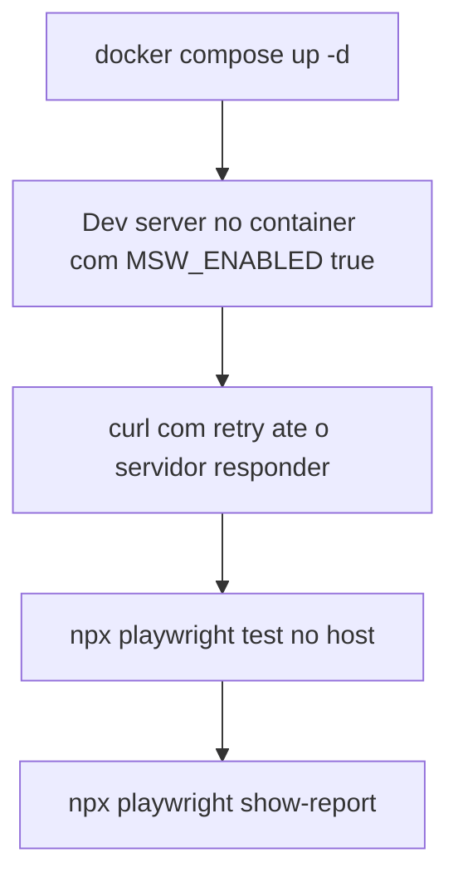
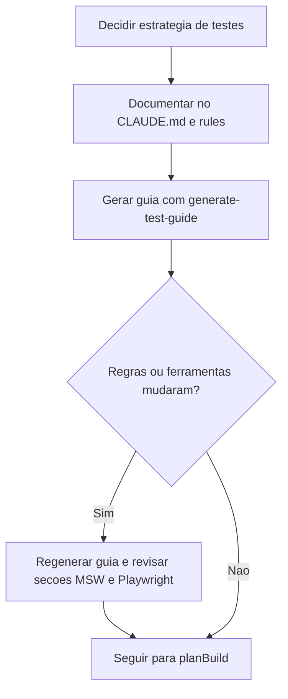

# Testes no Front-end com MSW

> [!summary] TL;DR
> - A estratégia de testes do front é definida antes da implementação: sem ela a IA não se autovalida, não sabe se o front respeita o contrato do back e cria testes que não testam nada.
> - No Streamtube: Vitest para unidade e integração, Playwright para E2E, MSW como API fake sincronizada com o contrato OpenAPI; o BFF é testado como função, nunca contra a API Nest real.
> - O sufixo do arquivo é contrato: `*.test.ts`, `*.integration.test.ts` e `*.e2e-spec.ts` definem runner, localização e o que é permitido dentro.
> - E2E: browser real, Next.js real e Route Handlers reais; só o NestJS é fake, via MSW no servidor (`instrumentation.ts` com `MSW_ENABLED=true`), com Playwright rodando no host.
> - O guia de testes do Next.js é uma skill gerada e viva: regenerar sempre que regras do CLAUDE.md ou convenções de Playwright/MSW mudarem.

## Conceitos-chave

### Estratégia de testes do front-end

- **Definir antes de implementar**: o que testar, em que camada e contra qual backend.
- **Next.js só front vs BFF**: o Next pode ser só front (SPA, chamadas do browser) ou ter backend próprio (BFF: o front chama rotas internas do Next, que chamam o Nest, ex: `/api/login` para o login do Nest); detalhes do BFF em [[Fundação de IA do Next.js]].
- **Testar o BFF via HTTP ou chamando a função**: escolhido invocar diretamente as funções das rotas com Vitest (alternativa citada: supertest).
- **API real vs API fake**: a real exige subir app, containers e dados de teste (lento, ambíguo, gasta tokens, a IA ora mocka ora chama real); escolhida a API fake, cuja vantagem é velocidade desde que fiel ao contrato.
- **OpenAPI como fonte de verdade**: tipagem forte no Next a partir do OpenAPI JSON; handlers MSW replicam os endpoints (ex: auth/login) tipados pelo mesmo contrato; caminho do contrato é usado por muitas empresas.
- **Ferramentas**: Vitest para unidade e integração (componentes, páginas e BFF chamando a função); Playwright para E2E instalado direto na máquina (rodar em container é opção recomendada em alguns cenários), também contra a API fake; Playwright MCP como etapa exploratória adicional que navega e sugere variações de teste, sem substituir a suíte (ver [[Testes E2E com Playwright CLI]]).

### Instruções de testes no CLAUDE.md

- **CLAUDE.md como fonte das convenções**: substitui o placeholder de testes por tipos, localização e tecnologias (documentar, não configurar); ver [[Arquivos de Inicialização do Agente]].
- **Convenções definidas**: unidade/integração em pastas `__tests__` perto do artefato com sufixo `.test.ts`; E2E em `tests/` na raiz do front com sufixo `.e2e-spec.ts`, espelhando a convenção do Nest em vez de `.spec.ts`; MSW com handlers (login, registro e demais operações) e server via `msw/node`.
- **Fluxo usado**: /init + plan mode com o prompt abaixo, rodada de perguntas (sufixos; o plano NÃO cobre `vitest.config.ts` nem o arquivo do Playwright, que ficam para uma task posterior), aceitar e revisar as seções afetadas (commands, long running processes, seção de testes, onde vive o MSW, árvore de diretórios).
- **Rules por path**: `next-frontend-testing.md` e `next-frontend-msw-mocks.md` carregam só ao tocar arquivos de teste ou mocks (ver [[Rules do Claude Code]]).

### Ajustes de Playwright e MSW

- **E2E roda no host**, não no container (afeta comandos, portas e pré-requisitos); usar `npx playwright test` direto em vez de script obrigatório no package.json; E2E saiu de long running processes; Vitest roda dentro do container.
- **MSW em dois modos**: Node server nos testes Vitest (`onUnhandledRequest: "error"`, fetch não interceptado falha o teste); no E2E o browser acessa o Next real, então o mock precisa estar no runtime da aplicação via `instrumentation.ts` (`onUnhandledRequest: "bypass"`), reusando a pasta `mocks/`. A regra antecipou a criação do `instrumentation.ts` antes de ele existir.
- **Arquitetura E2E**: browser real, Next.js real, BFF real (route handler), API fake MSW; o Nest não sobe.
- **`MSW_ENABLED=true`** no run dev desliga a integração com o Nest e permite alternar fake/real no futuro.
- **Sem `webServer`** no `playwright.config.ts`: startup separado e visível; regra explícita para a IA não introduzir.
- **Sessão com Iron Session** (cookies) precisa funcionar no ambiente fake; cenários por "reserved trigger fixtures" (ex: e-mail específico devolve 409 ou 400).

### Guia de testes do Next.js (skill gerada)

- **Skill generate-test-guide**: analisa stack e versões, pesquisa na web boas práticas por versão (Vitest + Next 16, MSW + Node, Playwright + Next.js, React 19), faz perguntas ao usuário e gera a skill multi-arquivo `testing-guide-<projeto>` com SKILL.md, `artifacts/` e `references/` (ver [[Criando Skills]]).
- **CLAUDE.md influencia o guia**: mesmo sem Vitest/Playwright/MSW implementados, estarem nas instruções direciona pesquisa e conteúdo; num Next recém-criado a saída seria genérica.
- **Organizado por artefato**: page, layout, client component, feature component, primitive do shadcn, ícone, hooks, route handler, server action, middleware, error, loading, not-found, metadata; inclui quando NÃO testar (ex: componente shadcn puro sem comportamento próprio).
- **Gotchas**: async Server Components não renderizam no Vitest (só Playwright), docblock `// @vitest-environment jsdom` por arquivo, mock de `next/navigation`, ordem de import do MSW, `Set-Cookie`, ler o body da requisição duas vezes, `passWithNoTests` dando verde sem testes.
- **Artefato vivo**: não é definitivo; regenerar quando o projeto amadurece ou editar só os arquivos pertinentes; ao mudar regras no CLAUDE.md ou convenções de Playwright/MSW, regenerar (a nova geração absorveu interceptação do MSW, gotchas e convenções do Playwright) e só então seguir para o planBuild da fase (ver [[Planejamento de Fases com plan-phase]]).

## Fluxograma / Processo

Pré-requisitos para rodar E2E:



Manutenção do guia:



## Erros comuns / Cuidados

- O agente afirmou que as bibliotecas já estavam no package.json: conferir (MSW estava, Vitest não).
- A árvore de arquivos e as convenções do CLAUDE.md afetam o guia gerado depois; revisar antes de gerar.
- O guia incluiu feature components voltados ao servidor que o projeto não usará exatamente (candidato a revisão).
- Copiar `onUnhandledRequest: "error"` para o `instrumentation.ts` quebra o dev server; copiar `"bypass"` para o Vitest deixa passar chamadas reais.
- Interceptar `/api/**` no browser com `page.route()` em E2E pula os Route Handlers reais.

## Materiais complementares

### Prompts

**Atualizar o CLAUDE.md do Next com a decisão de testes, via /init em plan mode (narrado na aula)**
```text
Quero atualizar o CLAUDE.md do Next front-end para a decisão de testes. Para testes end-to-end vamos usar o Playwright, para testes de unidade e integração das páginas, componentes e outros artefatos, usaremos o Vitest. Para o caso do BFF, que é chamado de Route Handler no Next.js, não criaremos testes apontando para a API do Nest. Teremos uma API fake, feita com MSW handlers, usando o msw/node para ele subir um servidor para essa API fake. Então podemos fazer esses testes usando o Vitest, chamando apenas a função Route Handler diretamente. Serão testes de integração. Todos os testes de unidade e de integração ficarão em pastas com __test__, perto do artefato que testam. Já os end-to-end ficarão numa pasta tests na raiz do front-end. Dada a estrutura que já temos no CLAUDE.md, analise as mudanças nas seções existentes e também novas seções que serão criadas.
```

**Seção de testes do `next-frontend/CLAUDE.md` (literal do repositório)**
````markdown
## Testing

Stack decisions for this project:

- **Vitest** for unit and integration tests of pages, components, hooks, utils, and BFF route handlers.
- **Playwright** for end-to-end tests (full browser flow).
- **MSW (`msw` + `msw/node`)** as the fake API for BFF tests: route handlers are tested **as functions** - they are imported and called directly, while `msw/node` intercepts the `fetch` calls they make to the NestJS API and returns fixtures. BFF tests **never** point to the real NestJS API.
- **MSW (`msw/node` via `instrumentation.ts`)** as the fake API for E2E tests: the dev server boots server-side MSW so the **real** `/api/**` Route Handlers run; only their upstream NestJS `fetch` is faked, reusing the `mocks/` handler set (no browser-level/BFF handler set). See "E2E architecture" below.

## Test type selection - apply mechanically

The suffix is a contract. It drives the runner (Vitest vs. Playwright), where the file lives, and what is allowed inside it.

| Suffix | When | Runner | External I/O | Location |
|---|---|---|---|---|
| `*.test.ts` / `*.test.tsx` | **Unit** - pure logic, collaborators mocked (utils, hooks, a single component in isolation). | Vitest | Forbidden. | `__tests__/` next to the artifact. |
| `*.integration.test.ts` / `*.integration.test.tsx` | **Integration** - multiple artifacts wired together; route handlers called as functions with `msw/node` intercepting `fetch` to the upstream API. | Vitest | MSW only (no real network). | `__tests__/` next to the artifact. |
| `*.e2e-spec.ts` | **End-to-end** - full browser flow; real `/api/**` run server-side, upstream faked (see "E2E architecture"). | Playwright | server-side MSW via instrumentation - no real network. | `tests/` at root. |

Routing decision tree (apply in order; first match wins):

- Renders a component or invokes a hook/util in isolation with mocks for collaborators → **`*.test.ts`** (or `.tsx` if rendering JSX).
- Imports a route handler (`import { GET } from "@/app/api/.../route"`), builds a `Request`/`NextRequest`, calls the handler, and asserts on its `Response`, with MSW intercepting fetches to the upstream API → **`*.integration.test.ts`**.
- Drives the full app in a real browser (navigation, forms, assertions on rendered DOM) → **`*.e2e-spec.ts`** under `tests/`.

### Running tests during development

Run only what is relevant to the change in progress:

```bash
# Vitest (single file or pattern) - inside the container
docker compose exec next-frontend npm test -- path/to/file.test.ts

# Playwright (single spec) - on the HOST
npx playwright test tests/foo.e2e-spec.ts
```

### E2E test prerequisites - start the environment before running Playwright

Playwright runs on the **host** and targets the **containerized** dev server. Before running any `*.e2e-spec.ts`, the dev server must be running inside the container with `MSW_ENABLED=true`. Follow these steps in order:

```bash
# 1. Ensure the container is up (idempotent)
docker compose up -d

# 2. Start the dev server with MSW enabled - runs in background (never exits)
docker compose exec -d next-frontend sh -c "MSW_ENABLED=true npm run dev"

# 3. Wait until the server is ready (retries up to ~30 s)
curl --retry 15 --retry-delay 2 --retry-connrefused -I http://localhost:3001

# 4. Run the E2E suite on the host
npx playwright test

# Or a single spec
npx playwright test tests/xxxx.e2e-spec.ts
```

**Important rules:**
- Step 2 must use `MSW_ENABLED=true` - without it `instrumentation.ts` skips MSW and upstream calls will fail or hit the real NestJS API.
- Never add `webServer` to `playwright.config.ts` - Playwright must not manage the dev server process (it runs inside Docker, not on the host).
- If the dev server is already running from a previous session, skip steps 2–3 and go straight to step 4.

### MSW + Vitest - wired

Vitest roda em `environment: "node"` (default) e carrega `mocks/setup.ts` via `setupFiles`; MSW sobe com `onUnhandledRequest: "error"` - qualquer `fetch` não interceptado falha o teste com `"request unhandled"`. Layout de `mocks/` (handlers por domínio + barrel, factories, server).

### E2E architecture

Real browser → real Next.js (RSC, layouts, real `/api/**` Route Handlers server-side) → upstream NestJS **faked at the server**. Only the NestJS API is fake; real `iron-session` cookies are set, so auth/session flows are genuinely testable.

**Mechanism.**

1. `instrumentation.ts` `register()` - when `NEXT_RUNTIME === "nodejs"` **and** `MSW_ENABLED=true`, dynamically imports `mocks/server.ts` and calls `server.listen({ onUnhandledRequest: "bypass" })`.
2. Reuses the `mocks/` upstream handlers (same set as Vitest); no browser-level handler set, no `tests/handlers/`.
3. Per-scenario outcomes via **reserved trigger fixtures** in the shared handlers (e.g. `email: "conflict@example.com"` → 409, `"badrequest@example.com"` → 400; else success). No per-test `server.use()`. Keep the trigger table small.
4. Playwright runs on the **host** (`npx playwright test`, `http://localhost:3001`); the containerized `next dev` must run with `MSW_ENABLED=true`. No `webServer` in `playwright.config.ts` (dev server is containerized).

**Hard rules.**

- E2E specs **MUST NOT** browser-intercept `/api/**` (`page.route()` or any browser-level mock) - it short-circuits the Route Handlers.
- E2E specs **MUST NOT** reach a real NestJS API - upstream is always the server-side `mocks/` MSW.
- Upstream handlers are **shared** with Vitest - no E2E-only fork; per-scenario deviation is a reserved trigger fixture branch, not a runtime override. Trigger values must not collide with Vitest fixture values.
- `onUnhandledRequest`: `"error"` in Vitest, **`"bypass"`** in instrumentation - never copy `"error"` into `instrumentation.ts`.
````

**Rule `.claude/rules/next-frontend-testing.md` (literal do repositório)**
````markdown
---
paths:
  - 'next-frontend/**/__tests__/**'
  - 'next-frontend/tests/**'
  - 'next-frontend/**/*.test.ts'
  - 'next-frontend/**/*.test.tsx'
  - 'next-frontend/**/*.integration.test.ts'
  - 'next-frontend/**/*.integration.test.tsx'
  - 'next-frontend/**/*.e2e-spec.ts'
description: 'Test type routing, file placement, forbidden patterns (no real-network Vitest tests)'
---

# next-frontend - Testing Rules

## Forbidden pattern - never hit the upstream API directly

A test file that opens a network connection to the real upstream API **MUST NOT** exist in this project. If you find yourself wanting one, the right tool is:

- **`*.e2e-spec.ts`** (Playwright) - drives the running app, which talks to whatever upstream the running environment is wired to.
- **`*.integration.test.ts`** (Vitest + MSW) - with hand-written handlers under `mocks/handlers.ts` or per-test overrides via `server.use(...)`.

Never write a Vitest test that opens a real `fetch` to the upstream host. The contract for integration tests is "BFF as functions, MSW as fake upstream" - see the MSW rule for the 4-step pattern.

## File placement summary

- **Unit / Integration tests live next to the code they exercise**, in a `__tests__/` directory:
  - `components/<feature>/__tests__/*.test.tsx` for component unit tests.
  - `app/api/<route>/__tests__/*.integration.test.ts` for Route Handler integration tests.
  - `lib/__tests__/*.test.ts` for util unit tests.
- **E2E tests live at the project root**: `next-frontend/tests/*.e2e-spec.ts`.

## DOM rendering opt-in

**DOM rendering opt-in:** o ambiente default `node` não renderiza componentes/páginas. Testes que renderizam JSX/TSX (componentes, páginas - linhas da tabela "Test type selection") devem optar pelo DOM **por arquivo** com o docblock `// @vitest-environment jsdom` no topo do arquivo (`jsdom` e `@testing-library/react` já estão instalados). Sem esse docblock, apenas lógica pura/hooks/utils rodam sob `node`.
````

**Rule `.claude/rules/next-frontend-msw-mocks.md` (literal do repositório)**
````markdown
---
paths:
  - 'next-frontend/mocks/**'
  - 'next-frontend/**/*.integration.test.ts'
  - 'next-frontend/**/*.integration.test.tsx'
description: 'MSW handler typing convention + Route Handler integration test pattern (paths-anchored fixtures)'
---

# next-frontend - MSW Mocks Rules

These rules govern MSW handler authoring (per-domain modules under `mocks/handlers/<domain>.ts`, the barrel, the `msw/node` server, and per-test `server.use(...)` overrides) and the BFF integration-test pattern that drives them.

## Where MSW lives

By convention, MSW lives under `next-frontend/mocks/`. The tree is per-domain - each phase contributes one new domain file plus one line in the barrel:

- `mocks/handlers/<domain>.ts` - handlers for a single API domain (e.g., `auth.ts`, `videos.ts`, `channels.ts`). One handler per `(method, path)` entry from the OpenAPI `paths`; per-test deviations layer via `server.use(...)`.
- `mocks/handlers/index.ts` - barrel re-export. Each phase appends one `import { handlers as <domain>Handlers } from "./<domain>"` line plus one spread into the exported `handlers` array.
- `mocks/factories/<domain>.ts` - response-body factories for the domain. Each shape exports a `buildX(overrides?: Partial<X>): X` function.
- `mocks/server.ts` - `setupServer(...handlers)` from `msw/node`, imported by Vitest's `setupFiles`.
- `mocks/setup.ts` - Vitest setup file that registers the MSW lifecycle (`listen` / `resetHandlers` / `close`).

Tests override fixtures per-case via `server.use(http.get(...))` inside `beforeEach` or individual `it` blocks.

## Lifecycle (Vitest `setupFiles`)

The MSW server is started once per Vitest run, reset between tests, and torn down at the end:

```ts
// next-frontend/mocks/setup.ts
import { afterAll, afterEach, beforeAll } from "vitest";
import { server } from "./server";

beforeAll(() => server.listen({ onUnhandledRequest: "error" }));
afterEach(() => server.resetHandlers());
afterAll(() => server.close());
```

`onUnhandledRequest: "error"` is load-bearing: any `fetch` that escapes the handler set fails the test loudly with `"request unhandled"`. That is the discipline that keeps the coverage matrix in sync with the contract - there is no silent passthrough to the real network.

`resetHandlers` runs after every test so a `server.use(...)` override in one test does not leak into the next.

## Factories convention

Hand-written deterministic factories under `mocks/factories/<domain>.ts` are the default. Every shape gets a `buildX(overrides?: Partial<X>): X` function that composes a hand-coded `baseX: X` literal with the caller's overrides:

```ts
// next-frontend/mocks/factories/<domain>.ts
import type { User } from "@/lib/api/contracts";

const baseUser: User = {
  id: "user-1",
  email: "alice@example.com",
  // mirror User from @/lib/api/contracts verbatim
};
export const buildUser = (overrides: Partial<User> = {}): User => ({
  ...baseUser,
  ...overrides,
});
```

`@faker-js/faker` is **opt-in** and scoped to bulk-collection builders only (e.g., `buildVideoList(n, seed)`). When used, call `faker.seed(N)` **immediately before** generating the collection so determinism is local to that builder and does not interact with the global cursor. Faker is not installed at foundation - the first phase that authors a `buildXList` triggers the install.

## Route Handler + MSW integration test pattern

For every test under `app/api/**/__tests__/*.integration.test.ts`:

1. **Import the handler directly from the route module** - `import { GET, POST } from "@/app/api/.../route"`.
2. **Construct a `Request`** (or `NextRequest`) with the URL, method, headers, and body the handler expects, then `await` the handler.
3. **`msw/node` intercepts** the `fetch` calls the handler makes to the upstream API - configured **once** in Vitest's `setupFiles` (see `mocks/setup.ts` and `mocks/server.ts`) - and returns fixtures defined in `mocks/handlers/<domain>.ts` (override per-test with `server.use(...)`).
4. **Assert on the `Response`** returned by the handler: status, headers, JSON body.

Why this pattern: it isolates the BFF from the upstream suite (no cross-project test coupling), is fully deterministic, and runs at unit-test speed. Any change to the upstream contract is reflected in the fixtures, not by hitting a live service.

## Typing convention - paths-anchored, hand-written

Handlers in `mocks/handlers/<domain>.ts` (and per-test `server.use(...)` overrides) **MUST** type their fixture bodies via the same `paths` symbol that types the BFF's `openapi-fetch` client. The contract chain - `openapi.json` → `lib/api/types.gen.ts` → `paths` → handler fixture - is end-to-end typed, so a stale fixture fails `tsc --noEmit` after `types.gen.ts` regenerates.

**Hand-written handlers only.** No `faker`-randomized auto-generated handlers - BFF integration tests need deterministic fixture bodies to assert on specific values.

```ts
// next-frontend/mocks/handlers/auth.ts
import { http, HttpResponse } from "msw";
import type { paths } from "@/lib/api/types.gen";
import { env } from "@/lib/env";

type GetVideoOk = paths["/videos/{id}"]["get"]["responses"][200]["content"]["application/json"];

export const handlers = [
  http.get(`${env.API_URL}/videos/:id`, () =>
    HttpResponse.json<GetVideoOk>({ /* deterministic fixture body */ }),
  ),
];
```

```ts
// next-frontend/mocks/server.ts
import { setupServer } from "msw/node";
import { handlers } from "./handlers";

export const server = setupServer(...handlers);
```

### Exception to the contracts-barrel rule

The BFF rule (`next-frontend-bff-api.md`) says **only** `lib/api/contracts.ts` may import `paths` directly from `@/lib/api/types.gen`. **Modules under `mocks/` are the documented exception** - they import `paths` directly because their job is to mirror the wire shape, not to expose named aliases. Feature code (Route Handlers, Components) still imports named aliases from `@/lib/api/contracts`.

### Per-test overrides reuse the same indexing pattern

```ts
server.use(
  http.get(`${env.API_URL}/videos/:id`, () =>
    HttpResponse.json<paths["/videos/{id}"]["get"]["responses"][404]["content"]["application/json"]>(
      { /* error fixture body */ },
      { status: 404 },
    ),
  ),
);
```

### URL composition

Use `${env.API_URL}/...` so the handler matches the value the BFF actually calls - the test runtime sets `API_URL` to whatever the test environment routes through.

### Endpoint coverage

Every endpoint added to the BFF's `paths` index **MUST** have a corresponding hand-written handler (or per-test override) before its integration test can run. `msw/node` fails with `"request unhandled"` if a fetch goes unintercepted - that is the discipline that keeps the coverage matrix in sync with the contract.

````

**Skill gerada `testing-guide-next-frontend/SKILL.md` (literal do repositório; `artifacts/` e `references/` estão na mesma pasta)**
````markdown
---
name: testing-guide-next-frontend
description: >
  Testing guide for next-frontend. Reference this skill when planning features,
  implementing code, creating tests, or reviewing changes in next-frontend.
  Covers what to test, at which layer, and how to set up each test - organized
  by artifact type. Triggers on: planning next-frontend features, implementing
  next-frontend features, writing tests for next-frontend, reviewing
  next-frontend code, reviewing next-frontend tests, what should I test in
  next-frontend, how to test next-frontend, next-frontend test guide.
---

## 0. Purpose

This guide helps you decide **what to test**, at **which layer**, and **how to set up tests** for each type of artifact in `next-frontend`. When working on a specific artifact type (page, client component, route handler, hook, utility, …), read the corresponding file in `artifacts/` for the complete recipe. Supporting references (MSW boundary, mock health, file conventions, gotchas) are in `references/`.

The contract is fixed by `next-frontend/CLAUDE.md` § "Testing" and the four `.claude/rules/next-frontend-*.md` rule files:

- **Vitest 4** runs unit + integration tests (`*.test.ts(x)`, `*.integration.test.ts(x)`). Default `environment: "node"`; tests that render JSX opt into jsdom **per-file** with the `// @vitest-environment jsdom` docblock.
- **Playwright** runs end-to-end tests (`*.e2e-spec.ts` under `tests/`) - see §6 and `references/gotchas.md` for the containerized architecture.
- **MSW (`msw/node`)** is the **only** fake for the NestJS upstream API. **No** Vitest test may open a real network connection to the upstream host (`.claude/rules/next-frontend-testing.md`).

> **Tooling status (2026-05):** Vitest + MSW are fully wired - `vitest.config.ts`, `mocks/setup.ts`, `mocks/server.ts`, the per-domain handler barrel, and the `npm test` script all exist and run. **Playwright is not yet installed** (no `@playwright/test`, no `playwright.config.ts`, no `test:e2e` script). E2E recipes below are the binding contract for browser flows; the first phase that needs a browser test triggers the Playwright install - no rule below changes when it lands.

## 1. Testability Foundations

These principles connect the universal layered-testing model to the Next.js 16 / React 19 / RSC reality of this project. They justify every decision in the artifact guides.

- **The server boundary is the real boundary in App Router.** A page or layout is a Server Component that may `fetch()`. A route handler is a server module the browser calls over HTTP. The one interesting "external system" for nearly every artifact is the **NestJS upstream API**, reached through the typed `upstream` client (`lib/api/upstream.ts`). The only two sanctioned ways to stand in for it are `msw/node` (Vitest) and the server-side MSW that `instrumentation.ts` boots for Playwright. **Never `vi.mock` global `fetch`; never point a Vitest test at the live API** - `mocks/setup.ts` runs MSW with `onUnhandledRequest: "error"`, so an unintercepted fetch fails the test loudly with `"request unhandled"`. That error *is* the contract-coverage discipline.
- **Async Server Components are not Vitest-renderable.** React 19 + Next.js 16 still cannot render `async function Page()` in jsdom - Vitest and React Testing Library both document this as unsupported (confirmed May 2026; no change since the prior generation). Behavior of async RSCs is proven via Playwright only. Synchronous Server Components and Client Components **are** unit-renderable under the `jsdom` docblock.
- **Mock owned collaborators across module boundaries, not within.** If `<LoginPage>` composes `<BrandLogo>` and `<AuthFooter>`, do **not** mock those - render them together. The mock boundary is the `fetch` to upstream (intercepted by MSW), `next/navigation` hooks (no Node implementation - must be mocked when a client component under unit test calls `useRouter`/`usePathname`/`useSearchParams`), and irreversible side effects (`router.push`, analytics). Everything else in the tree stays real.
- **Configured framework features are real in tests.** `next/image`, `next/link`, `next/font`, `cn()` from `lib/utils`, `cva` variants, design tokens, the Zod 4 `env` schema, the `openapi-fetch` `upstream` client - never mock these. Mocking them hides whether you wired them correctly (a wrong `href`, a missing `alt`, a token typo, a bad `API_URL` schema). They are the project's *configured dependency contracts* - verify them with real instances and test config, never a stub.
- **A Vitest+MSW test does not test the NestJS contract - it tests the BFF logic.** It proves the route handler asks the right URL/method/body and reshapes the response correctly *against a fixture*. Whether the real backend honors that shape is the upstream project's own integration suite plus Playwright against a running stack. Chain: Vitest+MSW proves BFF logic ↔ upstream's tests prove the API ↔ Playwright proves the rendered app. None substitutes another.
- **Tailwind classNames are not behavior.** `expect(el).toHaveClass("bg-primary")` is a mirror test - it copies the implementation. Assert what the user perceives: role, accessible name, `aria-*`, `data-slot`/`data-variant` attributes. Variant *visual correctness* is a Playwright/visual concern, not a Vitest assertion.
- **Module/config artifacts fail only at runtime.** `lib/env.ts` (Zod schema), `lib/api/upstream.ts` (server-only client), `lib/api/contracts.ts` (the sole `paths` importer), and the MSW handler barrel are wiring that TypeScript cannot fully prove. A wrong `API_URL` schema, a missing `server-only` guard, or a stale fixture only bites at runtime - these get boundary/integration coverage, not skipped as "just config".

## 2. Testing Criteria

### Worth testing in `next-frontend`

- **Route handlers under `app/api/**/route.ts`** that branch, check auth/session, validate the request body, or reshape the upstream response → `*.integration.test.ts` with MSW for the NestJS contract (plus a `*.test.ts` for any pure branching helper they extract).
- **`lib/` utilities and boundary modules with branching or system-shape assumptions** - `cn()` (`tailwind-merge` conflict resolution), `lib/env.ts` (Zod schema accept/reject), `lib/api/contracts.ts` aliases that *reshape* (`Pick`/composed) the wire shape.
- **Client components (`"use client"`) with state, handlers, or conditional rendering** - form submit/validation states, error display, disabled/loading transitions.
- **Auth/session flows** (login, signup, logout, forgot-password) - the critical user paths; covered end-to-end via Playwright and at the BFF seam via `*.integration.test.ts`.
- **The BFF↔NestJS wire contract** - every endpoint added to `paths` needs a hand-written MSW handler; a missing/stale fixture is a real bug that `"request unhandled"` or `tsc --noEmit` must catch.

### NOT worth testing in `next-frontend`

- **shadcn UI primitives (`components/ui/*`)** - configured-library wrappers; testing them duplicates `cva`/Radix coverage. Cover via consumers.
- **Icon components (`components/icons/*`)** - static SVG output; a render assertion is a mirror test.
- **Presentational feature components with no logic** (`components/<feature>/*` that only compose primitives) - covered via the page's E2E.
- **Static synchronous pages/layouts with no logic** - framework rendering; cover only if part of a critical flow (then E2E).
- **Tailwind class strings / static prop shape** - mirror tests.
- **Pass-through `contracts.ts` aliases** that merely index `paths` with no reshaping - `tsc` already proves them.

## 3. Feature Implementation Checklist

When implementing a feature, walk this checklist. For each artifact created or modified, read the linked guide and verify the required tests exist.

| Artifact created | Required tests | Guide |
|---|---|---|
| **Page** - sync RSC, static, no logic | None at component level; cover only if part of a critical flow → `*.e2e-spec.ts` | `artifacts/pages.md` |
| **Page** - sync RSC composing client children | Test client children directly; cover rendered page via `*.e2e-spec.ts` | `artifacts/pages.md` |
| **Page** - async RSC (`async function Page()` with `await`) | `*.e2e-spec.ts` only - Vitest cannot render it | `artifacts/pages.md` |
| **Layout** (`layout.tsx`) | None unless it adds logic (auth gate, conditional render); else via E2E | `artifacts/layouts.md` |
| **Client component** (`"use client"`) with state/handlers | `*.test.tsx` - RTL + `jsdom` docblock, mock `next/navigation`, MSW for fetch | `artifacts/client-components.md` |
| **Feature component** (server, composes primitives) | Skip unit; cover via the page's E2E | `artifacts/feature-components.md` |
| **shadcn UI primitive** (`components/ui/*`) | None - trust the library; cover via consumers | `artifacts/ui-primitives.md` |
| **Icon** (`components/icons/*`) | None | `artifacts/icons.md` |
| **`lib/` utility / boundary module** with branching or shape assumptions | `*.test.ts` | `artifacts/utilities.md` |
| **Custom hook** (`hooks/*`) | `*.test.ts(x)` with `renderHook`, `jsdom` docblock | `artifacts/hooks.md` |
| **Route handler** (`app/api/**/route.ts`) - proxy or with branching | `*.integration.test.ts` with MSW (+ `*.test.ts` for extracted pure logic) | `artifacts/route-handlers.md` |
| **Server action / middleware / error-loading-not-found / metadata** | See guide - depends on type | `artifacts/future-types.md` |

**How to use:** after implementing, walk every row. If a row doesn't apply (you didn't create that artifact type), skip it. Before declaring done, run the gates in `references/file-conventions.md` (Vitest suite, Playwright suite once installed, `tsc --noEmit`, `lint`) - see global `CLAUDE.md` → "Definition of Done (Technical)".

## 4. Artifact Type Testing Guide

When creating or modifying an artifact, read the corresponding guide for the complete recipe (what to test, layer, setup template, when to skip, project examples).

| Artifact Type | Pattern | Test Layer(s) | Guide |
|---|---|---|---|
| Pages | `app/**/page.tsx` | E2E for async; client-child unit; skip static | `artifacts/pages.md` |
| Layouts | `app/**/layout.tsx` | E2E only (when it has logic) | `artifacts/layouts.md` |
| Route handlers | `app/api/**/route.ts` (exports `GET`/`POST`/…) | Integration (Vitest+MSW) + Unit for extracted logic | `artifacts/route-handlers.md` |
| Client components | files with `"use client"` directive | Vitest unit (`*.test.tsx`) | `artifacts/client-components.md` |
| Feature components | `components/<feature>/*.tsx` (server, no logic) | Skip - covered via consumers | `artifacts/feature-components.md` |
| shadcn UI primitives | `components/ui/*.tsx` | None | `artifacts/ui-primitives.md` |
| Icons | `components/icons/*.tsx` | None | `artifacts/icons.md` |
| Utilities & boundary modules | `lib/**/*.ts` | Vitest unit (when branching / shape) | `artifacts/utilities.md` |
| Custom hooks | `hooks/*.ts` | Vitest unit | `artifacts/hooks.md` |
| Future types | Server actions, middleware, error/loading/not-found, metadata | See guide | `artifacts/future-types.md` |

## 5. Anti-patterns - Do NOT Do This

- ❌ **Open a real network connection to the upstream NestJS API from Vitest** - every fetch a route handler makes must be intercepted by `msw/node`. The rule is absolute (`references/external-systems.md`, `.claude/rules/next-frontend-testing.md`).
- ❌ **Mock `fetch` with `vi.mock`/`vi.fn` in BFF tests** - use MSW. A raw `fetch` stub hides URL/method/header mistakes that `"request unhandled"` would catch (`references/mock-health-rules.md`).
- ❌ **Try to render an async Server Component in Vitest** - unsupported in React 19/Next 16. Use Playwright (§1, `artifacts/pages.md`, `references/gotchas.md`).
- ❌ **Mock owned components inside a unit test** - render `<LoginPage>` with the real `<BrandLogo>`/`<AuthFooter>`. The mock boundary is `fetch`, `next/navigation`, side-effect APIs (`references/mock-health-rules.md`).
- ❌ **Assert Tailwind class strings** - `toHaveClass("bg-primary")` is a mirror test. Assert role, accessible name, `aria-*`, `data-slot`/`data-variant` (§1).
- ❌ **Unit-test shadcn primitives in `components/ui/`** - configured-library wrappers; test consumers (`artifacts/ui-primitives.md`).
- ❌ **Unit-test icon components** - static SVG is a mirror test (`artifacts/icons.md`).
- ❌ **Render a JSX/TSX test without the `// @vitest-environment jsdom` docblock** - default env is `node`; the render silently has no DOM (`references/gotchas.md`).
- ❌ **Skip the `next/navigation` mock when unit-testing a client component that uses `useRouter`/`usePathname`/`useSearchParams`** - the hook throws outside the Next runtime (`references/gotchas.md`).
- ❌ **Add `webServer` to `playwright.config.ts` or run Playwright against a production build** - the e2e contract is host Playwright → the **containerized `next dev`** with `MSW_ENABLED=true`; the dev server is not Playwright-managed (`references/file-conventions.md`, `references/gotchas.md`).
- ❌ **`page.route()` / browser-level interception of `/api/**` in an e2e spec** - it short-circuits the real Route Handlers; upstream is faked server-side via `instrumentation.ts` only (`artifacts/pages.md`, `references/external-systems.md`).
- ❌ **Copy `onUnhandledRequest: "error"` into `instrumentation.ts`** - it must be `"bypass"` there, `"error"` only in Vitest's `mocks/setup.ts` (`references/external-systems.md`).
- ❌ **Hand-write a DTO or hardcode the upstream base URL in a test/handler** - derive shapes from `paths`, compose URLs as `${env.API_URL}/...` (`references/external-systems.md`).
- ❌ **Hand-write an MSW handler that does not type its body via `paths`** - a stale fixture must fail `tsc --noEmit` after `types.gen.ts` regenerates (`artifacts/route-handlers.md`).

## 6. E2E Terminology Note

This guide uses **E2E** to mean *full browser flow via Playwright* - a real browser driving the running Next.js app (navigation, forms, assertions on rendered DOM). Architecture (per `next-frontend/CLAUDE.md`): real browser → containerized real Next.js (RSC, layouts, real `/api/**` Route Handlers server-side) → **upstream NestJS faked at the server** by the `mocks/` MSW that `instrumentation.ts` boots when `MSW_ENABLED=true`. This is stricter than the "HTTP integration" sense in the universal fundamentals: this project has **no supertest-style HTTP layer** for the Next app - route handlers are tested *as functions* in the `*.integration.test.ts` lane, not over HTTP. When external sources say "Next.js E2E", expect this Playwright meaning.

## 7. References

| Topic | File |
|---|---|
| NestJS upstream + Object Storage strategy; MSW boundary; Vitest vs instrumentation config | `references/external-systems.md` |
| Mock health rules; what to mock vs keep real | `references/mock-health-rules.md` |
| File naming, directory layout, scripts, build gates, coverage philosophy | `references/file-conventions.md` |
| Stack-specific gotchas (async RSC, jsdom docblock, `next/navigation`, containerized Playwright, Vitest 4) | `references/gotchas.md` |

## 8. How to Use This Guide

This guide is a multi-file skill:

- **`SKILL.md`** (this file) - always loaded. Core rules, quick reference, anti-patterns.
- **`artifacts/`** - one file per artifact type. Read the relevant file when creating or modifying that type.
- **`references/`** - supporting content. Read for MSW boundary details, mock-boundary rules, naming conventions, or pitfall reminders.

When working on a feature:

1. Use §3 (Feature Implementation Checklist) to identify which artifacts need tests.
2. Read the corresponding `artifacts/*.md` for each - that file carries the setup template to copy.
3. Consult `references/` for cross-cutting topics (MSW, mocking, naming, gotchas).
4. Before declaring done: run the full Vitest suite, the Playwright suite (once installed), `npx tsc --noEmit`, and `npm run lint` inside the container (`references/file-conventions.md`).

````

**Skill geradora `generate-test-guide/SKILL.md` (literal do repositório: frontmatter, abertura, Phase 2, Phase 3 e Constraints; Phase 1 completa e Phase 4 de composição estão no arquivo original, junto com `testing-fundamentals.md`)**
````markdown
---
name: generate-test-guide
description: >
  Analyzes a project's tech stack, searches the web for testing best practices,
  asks the user clarifying questions, and generates a project-specific testing
  multi-file skill at `.claude/skills/testing-guide-<project>/` with main SKILL.md and artifact/reference sub-files. Invoke with `/generate-test-guide <project-folder>`.
disable-model-invocation: true
---

# Generate Test Guide

You are a testing architecture expert. Your job is to analyze a project, research its stack, consult the user, and produce a **concrete, project-specific testing skill** file.

**Input:** `$ARGUMENTS` is the path to the project folder (default: current working directory).

**Output:** a multi-file skill at `.claude/skills/testing-guide-<project>/` (e.g., `testing-guide-nestjs-project`) with a main `SKILL.md` (~200-250 lines) and detailed guides in `artifacts/` and `references/` subdirectories. Each project gets its own skill, enabling monorepo support.

---

[...]

## Phase 2 - Web Research

For each major technology/framework detected, use **WebSearch** to find:

1. **Testing best practices** for the framework - search both broadly and version-specifically to maximize useful results (e.g., "NestJS testing best practices" AND "NestJS 11 testing best practices", using the version detected in Phase 1)
2. **How to test each artifact type** - search for testing guidance specific to each artifact type in the detected framework (e.g., "how to test NestJS guards", "testing NestJS pipes best practices", "testing NestJS interceptors"). Also search for types not yet present in the project, as these will receive proactive guidance.
3. **Mock vs real strategies** for the external systems detected (e.g., "testing with real PostgreSQL Docker vs mocking", "NestJS testing with TypeORM real database")
4. **Common testing pitfalls** for the stack (e.g., "Jest common mistakes NestJS", "e2e testing gotchas Express")

**Version-aware curation:** when evaluating search results, use the framework and library versions detected in Phase 1 as a compatibility filter. Discard advice that references APIs, decorators, configuration options, or patterns introduced in versions newer than what the project uses - this applies to frameworks (e.g., NestJS), ORMs (e.g., TypeORM), test runners (e.g., Jest), and any other dependency in the stack. If a result doesn't specify which version it applies to, cross-check its recommendations against the project's actual dependency versions before including them. This is especially important for projects using older versions, where modern best practices may reference features that don't exist in the project's stack.

Extract actionable insights - concrete patterns, recommended libraries, configuration tips, and pitfalls to avoid. Discard advice that applies to any project regardless of technology (e.g., "write small focused tests", "use descriptive names") - keep only advice specific to the detected frameworks, versions, or external systems that goes beyond what the fundamentals already cover.

---

## Phase 3 - User Questions

Output a structured message to the user with your findings and all questions below. Then use **AskUserQuestion** to wait for their response before proceeding to Phase 4.

### Summary to present (required elements)

The summary must include:
1. Detected languages, framework names, and versions
2. Detected test runner and configuration files
3. Type-grouped artifact summary showing instance counts and dominant testing patterns per type (e.g., "Services (*.service.ts): 2 instances - AuthService [branching → unit], UsersService [DB access → integration]. Dominant pattern: depends on characteristics."). Also list common framework artifact types not yet present in the project (e.g., "Not yet present: pipes, interceptors, filters, exception filters").
4. List of all external systems found
5. Summary of existing test file patterns and naming conventions
6. Any contradictions found between existing skills/rules (if any - ask the user for resolution)

### Questions to ask

1. **Confirmation** - "I detected [technologies/frameworks/external systems]. Is this accurate? Anything missing?"
2. **Test layers** - "Which test layers do you want covered? (unit / integration / e2e / all three)"
   - Note: always include module compilation and configured-lib tests in the generated guide regardless of the user's layer selection - these are mandatory per the fundamentals.
3. **External system strategy** - "For each external system, how should tests interact with it?"
   - Provide a pre-filled table based on your analysis with recommended defaults from the fundamentals' "Real vs Fake" table.
   - For any external system not covered in the fundamentals' table, apply the decision rule: if it can run locally in Docker in under 5 seconds with no external cost or flakiness risk, default to real; otherwise default to fake.
   - Ask the user to confirm or override each row.
4. **Team conventions** - "Are there any team-specific testing rules, naming conventions, or policies I should incorporate?"
5. **Coverage philosophy** - "What's the team's testing philosophy?"
   - **Pragmatic** - test what matters: focus on business-critical paths and system boundaries; skip tests for trivial or low-risk code.
   - **Thorough** - high coverage targets: include coverage targets in the File Conventions section; test more edge cases.
   - **Specific guidance** - let the user describe their own approach.

---

[...]

## Constraints

- **Do not modify** any existing files in `.claude/skills/` other than the generated `.claude/skills/testing-guide-<project>/` directory.
- **Do not modify** any existing files in `.claude/rules/`.
- **Do not create** test files - this skill only generates the testing skill documents.
- **Do not skip** any phase - all four phases (analysis, web research, user questions, generation) are mandatory.
- If `$ARGUMENTS` is empty, use the current working directory as the project path. However, if the current directory contains multiple sub-projects (multiple manifest files like `package.json` at different depths), do not analyze the root automatically - ask the user to specify the target sub-project.
- If the project path doesn't exist or has no recognizable project structure, inform the user and stop.

````

### Conteúdo extra

- Repositório do projeto: https://github.com/devfullcycle/mba-ia-greenfield-project (`next-frontend/CLAUDE.md`, `.claude/rules/next-frontend-*.md`, `.claude/skills/testing-guide-next-frontend/`, `.claude/skills/generate-test-guide/`).

## Tags de busca

`#dev-software-ia` `#msw` `#vitest` `#playwright` `#bff` `#testing-guide`
