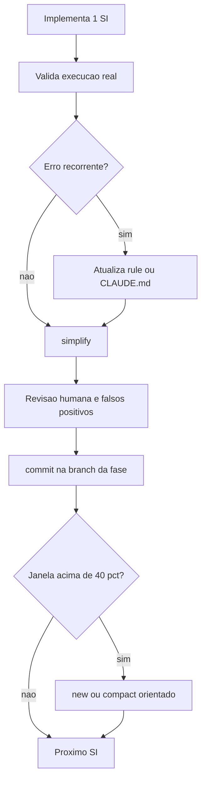

# Higiene do Workflow com IA

> [!summary] TL;DR
> - Depois de cada implementação curta: validar a execução real, simplificar com `/simplify`, revisar como humano e commitar com mensagem descritiva.
> - Erro recorrente não se resolve repetindo prompt: vira rule, seção do CLAUDE.md ou ajuste de skill.
> - Memórias do Claude Code ficam fora do projeto (não versionadas nem portáveis): preferir regra versionada e apagar memória criada pela IA.
> - A janela de contexto é restrição operacional: eficiência cai após ~40%; implementar 1 SI por vez e compactar ou abrir sessão nova antes de degradar.
> - Commits pequenos, por SI, em branch da fase (GitFlow), com coautoria da IA, dão rastreabilidade e auditoria.

## Conceitos-chave

- **Validar a execução**: derrubar e subir o ambiente, rodar o serviço e checar a resposta; env validado no startup transforma erro de config em falha explícita e cedo. Ver [[Ambiente e Scripts de Inicialização]].
- **Erro vira regra**: o `localhost` dentro do container (aponta para o próprio container) virou a seção "Docker Networking" no CLAUDE.md global; regra transversal ao monorepo vai no CLAUDE.md global, não no do NestJS. Ver [[Arquivos de Inicialização do Agente]] e [[CLAUDE.md e AGENTS.md (Instruções de Projeto)]].
- **Revisar a mudança da IA nas regras**: desativar o accept-edits automático para aprovar a seção antes de gravar; a IA corrigiu também o `.env.example` (o `.env` não é versionado).
- **Memórias**: ficam na pasta do usuário, não são versionadas nem portáveis e nem toda ferramenta tem; listar, ver o caminho e excluir a que a IA criou.
- **Fluxo pós-implementação**: implementar -> `/simplify` -> revisão humana -> commit -> PR com nova revisão de IA (ex: checar libs contra supply chain attacks). Ver [[Simplify e Verify]].
- **`/simplify`**: skill nativa (~56 linhas, visível no repo Claude Code System Prompts); identifica mudanças com `git diff` (só não commitadas), lança 3 subagentes em paralelo (reuso: código duplicado; qualidade: code smells; eficiência: N+1, operações paralelizáveis) e o agente principal consolida e corrige. Sem plan mode, Sonnet esforço medium, accept edits ligado.
- **Portabilidade do `/simplify`**: a variável `agentToolName` é do Claude Code (adaptar em Cursor/Copilot); Copilot padrão roda sequencial e precisa do Copilot CLI com front matter para subagents; dá para copiar a skill para o próprio "baú de skills" ou usar skills.sh. Ver [[Ecossistema de Skills]].
- **Commit como qualidade**: commits pequenos e descritivos, branches adequadas; GitFlow com `main` estável e `dev` de integração, documentado em git conventions no CLAUDE.md.
- **Plugin commit-commands**: oficial do Claude Code (buscar "git" em `/plugin`, depois `/reload-plugins`): `/commit` (commit dos arquivos staged seguindo as convenções), `/clean_gone` (remove branches locais já excluídas no remoto), `/commit-push-pr` (commit + push + PR via GitHub CLI). "Command" vem ficando obsoleto em favor de skill.
- **Coautoria no commit**: registrar que a IA participou e com qual modelo ajuda auditoria.
- **Janela de contexto**: limite nominal não é faixa segura; consenso de alerta acima de 40% (varia 40, 50, 60% por modelo); 68% já é Sonnet degradado. Ver [[Context Window em LLMs]] e [[Gestão de Context Window em Prompts]].
- **Compactação**: precisa de buffer livre para gerar o resumo; autocompactação tardia = "caos total"; compactar com frase orientando o resumo; compactações sucessivas crescem ("resumo do resumo do resumo"), aí abrir sessão nova "sem remorso".
- **Fork**: bifurca a sessão a partir da mesma base (como fork de repo Git), útil para explorar alternativas, tirar dúvidas ou debugar e voltar à base. Ver [[Fork de Sessão]].
- **Monitorar sempre**: `/context` o tempo todo ("cuide da janela de contexto como de um bebê") ou Status Line com branch, arquivos modificados, modelo e % da janela.
- **Não usar todo o 1M**: manter o workflow replicável em ambientes mais modestos; skills pessoais desnecessárias também ocupam contexto.

## Fluxograma / Processo



## Erros comuns / Cuidados

- Erro crucial do dev: não avaliar a execução, ou ver o erro e não mudar nada (o problema volta e culpa-se o modelo).
- Salvar prompts problemáticos e revisar depois; possível skill que analisa o histórico de conversas e propõe ajustes na fundação de IA.
- `/simplify` depois do commit não acha nada (só olha arquivos não commitados).
- `/simplify` consome tokens mesmo em mudança pequena (subagente de reuso gastou ~28k) e gera falsos positivos: revisão humana continua obrigatória. Ex: data source lendo config fora do Nest é aceitável porque só roda para `migration:run`.
- Código com "juros": optional chaining redundante (default da porta já no `app.config.ts`) não é bug, mas acumula.
- Mudanças não commitadas na `main` ao criar a branch da fase: usar `git stash`, criar a branch a partir de `dev`, `git stash apply` e perguntar explicitamente se aplicou; commit na branch errada exige merge depois.
- Não fazer commit manual quando dá para automatizar com qualidade; `/commit` não exige Opus nem esforço alto.
- Implementar a fase inteira de uma vez: no experimento a IA foi até o SI 6 e começou a "ratear" com 135k de 200k consumidos; primeiros SIs bons, seguintes ruins. Reagir só quando o output já está errado é tarde: o sinal vem da janela.
- Muitos arquivos por vez dificultam a revisão humana.

## Materiais complementares

### Prompts

**Transformar o erro em regra** (sessão `_claude-sessions/03-atualizacao-claude-md-info-docker.txt`)
```text
na sua última implementação, você usou localhost como host para conectar no
banco de dados, mas estamos em containers docker, o localhost diz respeito
somente ao próprio container.
quero atualizar as rules, para que você não cometa este mesmo erro
```

**Gerenciar memórias** (sessão `_claude-sessions/03-atualizacao-claude-md-info-docker.txt`)
```text
me mostre as memorias que você tem
```
```text
liste o caminho do arquivo
```
```text
exclua esta memória
```

**Simplificar o código da fase** (sessão `_claude-sessions/04-simpilfy-fase01.txt`)
```text
/simplify
```

**Criar branch da fase** (narrado na aula)
```text
Quero criar uma branch de implementação desta fase. A dev já existe. Eu vou criar a partir dela.
```

**Commit e merges com IA** (sessão `_claude-sessions/05-git-commit-fase01-e-claude.md.txt`)
```text
/commit-commands:commit
```
```text
faça o git merge para o dev
```
```text
e agora para faça a main
```

**Contraexemplo: fase inteira de uma vez** (narrado na aula)
```text
Implemente a fase 2 e crie uma lista de tarefas para que nós possamos acompanhar
```

### Conteúdo extra

- Resultado real do `/simplify` na fase 01 (sessão 04): removido o fallback `?? 3000` redundante no `main.ts` e o comentário placeholder do `seed.ts`; `data-source.ts` chamando `databaseConfig()` direto classificado como intencional (falso positivo).
- Commit gerado pelo `/commit` (sessão 05): "fase 01: configuração base com TypeORM, migrations, seeds e config centralizada", 19 arquivos; merge `--no-ff` em `dev` e depois em `main`, com conflito no plano da fase resolvido mantendo a versão de `dev` (121 linhas vs 67).

**Seções do CLAUDE.md global geradas a partir desses feedbacks** (`CLAUDE.md`, linhas 29-38 e 60-68 literais):

````markdown
## Docker Networking

This project runs entirely in Docker containers. When configuring connections between services (database, cache, queue, etc.), **always use the Docker Compose service name** as the host - never `localhost` or `127.0.0.1`.

Inside a container, `localhost` refers to the container itself, not the host machine or other containers. Services communicate through the Docker Compose network using their service names (e.g., `db`, `nestjs-api`).

- **Correct:** `DB_HOST=db` (the Compose service name)
- **Wrong:** `DB_HOST=localhost`

This applies to all environment variables, configuration files, and code that references service hosts.

## Git Conventions

- **Main branch:** `main` - never commit directly to it
- Branches: `feature/*`, `bugfix/*`, `hotfix/*`, `docs/*`
- **Commits:** short, descriptive messages focused on the "why" of the change
- **Workflow:** Git Flow conventions. Two long-lived branches:
  - `main` - stable, production-ready code
  - `dev` - integration branch; all feature/bugfix/hotfix branches start from `dev` and merge back into `dev`
  - When `dev` is stable, it is merged into `main`
````

## Tags de busca

`#dev-software-ia` `#simplify` `#commits-com-ia` `#janela-de-contexto` `#memorias`
