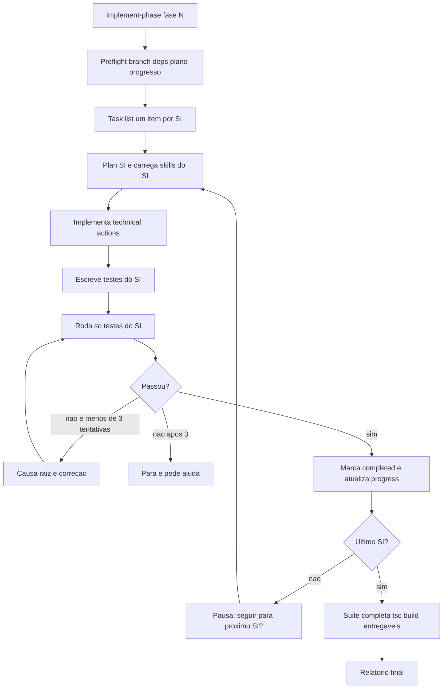

# Implementação de Fases com implement-phase

> [!summary] TL;DR
> - O plano define SIs e technical actions, mas não o contrato de execução; a skill `implement-phase` fixa a ordem, quando testar e quando parar, em vez de depender da inferência do modelo.
> - Fluxo: preflight (branch, deps, sanidade do plano, retomada) -> task list com um item por SI -> loop por SI (planejar, implementar, testar só o SI, até 3 tentativas de correção, pausa) -> verificação final (suíte completa, `tsc`, build, entregáveis) -> relatório.
> - `.progress.md` persiste status, testes e observações por SI: permite `/new` entre SIs e alimenta melhorias da fundação de IA.
> - Implementar 1 SI por vez com Sonnet (esforço medium), revisar, `/simplify`, commit e compactar ou abrir sessão nova.
> - Testes verdes não encerram a validação: critério de aceite = testes + `tsc` + build + execução manual + revisão arquitetural.

## Conceitos-chave

- **Por que uma skill de implementação**: no experimento a IA seguiu SI por SI por inferência do termo "step", não por regra; outro modelo pode implementar tudo e testar só no fim (acúmulo de erros, mais tokens). Terminologia ajuda, mas não substitui instrução formal.
- **Plano é o contrato**: a skill não toma decisões técnicas; se o plano estiver errado, para e pede revisão via plan-phase.
- **Preflight**: bloqueia em `main`/`dev` ou com arquivos não commitados fora do subprojeto, checa `node_modules`, valida a estrutura do plano e lê o progresso existente.
- **Task list**: um `TaskCreate` por SI (`SI-NN.X <título>`), status pending/in_progress/completed; em outras ferramentas revisar esses nomes de tool.
- **Loop por SI**: sem paralelismo e sem subagentes de implementação; carrega só as skills de boas práticas que o SI precisa (on demand); roda só os testes do SI; falha: ler o erro, achar causa raiz, sem enfraquecer teste, máximo 3 tentativas e depois pedir ajuda ("pedir ajuda aos universitários").
- **Modo padrão vs contínuo**: padrão pausa com "Seguir para SI-NN.X+1?"; contínuo só com pedido explícito ("execute tudo", "autopilot"), não recomendado por degradação de contexto.
- **Arquivo de progresso**: irmão do plano com sufixo `.progress.md`; status da fase, SIs X/Y, e por SI status, testes e observações fora de escopo.
- **Escolha de modelo**: Opus para planejar; Sonnet (200k ou 1M, use bem menos que 1M) para codificar, esforço medium basta com plano detalhado; Haiku é rápido mas deixa pontas soltas. Trocar de modelo no meio perde o prompt cache.
- **Orçamento de janela**: contexto fixo inicial ~16-17k (14k de system prompt); reservar espaço para implementação, "rateio" (erros, investigação, testes) e buffer de compactação; acima de ~40% risco da "zona burra". Ver [[Gestão de Context Window em Prompts]].
- **Não ser babá da IA**: deixar executar e corrigir depois com `/simplify` e refatoração; intervir só em besteira grande. `/btw` faz pergunta lateral sem pausar.
- **Commit por SI**: permite apagar e refazer só aquele SI. Ver [[Higiene do Workflow com IA]].
- **Correções estruturadas**: corrigir via research -> decisão -> atualizar plano -> implementar, não com pedidos soltos no chat; correção que irradia (endpoint, módulo, migration) vira novos SIs no mesmo plano. Ver [[Planejamento de Fases com plan-phase]].
- **Ambiguidade no plano vira erro de design**: "ChannelService independente" foi lido como serviço sem repositório (modularização só aparente); testes passaram mascarando o problema. Correção: replanejar só o SI 2.15 com `/plan-phase`, ChannelService com DataSource no construtor controlando transação/savepoint, UserService usando compensação.
- **Teste humano**: subir ambiente real, conferir banco (MCP do Postgres), containers, logs e chamadas HTTP (arquivo `api.http` do REST Client). Ver [[MCPs do Projeto Context7 e Postgres]].
- **Assets fora de `dist`**: runtime executa `dist`; templates Handlebars, JSON, imagens e seeds precisam de `compilerOptions.assets` com watch no `nest-cli.json`; testes de integração rodam TS direto e não pegam a falha (falso senso de cobertura).
- **`/implement` unificado**: mesma mecânica para fase ou task; testes do SI rodam em subagente que devolve só diagnóstico (ver [[Subagentes e Tasks Ad Hoc]]); SIs de tela divididos em Xa (visual shell via `figma-implement-design`) e Xb (lógica + testes).
- **Front-end**: ajustar MSW e Playwright antes dos SIs, senão o agente pula E2E achando que o ambiente não existe; drift report por tela antes do visual shell; parar antes do SI de drift para trocar para Opus. Ver [[Testes no Front-end com MSW]] e [[Figma MCP]].
- **Encerramento**: prática deliberada nas próximas fases, curadoria das skills e montar o próprio workflow por etapas e feedbacks; "planeje mais do que codifique". Ver [[Curadoria de Skills]].

## Fluxograma / Processo



Ciclo humano por SI: implementar -> revisar -> `/simplify` -> commit -> `/compact` orientado ou `/new`.

## Erros comuns / Cuidados

- IA usou `localhost` como host do banco dentro de container (usar o nome do serviço do Compose, ex: `db`); `npm run test` sem banco real não acusou `DB_PASSWORD` ausente.
- A IA rodou teste no host em vez do container: anotar no progresso e transformar em regra. Ver [[Rules do Claude Code]].
- Problemas no SI3 da fase 2: tabelas antigas no container, Jest não reconhecendo `integration.spec`, testes sem carregar `.env`, `localhost` no lugar de `db`; 46k tokens só nesse SI.
- Relatório final da fase 2: 13 SIs com testes verdes, mas 11 erros de tipagem (`import type`) e build não feito; testes com `--runInBand` (um banco compartilhado gera race condition).
- Revisão arquitetural achou: teste que só espera "lançar erro" (verificar o código da violação do Postgres), DomainException carregando código HTTP, AuthService com responsabilidade demais, Channel dentro do UsersModule, fallback de nickname não decidido. "A culpa é minha": gap de escopo onde o plano não foi específico.
- Primeiro teste humano com mais de 100 testes verdes: `POST /auth/register` retornou 500 por template `.hbs` ausente em `dist`. Corrigir a causa e procurar outros arquivos sujeitos à mesma falha.
- IA resumia logs em vez de mostrar: "São Tomé", verificar de fato.
- Logout revoga refresh tokens, mas access token não expirado continua válido (guard só valida assinatura/expiração); revogar exigiria consulta ao banco a cada request; lacuna vira novos SIs ou subfase (ex: 02.1).
- Front: `localhost` no BFF dentro do container não alcança o Nest (usar `host.docker.internal` e mapear no hosts da máquina); Node v25 incompatível com o Next gerava 500 em vez de 401 (voltar para Node LTS); handlers MSW simples por domínio evitam duplicar variações nos testes.
- Não existe planejamento perfeito: ajustes viram nova task estruturada. Fase 2 do front levou cerca de 2 horas.

## Materiais complementares

### Prompts

**Implementar a fase com plano pronto** (narrado na aula)
```text
Implemente a fase 01 configuração base
```

**Implementar só o que falta após atualizar o plano** (narrado na aula)
```text
Implemente a fase 1. Tem coisas já feitas, como o SI01 e SI02. Precisamos implementar apenas o que está faltando.
```

**Invocar a skill** (sessões `_claude-sessions/08-fase02-correcoes-01.txt` e `09-fase02-correcoes-02.txt`)
```text
/implement-phase fase 02
```

**Compactação orientada entre SIs** (narrado na aula)
```text
/compact Preserve os documentos MD lidos e resuma a implementação, não guarde código fonte lido
```

**Teste humano da fase 2** (narrados na aula)
```text
Verifique se o banco de dados tem as tabelas.
```
```text
Mostre os logs do start:dev que você rodou.
```
```text
Crie um api.http com todos os endpoints de forma lógica para que possamos testar o projeto.
```
```text
Faça uma melhoria no api.http: access token e refresh token podem ser reusados, capturados de response HTTP.
```
```text
Fiz a chamada do auth/register, mas retornou um erro 500. Verifique os logs.
```
```text
Liste as tabelas do banco de dados e veja se elas estão vazias.
```
```text
Quero que suba o ambiente do NestJS e rode o servidor web.
```
```text
Liste os dados da tabela de usuários.
```
```text
Liste os dados da tabela de refresh token.
```

**Regra sugerida após a revisão do código** (narrado na aula)
```text
Quando estiver avaliando erros, faça avaliação detalhada do tipo do erro.
```

**Planejar correções da fase já concluída** (narrado na aula)
```text
/plan-phase A fase 2 já está concluída, mas temos algumas correções e melhorias:
- 11 erros do TypeScript.
- O canal está acoplado ao módulo de usuário. Crie o módulo do canal; o serviço de usuário vai chamar o do canal.
- Nas retentativas, ao criar o canal, consulte se o canal a ser criado existe, assim evita forçar um erro. Se mesmo assim der erro na criação, continuam as retentativas, sempre pautadas por essa consulta.
- Não temos um teste para rodar as migrações. Crie um teste para isso.
- O endpoint de confirmação de e-mail deve ser GET, com o token recebido na query string, não no corpo, pois o link vai no e-mail.
- Os templates de e-mail não estão sendo copiados para a pasta dist. Eles precisam ter o comportamento de watch como dos arquivos TypeScript tradicionais.
```
```text
Mescle o plano já existente com o da fase 2.
```

**Reajustar um SI implementado errado** (narrados na aula)
```text
/plan-phase fase 2 já feita. Temos mais uma correção. Aconteceu um erro de implementação no SI 2.15, porque o ChannelsModule não tem controle sobre o canal. Ele deve criar canal, ter acesso ao repositório, ter controle sobre o nickname. O UsersModule apenas usa o ChannelService. Reajuste o SI 2.15 para podermos reimplementá-lo, mas verifique com cuidado as mudanças nos testes correlacionados para não quebrar a implementação.
```
```text
Ainda neste SI 2.15, temos o EntityManager sendo recebido pelo createChannel. Recebe EntityManager, tem controle total? Revise isto novamente.
```
```text
/implement-phase fase 2, somente o SI 2.15. Leia as observações no arquivo de progresso da fase para ter contexto sobre a implementação.
```
```text
Usando a fase 02, pegue a parte do final de verificação e execute o necessário para garantir que tudo está funcionando.
```

**Implementar task inteira de uma vez** (narrado na aula)
```text
/implement Faça no modo continuous mode.
```

**Conferir E2E no front** (narrado na aula)
```text
Você testou o E2E? Usou o instrumentation.ts?
```

**Subir os servidores para teste manual do front** (narrados na aula)
```text
Levante o servidor do Next.js.
```
```text
Suba o NestJS e rode o servidor dele.
```

### Conteúdo extra

**Diagrama da skill implement-phase** (`docs/diagrams/skill-implement-phase.mermaid`, literal):

````text
%%{init: {'theme': 'dark'}}%%
flowchart TB
    subgraph INPUT["📥 Entrada"]
        phase["phase-NN-*.md\n(plano - contrato)"]
        plan["project-plan.md\n(subproject alvo)"]
        decisions["decisions/\n(escolhas fixas)"]
        testing["testing-guide skill\n(how to write tests)"]
        practices["best-practices skills\n(subproject-specific)"]
    end

    subgraph PREP["🔧 Preparação"]
        preflight["Preflight\n(branch, deps,\nplan sanity)"]
        tasklist["Criar task list\n(1 task por SI,\nordem do Dependency Map)"]
    end

    subgraph LOOP["🔁 Loop por SI"]
        plan_uc["1. Plan SI\n(re-read section)"]
        implement["2. Implementar\ntechnical actions"]
        write_tests["3. Write tests\n(Tests section)"]
        run_tests["4. Run SI tests\n(escopo do SI)"]
        fix["5. Fix loop\n(max 3 tentativas)"]
        stop["6. STOP\nSeguir para SI-NN.X+1?"]
    end

    subgraph FINAL["✅ Final Verification"]
        suite["Full test suite"]
        tsc["tsc --noEmit"]
        build["npm run build"]
        deliv["Deliverables checklist"]
    end

    subgraph OUTPUT["📤 Saída"]
        report["Completion report"]
    end

    phase --> preflight
    plan --> preflight
    decisions --> preflight
    practices --> implement
    testing --> write_tests

    preflight --> tasklist
    tasklist --> plan_uc

    plan_uc --> implement
    implement --> write_tests
    write_tests --> run_tests
    run_tests --> fix
    fix --> stop
    stop -.próximo SI.-> plan_uc
    stop -.último SI.-> suite

    suite --> tsc
    tsc --> build
    build --> deliv
    deliv --> report

    classDef input fill:#42A5F5,stroke:#1E88E5,color:#FFF
    classDef process fill:#FF7043,stroke:#E64A19,color:#FFF
    classDef output fill:#66BB6A,stroke:#43A047,color:#FFF

    class phase,plan,decisions,testing,practices input
    class preflight,tasklist,plan_uc,implement,write_tests,run_tests,fix,stop,suite,tsc,build,deliv process
    class report output
````

**Skill implement-phase completa** (`.claude/skills/implement-phase/SKILL.md`, literal):

````markdown
---
name: implement-phase
description: "Execute a phase implementation plan step by step, respecting dependencies, running the relevant tests after each SI, and only advancing when tests pass. Use whenever the user asks to implement, execute, build, or deliver a planned phase - including variations like 'implement phase X', 'execute phase-02', 'build the auth phase', 'run the phase plan', 'implement the SIs', or any request to turn a phase plan document (docs/phases/phase-NN-*.md) into working code."
disable-model-invocation: true
---

# Implement Phase

Execute a phase implementation plan SI by SI. Each SI is only considered done when its implementation exists **and**, if the SI has a Tests section, the tests listed there pass. Move to the next SI only after the current one is complete (tests passing where the SI has a Tests section).

This skill is the execution counterpart of `plan-phase`. The plan document is the contract - this skill does not make technical decisions, it follows them.

## Inputs

The user either points to a phase document directly (e.g., `docs/phases/phase-02-auth.md`) or refers to it by number/name (e.g., "implement phase 02", "run the auth phase"). Resolve the path before proceeding:

- If the phase number is given, look for `docs/phases/phase-NN-*.md`.
- If multiple match, ask the user which one.
- If the file does not exist, stop and tell the user - they likely need to run `plan-phase` first.

The user may also request **continuous mode** at the start of the session with phrases like "execute tudo", "don't pause between SIs", "run all at once", "autopilot". The default mode pauses between SIs for confirmation.

## Context - read before implementing

1. **The phase document** - `docs/phases/phase-NN-*.md`. This is the primary source. Parse Objective, Step Implementations (each with Description, Technical actions, Tests, Dependencies, Acceptance criteria), Technical Specifications, Dependency Map, and Deliverables.
2. **Testing guide skill** - for each target subproject, use the Skill tool to load `testing-guide-{subproject}` if present. It defines how to write and run tests at each layer (Unit, Integration, E2E) for that subproject. The Tests section of each SI tells you **which** files to create; the testing guide tells you **how** to write them.

## Progress file - persistence across sessions

A progress file tracks which SIs are completed, their test results, and out-of-scope observations. It is the source of truth for resuming a phase across sessions and for generating the final completion report.

- **Location:** sibling of the phase document, with `.progress.md` suffix - e.g., `docs/phases/phase-02-auth.md` → `docs/phases/phase-02-auth.progress.md`
- **Created:** during "Set up the SI task list" (fresh start) or read during Preflight (resume)
- **Updated:** at step 6 of the per-SI loop, after each SI completes
- **Format:**

```markdown
# Phase NN - <name> - Progress

**Status:** in_progress | completed
**SIs:** X/Y completed

### SI-NN.X - <name>
- **Status:** completed | pending
- **Tests:** <result or "no tests">
- **Observations:** <out-of-scope notes or "none">
```

Each SI gets one section. Only `Status`, `Tests`, and `Observations` are updated - the structure is created once and entries are filled in as SIs complete.

## Preflight - run before touching code

Check these before starting implementation. Stop and surface any issue to the user rather than guessing:

- **Branch check**: `git status` and `git branch --show-current`. If the current branch is `main` or `dev`, or if there are uncommitted changes touching files outside the target subproject's directory (e.g., outside `nestjs-project/` when that is the target), stop and ask the user to set up the right branch first.
- **Subproject readiness**: the target subproject exists and its dependencies are installed (e.g., `nestjs-project/node_modules` present). If not, ask the user to set it up first.
- **Plan sanity**: the phase document has the expected structure (Step Implementations and Deliverables are required; Dependency Map is optional - if missing, the order will be derived from each SI's `Dependencies:` field). If the document looks malformed or incomplete, stop and report.
- **Resume check**: look for a progress file (`.progress.md` sibling of the phase document). If found, read it to determine which SIs are already completed. Inform the user: "Encontrado progress file com X/Y SIs completos. Retomando a partir de SI-NN.Z." If the progress file is malformed or inconsistent with the phase document, stop and report.

## Execution order

Implement SIs in the order defined by the **Dependency Map** in the phase document. If the Dependency Map is missing or contradicts the SIs' `Dependencies:` fields, derive the order from those fields using a topological sort - an SI can only start once all its dependencies are complete (tests passing where the SI has a Tests section).

Never skip ahead. Never implement two SIs in parallel in the same run. The guarantee "previous SI is complete (tests passing where the SI has a Tests section) before the next starts" is the core value this skill provides; violating it defeats the purpose.

## Set up the SI task list - before entering the per-SI loop

Before implementing the first SI, you **MUST** create a persistent task list that contains **one task per SI** in the phase, in the order they will be executed. Use the `TaskCreate` tool (one call per SI).

- Task subject format: `SI-NN.X - <SI name>` (e.g., `SI-02.1 - HTTP Infrastructure Foundations`).
- Task description: a one-line summary of what the SI delivers.
- Task activeForm: what you will be doing while the SI is in progress (e.g., `Implementing HTTP infrastructure`).
- All tasks start as `pending`.

This list is the visible plan the user can see before any code is written. It mirrors the phase document's SI sequence and serves as the execution contract for the session.

**Fresh start** (no progress file found): after creating the task list, create the progress file with all SIs as `pending`.

**Resume** (progress file found): after creating the task list, immediately mark already-completed SIs' tasks as `completed` (based on the progress file). The per-SI loop will skip completed SIs and start from the first `pending` one. If all SIs are already completed but the progress file's `Status` is still `in_progress`, skip the per-SI loop and proceed directly to final verification.

During the per-SI loop:
- Flip the current SI's task to `in_progress` when you start step 1 (Plan the SI).
- Flip it to `completed` at the beginning of step 6, **before** emitting the per-SI completion report and the "Seguir para SI-NN.X+1?" question. The `TaskUpdate` and progress file update are the last tool calls allowed before the mandatory STOP in default mode (in continuous mode, the per-SI completion report is emitted, then the next SI's `TaskUpdate → in_progress` follows).
- Never skip tasks, never batch updates - one SI's status is changed at a time.

Do **not** merge multiple SIs into one task. Do **not** add ad-hoc tasks for individual technical actions - those live in the per-SI working memory (step 1), not in the persistent task list.

## The per-SI loop

For each **pending** SI (completed SIs from a previous session are skipped), execute these steps in order. Do not batch them; each step's output informs the next.

### 1. Plan the SI

Re-read the SI section in full (Description, Technical actions, Tests, Dependencies, Acceptance criteria). Load relevant best-practices skills matching the artifacts this SI builds (e.g., `nestjs-best-practices` for modules/controllers/services, `typeorm` for entities/migrations) - load only what this SI needs, not all available skills. Keep a short internal checklist for this SI: one item per technical action; additionally, when the SI has a Tests section, one item per test file plus a "run tests" item. This is working memory to keep the SI on track - not a formal deliverable.

### 2. Implement the technical actions

Work through the technical actions in order. Stay within scope - only touch files required by **this** SI. If you notice unrelated issues (dead code, formatting, refactoring opportunities), note them for the user but do not act on them.

When the SI introduces new dependencies, install them with the exact version ranges listed in the SI's technical actions.

Follow the target subproject's conventions - read neighboring files before creating new ones so naming, structure, and style stay consistent.

### 3. Write the tests

If the SI has no Tests section, skip this step and steps 4–5, and go straight to step 6 (pause). Otherwise, continue below.

Create the test files listed in the SI's Tests section. Use the testing guide skill as the reference for how to structure each layer. Each test must verify something specific the SI introduces - do not write placeholder tests.

Cover the SI's Acceptance Criteria. Every AC owned by this SI should be observable from at least one of this SI's tests (the AC-to-test mapping is not always 1:1, but no AC should be untestable). Note: SIs with no testable artifacts (infrastructure SIs where behavior is exercised through other SIs' tests, pure-configuration SIs, or similar) may legitimately lack a Tests section - the "skip step 3" branch covers all such cases.

### 4. Run the tests for this SI

Run **only** the test files listed in the SI's Tests section - not the full suite.

### 5. Handle test failures (up to 3 fix attempts)

If tests pass on the first run, proceed to step 6 (pause).

If tests fail, enter the **fix loop**: read the failure output, diagnose the root cause, apply a focused fix, re-run the same tests. Do this at most **3 times**. Count attempts deliberately - do not lose count and loop indefinitely.

Fix-loop discipline:
- **Read the error.** Do not retry blindly. If the same fix is applied twice, that's a sign the diagnosis is wrong.
- **Fix the root cause.** Do not weaken tests to make them pass. Do not add skips, `.only`, or `xit`. Do not catch and swallow errors just to hide them.
- **Stay in scope.** If the failure reveals a problem in a previous SI's code, stop - that's a signal to escalate, not to quietly edit a completed SI.
- **No shortcuts.** Never disable hooks or bypass safety checks.

After 3 unsuccessful fix attempts, **stop**. Report to the user:
- Which SI is stuck.
- The current test failure output (concise).
- Your hypothesis about the root cause.
- What you've tried.

Wait for the user's guidance. Do not proceed to the next SI until the user unblocks you.

### 6. Pause for confirmation - STOP before the next SI

This step is a **hard stop**. After completing an SI you **MUST NOT** begin the next SI without the user's explicit approval (given per-SI in default mode, or upfront when the user requested continuous mode).

- **Default mode (pause - this is the default)**: First, make a `TaskUpdate` call marking the current SI's task as `completed`, then update the progress file (mark the SI as `completed`, record test results and any out-of-scope observations noted during this SI) - these are the final tool calls permitted in this step. Then emit the per-SI completion report (SI id, name, tests passing - or `no tests` if the SI had no Tests section) and emit exactly this question as the final line of your message: **"Seguir para SI-NN.X+1?"** (substitute the next SI's id). Then **STOP**. Do not call any further tools. Do not start reading files for the next SI. Do not update the next SI's task to `in_progress`. Wait for the user's reply in a new turn before doing anything else.
- **Continuous mode** (only when the user **explicitly** requested it at the start of the session with phrases like "execute tudo", "autopilot", "don't pause between SIs", or "run all at once"): Still perform the `TaskUpdate → completed` and progress file update, and emit the per-SI completion report (SI id, name, tests passing - or `no tests` if the SI had no Tests section), but **skip** the "Seguir para SI-NN.X+1?" question and the STOP. Then proceed directly to step 1 of the next SI. If you are unsure whether continuous mode was requested, assume default mode and pause.
- **Last SI of the phase**: Still perform the `TaskUpdate → completed` and progress file update (same as the other modes); the per-SI completion report is folded into the phase-level Completion report (see section below), so skip the per-SI report, the question, and the STOP, and go straight to final verification.

Violating this stop is the single most common failure mode of this skill. Treat "Seguir para SI-NN.X+1?" as a terminator, not a rhetorical question.

## Final verification - after all SIs are done

Once every SI in the phase has been implemented and tested, run the phase-level checks defined in the plan's **Deliverables** checklist. These typically include:

1. **Full test suite**: Run every test command listed in the plan's Deliverables (typically one for unit/integration tests and, when applicable, a separate one for E2E tests). The goal is to exercise every test in the phase together, not just the tests of a single SI.
2. **Type-check**: Run the type-check command defined in the plan's Deliverables (e.g., `npx tsc --noEmit` for TypeScript projects).
3. **Project build**: Run the build command defined in the project (e.g., `npm run build`) to verify the code compiles and bundles correctly.

Verify any additional deliverables listed in the plan (migrations, documentation updates, seed data, configuration files). These results are presented in the **Completion report** (see section below).

If the phase spans multiple subprojects, the plan's Deliverables checklist will list these checks per subproject (e.g., `All SI tests pass in nestjs-project` and `All SI tests pass in nextjs-project`) - run each subproject's commands independently, in the order implied by the checklist.

If any final check fails, apply the same fix-loop discipline as step 5: up to 3 focused fix attempts total (shared across all failing checks, not 3 per check), re-running the affected checks after each attempt. If still failing after 3 attempts, stop and report to the user.

## Completion report

When the phase is fully done, read the progress file and generate the report:
- Results of each deliverable check (from final verification - the only new information at this point).
- Out-of-scope observations aggregated from the progress file (as a list of follow-ups for the user, not as things to act on).

Mark the progress file's `Status` as `completed`. Git operations (add, commit, push, PR) are out of scope - the user owns version control.

## Rules

- The phase plan is the contract. Do not add SIs, drop SIs, or change SI boundaries mid-execution. If the plan is wrong, stop and ask the user to revise it via `plan-phase`.
- Before the first SI, create the SI task list (one `TaskCreate` per SI, in order) so the user sees the full plan. Flip each task's status exactly at the boundaries defined in step 1 (`in_progress`) and step 6 (`completed`).
- Respect dependency order - never implement an SI whose dependencies are not yet complete (tests passing where the SI has a Tests section).
- One SI at a time. No parallel implementation within the same phase run.
- Run only the SI's own tests during the loop. Save the full suite for final verification.
- Never weaken tests to make them pass. Never bypass hooks.
- Stay within the scope of the current SI - note unrelated issues, don't act on them.
- After each SI (except the last) in default mode, **STOP after emitting "Seguir para SI-NN.X+1?"** and wait for user approval before any further tool call. Continuous mode applies only when the user explicitly requested it at the start of the session.
- Stop and ask when the fix loop exhausts its 3 attempts, when a dependency is missing, or when the plan conflicts with reality.
````

**Skill /implement unificada: frontmatter, entradas e regras** (`.claude/skills/implement/SKILL.md`, linhas 1-31 e 575-591 literais; preflight, loop por SI com SIs de tela Xa/Xb, specs E2E e relatório nas linhas 32-574):

````markdown
---
name: implement
description: "Execute a phase or task implementation plan step by step, respecting dependencies, running the relevant tests after each SI, and only advancing when tests pass. Use whenever the user asks to implement, execute, build, or deliver a planned phase or task - including variations like 'implement phase X', 'execute phase-02', 'build the auth phase', 'implement task <slug>', 'run the task plan', 'implement the SIs', or any request to turn a plan document (docs/phases/phase-NN-{slug}/phase-NN-{slug}.md or docs/tasks/task-{slug}/task-{slug}.md) into working code."
disable-model-invocation: true
---

# Implement

Execute a plan (phase or task) SI by SI. Each SI is only considered done when its implementation exists **and**, if the SI has a Tests section, the tests listed there pass. Move to the next SI only after the current one is complete (tests passing where the SI has a Tests section).

This skill is the execution counterpart of `plan-pipeline`. The plan document is the contract - this skill does not make technical decisions, it follows them.

## Inputs

`/implement <NN | slug> [continuous]`

The user either points to a plan document directly (e.g., `docs/phases/phase-02-auth/phase-02-auth.md` or `docs/tasks/task-parallel-db-tests/task-parallel-db-tests.md`) or refers to it by number/slug (e.g., "implement phase 02", "run the auth phase", "implement task parallel-db-tests"). Resolve the path before proceeding:

**Mode detection:**

- **Integer arg** → phase mode. Resolve to `docs/phases/phase-NN-{slug}/phase-NN-{slug}.md` (glob `docs/phases/phase-NN-*/phase-NN-*.md`).
- **String arg** → task mode by default. Resolve to `docs/tasks/task-{slug}/task-{slug}.md`. **Phase-slice shortcut (optional, slug-primary):** if no task plan matches, also glob `docs/phases/phase-*-{slug}/phase-*-{slug}.md` - a single match resolves to phase mode on that slice. This aligns with the `plan-pipeline` slicing model without requiring users to remember the phase number.

**Fallback:** if mode detection is ambiguous or an explicit path is given, glob both directories; if multiple match, ask the user which one.

**Multi-match in phase mode is the expected slicing path, not an edge case.** Per the `plan-pipeline` slicing model, a single phase `NN` may have multiple phase-scope slice docs (e.g., `phase-02-auth-backend` + `phase-02-auth-frontend`). When `/implement 2` globs `docs/phases/phase-02-*/phase-02-*.md` and returns ≥2 matches, the "ask the user which one" fallback above IS the slicing resolution - not a degenerate case. Prefer calling it out by slice slug in the disambiguation prompt (e.g., `"Phase 2 has multiple slices: auth-backend, auth-frontend. Which one?"`) so users can re-invoke directly via the slug-primary path (`/implement auth-frontend`).

- If no file matches, stop and tell the user - they likely need to run `plan-pipeline` first.

The user may also request **continuous mode** at the start of the session with phrases like "execute tudo", "don't pause between SIs", "run all at once", "autopilot". The default mode pauses between SIs for confirmation.


## Rules

- The plan document is the contract. Do not add SIs, drop SIs, or change SI boundaries mid-execution. If the plan is wrong, stop and ask the user to revise it via `plan-pipeline`.
- Before the first SI, create the SI task list (one `TaskCreate` per SI, in order) so the user sees the full plan. Flip each task's status exactly at the boundaries defined in step 1 (`in_progress`) and step 6 (`completed`).
- Respect dependency order - never implement an SI whose dependencies are not yet complete (tests passing where the SI has a Tests section).
- One SI at a time. No parallel implementation within the same phase run.
- Run only the SI's own tests during the loop, via the subagent pattern defined in step 4 - which requires the test subagent to first Read `{subproject}/CLAUDE.md` for command conventions (subagents inherit nothing from Claude Code's system prompt). Save the full suite for final verification.
- When reading subproject files directly, prefer `offset` + `limit` over whole-file reads; full-file reads only when rewriting most of the file. Delegate convention discovery to an `Explore` subagent with an explicit response-format contract (signatures / prose summary / path tree - never full file dumps). See step 2.
- Never weaken tests to make them pass. Never bypass hooks.
- Stay within the scope of the current SI - note unrelated issues, don't act on them.
- After each SI in default mode, **STOP** and wait for user approval before advancing - per-SI transitions via "Seguir para {next-SI-id}?" (phase mode: `SI-NN.X+1`; task mode: `SI-N+1`), and after the final SI via "Rodar final verification?" before starting the plan-level checks. Continuous mode applies only when the user explicitly requested it at the start of the session, in which case both pauses are skipped.
- Stop and ask when the fix loop exhausts its 3 attempts, when a dependency is missing, or when the plan conflicts with reality.
- **Narrow handoff to `figma:figma-implement-design`** (Decisão #31). Pass only Figma URL, Reused DS, Server-connected component names, target paths. **Never** pass auth/rendering/error/validation info - those belong to SI-Xb.
- **SI-Xa and SI-Xb are distinct SIs, not sub-SIs of the same entity** (Decisão #32). Each has its own Dependency Map entry, its own Tests table, its own Acceptance criteria, its own progress.md line. Completing SI-Xa marks Xa done; completing SI-Xb independently marks Xb done.
- **SI-Xb execution is per-action, not monolithic.** Iterate Technical actions (1) through (N ≤5) in order; each marked individually in progress.md as completed. If action (K) fails, SI-Xb is half-done; rerun `/implement {slug}` picks up at action (K).
- **Graceful fallback if figma-implement-design is unavailable.** If the skill is not registered (not installed, plugin absent), halt SI-Xa with error: `"SI-NN.Xa requires skill 'figma:figma-implement-design' which is not available. Install the figma plugin or implement visual shell manually (create target files + mark SI-NN.Xa as manual-done in progress.md) before resuming /implement."`. SI-Xb **does NOT block** on figma plugin availability - if user completes SI-Xa manually and marks it done, `/implement` proceeds normally to SI-Xb. Other SIs (backend) continue executing.
- **Do NOT re-invoke `figma:figma-implement-design` during SI-Xb execution.** Cadencing is behavioral (see SI-Xa block in step 1) - figma-implement-design fires only on SI-Xa, never SI-Xb.
````

## Tags de busca

`#dev-software-ia` `#implement-phase` `#progress-md` `#revisao-humana` `#execucao-por-si`
