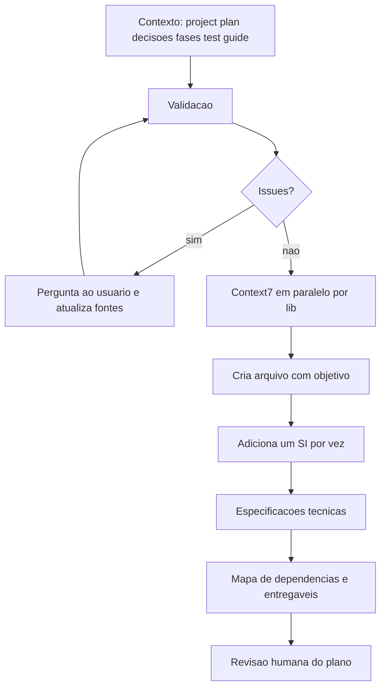

# Planejamento de Fases com plan-phase

> [!summary] TL;DR
> - `/plan-phase` transforma project plan + decisões técnicas + fases anteriores + guia de testes num plano de fase com estrutura fixa: Step Implementations (SIs), especificações técnicas, mapa de dependências e entregáveis.
> - Quatro blocos: contexto obrigatório, validação (parar e perguntar antes de gerar), pesquisa localizada com Context7 em paralelo e geração incremental SI por SI.
> - SI pequeno: máximo 5 technical actions e 5 arquivos de teste; critérios de aceitação observáveis (1 mínimo, 3 a 7 típico, 10 máximo).
> - A skill evolui com a execução: nova categoria "consequências não mapeadas" e convenções REST entraram depois de falhas reais.
> - No workflow expandido o plan-phase é quebrado em plan-context, plan-validate, plan-resolve e plan-build (fases A, B e C), com gate clean/dirty.

## Conceitos-chave

- **Por que a skill existe**: o prompt nativo do plan mode (~74 linhas: "arquiteto de software", somente leitura, explorar codebase, trade-offs, subagentes em paralelo) não define o formato do plano; o time deve definir o padrão. Pode-se ativar plan mode e chamar a skill. Ver [[Plan Mode]].
- **Contexto obrigatório**: project plan, decisões (sumário primeiro, leitura full só se houver conflito), fases anteriores e o test guide do subprojeto carregado via Skill tool (carregar força comportamento; não só ler). Ver [[Edge Cases e Test Guidelines]].
- **Validação**: inconsistências entre documentos, ambiguidades ("handle authentication" não diz nada), decisões faltantes, lacunas de dependência e consequências não mapeadas dos requisitos funcionais; se achar algo, para e pergunta.
- **Consequências não mapeadas**: simular a execução de cada requisito: entradas e edge cases, saídas que colidem/estouram/violam UNIQUE, entidades relacionadas e side effects, concorrência, caminho de falha e atomicidade. Nasceu da colisão de handle (`luiz@gmail.com` e `luiz@outlook.com` geram o mesmo canal). Generalizar a correção ("se especifico A, resulta sempre em B?") em vez de ancorar no exemplo.
- **Step Implementation (SI)**: unidade de trabalho coesa numerada pela fase (SI-02.1...); "IA é boa em tarefas pequenas"; na dúvida, SIs menores; separar infraestrutura (instalar, configurar) de comportamento (implementar, testar).
- **Technical Actions**: verbo no infinitivo, específicas para outro agente implementar sem ambiguidade, com libs, módulos, patterns e versões compatíveis; sem código. Ruim: `setupRateLimit`. Bom: instalar e configurar rate limit com 10 requests por minuto nos endpoints de auth.
- **Testes por SI**: tabela "one row per test" com arquivo, camada (unidade, integração, E2E) e o que verifica, derivada do test guide. Ver [[Testes Automatizados vs IA]].
- **Critérios de aceitação**: comportamento observável de fora (HTTP, banco, side effects, segurança); derivar do caminho feliz, depois branches, side effects, limites de segurança e cortar redundância.
- **Especificações técnicas**: modelagem de dados, contrato da API (verbo, path, headers, body, resposta, erros), matriz de autorização, catálogo de erros de domínio (ex: "Email already exists" 409; sem erros genéricos de framework), events/messages, mapa de dependências (SIs paralelizáveis) e entregáveis em checklist.
- **Escrita incremental**: criar o arquivo com cabeçalho e ir adicionando um SI por vez com Edit; um único Write excede limites e pesa memória. Ambiguidade descoberta no meio vira marcador `[DECIDE: ...]` resolvido no fim via AskUserQuestion.
- **Convenções REST**: 204 sem corpo para ação sem dado produzido; 201 com representação e `Location`; nunca `{ message }` como único conteúdo de sucesso; endpoints de ação são válidos em REST. Ex: `POST /auth/forgot-password` sempre 204.
- **Replanejar em vez de editar trechos**: rodar `/plan-phase` de novo pedindo a mudança mantém dependências, testes e critérios coerentes.
- **Escolha de modelo**: Opus com effort alto para planejar (a validação pega mais gaps); fase 2 consumiu ~103k a 112k tokens.
- **Pipeline expandido**: plan-context consolida (não detecta issues), plan-validate só lê `context.md` e escreve `validation.md`, plan-resolve pergunta e transcreve, plan-build escreve o plano (fase A: technical specs e pausa para revisão com preview; fase B: SIs, mapa e entregáveis; fase C: append mode). Ver [[Workflow RPI Research Plan Implement]].
- **sourceMtime**: registra o mtime de cada fonte usada para gerar `context.md`/`validation.md`; fonte mais nova torna o derivado stale e obriga a regenerar (nunca automaticamente).
- **context.md**: escopo, fora de escopo, entregáveis, projetos afetados, itens deferidos, índice de decisões, decisões herdadas, inventário de UI e requisitos de teste; vira a entrada principal do planBuild e o project plan vira referência secundária.
- **validation.md**: status clean/dirty, contagem de issues por categoria (IC, AMB, MD, DG, ICC, OQ, UIG) e histórico de resolvidas; qualquer pendência aborta o planBuild.
- **Migração de fases antigas**: cada fase vira diretório com `context.md`, `validation.md` e `progress.md` (retrospectivo, com SIs completed); slug canônico igual em decisões, diretórios e arquivos.
- **Plano de front-end**: áreas de front-end runtime, UI Contracts por tela (rota, Figma, renderização, estados de UX, interações, catálogo de erros de UX) e matriz de rastreabilidade (operação -> componentes -> página); fase 2 front gerou 24 SIs (6 bootstrap, 9 foundation, 9 de tela: drift, visual shell, lógica + testes). Ver [[shadcn e Componentes do Design System]].
- **Reprodutibilidade**: recriar o plano gera praticamente os mesmos SIs porque o pipeline é amarrado.

## Fluxograma / Processo



## Erros comuns / Cuidados

- Plano com gaps gera implementação pouco assertiva: o agente preenche lacunas por inferência.
- Plano bom é completo para o escopo atual, não inflado: fase só de infraestrutura não leva entidades, endpoints, ACL nem catálogo de erros.
- Sem consultar docs atuais o plano sai com comandos/APIs desatualizados.
- Plan mode pode ultrapassar o objetivo e implementar ao aprovar o plano: deixar explícito que a saída é só o arquivo (ou cancelar e ler pelo caminho do plano).
- A validação não pega tudo (IA não determinística): ler o plano antes de implementar. Ex: "refresh token opaco" sem respaldo em TD; resposta 200 com mensagem redundante em vez de 204.
- Testar melhoria de skill excluindo o plano anterior e arquivos paralelos da pasta; o Claude tende a ler arquivos vizinhos e contaminar o teste.
- Ao dizer que a fase já estava implementada, a IA criou plano separado em vez de atualizar: pedir explicitamente para mesclar.
- Não editar o arquivo do plano enquanto a IA ainda escreve.
- Falso positivo de missing decision: o correlator pode deixar fora uma TD existente; a correção é refazer a correlação e regenerar o contexto, não duplicar decisão.
- Declarar adiamento também é decisão de arquitetura; omissão silenciosa gera ruído no validate.
- "Puxar o freio de mão no planejamento para que a implementação seja commodity; nós somos os arquitetos da IA."

## Materiais complementares

### Prompts

**Gerar o plano da fase** (sessão `_claude-sessions/02-planejamento-de-implementacao-fase01.txt`)
```text
/plan-phase fase 01
```

**Corrigir o plan mode que tentou implementar** (sessão `_claude-sessions/02-planejamento-de-implementacao-fase01.txt`)
```text
eu só quero que você salve o plano
```

**Atualizar o plano existente com nova decisão, sem implementar** (narrado na aula)
```text
/plan-phase fase 01. Ela já existe. Queremos atualizá-la com as Decisões Técnicas 1. É só para atualizar o plano. Não implemente nada na codebase.
```

**Apontar gap que a validação não detectou** (narrado na aula; formular como dúvida, não como solução)
```text
Eu quero a opção 1, mas você não identificou problemas quando usuários com mesmo prefixo de e-mail tentarem criar suas contas. Haverá conflito. Precisamos pensar nisso.
```

**Melhorar a validação da skill a partir da transcrição exportada** (sessão `_claude-sessions/06-atualizando-skill-plan-impl-detalhes-obscuros.txt`)
```text
numa inteiração para criar o plano de implementação da fase 02 do projeto
(auth), quando você passou na parte de validação para validar
inconsistencias, decisões faltantes e tudo mais, você não identificou que
poderia ter conflito de canais quando o prefixo de mail dos usuários fosse
igual, aqui está a transcrição
@2026-04-06-213454-local-command-caveatcaveat-the-messages-below.txt

eu quero melhorar @.claude/skills/plan-phase/SKILL.md para que neste parte de
 validação, não deixemos passar este tipo de detalhes.

me ajude a identificar que tipo de detalhe é para acrescentar ou atualizar a
parte de validação para identificar coisas como estas e outras decisões
obscuras do projeto
```

**Apontar inconsistência no plano** (narrado na aula, abreviado)
```text
Nesta linha temos a menção de um Refresh Token opaco. Não definimos isso nas specs.
```
```text
Procure mais menções sobre isso no documento <fase 2 auth> e corrija.
```

**Ensinar convenções REST à skill** (sessão `_claude-sessions/07-atualizando-skill-plan-boas-praticas-rest.txt`)
```text
No plano de impl. @docs/phases/phase-02-auth.md , temos
  no contrato da api, mensagem redundante quando temos
  sucesso da operação, isto não é uma boa prática do rest.
  Se a operação foi feita com sucesso e não temos nada a
  retornar na resposta http, podemos usar o status code
  204. Este é apenas um exemplo, me ajude a pensar padrões
  do REST que deveríamos estar especificados no
  @.claude/skills/plan-phase/SKILL.md para que ela não
  cometa estes erros, ou seja, siga as boas práticas do
  REST
```

**Atualizar contratos com as novas diretrizes** (narrado na aula)
```text
/plan-phase Atualize a fase de autenticação, atualizando o contrato da API seguindo as novas diretrizes.
```

**Migrar fases implementadas para o formato do pipeline** (sessão `_claude-sessions/12-adaptacao-docs-phases-e-td-existentes.txt`)
```text
dado o que existe as skills plan-* (não considere plan-phase e
implement-phase) e /implement,  quero adaptar 2 fases já desenvolvidas para o
 novo formato de como as skills trabalham para gerar as fases e seus
arquivos.
analise as skills, rastreie as mudanças e gere as alterações
```

**Revalidar a migração** (sessão `_claude-sessions/12-adaptacao-docs-phases-e-td-existentes.txt`)
```text
Revalide as mudanças que foram feitas, temos o nextjs-project que está em
docs, mas o projeto é next-frontend.
Revalide se o formato dos novos docs está adequado ao que as skills geram
```

**Declarar adiamento para fechar UI Gap no planValidate** (narrado na aula)
```text
A tela de confirmação da conta não será implementada nesta fase corrente. Será adiada.
```

**Contestar missing decision no planResolve** (narrado na aula, parcial)
```text
Dado o que você disse, eu rodei o /research conforme recomendado.
```

### Conteúdo extra

**Plano da fase 02 (auth) otimizado**: 12 questões respondidas (só API; cadastro só com e-mail e senha; prefixo do e-mail vira nickname único do canal, nome separado; reenvio de confirmação com expiração de 1 h; erro HTTP com statusCode, error, message; rate limit de 10 req/min; colisão com sufixo aleatório; prefixo só letras, números e underscore, até 50 caracteres; login com e-mail não confirmado bloqueado; reset revoga todos os refresh tokens; registro usuário+canal atômico; grace period de 10 s no refresh) e 13 SIs (~700 linhas): dependências e Docker Compose, filtros globais, entidades User e Channel, entidades de refresh token e token opaco, e-mail, registro com canal, confirmação, login, JWT guard, rotação, logout, reset, rate limit.

**Plano da fase 01**: 68 linhas; SIs de TypeORM + driver Postgres, DataSource, TypeOrmModule e seeds; depois SI3 (ConfigModule + Joi + .env) e SI4 (eliminar `process.env`).

**Diagrama da skill plan-phase** (`docs/diagrams/skill-plan-phase.mermaid`, literal):

````text
 %%{init: {'theme': 'dark'}}%%
flowchart LR
    subgraph INPUT["📥 Entrada"]
        plan["project-plan.md\n(phase capabilities)"]
        decisions["decisions/\n(user choices per phase)"]
        phases["phases/\n(fases anteriores)"]
        testing["testing-guide skill\n(test layers & coverage)"]
    end

    subgraph PROCESS["📋 Planejamento"]
        validate["Validar\n(consistência, ambiguidades,\ndecisões faltantes,\ndependências)"]
        research["Pesquisar\n(Context7, web search)"]
        decompose["Decompor em\nImplementation Steps"]
        actions["Definir\nactions técnicas"]
        tests["Escrever Tests\n(layer & files por SI)"]
        criteria["Escrever\nacceptance criteria"]
        specs["Escrever\nTechnical Specifications\n(Data Model, API Contracts,\nAuth Matrix, Error Catalog,\nEvents/Messages)"]
    end

    subgraph OUTPUT["📤 Saída"]
        doc["phase-NN-[name].md\n(SIs, Specs, Dependency Map,\nDeliverables)"]
    end

    plan --> validate
    decisions --> validate
    phases --> validate
    validate --> research
    research --> decompose
    decompose --> actions
    actions --> tests
    testing --> tests
    tests --> criteria
    criteria --> specs
    specs --> doc

    classDef input fill:#42A5F5,stroke:#1E88E5,color:#FFF
    classDef process fill:#FF7043,stroke:#E64A19,color:#FFF
    classDef output fill:#66BB6A,stroke:#43A047,color:#FFF

    class plan,decisions,phases,testing input
    class validate,research,decompose,actions,tests,criteria,specs process
    class doc output
````

**Skill plan-phase: frontmatter, contexto, validação, pesquisa e template do SI** (`.claude/skills/plan-phase/SKILL.md`, linhas 1-111 literais; templates de especificações técnicas nas linhas 112-212):

````markdown
---
name: plan-phase
description: "Generate a technical implementation plan for a project phase. Use whenever the user asks to plan, detail, or generate the technical plan for a phase - including variations like 'plan phase X', 'detail the phase', 'generate phase implementation', 'create the phase-XX.md', or any mention of creating the technical document for a project phase."
disable-model-invocation: true
---

# Plan Phase

Generate a technical implementation plan for a project phase. This document connects the general plan (what to deliver) with execution (code). It defines technical step implementations, implementation actions, dependencies, and acceptance criteria.

## Context - read before generating

1. **`docs/project-plan.md`** - general project plan. Contains the phase description, its capabilities, and deliverables. This is the primary source.
2. **`docs/decisions/`** - For previous phases: read only the **Decisions Summary** table at the end of each document - it is sufficient to detect conflicts without reading the full discussion. If the summary suggests a conflict with the current phase, read the full document of that phase to confirm before reporting. These choices are hard constraints; do not reopen them. For the current phase: if a decisions document exists, read it in full and use the user's choices. If it doesn't exist, the user must provide their technical decisions alongside the request.
3. **`docs/phases/`** - already planned phases. Read all of them to maintain consistency in format, naming, and level of detail.
4. **Testing conventions** - Identify the target subproject(s) from `docs/project-plan.md`. If a phase spans multiple subprojects, apply this step to each. If the target subproject has a testing guide skill (e.g., `testing-guide-{subproject}`), use the Skill tool to load it. Use it as the reference to identify which test layers (Unit, Integration, E2E) and which test files are required for each artifact created in each SI. This information populates the **Tests** section of each SI and informs the **Deliverables**. Other skills (best practices, ORM guides) are implementation concerns and should not be loaded during planning.

If the user has not provided technical decisions and no decisions document exists, ask before generating. Technical decisions are the user's responsibility, not the agent's. Examples: authentication strategy, specific libs, storage patterns, upload limits, accepted formats.

## Validation - run before generating

After reading all context sources, validate the inputs before producing any output. The goal is to catch problems that would lead to a flawed implementation plan. Check for:

**Inconsistencies across documents:**
- Capabilities in project-plan.md that contradict technical decisions (e.g., project plan says "email confirmation" but decisions say "no email service").
- Technical decisions that conflict with each other (e.g., "JWT stateless" but also "immediate token revocation").
- Decisions that conflict with choices made in previous phases.

**Ambiguities in the phase scope:**
- Capabilities described too vaguely to decompose into actionable step implementations (e.g., "handle authentication" - which flows exactly?).
- Unclear boundaries - is a capability part of this phase or the next?
- Missing edge cases visible from reading the spec (e.g., "user login" but no mention of what happens when email is unconfirmed). Flag here only gaps apparent from static reading; edge cases that require tracing execution paths belong to "Unmapped consequences" below.

**Missing decisions:**
- Capabilities that require a technical choice but have no corresponding decision (e.g., phase includes "upload large files" but no decision on chunked vs streaming vs resumable).
- Implicit assumptions that should be explicit (e.g., "rate limit on auth endpoints" but no defined values).
- Phase exposes HTTP endpoints in a subproject but no error response format has been decided for that subproject (in this phase or a previous one).

**Dependency gaps:**
- Phase depends on something from a previous phase that was not planned or delivered.
- Circular or missing dependencies between capabilities within the phase.

**Unmapped consequences of functional requirements:**

Unlike the categories above - which compare documents against each other statically - this one requires mentally simulating each functional requirement's execution and checking whether all consequences are addressed. For every capability in the phase, walk through the operation step by step and ask:

- **What are the inputs, and what are their edge cases?** Consider realistic variance in the data that triggers the operation (e.g., "channel handle from email prefix" - what if two users share the same prefix? What if the prefix is empty, one character, or 200 characters? What if it contains only special characters that get stripped?).
- **What does this operation produce, and can those outputs collide, overflow, or violate constraints?** Trace each derived or generated value to where it is stored or used. Check whether uniqueness constraints, length limits, format requirements, or downstream consumers can be violated by legitimate inputs (e.g., a derived handle that is unique in the spec but not unique in practice given the derivation rule).
- **What happens to related entities and side effects?** When the operation creates, modifies, or deletes data, trace the impact on every entity it touches directly or transitively. Ask whether cascading effects, ordering dependencies, or state transitions in related entities are specified (e.g., "delete user" - are their videos, comments, and upload jobs handled? "change email" - does the channel handle update too, or is it frozen?).
- **What happens under concurrency or repeated execution?** Consider whether two users or two requests performing the same operation simultaneously could produce race conditions, duplicate records, or inconsistent states not addressed by the specs (e.g., two simultaneous registrations with the same email, concurrent refresh token rotations).
- **Is the failure path specified?** For each step that can fail, check whether the specs define what happens - rollback behavior, error response, user-facing message, or cleanup of partial state (e.g., "registration creates user + channel" - what if channel creation fails after the user row is inserted? Is it transactional?).

The goal is not to enumerate every possible edge case exhaustively, but to simulate realistic execution paths and flag consequences that no document currently addresses. Report each finding the same way as other validation issues: quote the requirement, describe the unmapped consequence, and ask the user to decide.

**If any issues are found:** stop and present them to the user before generating the plan. Group issues by type (inconsistency, ambiguity, missing decision, dependency gap, unmapped consequence). Be specific - quote the conflicting statements or point to the exact capability that is unclear. Wait for the user to resolve them. Once the user confirms resolutions (typically by updating `docs/decisions/` for the current phase, the phase scope in `docs/project-plan.md`, or providing explicit out-of-scope decisions for unmapped consequences), re-read the affected sources and re-run the validation checks before generating the plan.

**If no issues are found:** proceed to generate the plan.

## Research during planning

When writing implementation actions, you may need to verify specific details about libs, APIs, or patterns referenced in the technical decisions. Use the Context7 MCP to fetch current documentation for any lib or framework mentioned in the decisions. This ensures implementation actions reference accurate APIs, method names, and configuration options - not outdated ones from training data.

**Dispatch Context7 lookups in parallel.** At the start of plan drafting, issue one tool call per library mentioned in the decisions document, all in a single message. For example, for an auth phase that chose argon2, @nestjs/jwt, @nestjs-modules/mailer, class-validator, and typeorm, send five `mcp__context7__query-docs` calls in parallel. Do NOT look up libraries one-by-one as you write each SI - batch them upfront and refer back to the results.

Use web search for broader questions: best practices, security recommendations, RFC details, or comparisons that go beyond a single lib's docs.

## Output structure

The plan follows a fixed structure. Each phase generates a single markdown file.

> **Reading the template below:** text rendered as `_(italic in parentheses)_` is author guidance about *when* to include the surrounding section or subsection. Do **not** copy these parentheticals into the generated phase document - apply them as conditions and include the block only when the condition holds.

```markdown
# Phase NN - [Phase Name]

## Objective

One sentence summarizing what this phase delivers.

---

## Step Implementations

### SI-NN.1 - [SI name]

**Description:** What this step implementation implements, in one or two sentences.

**Technical actions:**

- Concrete implementation action
- Concrete implementation action
- Concrete implementation action

**Tests:** _(omit if the SI creates no testable artifacts)_

| File | Layer | Verifies |
|------|-------|----------|
| file.spec.ts | Unit/Integration/E2E | what this file tests |

**Dependencies:** SI-NN.X (comma-separated if multiple, e.g., `SI-02.1, SI-02.3`) or None

**Acceptance criteria:**

- Verifiable criterion specific to this step implementation
- Verifiable criterion specific to this step implementation

---

(repeat for each step implementation)

## Technical Specifications
````

**Skill plan-phase: decomposição, technical actions, testes e critérios de aceitação** (mesmo arquivo, linhas 213-359 literais):

````markdown
## How to decompose the phase into Step Implementations

Each capability listed in the phase from project-plan.md becomes one or more technical step implementations. The decomposition follows these rules:

- **One step implementation = one cohesive unit of work.** If two capabilities share the same module/service and don't make sense separately, group them. If a capability is too large, break it down.
- **Numbering follows the phase.** Phase 02 → SI-02.1, SI-02.2, etc.
- **Dependencies are between step implementations of the same phase.** Dependencies with other phases are already in project-plan.md and don't need to be repeated.
- **Size constraint.** An SI that is too large leads to quality degradation during implementation. Use these heuristics to keep SIs small:
    - Maximum 5 technical actions per SI.
    - Maximum 5 test files per SI.
    - If an SI installs dependencies AND configures modules AND creates entities AND implements business logic - it is doing too much. Separate infrastructure (install, configure) from behavior (implement, test).
    - When in doubt, prefer more smaller SIs over fewer larger ones. The execution skill handles dependencies between them.

## How to write Technical Actions

Technical actions are the heart of the document - they guide implementation. Follow these guidelines:

- Use action verbs in the infinitive: create, configure, implement, add, enable.
- Be specific enough that another agent can implement without ambiguity. "Set up rate limiting" is vague. "Install and configure rate-limiting middleware with a 10-requests-per-minute window on auth endpoints" is actionable.
- Include names of libs, modules, patterns, and relevant configurations. The plan must reflect the user's technical decisions.
- Do not include code. The plan describes what to do, not how to code it. Referencing lib APIs, method names, and configuration options by name in prose is expected.
- When introducing new dependencies, list the package name with a version range compatible with the project's existing framework version. Example: `Install @nestjs/jwt@^11.0.0, @nestjs/typeorm@^11.0.0 (NestJS 11 compatible)`. This prevents peer dependency conflicts during implementation.

## How to write the Tests section

Each SI that creates testable artifacts has a **Tests** section (table format) listing the test files to be created, their layer, and what they verify. The layer and coverage requirements come from the testing guide's Feature Implementation Checklist - do not reinvent them here.

### Process

1. **List the artifacts** created in the SI (entities, services, modules, controllers, middleware, DTOs, and any other artifact types defined by the subproject's testing guide).
2. **For each artifact**, consult the testing guide to determine which test layers are required. If the subproject has no testing guide, insert a `[DECIDE: testing layers for <artifact> - unit only | unit + integration | unit + integration + e2e]` marker (see drafting marker convention) and continue; do not invent layer requirements.
3. **Write one row per test file** with: file name, layer, and what the test verifies (brief - not full test names).

### Format

| File | Layer | Verifies |
|------|-------|----------|
| file.spec.ts | Unit/Integration/E2E | what this file tests |

E2E tests are listed per endpoint group (one row per e2e spec file - typically the set of endpoints sharing a controller/feature), not per individual endpoint. If the SI creates no testable artifacts, the Tests section may be omitted.

## How to write Acceptance Criteria

Acceptance criteria live inside each step implementation - they describe how to verify that specific SI is done by observing system behavior from the outside. They answer: "How do I confirm this SI works without reading the source code?"

Implementation details (which library, which algorithm, which ORM method) belong in Technical actions. Which test files verify the criteria belongs in the Tests section. ACs focus only on externally observable behavior.

### Template formulas

Use these sentence patterns. Replace the bracketed placeholders with specifics from the SI's technical actions and API contracts.

**HTTP endpoint behavior** (most common - one per endpoint per relevant scenario):

    [METHOD] [/path] with [input description] returns [HTTP status] with [expected body or error code]

Example: `POST /auth/register with an already-registered email returns 409 with EMAIL_ALREADY_EXISTS`

For 204 No Content responses (action endpoints with no response body):

    [METHOD] [/path] with [input description] returns 204 with no response body - [observable side effect]

Example: `POST /auth/logout with a valid access token returns 204 with no response body - all user's refresh tokens are revoked`

**Database/persistence behavior** (constraint enforcement, atomicity, data integrity):

    [operation description] - [expected persistence outcome or constraint violation]

Example: `Creating a user with channel is atomic - if channel creation fails, no user row is persisted`

**Side-effect behavior** (email sent, event published, job enqueued):

    [trigger action] causes [observable side effect] containing [key payload element]

Example: `Registering a new user causes a confirmation email to be delivered containing a confirmation link with a token`

**Security behavior** (data not leaked, timing-safe, tokens invalidated):

    [action that probes for information] returns [response that reveals nothing or enforces the boundary]

Example: `POST /auth/login with a non-existent email returns 401 with INVALID_CREDENTIALS - same error as wrong password, not revealing email existence`

### Step-by-step: deriving ACs from an SI

1. **Start with the happy path.** Read the SI's technical actions end-to-end. Write one AC describing the successful outcome an external observer would see (HTTP response, email received, record created).
2. **Walk each branching point.** For every conditional in the technical actions (uniqueness check, permission check, token validation, confirmation status), write one AC for the failure branch. Use the error code from the Error Catalog.
3. **Check for side effects.** If the SI sends an email, publishes an event, or enqueues a job, write one AC for each side effect. Describe what is observable - not the internal mechanism.
4. **Check for security boundaries.** If the SI handles credentials, tokens, or user-identifying data, write one AC ensuring the system does not leak information.
5. **Trim redundancy.** If an AC duplicates what another SI already covers (e.g., global validation behavior tested once in the infrastructure SI), remove it. Each AC must verify something unique to this SI.

### Few-shot examples

**Example 1 - HTTP endpoint (registration)**

BAD: `User registration works and creates an account`
GOOD: `POST /auth/register with valid email and password returns 201 with { id, email, name }; a channel is automatically created with handle derived from the email prefix`
WHY: Specifies method, path, input, status code, response shape, and observable side effect - verifiable without reading code.

**Example 2 - Security (login)**

BAD: `Login fails when credentials are wrong`
GOOD: `POST /auth/login with a non-existent email returns 401 with INVALID_CREDENTIALS - same error code and status as a wrong password, so email existence is not revealed`
WHY: Makes the security requirement explicit and verifiable: an observer can confirm both cases return the same error.

**Example 3 - Side effect (email confirmation)**

BAD: `Confirmation email is sent after registration`
GOOD: `Registering a new user causes a confirmation email to be delivered to the registered address, containing the user's name and a confirmation link with the token`
WHY: Specifies observable outcome (email delivered), recipient, and key content - verifiable by inspecting the test mailbox.

**Example 4 - Persistence (token reuse detection)**

BAD: `Refresh token rotation handles theft`
GOOD: `POST /auth/refresh with an already-used refresh token returns 401 with TOKEN_REUSE_DETECTED and all refresh tokens in the same rotation family are revoked`
WHY: Describes exact trigger, response, and persistence consequence - all observable without reading source.

### Validation checklist

Before finalizing, verify each criterion passes:

1. **Observable?** Can I verify this by calling an endpoint, checking a mailbox, or querying a database - without reading source code?
2. **Specific?** Does it name the HTTP method, path, status code, error code, or observable outcome?
3. **Scoped?** Does it belong to exactly this SI?
4. **Non-redundant?** Is it not already covered by another AC in this or a different SI?
5. **Behavioral, not implementation?** Does it describe what the system does - not how it does it internally?
6. **Distinct from Technical actions?** Implementation choices belong in Technical actions. ACs describe the externally visible result.
7. **Distinct from Tests?** ACs do not reference test layers or test files - that mapping lives in the Tests section.

### Boundary rules

| Concern | Where it goes | Example |
|---------|---------------|---------|
| What the system does externally | **Acceptance criteria** | `POST /auth/login with valid credentials returns 200 with { access_token, refresh_token }` |
| How to build it internally | **Technical actions** | `Hash password using argon2.hash(); verify with argon2.verify()` |
| Which test files verify it | **Tests section** | `auth.e2e-spec.ts \| E2E \| login 200, 401, 403` |

### How many ACs per SI

- **Minimum: 1** - happy path AC.
- **Typical: 3–7** - One happy path + error branches + side effects + security boundaries.
- **Soft cap: 10** - When an SI exceeds 10 ACs, split the SI unless the extra criteria are genuinely inseparable.

### Edge cases

- **Infrastructure SIs** (no dedicated endpoint of their own - behavior is exercised through any request they intercept, such as framework-level middleware, error handlers, or request interceptors): ACs describe the observable effect on requests that pass through. Example: `A request with an invalid body returns 400 with validation error messages`.
- **Side-effect SIs** (email, queue, event): ACs describe the observable effect on the external system and mention the verification tool if needed.
- **Pure persistence SIs** (entity creation, migration): ACs describe schema or constraint behavior. Example: `Inserting a duplicate email fails with a unique constraint violation`.

````

**Skill plan-phase: escrita incremental e convenções REST** (mesmo arquivo, linhas 360-409 literais; guia de especificações técnicas nas linhas 410-488):

````markdown
## How to draft the plan file

Write the plan file incrementally, not in a single large write. This bounds each tool call, makes review easier, and avoids hitting output size limits.

**Recommended order:**

1. **Before creating the file**, dispatch Context7 lookups in parallel for every library mentioned in the decisions document (see `## Research during planning` above). **Then create the file** with the header, Objective, and a placeholder `## Step Implementations` heading (single `Write` call).
2. **Append SIs one at a time** - use `Edit` to insert each SI (Description, Technical actions, Tests, Dependencies, Acceptance criteria) after the last SI. Finalize each SI's acceptance criteria using the AC validation checklist (see `### Validation checklist` under "How to write Acceptance Criteria") before moving on.
3. **Append Technical Specifications** after all SIs are written - one subsection at a time (Data Model → API Contracts → Authorization Matrix → Error Catalog → Events/Messages). Include only applicable subsections.
4. **Append Dependency Map and Deliverables** last.

**Why incremental:** a single `Write` call with the full plan can exceed practical output limits when the phase has many SIs, extensive API contracts, or a large error catalog. Incremental writes also let you capture ambiguities as inline markers without breaking the drafting flow (see marker convention below).

**Handling unresolved ambiguities during drafting:** If you reach a point where a decision is missing and was not caught during Validation, insert an inline marker `[DECIDE: option A | option B - brief context]` in the draft and continue. When the draft is complete, present all markers to the user via `AskUserQuestion` (one question per marker). `AskUserQuestion` accepts up to 4 questions per call, so if there are ≤4 markers use a single call; if there are more, issue sequential calls of up to 4 questions each until all markers are resolved. Apply the answers with targeted `Edit` calls. This avoids breaking the drafting flow with mid-stream questions.

## REST Conventions for API Contracts

When specifying API contracts, follow these conventions to ensure the plan produces RESTful, standards-compliant endpoint definitions.

### Success Status Code Selection

| Status | When to use | Response body |
|--------|-------------|---------------|
| **200 OK** | Operation succeeded and returns meaningful data (resource representation, token pair, search results, computed value) | Yes - the resource or data produced |
| **201 Created** | POST that creates a new identifiable resource | Yes - representation of the created resource (at minimum: ID + essential fields) |
| **204 No Content** | Operation succeeded with nothing meaningful to return | **None** - no response body at all |
| **202 Accepted** | Operation accepted for asynchronous processing - result not yet available | Optional - reference to the job/task for polling |

### Response Body Rules

The body of a success response contains the **representation of the resource/data produced** or **nothing** (204). Never return `{ message: "..." }` as the sole content of a success response - the HTTP status code already communicates the outcome.

Decision guide:

- **Endpoint creates a resource** (register user, create video) → 201 + resource representation
- **Endpoint returns data** (login → tokens, search → results) → 200 + data
- **Endpoint executes an action without producing data** (logout, confirm email, revoke token, send email) → 204 with no body
- **Security-neutral endpoint** (forgot-password, resend-confirmation - always returns the same response regardless of input to avoid leaking information) → 204 with no body (the absence of a body naturally prevents information leakage)

### Location Header for 201 Created

When the created resource has a retrieval endpoint (GET), include a `Location` response header pointing to the resource URI (e.g., `Location: /users/:id`). Omit when no GET endpoint exists for the resource in the current phase.

### Action Endpoints vs. Resource Endpoints

Not every endpoint maps to CRUD on a resource. Action endpoints (login, logout, confirm, reset) are valid in REST. The rule:

- Action that **produces a result** (login → tokens) → 200 with the result
- Action that **triggers a side effect without producing data** (logout, confirm) → 204 with no body

````

**Skill plan-phase: regras e saída** (mesmo arquivo, linhas 489-504 literais):

````markdown
## Rules

- Format and level of detail must be consistent with already planned phases in `docs/phases/`.
- Do not repeat information already in `docs/project-plan.md` (overview, stack, project characteristics).
- If the phase depends on others, assume everything from previous phases is already implemented and functional.
- Every step implementation must have an explicit **Dependencies** field (its value may be "None").
- Every step implementation must have at least one acceptance criterion.
- Deliverables must be a checklist (with `- [ ]`), not prose.
- Include only the Technical Specification sections that apply to the phase based on the applicability checklist. Omit sections that are not relevant.
- SIs that introduce new dependencies must list packages with compatible version ranges in their Technical actions.
- When a phase spans multiple subprojects, repeat the test/type-check/build deliverables per subproject, each with its own command (e.g., `All SI tests pass in nestjs-project (<command>)` and `All SI tests pass in nextjs-project (<command>)`).

## Output

Save to: `docs/phases/phase-NN-[name-slug].md`

````

**plan-context: papel e hard rules** (`.claude/skills/plan-context/SKILL.md`, linhas 1-12 e 483-506 literais; procedimento e template do `context.md` nas linhas 13-482):

````markdown
---
name: plan-context
description: "Stage 1 of the plan pipeline (phase and task modes). Consolidates project-plan.md (phase mode), decisions docs (phase-scope + ad-hoc tied to the phase, or the task's own + correlated docs), prior phases (or latest completed phase) and testing guide into a lean context.md. Use when the user asks to start planning a phase or task, generate the context, or run the first stage of the planning pipeline. Triggers: 'plan-context NN', 'plan-context <slug>', 'plan-context \"prose\"', 'gera o contexto da fase NN', 'inicia planejamento da task <slug>'."
disable-model-invocation: true
---

# Plan Pipeline - Stage 1: Context

Consolidate the planning inputs into a lean, indexed `context.md`. This stage is a **pure consolidator** - it reads sources via subagents, produces a short structured artifact, and nothing else. It does not detect inconsistencies (that is `plan-validate`'s job), does not ask the user questions beyond slug confirmation and correlated-decisions confirmation, does not edit decisions docs.

Read `plan-pipeline/SKILL.md` for shared conventions (mode detection, slug discovery, `sources_mtime`, abort-with-command protocol, subagent dispatch, frontmatter format, read strategy rules). This file references those conventions by name without repeating them.


## Hard rules

- **Do not detect issues.** Missing decisions, ambiguous capabilities, inherited conflicts - all of these are `plan-validate`'s domain. Context only indexes what exists. Never emit an "Open Questions" section.
- **Do not copy full TD bodies.** Only `**Recommendation:**` prose + `**Libraries:**` fields - sourced from `decisions-detail-reader` / `phases-reader` inherited block / correlator-confirmed docs - belong in `## Decisions Detail` / `## Inherited Decisions Detail`. `**Context:**`, `**Options:**`, `### Option X:` blocks, Pros/Cons stay on disk in the decisions doc.
- **Do not read decisions docs or prior phase docs directly** beyond the bounded-read per correlator-confirmed doc (TD headers + bodies limited to Recommendation + Libraries). Subagents own the full indexing reads. The main thread only dispatches them and consumes their output.
- **Do not ask the user questions** beyond (a) slug confirmation (task mode only), (b) slug-collision disambiguation (task mode only, per Decisão #22), (c) correlated-decisions confirmation (both modes, per step 4), and (d) **inventory-handling confirmation (both modes, per Step 0.5 - dispatched only when UI scope signal is present AND inventory file is absent; offers 4 options: (a) run /screen-inventory first, (b) deferred, (b') logic-only, (c) cancel)**. If something is missing (no phase-scope doc, no phase definition in project-plan.md), abort with the canonical next-command.
- **In task mode, never invent capability bullets.** `## Scope` is the prose verbatim. There is no capability gate; `## Capability Coverage` is not emitted.
- **In task mode, `## Capability Coverage` is omitted entirely** - not emitted as empty, not emitted as placeholder.
- **`sources_mtime` records (Decisão #21):**
  - **Phase mode:** `docs/project-plan.md` + the phase's own decisions doc (via `decisions-reader`) + every ad-hoc doc with `NN ∈ related_phases` + correlator-confirmed origin-3 docs + prior-phase context.md files + testing-guide skill file(s).
  - **Task mode:** the task's own decisions doc (if it exists) + correlator-confirmed docs + the latest completed phase's context.md (if any) + testing-guide skill file(s).
  The full `docs/decisions/` directory listing is never recorded.
- **Aborts replace writes.** If the stage aborts at any point, `context.md` is not created or modified. The user fixes the cited problem and retries. **Exception (Decisão #28, task mode only):** the Step 0.5 partial-write path intentionally writes a minimal `state: partial-awaiting-inventory` context.md (frontmatter + `## Scope` only) **before** aborting - the only legitimate write-before-abort in this stage. Rationale: screen-inventory in task mode reads `## Scope` from context.md to extract capability mapping; without partial write there would be a deadlock (plan-context needs inventory; screen-inventory needs context.md). Downstream stages detect the `state: partial-awaiting-inventory` marker in preflight and abort with a dedicated message pointing at `/screen-inventory {slug}`.
- **UI scope signals (Decisão #2).** Detection is automatic from the slice's `covers_capabilities` bullets (or phase bullets as monolithic fallback when `covers_capabilities` is omitted) in phase mode, or scope prose in task mode - UI phrasing matches `Tela`, `Página`, `Área`, `Login`, `UI` (case-insensitive substring). Explicit user override happens only when inventory is absent despite signals (Step 0.5 AskUserQuestion). Never silently skip - always honor the detection.
- **Inventory file is read-only to this stage.** Never write or edit `docs/inventories/*.md` or `docs/tasks/task-{slug}/inventory.md`. If validation (via `Status: Pending`) detects a pending inventory, abort; never force-regenerate.
- **`## UI Inventory` section is present-only when applicable.** Four states: omitted (no UI scope), deferred (single-line placeholder), logic-only (multi-line placeholder with `_Frontend-runtime only -` token-anchor), populated (full digest). Deferred and logic-only placeholders are mutually exclusive by token-anchor construction; downstream `plan-build` Gate 9 + `plan-validate` body inference disambiguate them via two independent pattern tests.
- **`## Non-UI / Deferred Capabilities` is always emitted in context.md regenerated post-integration.** Placeholder `_None._` or single-row empty table when no entries - ensures `plan-resolve` can always locate the section for append. **Legacy context.md (pre-integration) may lack the section** - downstream stages (`plan-resolve` / `plan-build` / `phases-reader`) treat absent section as empty (`_None._` semantics). Partial context.md (Decisão #28, `state: partial-awaiting-inventory`) omits it by design; `plan-resolve` never runs on partial context.md because state marker detection in `plan-validate` preflight aborts before the `status: clean` gate.
- **Idempotent.** Rerunning `/plan-context <arg>` overwrites `context.md` from scratch (no history preserved here - this is the root artifact; everything else depends on a fresh context). In the rerun-from-partial (task mode) case, the overwrite removes `state: partial-awaiting-inventory` from the frontmatter - the marker is ephemeral.

## Rerun semantics

Rerunning this stage is the only way to **regenerate** `context.md` end-to-end. Downstream stages may patch specific fields inside the file (per `plan-pipeline/SKILL.md` - "Other stages may read or patch it, but never recreate it from scratch"): `plan-resolve` in particular patches the `## Decisions Index` rows when TDs flip to `decided`/`superseded`, and refreshes the matching `sources_mtime` entries to honor the upstream-fingerprint contract (see `plan-resolve/SKILL.md` → `sources_mtime` invariant). Full regeneration - re-reading sources, rebuilding Scope / Capability Coverage / Inherited Conventions / Testing Requirements - happens only via `/plan-context NN`.

If `sources_mtime` in an existing `context.md` is stale relative to a source resolve did NOT edit (e.g., the user manually touched `docs/project-plan.md`, or a new ad-hoc decisions doc was added via `/research`), downstream stages abort and tell the user to rerun this stage. When this stage runs again, it silently overwrites the prior `context.md`. `validation.md` from a previous run becomes stale (its own staleness-check detects this) and must also be regenerated by `/plan-validate`.
````

**plan-validate: papel e hard rules** (`.claude/skills/plan-validate/SKILL.md`, linhas 1-12 e 394-419 literais; os 8 checks de coerência e o template do `validation.md` nas linhas 100-393):

````markdown
---
name: plan-validate
description: "Stage 2 of the plan pipeline (phase and task modes). Reads context.md (which embeds `## Decisions Detail` and `## Inherited Decisions Detail` with Recommendation + Libraries per TD), detects inconsistencies, ambiguities, missing decisions, dependency gaps (phase mode), and inherited-constraint conflicts. Produces or regenerates validation.md with a status: clean|dirty verdict. Use after /plan-context <arg> and after each /plan-resolve <arg> cycle. Triggers: 'plan-validate NN', 'plan-validate <slug>', 'valida a fase NN', 'run validation stage'."
disable-model-invocation: true
---

# Plan Pipeline - Stage 2: Validate

Inspect context.md for coherence issues. Emit a fresh `validation.md` with per-section issue IDs and a `status: clean|dirty` verdict. Preserve the history of resolved issues across reruns.

Read `plan-pipeline/SKILL.md` for shared conventions (mode detection, issue IDs, `sources_mtime`, staleness abort, frontmatter format, read strategy). This file references them without repeating.


## Hard rules

- **Do not edit decisions docs or context.md.** This stage is read-only on upstream artifacts. Writes go only to `validation.md`.
- **Do not ask the user questions.** If information is needed to classify an issue, phrase the issue as a question under the appropriate category - `plan-resolve` will surface it to the user.
- **Do not invent issues** to fill categories. Empty categories are normal and healthy.
- **Always preserve resolved issues** in the frontmatter and the `## Resolved Issues` section - never re-number, never drop. Audit trail is load-bearing.
- **No decisions-doc reads.** This stage reads only context.md. The preflight staleness check ensures context.md reflects the current state of all source docs.
- **No staleness auto-regeneration.** If context.md is stale, abort - do not dispatch subagents.
- **Task mode - `MD-N` narrowed.** Only "decision required by scope that no TD resolves" fires. No "uncovered bullet" sub-type applies (there are no capability bullets in task-mode scope).
- **Task mode - `DG-N` never fires.** The dependency-gap concept belongs to phase lineage, which does not apply to tasks.
- **Task mode - the `MD-N ≥ 2` advisory is informational only.** It does NOT block `status: clean` when all other checks pass. Fast path + advisory are independent: fast path triggers only when `MD-N` is zero; advisory triggers when `MD-N ≥ 2`.
- **UIG-N fires only when `## UI Inventory` is populated.** Skip entirely when inventory absent or deferred. Never fabricate UIG-N for phases without UI scope.
- **Zero inventory-file reads.** All UI information needed for validate (join table, server-connected components, open questions) is pre-processed into `## UI Inventory` by `inventory-digest-reader`. Invariant "validate reads only context.md" preserved.
- **Do not classify UIG-N as a subcategory of MD-N or DG-N.** Distinct category with distinct resolution paths (per the principle that each category maps to distinct resolution semantics).
- **Advisories never flip `status`.** `MC-cross-N` is tracked under the `advisories:` frontmatter array and rendered under `## Cross-slice Advisories`; it is informational and does NOT block `plan-build`. Only hard-error issues (including `CC-N`) flip `status` to `dirty`.
- **Check 8 is suppressed for monolithic phases.** When `count(phase-scope docs for NN) == 1` - the common case for today's pipeline - skip Check 8 entirely. No `CC-N` and no `MC-cross-N` are emitted, and the `## Cross-slice Advisories` / `## Capability Consistency` sections are omitted from the body. Prevents advisory spam during first-slice bootstrap.
- **`## Inherited Deferred Capabilities` does NOT fire issues.** Validate reads the section for context (it may influence how capabilities are interpreted in the current phase) but never emits issues when entries are not addressed - user is explicit owner of cross-phase UI flow via `project-plan.md` edits.

## Rerun semantics

Rerunning after `plan-resolve` is the canonical flow. The new run:

- Drops open issues that the prior `issues:` frontmatter marked `resolved` via `resolve`.
- Re-runs all 7 checks (phase mode) / 6 checks (task mode) against the now-updated context.md.
- May find new issues introduced by the resolution (e.g., a newly decided TD conflicts with an inherited constraint).
- Updates `status` accordingly - only reaches `clean` when every check is empty.
````

**plan-resolve: papel e hard rules** (`.claude/skills/plan-resolve/SKILL.md`, linhas 1-12 e 331-354 literais; procedimento e `library-refs.md` nas linhas 72-330):

````markdown
---
name: plan-resolve
description: "Stage 3 of the plan pipeline (phase and task modes). Reads validation.md, asks the user via AskUserQuestion, and applies the answers to the decisions doc (filling **Decision:** fields, injecting superseded markers, or creating the decisions doc on-the-fly in task-sem-research), context.md (patching the Decisions Index), and validation.md (marking issues resolved). Dispatches Context7 for newly decided libraries and writes library-refs.md. In phase mode, aborts on MD-N with a /research instruction. In task mode, MD-N may be resolved inline by creating the decisions doc. Use after /plan-validate <arg> reports status: dirty. Triggers: 'plan-resolve NN', 'plan-resolve <slug>', 'resolve issues da fase NN', 'apply decisions to task <slug>'."
disable-model-invocation: true
---

# Plan Pipeline - Stage 3: Resolve

Close the open issues in `validation.md` by asking the user and materializing answers into the decisions doc + context.md + validation.md. Fetches fresh docs via Context7 for any library that was newly decided in this cycle and caches them in `library-refs.md`.

Read `plan-pipeline/SKILL.md` for shared conventions (mode detection, issue IDs, abort-with-command protocol, read strategy). This file references them without repeating.


## Hard rules

- **Phase mode - never create new TDs.** `MD-N` aborts with a /research instruction; never invent TDs to close an MD in phase mode.
- **Task mode - may create TDs on-the-fly** to resolve `MD-N`, but only via the "task-sem-research inline create" procedure. TDs born this way are written with `**Decision:**` already filled (never `_[pending]_`). `plan-resolve` never touches `## Capability Coverage` in task mode (the section does not exist).
- **Never skip `AskUserQuestion`** for IC/AMB/DG/ICC/OQ. Even when the answer seems obvious, surface to the user - this stage's contract is "user decides, agent transcribes".
- **Two-pass order is mandatory.** Collect all answers before any Edit. Partial-state failures (Context7 down, Edit conflict) are easier to recover when decisions-doc edits are batched.
- **Bounded reads only.** Never Read the full decisions doc - always grep for TD header positions first, then Read the target range. Same for context.md and validation.md (their frontmatter first, then the relevant section).
- **No writes to project-plan.md.** If a resolution would require editing project-plan (e.g., a capability reword), emit instead: `"Issue <ID> requires editing docs/project-plan.md. Make the edit and rerun /plan-context NN + /plan-validate NN + /plan-resolve NN."` - abort for that issue specifically.
- **Superseded marker ownership.** Injecting `<!-- status: superseded-by: ... -->` is exclusive to this stage. `research/SKILL.md` documents the convention but does not write the marker; `plan-validate` / `plan-build` read it but do not write it. Markers may be injected into either phase-scope or ad-hoc decisions docs (no scope restriction).
- **Revisions block ownership.** Appending `**Revisions:**` block entries is shared between this stage (when an `IC-N` answer triggers the `Append revision to TD-YY` classification) and the `/decide` skill (front-door for ad-hoc parameter changes). `research/SKILL.md` documents the format; `decisions-reader` and `decisions-detail-reader` surface it. `plan-validate` / `plan-build` read but do not write. Manual editor edits are also permitted - the format is human-friendly and append-only by convention.
- **`sources_mtime` invariant.** Any artifact this stage writes to that records `sources_mtime` for a doc this stage also edited MUST have that entry refreshed (via `stat`) before the stage emits its next-command. Concretely: after editing `technical-decisions-{slug}.md` (or any ad-hoc decisions doc), the matching entries inside `context.md`'s and `library-refs.md`'s frontmatter must be updated to the post-edit mtime. Leaving them stale violates the upstream-fingerprint contract and forces gratuitous `/plan-context NN` reruns downstream. `validation.md`'s `sources_mtime` is exempt (validate rewrites it wholesale on next run). **Phase slicing extension:** when the current slice's phase-scope decisions doc has a non-empty `depends_on_slices` frontmatter field, both the slice's `context.md` and its `library-refs.md` record `sources_mtime` entries for each sibling slice's `library-refs.md` (keyed by the sibling's full path). Resolve does not edit sibling `library-refs.md` files directly, but if a sibling was the target of a cross-scope propagation copy in step 6, the sibling mtime must be refreshed here too.
- **Never edit inventory files.** `plan-resolve` is read-only for `docs/inventories/screen-inventory-*.md` and `docs/tasks/task-{slug}/inventory.md`. Any change to inventory requires running `/screen-inventory` extension run. Intentional asymmetry with task-sem-research inline create (decisions docs are text-only; inventories require Figma MCP infrastructure).
- **UIG-N option (a) - extension run - always aborts.** Even when other UIG-N instances in the same run chose (b) / (c) / (d) / (e), option (a) triggers the abort-with-command at Step 3 end. The `/screen-inventory` extension run is the only path to materialize a new verb.
- **`## UI Inventory` in context.md is not touched by this stage.** Only `## Non-UI / Deferred Capabilities` is appended. Rationale: inventory digest reflects the state of the inventory file; since we don't edit the inventory, we don't invalidate its digest.

## Recovery from a partial run

If this stage aborts mid-run (Context7 failure, unexpected edit conflict), the state is:

- All decisions-doc edits up to the abort point are persisted.
- validation.md's `issues:` frontmatter is partially updated - only issues whose edits completed are marked `resolved`.
- Rerunning `/plan-resolve NN` will re-inventory open issues and continue from where it stopped; already-resolved issues are not re-asked.

If the state is inconsistent (e.g., decisions doc has a `**Decision:** B` but validation.md still lists the issue as open), rerunning `/plan-validate NN` first is the canonical recovery - validate will re-detect or drop the stale issue based on the current truth.
````

**plan-build: orquestrador, despacho de fases e hard rules** (`.claude/skills/plan-build/SKILL.md`, linhas 1-33, 156-171 e 245-292 literais; gates de preflight nas linhas 35-155; procedimentos em `phase-a.md`, `phase-b.md` e `phase-c.md`, templates em `templates/`):

````markdown
---
name: plan-build
description: "Stage 4 of the plan pipeline (phase and task modes). Runs abort-fast preflight checks (mode detection, context.md + validation.md present and fresh, status clean, library-refs.md present if required, resume detection) and writes the final phase-NN-{slug}.md or task-{slug}.md artifact directly from the main thread. The procedure is split across companion files: phase-a.md (scaffold + Technical Specifications + pause), phase-b.md (Step Implementations + Dependency Map + Deliverables), phase-c.md (append-mode for incremental delta builds). The pause between Phase A and Phase B creates a natural review checkpoint. Use as the final stage after validation.md reports clean. Triggers: 'plan-build NN', 'plan-build <slug>', 'build the phase NN', 'build task <slug>'."
disable-model-invocation: true
---

# Plan Pipeline - Stage 4: Build (orchestrator)

This file is the **dispatcher**. It runs preflight gates, decides which phase to execute, and hands off to a companion file:

- `phase-a.md` - scaffold + Technical Specifications + A5 pause.
- `phase-b.md` - SIs + Dependency Map + Deliverables (after A5 "Continue now", or as resume target).
- `phase-c.md` - append-mode (incremental delta builds when a fully-completed artifact exists).
- `templates/screen-si.md` - Screen SI Xa/Xb templates (read on demand from Phase B when `ui_in_scope: true`).
- `templates/tech-specs/*.md` - per-subsection Tech Specs templates (read on demand from Phase A4).

This skill is **main-writes**: the main thread reads `context.md`, decomposes scope into Step Implementations, expands Technical Specifications, and writes the final artifact via incremental `Edit` calls. The runtime is **2-phase + append**, with a pause point between Technical Specifications and Step Implementations - the format of the final file is **unchanged** (`## Step Implementations` precedes `## Technical Specifications` per the canonical artifact shape; sentinelas preserve section order during the split).

Read `plan-pipeline/SKILL.md` for shared conventions (mode detection, slug discovery, `sources_mtime` staleness, `status: clean|dirty` gate, frontmatter format).

---

## Input

One argument: phase number `NN` (integer, phase mode) OR task slug `{slug}` (string, task mode). Optional flag: `--rebuild` (forces fresh Phase A even when the artifact is already built - bypasses Phase C).

Mode detection follows `plan-pipeline/SKILL.md`:

- **Phase mode** (integer `NN`): resolve slug via phase-scope decisions-doc filter. On 0 matches abort with `"Run /research phase NN first"`. On ≥2 matches abort with `"Phase NN has multiple slices: <list>. Pass an explicit slice slug."` (list = slugs of all matched phase-scope docs). On exactly 1 match, proceed. Compute `{target_dir}` = `docs/phases/phase-NN-{slug}/`. Compute `{target_path}` = `docs/phases/phase-NN-{slug}/phase-NN-{slug}.md`.
- **Phase mode (slice slug)** (string matching a `scope_type: phase` doc): identifier IS the slice slug; `NN` is extracted from the doc's `related_phases[0]`. Same `{target_dir}` / `{target_path}` computation follows. Mode detection rules are defined in `plan-pipeline/SKILL.md`.
- **Task mode** (string `{slug}`): expect `docs/tasks/task-{slug}/` to exist; abort if missing: `"docs/tasks/task-{slug}/ not found. Run /plan-context {slug} first."`. Compute `{target_path}` = `docs/tasks/task-{slug}/task-{slug}.md`.

---

## Phase dispatch

After Gate 10 determines the routing branch, Read the corresponding companion file before executing its procedure. The harness loads only `SKILL.md` at invocation; companion files are loaded on-demand at dispatch.

| Gate 10 outcome | Read | Then execute |
|---|---|---|
| Fresh Phase A (case 1) | `.claude/skills/plan-build/phase-a.md` | Phase A procedure (A1-A5) |
| Resume Phase B (case 2) | `.claude/skills/plan-build/phase-b.md` | Phase B procedure (B1-B7) |
| Fresh Phase A (cases 3-4 - partial-artifact recovery) | `.claude/skills/plan-build/phase-a.md` | Phase A procedure (Write overwrites the half-built file) |
| Append-mode (case 5, default) | `.claude/skills/plan-build/phase-c.md` | Phase C procedure (C1-C7) |
| Fresh Phase A (case 5 with `--rebuild`) | `.claude/skills/plan-build/phase-a.md` | Phase A procedure as fresh build |

**Same-session A→B continuation.** When the user picks "Continue now" at the A5 pause, Read `.claude/skills/plan-build/phase-b.md` before executing B1. The companion file is not auto-loaded by the harness - every cross-file procedure step requires an explicit Read. Phase B's B1 step is a no-op in this same-session continuation path (working memory from Phase A carries over).

---


## Hard rules

These invariants apply across every phase. They are listed here (and only here) so any future cross-cutting change has a single place to land. The phase files reference this section by name.

- **Never write the full file in a single Write call.** Incremental (scaffold → Tech Specs subsections via Edit → SI-by-SI Edits → Dep Map Edit → Deliverables Edit) is mandatory - it respects output size limits and the SI-by-SI no-lookback rule.
- **No decisions-doc reads (TDs in memory from context.md).** All TD detail is in context.md's `## Decisions Detail` (current-scope) and `## Inherited Decisions Detail` (inherited). Any reference to a TD in Technical actions uses the Recommendation prose already in memory from whichever of A1 or B1 ran.
- **Never re-read context.md within a phase by default.** Read once at A1 in Phase A. In Phase B, B1(a) reads context.md only on new-session resume (same-session continuation skips B1 entirely - the content is in the message log). Re-reads are the on-demand fallback documented at the end of Phase B § B1 - fire only when working memory recall fails.
- **Phase B Technical actions must align with Phase A Tech Specs.** Tech Specs become available to Phase B either through the message log (same-session continuation, from the A4 Edit arguments) or through B1(b) (new-session resume, bounded read of `## Technical Specifications` from `{target_path}`). Either way, B2 and B4 consume those normalized specs (Data Model field names, API Contracts shapes, Authorization Matrix rows, Error Catalog codes, UI Contracts per screen). Do not re-derive these from raw TD prose in Phase B - the only canonical surface is what Phase A wrote.
- **Never re-read already-written SIs.** After Edit appends an SI block to the file, do not Read it back. Grep headers only if a cross-ref is needed (`Grep -n '^### SI-' {target_path}`).
- **Do not invent TDs or conventions.** Every citation must be sourced from context.md - `## Decisions Index`, `## Decisions Detail`, `## Inherited Decisions Detail`, or `## Inherited Conventions`.
- **Do not emit prose outside the template.** The artifact has a fixed shape; no meta-commentary, no "Notes for the implementer" sections beyond what the template provides.
- **No Agent dispatch in /plan-build default path.** Reads of context.md, library-refs.md, and inventory bounded sections happen directly from the main thread. The skill may call `Skill` (e.g., `context7` MCP tool) or `AskUserQuestion` (the A5 pause, Phase C diff preview) - both are main-thread tool calls, not subagent dispatches.
- **Aborts replace writes (per Gate 10).** Gate 10 requires both `<!-- SIs will be written in Phase B -->` AND `<!-- phase-a-complete -->` to enter the resume branch. The 5 abort outcomes:
  - Abort before A3 → no file exists. Next `/plan-build <arg>` runs fresh Phase A.
  - Abort mid-A4 OR mid-A4.5 (some Tech Specs subsections written, optionally a `<!-- {rule-id}-pending -->` sentinel from a `docs/rules/plan-build/` rule abort, A4.6 didn't run, phase-a-complete absent) → next run sees only the SIs sentinela; routes to fresh Phase A; Write in A3 overwrites the half-built file (including any custom-rule sentinel). Partial Tech Specs are discarded - never read by Phase B; A4.5 re-runs all rules against the freshly-rendered Tech Specs.
  - Abort exactly between A4.6 and A5 (both required sentinelas present, A5 pause never dispatched) → next run treats it as the canonical resume state and proceeds to Phase B. Equivalent to user picking "Stop here" in A5.
  - Abort mid-Phase B between B4 SI Edits (SIs sentinela already replaced, phase-a-complete still present) → next run sees only phase-a-complete; routes to fresh Phase A; Write overwrites.
  - Abort after B7 success (all sentinelas removed) → next run sees neither; routes to **Phase C (append-mode)** by default (or fresh Phase A under `--rebuild`).
  In all cases the user does not need to `rm` anything; just rerun.
- **Inventory file reads are bounded per-screen.** Never Read the full inventory file; always grep for screen section boundaries first (Phase A § A4 step c).
- **`ui_in_scope: deferred` state.** UI Contracts and UI ↔ API Traceability Matrix subsections are NOT emitted when `ui_in_scope == deferred`. The artifact is valid without them - deferred UI is an explicit user decision documented in `## Non-UI / Deferred Capabilities`. Phase B's `templates/screen-si.md` is also not read in this state.
- **TD Scope filter from A2 is mandatory in A4.** TDs with `Scope: Repo-wide` are never rendered in any runtime subsection (Phase A § A2).
- **Sentinela canonical source.** The literal forms `<!-- SIs will be written in Phase B -->`, `<!-- phase-a-complete -->`, and `<!-- {rule-id}-pending -->` (canonical: `<!-- ccr-pending -->`; future abort-capable rules in `docs/rules/plan-build/` declare their own unique `{rule-id}` in their body) are defined in Gate 10 above. Phase A writes them; Phase B consumes the first two; Gate 10 reads any `<!-- *-pending -->` generically. Never paraphrase. Validator flags drift between Gate 10 and any phase file's Edit anchors or rule MD body.

### Append-mode hard rules (Phase C)

These extend the rules above with append-mode-specific invariants:

- **Never renumber existing SIs.** New SIs always extend the numbering forward; existing SI numbers are immutable.
- **Never modify executed SIs (status `completed` in progress.md).** Always append a new amendment SI instead.
- **Diff preview is mandatory.** No Edit fires without C3 confirmation (the AskUserQuestion summarizing all proposed changes). The fail-safe is "user said cancelar".
- **`sources_mtime` refresh is mandatory** (Phase C § C5). Skipping it makes the next run replay the same deltas.
- **`progress.md` must exist for append.** Ausência aborta com mensagem explícita - see Phase C § "When append-mode runs" matrix.
- **`--rebuild` flag is the escape hatch.** When the user wants legacy overwrite behavior, the flag bypasses Phase C entirely and falls back to fresh Phase A (Rerun semantics case 5 override).

---

## Rerun semantics

Cases (Gate 10 dispatches):

1. **`/plan-build NN` with no existing artifact** → fresh Phase A (Write scaffold + Tech Specs + sentinelas + phase-a-complete), pause at A5.
2. **`/plan-build NN` with both required sentinelas present** (`<!-- SIs will be written in Phase B -->` AND `<!-- phase-a-complete -->`) → Gate 10 skips Phase A, enters Phase B directly (resume case). B1 reloads context.md and bounded-reads Tech Specs.
3. **`/plan-build NN` with only the SIs sentinela** (no phase-a-complete) → Phase A errored mid-A4 in a prior run, OR a rule from `docs/rules/plan-build/` aborted in A4.5 with a `<!-- {rule-id}-pending -->` sentinel injected. Partial Tech Specs (and any custom-rule abort sentinel) are not trustworthy. Fresh Phase A overwrites.
4. **`/plan-build NN` with only phase-a-complete** (no SIs sentinela) → Phase B started and replaced the SIs sentinela in a prior run, then errored. Fresh Phase A overwrites.
5. **`/plan-build NN` with a fully-completed artifact (no sentinelas)** → **route to Append-mode** (Phase C) by default. To force a fresh full rebuild instead, pass the explicit `--rebuild` flag (`/plan-build NN --rebuild`) and the dispatcher falls back to fresh Phase A (the legacy "idempotent overwrite" semantics).

The skill keeps no state across runs; every invocation starts from the preflight gates. Stability across reruns comes from the upstream artifacts (context.md, library-refs.md, decisions docs) being stable - not from the final artifact itself.
````

## Tags de busca

`#dev-software-ia` `#plan-phase` `#step-implementation` `#criterios-de-aceitacao` `#plan-pipeline`
