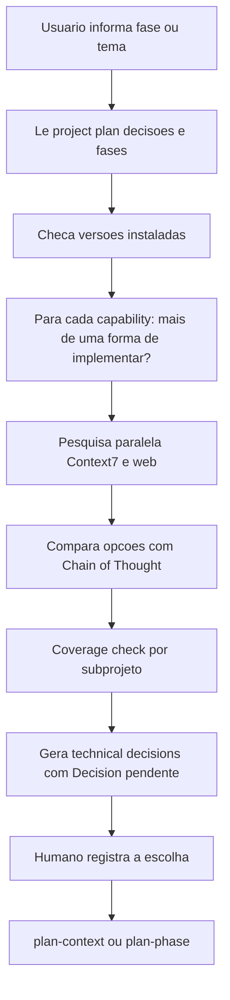

# Skill de Research e Decisões Técnicas

> [!summary] TL;DR
> - `/research` é a primeira etapa do [[Workflow RPI Research Plan Implement]]: investiga alternativas, explicita trade-offs e recomenda, gerando o documento de decisões técnicas (TDs) da fase ou do tema ad hoc.
> - Recomendação é sugestão, não decisão: o humano registra a escolha no campo `Decision`.
> - Só vale rodar com dúvida real (lib/serviço, padrões concorrentes, requisito não funcional); fase trivial gasta tempo e tokens à toa.
> - Na versão expandida as TDs ganham front matter (scope_type, related_phases, status), campo `Scope` (Backend, Frontend, Cross-layer, Repo-wide) e `Capability` ligando cada TD a um bullet do project plan.
> - `/decide` é a porta de entrada para necessidades em texto livre: triagem contra TDs existentes e roteamento para Revision, Supersede, Reaffirm ou Greenfield.

## Conceitos-chave

- **User command**: frontmatter com `disable-model-invocation: true`, só o usuário invoca; a description serve de ênfase. Ver [[Criando Skills]].
- **Modo de raciocínio**: Chain of Thought para comparar opções. Ver [[Chain of Thought e Self-Consistency]].
- **Entradas**: planejamento geral do projeto, decisões técnicas anteriores (`docs/decisions`), fases já planejadas; checa o projeto real (package.json, lockfile, versões instaladas) antes de pesquisar.
- **Pesquisa**: Context7 para documentação na versão da stack e web para informação atualizada e alternativas, em paralelo. Ver [[MCPs do Projeto Context7 e Postgres]].
- **Fonte primária**: documentação oficial e RFCs acima de blogs genéricos; em projeto legado, não pesquisar pela última versão.
- **Honestidade nos trade-offs**: não forçar recomendação; se opções equivalentes, deixar o usuário decidir.
- **Estrutura da TD**: nome, contexto, opções A/B/C (2 a 4) com como funciona, prós e contras, recomendação justificada, `Decision` pendente; sumário no fim para leitura leve (depois grep na decisão específica).
- **O que é TD (teste d+a)**: escolha estratégica que o implementador não re-deriva de best practices. Descarta quando a skill de boas práticas resolve (d) e o item não é contrato entre componentes (a). Ex. mantido: storage do token (cookie vs header). Ex. descartado: nome de script npm.
- **Scope da TD**: Backend, Frontend, Cross-layer (ex: erro produzido no back e consumido no front, decidido uma vez só) ou Repo-wide (monorepo, compose, CI, lint).
- **Capability**: liga a TD a um bullet literal do project plan; permite checar cobertura e lacunas (árvore de decisões). TD sem capability rastreável é extrapolação.
- **Front matter das TDs**: `scope_type`, `related_phases`, `status`, `date`, `scope_description`; torna o documento pesquisável por grep sem gastar janela.
- **Decisão adiada**: registrar explicitamente (ex: front-end deferred) em vez de omitir; "silêncio por omissão é falha".
- **Slug**: arquivo `docs/decisions/technical-decisions-<slug>.md`; o mesmo slug é reutilizado em contexto, validação, resolução e planejamento.
- **Decide**: triagem via subagente `decisions-correlator`, mostra top 3 candidatos + "Nenhum, criar novo TD"; Revision edita inline (bloco `Revisions`), Supersede e Greenfield abortam mandando rodar `/research`; Reaffirm não altera nada. Ver [[Subagentes e Tasks Ad Hoc]].
- **Decisão técnica retroativa**: regra que a IA decidiu no código (ex: sufixo do nickname do canal, fallback `user_` + 8 caracteres) deve virar TD, com nota de retroatividade; registrar o quê e por quê, não classe/arquivo (envelhece rápido).
- **Decisões de negócio ficam fora do research**: o foco é avaliar opções técnicas; decisões tomadas no planejamento podem ser registradas depois via `/research`.

## Fluxograma / Processo



## Erros comuns / Cuidados

- A IA mapeia bem as opções, mas experiência com a stack evita abstrações desnecessárias (ex: Passport + @nestjs/jwt recomendado pela IA foi trocado por guards customizados porque Passport seria subutilizado).
- Rodar com modelo de bom reasoning (Opus) e em plan mode amplia a exploração das opções. Ver [[Plan Mode]].
- O agente pode começar a implementar (ex: instalar Joi) quando devia só salvar a decisão: reforçar "só salve, não faça nada"; commit antes ajuda a reverter.
- Revisar não só planos mas também as decisões técnicas, que guiam a IA a não inventar.
- Ao chamar `/research` com pedido de mudança numa TD recém-criada, explicitar o motivo (ex: cópia local do OpenAPI por causa do Docker).

## Materiais complementares

### Prompts

**Research de fase pelo comando** (narrado na aula)
```text
/research fase 2 somente para o front-end
```

**Research de sistema de configuração da fase 1** (narrado na aula)
```text
/research Eu quero planejar a fase 1, mas quero adicionar um sistema de configuração para não ficar lendo as variáveis de ambiente diretamente no Nest.js. Importante também ver como organizar as variáveis de ambiente.
```

**Registrar no arquivo de decisões as decisões técnicas tomadas no planejamento** (narrado na aula)
```text
/research Quero atualizar as decisões técnicas que foram tomadas no planejamento da fase 02 do arquivo <arquivo da fase 02>
```

**Documentar decisão técnica retroativa** (narrado na aula)
```text
Como nós fizemos a implementação da fase 2, você decidiu a lógica do sufixo do canal com os caracteres permitidos a partir do prefixo do e-mail, e ainda, se do prefixo não se tirar nada, gera um aleatório. Quero documentar essa decisão técnica.
```

**Ajustar decisão recém-criada por restrição do Docker** (narrado na aula)
```text
/research Eu quero que a decisão recém criada mencione que nós vamos pegar uma cópia do OpenAPI JSON do nestjs-project. Ou seja, vamos usar o arquivo local porque estamos usando Docker. Faça as mudanças.
```

**Migrar as TDs existentes para o novo formato da skill** (sessão `_claude-sessions/12-adaptacao-docs-phases-e-td-existentes.txt`)
```text
dado o que existe no @.claude/skills/research/SKILL.md quero adaptar os TD
existentes para o formato que a SKILL gerada depois das mudanças que fizemos
nela.
analise como a SKILL gera as TD, rastreie as mudanças nos TDS existentes e
gere as alterações
```

### Conteúdo extra

**Decisões da fase 02 (auth) registradas pelo humano**:
- Hashing: bcrypt (desde 1999) vs Argon2id (vencedor da Password Hashing Competition 2015); escolhido Argon2id.
- Biblioteca: Passport + @nestjs/jwt vs custom guards + JWT; escolhida a opção B.
- Refresh token: rotação (cada refresh gera novo par; reuso de token antigo revoga todos os tokens do usuário; tabela `refresh_tokens` no Postgres); alternativas eram blacklist e versionamento por contador. Formato definido depois como JWT.
- Confirmação/reset de e-mail: token opaco no banco (não JWT, que é autocontido).
- Envio de e-mail: pacote de mailer integrado ao Nest.
- Fase 1 (config): @nestjs/config oficial, validação com Joi, variáveis agrupadas por namespace com `registerAs`.
- Fase 2 front-end: 7 decisões sem perguntas, com âncoras em TDs anteriores; BFF cookie-based (browser -> BFF Next -> Nest), Iron Session (cookie criptografado, sem session store, escala horizontalmente), refresh centralizado no BFF, React Hook Form. Research é pré-requisito do [[Inventário de Telas]].
- Migração: 14 TDs das fases 1 e 2 adaptadas para o formato com front matter.

**Diagrama da skill de research** (`docs/diagrams/skill-research.mermaid`, literal):

````text
%%{init: {'theme': 'dark'}}%%
flowchart LR
    subgraph INPUT["📥 Entrada"]
        plan["project-plan.md\n(capabilities)"]
        decisions["decisions/\n(decisões anteriores)"]
    end

    subgraph PROCESS["🔍 Pesquisa"]
        identify["Identificar<br/>decisões técnicas"]
        research["Pesquisar opções\n(Context7, Web)"]
        evaluate["Avaliar trade-offs"]
        recommend["Recomendar"]
    end

    subgraph OUTPUT["📤 Saída"]
        doc["technical-decisions-phase-NN.md<br/>(TD-01, TD-02...)"]
    end

    plan --> identify
    decisions --> identify
    identify --> research
    research --> evaluate
    evaluate --> recommend
    recommend --> doc

    classDef input fill:#42A5F5,stroke:#1E88E5,color:#FFF
    classDef process fill:#FF7043,stroke:#E64A19,color:#FFF
    classDef output fill:#66BB6A,stroke:#43A047,color:#FFF

    class plan,decisions input
    class identify,research,evaluate,recommend process
    class doc output
````

**Skill research: frontmatter, entrada, contexto, quando usar e o que é TD** (`.claude/skills/research/SKILL.md`, linhas 1-118 literais; categorias por camada nas linhas 119-198):

````markdown
---
name: research
description: "Research technical options and generate a structured decisions document. Use whenever the user needs to explore alternatives, understand trade-offs, or define technical paths - whether for a project phase or an ad-hoc topic. Trigger phrases include: 'research options for phase X', 'research how to do Y', 'technical decisions for Z', 'what are the options for...', 'explore alternatives for...', 'research the phase', 'investigate options for parallel DB testing', or any mention of exploring alternatives, trade-offs, or technical choices before planning or implementing."
disable-model-invocation: true
---

# Research

Research technical options and generate a structured decisions document for a defined scope - a project phase, an ad-hoc technical question, a bug investigation, or a refactoring exploration. This document identifies decisions that need to be made, presents alternatives with trade-offs, and recommends a path. The user reviews, decides, and the result feeds `plan-context`, or stands alone as a reference when no planning step follows.

## Related entry points

- **`/decide "<free-text>"`** - front-door for unstructured needs (when you don't know if a TD already covers the area, or if a change is a Revision vs Supersede). `/decide` triages and either applies a Revision inline OR sends you back here for greenfield research / superseding research.
- This skill (`/research`) is the right direct entry when you **know** it's a new TD: phase research kickoff, or an ad-hoc topic you've already decided to research formally.

## Input handling

The user provides the research scope in one of three ways:

1. **Phase reference:** the user names a phase (e.g., "research phase 03", "technical decisions for the upload phase"). The skill reads that phase's capabilities from `docs/project-plan.md` as the scope definition.
2. **Inline description:** the user describes the topic directly in the chat (e.g., "research how to run tests in parallel against the same database instance"). No phase is involved; the description IS the scope.
3. **External document:** the user points to a file containing the problem description, scope, and constraints (e.g., "research from docs/topics/parallel-db-testing.md").

If the user provides both a phase reference and an inline description, the phase capabilities define the scope boundary and the inline description narrows the focus. If the user provides both an inline description and an external document, the document takes precedence and the inline message adds context. If the user provides both a phase reference and an external document, the phase capabilities define the hard scope boundary (nothing outside the phase's bullets belongs in the document) and the external document supplies additional context, constraints, or detail within that boundary.

**Mode detection:** determine the mode from the user's input:
- If the input references a phase number or unambiguous phase name matching `docs/project-plan.md` → **phase mode**.
- Otherwise → **ad-hoc mode**.

The mode affects context gathering and output metadata. The **capability gate** (each TD traces to a phase bullet, via the **`Capability:` field** per TD) applies to phase mode **and** to ad-hoc mode when `related_phases` is non-empty. The research process, option analysis, and most rules apply identically in both modes. Aggregate capability coverage is not written here - it is assembled downstream by `plan-context`.

**If the input is too vague to identify technical decisions** (e.g., "research the database" - which aspect? performance? schema design? migration strategy?), ask the user to clarify before proceeding.

## Context - read before generating

1. **`docs/project-plan.md`** - general project plan.
   - **Phase mode:** read the target phase's description, capabilities, and the defined stack. The phase capabilities are the primary scope definition.
   - **Ad-hoc mode:** read only the **Stack** and **General Architecture** sections. These constrain which technologies are in play. The phase list may help identify whether the topic overlaps with a planned phase - if it does, record the overlap in the YAML frontmatter's `related_phases` field (see Output structure).
2. **`docs/decisions/`** - canonical source of prior technical decisions. These are hard constraints - do not reopen decisions already made, regardless of mode. In ad-hoc mode, read only decisions relevant to the topic area (not all files).
3. **`docs/phases/`** and **`docs/tasks/`** - already planned phases and tasks. Read for format and naming consistency reference only, not as a source of technical decisions. In ad-hoc mode, scan for overlap with the research topic - if a phase or task already covers the area, note it.
4. **User's scope description** _(ad-hoc mode only)_ - the primary input. Extract: what question needs answering, which modules/layers/areas are affected, what constraints exist.
5. **Current code** _(when the topic relates to existing code)_ - if the research concerns a bug, refactoring, or improvement to existing code, read the relevant source files to understand the current implementation. More common in ad-hoc mode.

### Scope detection

Before identifying decisions, determine what the scope spans - along two independent dimensions:

**Dimension 1 - Subprojects affected:**
- **Phase mode:** read the target phase in `docs/project-plan.md` and list every subproject directory referenced by its capabilities (e.g., the backend or frontend subproject).
- **Ad-hoc mode:** infer from the user's description which subprojects are affected. Database/persistence/server-side topics map to the backend subproject; rendering/UI/client-side topics map to the frontend subproject.

**Resolving subproject directory names** - discover them in this order:

1. `docs/project-plan.md`'s `### Subprojects` section, if present.
2. The repo root directory listing (subproject dirs are typically at the root, named after their stack/framework).
3. **If the role-to-directory mapping is still ambiguous** (e.g., multiple candidates for "backend", or unclear which dir is "frontend"), ask the user via `AskUserQuestion` before proceeding. Do not guess.

**Dimension 2 - Repository-transversal concerns:** independent of which subprojects are in play, decide whether the scope also touches monorepo tooling, Docker Compose structure, CI/CD, lint/format config, git hooks, shared TS config, or env management. If yes, the **Repo-wide / Infra & Tooling** category (see below) comes into play.

The two dimensions together drive which context sources to load and which decision categories (backend, frontend, cross-layer, repo-wide) to consider. If only one subproject is affected and no transversal concern applies, load only that subproject's sources; otherwise load all relevant sources - a single decisions document covers everything.

## When this skill is needed

Not every scope needs a formal research document. Use this checklist:

- Does the scope involve **choices of lib, framework, or service** with real alternatives? (e.g., bcrypt vs argon2, JWT vs session)
- Are there **competing implementation patterns** with relevant trade-offs? (e.g., refresh token rotation vs blacklist)
- Does the scope have **non-functional requirements** that impact technical choices? (e.g., 10GB upload → chunked vs streaming vs tus)
- Do you have a **real doubt** about which path to take?

If the answer is no to all:
- **Phase mode:** skipping is only valid when **every** capability bullet of the target phase can be mapped to either (i) a TD already decided in a prior phase and recorded in `docs/decisions/`, or (ii) a canonical stack pattern explicitly documented in `docs/decisions/` or `{subproject}/CLAUDE.md`. Before proposing the skip, produce the mapping in writing - one line per capability → source - and present it to the user. If a single capability is unmapped, proceed with research; "no real doubts" without a documented mapping is not a valid skip.
- **Ad-hoc mode:** tell the user there are no meaningful alternatives to research - the answer is straightforward and does not warrant a decisions document.

## What counts as a Technical Decision (and what doesn't)

A TD documents a **strategic choice** - one whose trade-offs and second-order effects the implementer cannot re-derive from best-practices alone at execution time. **Implementation details do NOT belong in a TD**; they are resolved by `implement` using best-practices skills (e.g., `typeorm`, `nestjs-best-practices`) and the neighboring code.

Apply this test before writing any TD:

- **(d) Best-practices resolution** - is the item's answer already documented in a best-practices skill, framework doc (fetch via `context7`), or canonical stack idiom? If yes, `implement` converges without a TD.
- **(a) Cross-component contract** (tie-breaker) - is the item cited in ≥2 files that must stay consistent (e.g., Joi schema + `compose.yaml` + `.env.example`)? If yes, strategic. If no, likely implementation.

**Drop the TD candidate when (d) holds AND (a) does not.** Examples to drop:

- Export form of a file (`export default` vs `export const`) - typeorm convention.
- Glob patterns for framework discovery (`*.entity.ts`, `*.migration.ts`) - framework docs.
- Directory names following stack conventions (`src/database/seeds/`) - stack idiom.
- npm script names (`migration:generate`, `seed`) - CLI tool convention.
- Framework module options with established defaults (`ConfigModule.isGlobal`, `TypeOrmModule.synchronize`).
- Container-level defaults (healthchecks, volume strategies, command idioms) - compose convention.

**Keep the TD when (d) fails (no skill covers it) OR (a) holds (genuinely cross-component).** Examples to keep:

- Token storage (cookie vs header) - cross-component contract backend↔frontend.
- Canonical set of environment variable keys - cross-component (schema + compose + runtime).
- Auth strategy (stateless vs stateful) - no single skill resolves.
- Upload protocol (tus vs multipart vs presigned) - cross-component + multiple viable options genuinely dominate each other.

Edge case - **skill silence**: if (d) holds in principle (the skill is in scope for the subproject) but the skill does not document the specific item, fall back to (a) alone. Cross-component → strategic, keep. Single-component → implementation-by-default; drop.

A TD that fails this test is extrapolation. Drop it - the implementer will resolve it with the skill + code context.

## How to identify technical decisions

Read each element of the defined scope - phase capabilities from `docs/project-plan.md` in phase mode, or the problem/question described by the user in ad-hoc mode - and ask: "is there more than one reasonable way to implement this with the project's stack?" If yes, it is a technical decision.

Technical decisions appear in recurring categories:

- **Strategy:** how to approach the problem (e.g., stateless vs stateful auth)
- **Lib/Service:** which tool to use (e.g., Passport.js vs manual implementation)
- **Pattern:** which pattern to follow (e.g., refresh token rotation vs blacklist)
- **Storage:** where and how to persist data (e.g., token in cookie vs localStorage)
- **Limits and policies:** values and technical business rules (e.g., token expiration, rate limit, max size)

Ignore decisions already made in project-plan.md or in previous phases. Also ignore trivial decisions that have an obvious answer in the context of the stack.

The categories above are a **thinking framework** - they help you ask "what kind of decision is this?". The lists below are **domain checklists** - they help you ask "where do decisions typically appear in this kind of work?". Use both lenses: the framework to classify, the checklists to not miss areas.
````

**Skill research: como pesquisar, coverage check e template de saída** (mesmo arquivo, linhas 199-300 literais; regras de marker `Renders in` e bloco `Revisions` nas linhas 301-360):

````markdown
## How to research options

For each identified decision:

1. **Check installed versions before evaluating options.** Identify which subproject in the monorepo is in scope (from the TD's `Scope:` field) and read its **dependency manifest** + lockfile to see the versions actually installed - the manifest pair varies by stack (e.g., `package.json` + `package-lock.json` for Node, `pyproject.toml` + `poetry.lock` for Python, `go.mod` + `go.sum` for Go, `Cargo.toml` + `Cargo.lock` for Rust, `pom.xml` for Maven, `build.gradle{.kts}` for Gradle). This constrains which documentation versions to fetch via Context7 and which alternatives are truly compatible with the existing stack. Mapping by Scope:
   - `Scope: Backend` → backend subproject's manifest.
   - `Scope: Frontend` → frontend subproject's manifest.
   - `Scope: Cross-layer` → **both** subprojects' manifests; the chosen option must be compatible with both stacks simultaneously (typical case: a validation schema shared backend ↔ frontend, possibly across different language stacks).
   - `Scope: Repo-wide` → the root-level manifest (if present) plus every affected subproject's manifest; use Context7 for tooling docs (workspace/monorepo runners, lint/format tooling, git hooks, container orchestration, etc.). Validate compatibility against every subproject currently in the repo.
2. **Research within stack context.** For each option being evaluated, use Context7 MCP to fetch documentation for the versions compatible with your project's installed dependencies. This gives accurate API details, version compatibility, and known limitations - better than relying on training data or latest versions.
3. **Search for up-to-date information on alternatives.** Use web search and Context7 to look up current documentation for competing libs, frameworks, and patterns. Versions change, libs get deprecated, new options emerge.
4. **Prioritize primary sources.** Official documentation, RFCs, lib repositories. Avoid generic blog posts as a primary source.
5. **Be honest about trade-offs.** Don't force a recommendation. If two options are equivalent in the context of your stack and constraints, say so.

## Coverage check - run before writing the document

After identifying all TDs and before emitting the document, run a **subproject coverage** check. This is a gate, not a suggestion.

For each subproject listed in Scope detection, enumerate which TDs cover it. If any subproject in scope has **zero TDs**, either:

- Add an explicit written justification in the `_Subprojects in scope:_` note right under the title (e.g., "Frontend in this phase is pure composition of UI primitives already decided in prior phases - no open technical choice"), **or**
- Go back to the identification step and re-scan the relevant capabilities focused on that subproject's checklist. Silence by omission is a failure mode - not an answer.

Only after the subproject pass is satisfied, emit the document.

**Capability coverage is NOT gated here.** The aggregate "every phase bullet → some TD" table is assembled by `plan-context` from all documents tied to the phase (this doc + any other `phase`-scope doc + any ad-hoc with the phase in `related_phases`). Gating - whether every capability actually has a covering TD - is then enforced by `plan-validate`, which emits `MD-N` issues for uncovered capabilities. A single document cannot decide capability coverage alone.

## Output structure

```markdown
---
scope_type: phase                                    # phase | ad-hoc
related_phases: [NN]                                 # array of ints; [] for None
status: pending                                      # pending | decided
date: YYYY-MM-DD
scope_description: "[One-line description of what this research covers]"
---

# Technical Decisions - [Descriptive Title]

_Subprojects in scope:_

- `<subproject-A>/` - {one-line note on this subproject's role in the document, or an explicit "no open decision" justification, e.g., "already initialized; receives config/migrations/seeds"}
- `<subproject-B>/` - {one-line note, or explicit justification such as "Frontend deferred to Fase 02+ - no TD in this document"}

(Substitute `<subproject-X>` with the actual subproject directory names - resolved per the same hierarchy used elsewhere in this skill: read project layout → cross-reference `docs/project-plan.md` § Subprojects → ask user via `AskUserQuestion` if ambiguous.)

---

## TD-01: [Decision name]

**Scope:** Backend | Frontend | Cross-layer | Repo-wide

Emit exactly **one** of the two lines below - pick based on the document's `related_phases` frontmatter:

- When `related_phases` is **non-empty** (phase mode, or ad-hoc linked to one or more phases):

  **Capability:** [literal capability bullet from project-plan.md, citing the bullet(s) from all listed `related_phases`. When a TD genuinely applies to multiple capabilities of the phase (cross-cutting conventions, repo-wide tooling that supports the whole phase), use `Transversal - covers: <list the specific capability bullets>`. `Transversal` is not a way to opt out of the capability gate: it still requires explicit mapping to the capabilities it supports.]

- When `related_phases: []` (purely global ad-hoc):

  **Trigger:** [one-sentence description of the user's question or the problem driving this TD.]

**Context:** Why this decision needs to be made. Which scope element depends on it. For `Cross-layer` decisions, briefly note why both subprojects are affected.

**Options:**

### Option A: [Name]
- How it works (2-3 sentences)
- **Pros:** concrete advantages
- **Cons:** concrete disadvantages

### Option B: [Name]
- How it works (2-3 sentences)
- **Pros:** concrete advantages
- **Cons:** concrete disadvantages

### Option C: [Name] _(if applicable)_
- How it works (2-3 sentences)
- **Pros:** concrete advantages
- **Cons:** concrete disadvantages

**Recommendation:** [Recommended option] - one-sentence justification considering the stack and project context.

**Decision:** _[pending]_

**Renders in:** ui-contracts | frontend-runtime _(optional; omit unless this TD is FE-runtime architectural-transversal)_

---

(repeat for each decision)

## Decisions Summary

| ID | Scope | Decision | Recommendation | Choice |
|----|-------|----------|---------------|--------|
| TD-01 | Backend / Frontend / Cross-layer / Repo-wide | [Name] | [Recommended option] | _[pending]_ |
| TD-02 | Backend / Frontend / Cross-layer / Repo-wide | [Name] | [Recommended option] | _[pending]_ |
```

**Constraints on the emitted output (producer rules, not literal output):**

````

**Skill research: recomendações, regras, saída e instruções de fechamento** (mesmo arquivo, linhas 361-433 literais):

````markdown
## How to write recommendations

The recommendation is a suggestion, not a decision. It must:

- Be justified by the project context, not by generic preference.
- Consider what was already decided in previous phases.
- Be explicit about what is gained and what is lost.
- Admit when there is no significant difference between options.

Back-end example:

Bad recommendations: "JWT is more modern." "Everyone uses bcrypt."
Good recommendations: "JWT + refresh in DB enables rotation (RFC 9700) without adding Redis as an auth dependency, since PostgreSQL is already in the stack."

Front-end examples, same pattern:

Bad: "React Query is more popular than SWR."
Good: "React Query aligns with Next.js 16's `revalidateTag` cache invalidation, reusing the App Router fetch cache instead of duplicating a client cache layer; SWR has no equivalent integration with Next 16's cache tags in the installed version."

Bad: "Use Zustand because it is simpler."
Good: "Zustand is sufficient because the identified client state is limited to transient UI flags (upload modal open, toast queue) - a global store is overkill; React's built-in `useState` + `useContext` covers it without adding a dependency to a Next 16 + React 19 project that already favors server state."

## Rules

- Present between 2 and 4 options per decision. Less than 2 is not a decision. More than 4 is noise.
- Do not include options that are clearly inadequate for the project's stack or scope.
- Do not make decisions for the user. Recommend, but leave the "Decision" field for them to fill.
- Do not go into implementation details. Apply the (d)+(a) test described in `## What counts as a Technical Decision (and what doesn't)`: drop any TD candidate that a best-practices skill resolves AND that is not cited cross-component. Those items are `implement`'s job, resolved at SI execution time via skills + neighboring code.
- If a decision depends on another (e.g., token storage choice depends on auth strategy), indicate the dependency.
- Keep each option concise. If the explanation of an option exceeds 5-6 lines, it's too detailed for this document.
- When the scope spans multiple subprojects (e.g., backend + frontend), a single decisions document covers all of them. Do not produce one file per subproject.
- Cross-layer decisions must be marked `Scope: Cross-layer` and decided once. Splitting one cross-layer concern into two layer-specific TDs is a validation error - it produces contradictory choices and breaks the contract-first guarantee between back and front.
- `Scope: Repo-wide` covers decisions whose effect is the repository, the dev environment, or the pipelines shared across subprojects (monorepo tooling, compose structure, CI/CD, lint/format/git hooks, shared TS config). Do not use it for runtime code concerns - those belong in `Backend`, `Frontend`, or `Cross-layer`.
- Frontmatter is the sole carrier of classification metadata. `scope_type` must be `phase` or `ad-hoc`. `related_phases` is an array of integers - use `[]` for "None". Cardinality: `scope_type: phase` requires exactly one entry in `related_phases`; `scope_type: ad-hoc` accepts zero or more. A `phase`-scoped document tied to zero or multiple phases is a convention error.
- **Multiple `scope_type: phase` docs per phase number ARE allowed (slicing model).** Each slice must have a distinct slug and exactly one integer in `related_phases`. Coverage gaps across slices are detected downstream by `plan-validate` (advisory, via `MC-cross-N`) and `plan-build` (hard gate on the last slice). To add complementary per-topic research that is NOT a slice, use `scope_type: ad-hoc` with the phase number in `related_phases`. See the **Phase slicing frontmatter** rules below for `covers_capabilities` and `depends_on_slices`.
- **Phase slicing frontmatter (optional fields on `scope_type: phase` docs):**
  - `covers_capabilities: [<bullet verbatim from project-plan.md>, ...]` - declares which phase capability bullets this slice owns. Omitted = "this slice covers all capabilities of its phase" (monolithic semantics preserved).
  - `depends_on_slices: [<sibling-slug>, ...]` - declares cross-slice DAG dependencies on sibling slice slugs of the same phase. Omitted or `[]` = no sibling dependency. Downstream maturity gate: a listed sibling must have all TDs `decided` OR a plan-build artifact present on disk before this slice can consume it as inheritance.
- Whenever `related_phases` is non-empty (phase mode or ad-hoc-linked-to-phase), every TD must carry a `Capability:` field citing the literal bullet(s) from `docs/project-plan.md` of the listed phase(s). For TDs that genuinely support multiple capabilities (cross-cutting conventions, repo-wide tooling that enables the whole phase), use `Transversal - covers: <list the specific bullets>`. `Transversal` is not an opt-out from the capability gate - the listed bullets are still required. A TD with no traceable capability is extrapolation - drop it.
- Aggregate capability coverage (every phase bullet → some TD) is **not** written in this document. `plan-context` builds it by aggregating all documents where the phase appears in `related_phases`. Individual documents only need per-TD `Capability:` fields.
- In ad-hoc mode with `related_phases: []` (purely global), TDs use `Trigger:` instead of `Capability:`. Organize the document around the user's question, not around phase capabilities.
- External references to a TD use the form `{slug}/TD-NN`, where `{slug}` is the descriptive-slug portion of the filename (after `technical-decisions-`) and `NN` is the TD's local number. Within a single document, keep the local `TD-NN` numbering - the `{slug}/` prefix is added only in references written in other documents or in pipeline artifacts.
- **Superseded TDs** are marked by `plan-resolve` with an HTML comment `<!-- status: superseded-by: {slug}/TD-NN -->` placed immediately after the TD heading. Do not write this marker manually during research - it is owned by the resolve stage and injected when a later decision replaces an earlier one. Downstream readers (the `decisions-reader` subagent used by `plan-context` and `plan-validate`) surface the marker in their output so consumers can exclude superseded TDs from active enumeration while still auditing history.
- **`**Scope:**` field is required** - downstream `/plan-build` filters Technical Specifications subsections by this field (Backend / Frontend / Cross-layer / Repo-wide). Never omit it in new TDs. `plan-validate` IC-N check also depends on this field to detect orphan Frontend TDs in backend-only phases (Check 1 / Scope-Subsection orphan in `plan-validate/SKILL.md`).
- **Shared-types TD naming convention (per Decisão #29 detection heuristic).** When creating a TD that covers FE↔BE contract sync strategy (shared types, codegen, OpenAPI, schema sharing, gRPC/protobuf, manual-transcription-accepted, etc.), include at least one keyword from the detection list in the TD heading (`## TD-NN: [Decision name]`) OR the first 500 chars of `**Recommendation:**` prose: `contract | shape | schema | sync | shared types | codegen | type generation | DTO | OpenAPI | protobuf | swagger | grpc | interface-sharing`. Keywords are case-insensitive. Without a keyword match, `plan-validate`'s MD-N shared-types sub-type will **fail to detect the TD as covering the concern** → false MD-N fires on subsequent phases → user is prompted to create another TD redundantly. This is not a semantic judgment (keywords don't mandate content) - it's a **naming convention** that keeps the pipeline's heuristic aligned with the researcher's intent. Scope of the TD should be `Cross-layer` or `Repo-wide` (the two Scopes the heuristic filters by).

## Output

Save to: `docs/decisions/technical-decisions-[descriptive-slug].md`

The slug is a short, descriptive kebab-case name derived from the research topic. No phase number or sequence counter in the filename.

**Examples:**
- Phase research: `docs/decisions/technical-decisions-auth.md`
- Phase research: `docs/decisions/technical-decisions-upload-processing.md`
- Ad-hoc research: `docs/decisions/technical-decisions-parallel-db-testing.md`
- Ad-hoc research: `docs/decisions/technical-decisions-refresh-token-rotation.md`

**Slug collision:** handling depends on whether the collision is with a sibling slice of the same phase or with any other doc:

- **Collision with a phase-scope doc of the same NN** (slicing case - the existing doc has `scope_type: phase` and `related_phases: [NN]` matching the target phase) → do NOT auto-suffix. Use `AskUserQuestion` with two options: (a) edit the existing slice (open it and add TDs there); (b) create a new slice with a distinct slug provided by the user. This preserves the slicing model's explicitness - a new slice is a conscious choice, not an accidental suffix.
- **Collision with any other doc** (ad-hoc, or phase-scope of a different NN) → keep the current auto-suffix behavior (e.g., `technical-decisions-auth-session-storage.md`). Do not overwrite existing decisions documents. This preserves UX for non-slicing users.

After the user fills in the decisions, this document serves as input for `plan-context`, or stands alone as a reference.

## Closing instructions (what to tell the user after the doc is written)

When this skill finishes generating the decisions doc, the next-step instruction emitted to the user MUST follow these rules - regardless of what other skills' templates appear in the session context:

- **Recommend `/plan-context <slug>` (NEVER `/plan-resolve`) as the first command.** The pipeline order is `plan-context → plan-validate → plan-resolve`; each stage requires the artifact produced by the previous one (`plan-resolve` aborts with "validation.md not found" if invoked directly; `plan-validate` aborts without `context.md`). Skipping ahead to `/plan-resolve` is always wrong.
- **The `<slug>` is the slug of the freshly-written doc**, not the slug of any prior/superseded doc, not a phase number, not a task slug from another scope. For phase-scope docs (`scope_type: phase`), the equivalent is the phase number `NN` shortcut. For ad-hoc docs with `related_phases: [NN, ...]`, either the doc's slug or any of the listed phase numbers works (both resolve to the same scope downstream).
- **Orphan ad-hoc docs (`related_phases: []`) ARE supported by the pipeline.** Per `plan-context/SKILL.md`'s task-mode handling of `scope_type: ad-hoc`, passing the doc's slug as the argument bootstraps `docs/tasks/task-{slug}/` automatically. The user does NOT need to manually create the task dir, and does NOT need to fall back to manual editing of `**Decision:** _[pending]_` fields. The pipeline handles orphan ad-hoc the same as any other ad-hoc doc.
- **Supersede marker injection is owned by `/plan-resolve`** (per `plan-resolve/SKILL.md` line 43, which authorizes cross-doc edits). Do NOT instruct the user to edit the superseded TD's marker manually. When the new doc's heading or Notes section explicitly cites `"supersedes <slug>/TD-NN"`, `/plan-resolve` reads that signal during its AskUserQuestion processing of the pending TD and injects the marker on the old TD automatically - even when the old doc is in a different decisions file or a different scope.
````

**Skill decide completa** (`.claude/skills/decide/SKILL.md`, literal):

````markdown
---
name: decide
description: "Front-door for free-text decision needs. Triages user input against existing technical decisions, then routes to one of three branches: Revision (parameter change in existing decided TD), Supersede (Option letter change requires new TD), or Greenfield (no relevant TD exists). Trigger phrases: 'tem decisão sobre X?', 'quero mudar Y', 'preciso decidir Z', 'já decidimos sobre...', 'mudou o caminho/parâmetro/threshold de...', any free-text input describing a need that may or may not be covered by a TD. For structured phase research, use /research <phase> directly. For pipeline-stage operations on known scopes, use /plan-context, /plan-validate, /plan-resolve, /plan-build directly."
disable-model-invocation: true
---

# Decide

Front-door skill for **free-text decision needs**. The user describes a need; this skill figures out whether it maps to a Revision (inline append on existing TD), a Supersede (new TD elsewhere), or a Greenfield decision - and applies the Revision case directly. Supersede and Greenfield abort with explicit `/research` instructions for the user to invoke.

This skill is the entry point when the input is **unstructured**: you don't know which TD exists, you don't know if it's a parameter change or a fundamental shift, you don't even know if a TD covers the area. For structured pipeline work (phase planning, plan refresh), use the direct stage commands.

## Input handling

The user provides a free-text description of the need. Examples:

- `/decide "quero mover openapi.json de docs/ para o subprojeto backend"`
- `/decide "preciso ajustar o threshold do rate limit, está apertado demais"`
- `/decide "tem decisão sobre cache de auth tokens?"`
- `/decide "vamos trocar bcrypt por argon2"`

If the input is empty, abort with: `"Pass a free-text description of your decision need: /decide \"<what you want to change or research>\"."`.

If the input is a phase reference (`phase NN`, `phase-NN-slug`, integer NN matching a phase) - meaning the user really wants structured phase research, not triagem - abort with: `"Phase research has known shape. Use /research phase-NN directly to start a structured research cycle."`.

## Procedure

### Step 1 - Triagem via `decisions-correlator`

Dispatch the existing `decisions-correlator` subagent (already used by `/plan-context`) with:

- `mode`: `task` (matches the broader-pool semantics - searches all decisions docs except the current target's own; here there is no "own" doc, so all candidates are eligible)
- `identifier`: a synthetic placeholder slug like `_decide-triage` (the agent reports this in its filter trace; it does not need a real file)
- `scope_prose`: the user's free-text input verbatim

The agent returns a ranked shortlist of `docs/decisions/technical-decisions-*.md` files semantically correlated with the input.

_Note: this is the first runtime path that uses `decisions-correlator` with a synthetic slug in `mode=task`. The agent's task-mode pool is "every doc EXCEPT the task's own"; with a non-existent slug, the exclusion is a no-op so all docs become eligible - which is the intended triage behavior. SI-3.8 (smoke test, deferred) is the canonical place to verify the agent accepts this dispatch. If the agent rejects synthetic slugs in production, surface the error to the user and we redesign the triage step rather than silently switching to a different (narrower) pool._

Capture the agent's filter trace as proof-of-iteration. Surface it inline in the response so the user sees what was considered.

### Step 2 - Disambiguação via `AskUserQuestion`

Present the **top-3** candidates from the shortlist (or fewer if the agent returned <3). Even when the top match has clear high confidence, show 3 to give the user visibility into competing candidates and a chance to redirect.

Format each candidate option with:

- `label`: the short ref `{slug}/TD-NN` plus a 1-line summary of the TD's topic.
- `description`: the TD's current state (decision letter, scope, last revision date if any).
- For low-confidence matches (correlator score below threshold - agent's own threshold is opaque; treat anything beyond rank 1 as "potentially relevant"), prepend `[low confidence] ` to the label.

Always include a 4th option: `"Nenhum - criar novo TD"`.

The `AskUserQuestion` is single-select with these 4 options (3 candidates + "Nenhum").

When the user picks a candidate, **first verify the TD's status** via bounded grep on its decisions doc (`Grep -n '^### TD-NN:' <file>` to locate the TD's range, then bounded `Read` of that range). Find the `**Decision:**` line:

- If `**Decision:**` is `_[pending]_` → abort with: `"TD-NN está pending - rode /plan-validate <scope> para surfaceear o OQ-N do TD pending, depois /plan-resolve <scope> para preencher a decisão. /decide só opera sobre TDs já decididos: pending TDs não suportam Revision (não há decisão a revisar) nem Reaffirm (não há decisão a reafirmar). Pular /plan-validate antes de /plan-resolve cai em 'validation.md is already clean - nothing to resolve' se o TD nunca foi surfaced como issue."`. Skill terminates without further questions.
- Otherwise (TD has a decided Option letter) → ask a follow-up question to classify the action:

```
"Qual ação aplicar ao {ref}?"
  [1] Revision  - parameter/prose changes; same Option letter
  [2] Supersede - Option letter changes; replace with a different option
  [3] Reaffirm  - TD already correct; just record the user's clarification (no edit)
```

When the user picks `"Nenhum"`, jump to the Greenfield branch (Step 3).

### Step 3 - Branch dispatch

Based on the answer in Step 2, route to one of:

#### Revision branch

- **Constraint:** `AskUserQuestion` is choice-based - does NOT support free-form text input.
- **Mechanism:**
  1. Generate a **draft** `**Revisions:**` block entry using:
     - `date` = today's date via `Bash 'date +%F'` (no user input).
     - `one-liner` = inferred from the user's initial `/decide "..."` input + the affected TD's topic. Concise, ≤150 chars.
     - `rationale` = inferred from contextual cues (TD's existing prose, user's input phrasing, surrounding code if obviously relevant). Brief, factual.
  2. Show the draft inline in the assistant response (not via `AskUserQuestion`) so the user sees the full proposed block.
  3. Issue a final `AskUserQuestion` with 2 options:
     - `[Aceitar e gravar]` - apply the Edit
     - `[Cancelar - vou editar manualmente]` - abort, no Edit
  4. On accept, locate the target TD in its decisions doc and Edit. Anchor priority (first present wins, since `**Libraries:**` is OPTIONAL - `plan-resolve/SKILL.md:138` only adds it when the chosen Option implies specific libraries; TDs decided via inline-create in task mode without library implications have NO Libraries line):
     - Find `**Decision:**` line within the TD's range - always present in a decided TD (this is the gate that brought us here).
     - **Anchor case 1 - Revisions block already exists.** Append a new bullet at the end of the existing `**Revisions:**` block. Locate the block via bounded grep; the block ends at the next blank line OR `---` separator OR next `**` field, whichever comes first.
     - **Anchor case 2 - no Revisions block, but Libraries line exists.** Insert a new `**Revisions:**` block after `**Libraries:**` with a blank line before the heading.
     - **Anchor case 3 - neither Revisions block nor Libraries line.** Insert a new `**Revisions:**` block immediately after `**Decision:**` with a blank line before the heading. (TD may simply not cite libraries; this is a valid state.)
  5. On cancel, terminate without edit; instruct user how to apply manually.
- **Output:** confirmation of the edit (path + line range) followed by Step 4 (impact report).

#### Supersede branch

- **Constraint:** skills do not delegate internally to other skills - abort with an explicit instruction for the user to invoke the next skill.
- **Mechanism:** terminate the skill (no edits) with a copy-paste-ready instruction:

  ```
  Próximo passo: rode /research <slug-sugerido> para criar o novo TD substituto.

  Passe ao /research o seguinte contexto via prompt:
    "Esta pesquisa supersedará <slug-antigo>/TD-NN - Option <X> (<nome>).
     Considere o trade-off da escolha anterior e a nova necessidade: <user input>."

  Após o /research completar (o novo doc fica em docs/decisions/technical-decisions-<slug-sugerido>.md
  com status: pending), rode na ordem (usando o slug do NOVO TD como argumento - não o antigo,
  não um phase number):

      /plan-context <slug-sugerido>     ← bootstrap task-mode (cria docs/tasks/task-<slug>/
                                          via mkdir -p; orphan ad-hoc com related_phases: []
                                          é aceito como task scope)
      /plan-validate <slug-sugerido>    ← surface o pending TD novo como issue
      /plan-resolve <slug-sugerido>     ← AskUserQuestion no pending TD; ao escolher a opção
                                          recomendada, plan-resolve lê o "supersedes <slug-antigo>/TD-NN"
                                          do heading + Notes do novo TD e injeta o marker
                                          <!-- status: superseded-by: <slug-novo>/TD-NN --> no TD antigo
                                          (autoridade cross-doc per plan-resolve/SKILL.md line 43).

  NÃO recomende /plan-resolve diretamente (pulando context/validate). plan-resolve aborta com
  "validation.md not found" se rodado antes de plan-validate, que por sua vez aborta sem context.md.
  ```

  - Substitute `<slug-sugerido>` with a kebab-case slug derived from the user input (e.g., `auth-refresh-grace-period`, `openapi-spec-codegen`).
  - Substitute `<slug-antigo>/TD-NN`, `<X>`, `<nome>`, and `<user input>` with the actual values.

#### Greenfield branch

- **Mechanism:** mirror Supersede branch's abort pattern - terminate with explicit instruction:

  ```
  Próximo passo: rode /research <slug-sugerido> para criar o novo TD greenfield.

  Sua necessidade: "<user input>"
  ```

  - `<slug-sugerido>` derived from the user input.

#### Reaffirm branch

- **Mechanism:** no decisions-doc edit, no other artifact touched. Skill terminates with a brief acknowledgment: `"TD-XX is already aligned with your input; no change needed."`. Reaffirm is a no-op on artifacts - its only purpose is to signal-back to the user that the triage was successful and no Revision/Supersede is warranted.

### Step 4 - Impact report (Revision branch only)

Generate a dynamic impact report listing **only** the next steps with real triggers. This runs only after a successful Revision Edit.

#### Discovery - which scopes are affected

```
Glob 'docs/{phases,tasks}/*/context.md'
```

For each match, bounded `Read` of the top frontmatter block only (`---` ... `---`). Parse the `sources_mtime` mapping. A scope is "affected" iff the path of the TD's decision doc (the one just edited) appears as a key in `sources_mtime`.

#### Sections to emit

For each affected scope, emit applicable subsections:

- **A. Plan artifacts (manual review).** If grep `<old-parameter-value>` in the scope's `task-*.md` / `phase-*.md` / `progress.md` / `validation.md` returns ≥1 hit, list the files. The user typically updates these manually (or via `/plan-context <scope>` regeneration).
- **B. Source-code consumers.** Project-wide `grep -rn <old-value>` filtered to each subproject's source root (e.g., `<subproject>/src/` for backend-flavored layouts, the subproject root itself for Next-style layouts) plus root-level config files (dependency manifests, build configs, lockfiles). List matches by file with line counts. The user edits manually (or via a focused `/implement` subtask if extensive).
- **C. Tests potentially affected.** `grep -rn <old-value> --include='*.spec.*' --include='*.test.*'`. If zero matches, note the absence; if non-zero, list and warn that test updates may be required.
- **D. Documentation.** Filtered to `*.md` outside `docs/decisions/`, `docs/phases/`, `docs/tasks/` (rules, CLAUDEs, READMEs).
- **E. Pipeline (rode na ordem, conforme aplicável):**
  - `/plan-context <scope>` - emit when context.md exists for the scope and cited the doc in `sources_mtime`. Refreshes context.md to reflect the Revision.
  - `/plan-validate <scope>` - emit as sanity check companion to plan-context.
  - `/plan-resolve <scope>` - emit only if the Revision changed the `**Libraries:**` line of the TD (compare pre/post Edit). Resolve will refresh `library-refs.md` via Context7.
  - `/plan-build <scope>` - emit only if a plan file exists in the scope dir AND grep of the affected parameter in the plan's SIs returns ≥1 match. Skill explicitly notes that `/plan-build` will operate in append-mode (per `plan-build/SKILL.md`).

The skill **only suggests**; it never invokes another skill automatically. The user copy-pastes the next command.

#### Output format example

```
✓ Revision aplicada em <slug>/TD-NN (linha NN-MM de docs/decisions/technical-decisions-<slug>.md).

Downstream - rode manualmente conforme aplicável:

A. Plan artifacts:
   - docs/tasks/task-<slug>/task-<slug>.md (3 referências stale)
   - docs/tasks/task-<slug>/context.md (1 referência)

B. Código-fonte:
   - <backend-subproject>/<dependency-manifest> (script Y)
   - <frontend-subproject>/<dependency-manifest> (script Z)

C. Tests:
   - nenhum arquivo de teste do projeto referencia o valor antigo.

D. Documentação:
   - <subproject>/<doc-file> (2 menções)
   - <repo-doc>/<file>.md (1 menção)

E. Pipeline (rode na ordem):
   1. /plan-context task-<slug>
   2. /plan-validate task-<slug>
   3. /plan-resolve task-<slug>        ← Libraries mudaram
   4. /plan-build task-<slug>          ← append-mode auto; SIs pendentes citam o parâmetro
```

Placeholders no example acima são preenchidos at runtime com valores concretos descobertos pela skill (subproject directories from `affected_subprojects:` field of plan frontmatter, file extensions from each subproject's stack, etc.). Quando a skill realmente emite o report, valores são substituídos com paths reais - placeholders são só do template.

If a section has zero items, omit it entirely (no "Nothing to do" placeholders).

## Decisões cravadas (sessão grill 2026-04-27)

Estas decisões orientaram o design do skill. Não voltam a ser pergunta:

- **Triagem zero matches** → top-3 mostrado mesmo com low-confidence; usuário pode escolher um ou criar novo.
- **Múltiplos matches** → AskUserQuestion single-select com escape "criar novo"; multi-select não suportado.
- **Migração de docs antigos** → forward-only; pre-2026-04-27 é histórico opaco.
- **Impact report seção E** é dinâmica; lista APENAS stages com gatilho real.

## Hard rules

- **Single-select only.** AskUserQuestion is choice-based; if multiple TDs are co-affected, the user invokes `/decide` once per TD. Multi-select adds complexity for <10% of cases.
- **No free-form text input via AskUserQuestion.** Drafts are inferred and shown inline; user confirms via Aceitar/Cancelar binary.
- **No skill-to-skill delegation.** Supersede and Greenfield branches abort with copy-paste instructions; the user invokes `/research` explicitly.
- **No automatic pipeline chaining.** Impact report (Step 4) lists suggestions; `/decide` never invokes `/plan-context`, `/plan-build`, etc. on the user's behalf.
- **Forward-only migration.** TDs created before 2026-04-28 (the date this skill landed) are treated as opaque history; absence of a `**Revisions:**` block does NOT mean "never changed", just "not structured before". (The Revisions/Supersede design itself was discussed on 2026-04-27 - the grill session date - but the skill became user-invocable only on 2026-04-28 when the implementation shipped.)
- **Edits restricted to decisions docs.** This skill never edits source code, tests, plan artifacts, or library-refs. Those surfaces are listed in the impact report; the user (or another skill) handles them.
- **Phase mode bypass.** If the user input is a phase reference, abort with the structured-pipeline instruction (see Input handling). `/decide` is for unstructured needs only.

## Trigger sentinel for memory recall

This skill closes the gap left by `/research` (which assumes greenfield) and the pipeline stages (which assume known scope). Before this skill existed, the user had to triage themselves by reading `docs/decisions/*.md` manually before deciding which command to invoke. `/decide` makes the triage automatic.
````

## Tags de busca

`#dev-software-ia` `#research` `#decisoes-tecnicas` `#decide` `#trade-offs`
