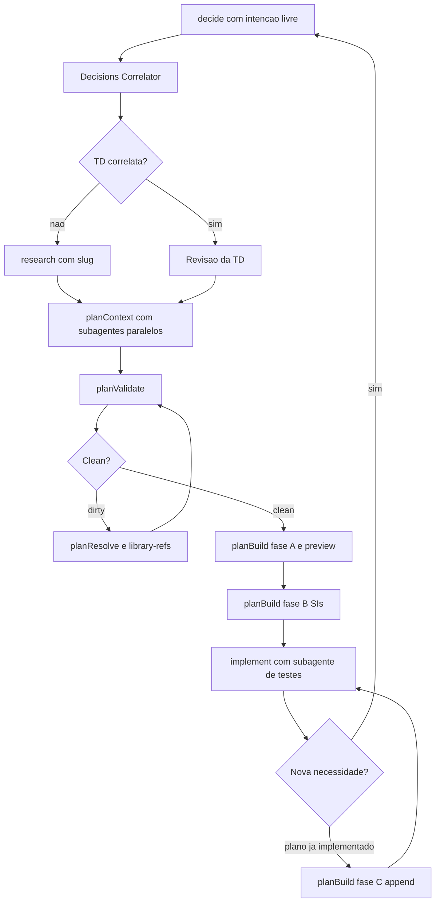

# Subagentes e Tasks Ad Hoc

> [!summary] TL;DR
> - Task ad hoc é a necessidade pontual fora de fase (ex: gerar o OpenAPI do NestJS) que percorre o mesmo pipeline em modo task: decide -> research -> planContext -> planValidate -> planResolve -> planBuild -> implement.
> - Subagentes isolam contexto: leituras pesadas e execuções auxiliares saem do agente principal e voltam como resposta compacta e estruturada.
> - Disparam subagentes: decide, planContext e planResolve; não disparam: planValidate, planBuild e planTestSpecs. No /implement os testes rodam em subagente.
> - Subagentes não herdam memória do agente principal (nem CLAUDE.md): comandos e convenções precisam estar no prompt ou em leituras orientadas.
> - Mudança de necessidade depois de implementado volta por /decide e entra no plano via planBuild em append mode (fase C), sem regenerar o que já foi feito.

## Conceitos-chave

- **Isolamento de contexto**: subagentes podem até gastar mais tokens no total, mas concentram cada responsabilidade em contexto menor (decisão de engenharia). No OpenAPI cada um usou ~10 mil tokens e a sessão principal ficou em 13%. Ver [[Context Window em LLMs]].
- **Decisions Correlator**: lê só o front matter das TDs e devolve shortlist ranqueada por similaridade; no decide decide entre reaproveitar ou abrir TD; no planContext puxa TDs correlatas para o `context.md`.
- **Plan Reader**: só em fases; extrai do project plan o escopo da fase atual e vizinhas imediatas (grep em vez de carregar o arquivo inteiro).
- **Decisions Reader**: índice tabular das decisões relevantes.
- **Decisions Detail Reader**: só `Recommendation` e `Libraries` de cada TD decidida; separado do reader para permitir paralelismo. planResolve reutiliza os dois para gerar perguntas.
- **Phases Reader**: convenções, decisões herdadas e capacidades deferidas das fases anteriores (em task mode, só a última fase completa).
- **Inventory Digest Reader**: digest do inventário de telas para a seção UI Inventory. Ver [[Inventário de Telas]].
- **Subagente de testes no /implement**: lê primeiro o CLAUDE.md do subprojeto, roda só os testes do SI e devolve diagnóstico preservado sem ruído (no OpenAPI gastou ~25 mil tokens); evita logs extensos de `npm run test` e `npm run test:e2e` na janela principal.
- **Contrato de retorno**: todo prompt de subagente termina com formato estrito ("Return ONLY a markdown table..."), forçando destilar em vez de repassar.
- **Task ad hoc**: arquivos ficam em `docs/tasks/task-<slug>/` (`context.md`, `validation.md`, `library-refs.md`, `task-<slug>.md`, `progress.md`); o slug do research é reutilizado em todas as etapas.
- **Decide como triagem**: decide qual processo de decisão iniciar, não a solução; sem TD correlata (no OpenAPI o correlator achou 2 candidatos fracos: contratos REST e configuração base) abre research Greenfield. Ver [[Skill de Research e Decisões Técnicas]].
- **planValidate dirty**: decisões não tomadas viram issues abertas (ex: estratégia de exposição do spec, disponibilidade da Swagger UI); planResolve pergunta via AskUserQuestion só o que exige escolha; revalidar depois porque a IA é não determinística.
- **library-refs**: registra lib, versão, ID do Context7, data da pesquisa, TD correlata e bootstrap; memória técnica que evita novas consultas ao Context7 no /implement. A TD diz o que foi escolhido e por quê; library-refs guarda a referência operacional.
- **planBuild fases A, B e C**: A gera technical specifications e preview para revisão (pausa); B gera os SIs finais; C (append mode) acrescenta SIs a um plano já implementado preservando histórico e progresso (ex: SI5 para enriquecer controllers, DTOs e erros, mantendo SI1 a SI4). Condição: `validation.md` clean e issuesCount 0.
- **Decisão do OpenAPI**: @nestjs/swagger (oficial, gera spec do código) vs OpenAPI manual (manutenção cara, perde fidelidade) vs terceiros; final: NestJS Swagger, exportar OpenAPI JSON, Swagger UI só em Dev e Stage. O JSON é o elo com o Next.js para gerar tipos. Ver [[Fundação de IA do Next.js]].
- **Revisar vs superseded**: para enriquecer o OpenAPI a TD-01 foi revisada (adicionando convenções: CLI do Swagger + class-validator), não substituída.

## Fluxograma / Processo



## Erros comuns / Cuidados

- "Delegar responsabilidade sem delegar instrução produz agentes isolados, mas desinformados": sem o CLAUDE.md do subprojeto o subagente roda testes no host em vez do container.
- Falso positivo de UI: o workflow pode detectar sinais de UI numa task só de back-end; não aceitar defer automático, explicitar que não há telas nem front.
- OpenAPI gerado automaticamente sai genérico (lista rotas sem parâmetros, payloads, erros e status codes): serve como inventário de rotas, não contrato; enriquecer com decorators do Swagger (respostas, 409 Conflict, ApiBearerAuth). O controller fica grande (um decorator por status: 200, 400, 401, 409).
- Mudança de necessidade: revisar a TD via /decide e depois planBuild fase C; não editar o SI direto.
- Docker Desktop precisa estar rodando para implementação e testes.
- Abrir sessão nova para o planBuild mesmo com contexto baixo (22%); planejar com o modelo mais forte e implementar com Sonnet; rodar `/simplify` ao fim de cada SI.

## Materiais complementares

### Prompts

**Triagem da task de documentação da API** (narrado na aula)
```text
/decide Eu quero implementar a Doc OpenAPI no projeto NestJS. Não quero fazer o front aqui logo de cara.
```

**Corrigir falso positivo de UI no planContext** (narrado na aula)
```text
Isto é apenas uma documentação da API que vai gerar o JSON. Não tem telas nem front-end.
```

**Reabrir a decisão para enriquecer o OpenAPI** (narrado na aula)
```text
/decide A integração do OpenAPI com o NestJS foi feita. Porém, o OpenAPI JSON gerado foi genérico. Ele não tem detalhes dos parâmetros das requests, dados retornados na response, erros, status codes e etc. Eu quero fazer essa adaptação.
```

**planBuild em append mode sobre plano já implementado** (narrado na aula)
```text
O planejamento já existe e já foi implementado. Mas tivemos uma mudança no contexto que deve gerar novos SIs no planejamento já existente. Faça isso.
```

### Conteúdo extra

- Resultado da task OpenAPI: plano com 197 linhas e 4 SIs (instalar Swagger, `swagger.config.ts`, integrar no `main.ts`, exportar JSON); 140 testes unitários/integração e 52 E2E; depois SI5 com 5 technical actions.

**Delegação a subagentes no pipeline** (`.claude/skills/plan-pipeline/SKILL.md`, linhas 194-245 literais):

````markdown
## Shared convention - Subagent delegation

Heavy reads (project-plan, globbing all decisions docs, scanning prior phases) are delegated to subagents in `.claude/agents/`:

- `decisions-reader` - globs and filters decisions docs; returns a structured TD index.
  - Phase mode: filter by `NN ∈ related_phases`.
  - Task mode: filter by filename match on the task's own decisions doc (if it exists).
- `decisions-detail-reader` - extracts `**Recommendation**` prose + `**Libraries**` for each decided TD; output is embedded in context.md's `## Decisions Detail` section. Same mode-aware filter as `decisions-reader`.
- `decisions-correlator` - (new) semantic filter across decisions docs by candidate pool.
  - Phase mode pool: `scope_type: ad-hoc` with `related_phases: []` (origin 3 - standalone and task research that would otherwise be invisible to phase mode).
  - Task mode pool: every decisions doc EXCEPT the task's own.
  Returns a ranked shortlist; the caller confirms inclusion via `AskUserQuestion`.
- `phases-reader` - reads prior phases; returns Conventions to Match AND Inherited TD Details AND **Inherited Deferred Capabilities** (extracted from each prior phase's context.md `## Non-UI / Deferred Capabilities` rows where `Status: deferred`).
  - Phase mode: all prior phases (NN-1, NN-2, …).
  - Task mode: the latest completed phase (NN where every `phase-NN-*/progress.md` reports `Status: completed`). Sliced phases count as completed only when ALL slices are done.
- `plan-reader` - extracts target phase + neighbors from project-plan.md. **Only dispatched in phase mode** (project-plan.md is phase-exclusive).
- `inventory-digest-reader` - reads the screen inventory file and returns a compact digest for embedding in context.md's `## UI Inventory` section (includes `### UI ↔ Capability Join`, `### Server-connected Components`, `### Open Questions from Inventory` verbatim).
  - Phase mode: slug-exact lookup at `docs/inventories/screen-inventory-phase-NN-{slug}.md` (no wildcard). Caller must pass `slug` alongside `NN`.
  - Task mode: reads `docs/tasks/task-{slug}/inventory.md`.
  - Dispatched **conditionally** - only when the inventory file exists. Absence is handled by the caller via fallback placeholder (not an error).
  - Task mode additionally consumes inventories from ALL UI-bearing slices of the latest completed phase (aggregated + deduped by component name) and emits `### Inherited UI Components` for cross-phase DS reuse.

Dispatch them **in parallel** via the `Agent` tool with `subagent_type: <name>`. Each subagent returns a compact structured response (table or YAML-like) - the main thread consolidates without loading the raw source files.

**Subagent default mode=phase (Decisão #25).** `phases-reader`, `decisions-reader`, `decisions-detail-reader`, `inventory-digest-reader` treat the absence of `mode` as `mode=phase`. Callers that never pass `mode` (legacy pre-rename dispatches, or any caller exercising phase behavior) continue to work unchanged. Task mode requires the caller to pass `mode=task` explicitly.

**When to use subagents vs direct reads:**

- Subagent - a file is large (>100 lines) OR multiple similar files need filtering OR the main thread only needs a distilled summary.
- Direct Read - a file is small enough to fit in a single bounded Read AND the main thread needs its structure (e.g., you are about to Edit it - Read is a prerequisite). `context.md` exception: read in full per stage despite size - single read beats scattered TD reads.

## Shared convention - Read strategy rules

Every stage skill applies these mandatory rules to keep the main context window small:

1. **Frontmatter-first filtering** - when globbing `docs/decisions/*.md` or `docs/phases/*/`, read only the frontmatter (top `---` block, typically ≤15 lines) first. Decide relevance from frontmatter fields (`scope_type`, `related_phases`, `status`) before reading any body content.

2. **Bounded grep via sibling-anchor** - to extract a section (a TD block, an SI block, a named subsection), use `Grep -n` to locate both the target header AND the next sibling header of the same level, then `Read` the exact line range. Never use `-A N` blindly - it over-fetches or under-fetches.

   Example: to read TD-05 from a decisions doc, grep `^### TD-0[56]` with `-n`; take the two line numbers; Read from the first to the second minus one.

3. **Structured return contracts for subagents** - every subagent prompt ends with a strict output contract: "Return ONLY a markdown table with columns X/Y/Z. No prose. No quotes longer than one line from source. Max N rows." Forces the subagent to distill, not relay.

4. **Build SI-by-SI no-lookback** - `plan-build` writes one SI at a time. After a SI is Edited into the phase file, it is not re-Read. To reference prior SIs (e.g., to build the Dependency Map), grep their headers only.

5. **Abort-fast in O(1) before heavy reads** - every stage's first actions are cheap checks: does the prerequisite artifact exist? Is slug discovery unambiguous? Are `sources_mtime` keys present and valid? Any failure aborts immediately, before dispatching subagents or reading decisions docs.

**Soft preferences (not hard rules):**

- **Resolve in two passes** - collect all `AskUserQuestion` answers first (computing `(file, old_string, new_string)` tuples in memory), then apply all Edits. Avoids partial-state failures.
- **Read budget per skill** - each stage SKILL.md is expected to complete its work within a small number of main-thread Reads (typically 1-3). Exceeding suggests the decomposition is leaking.

````

**Subagente plan-reader completo** (`.claude/agents/plan-reader.md`, literal):

````markdown
---
name: plan-reader
description: Reads docs/project-plan.md and extracts only the target phase's scope (name, capabilities, out-of-scope, deliverables, affected subprojects) plus one-line summaries of the immediate neighbor phases. Returns a compact structured summary so the main thread never loads the full project-plan.
tools: Read, Grep, Glob
---

# plan-reader

Read-only subagent. Given a target phase number `NN`, extracts exactly the phase scope and neighbor context needed by `plan-context`. Does not return the whole project-plan.

**Phase mode only.** `docs/project-plan.md` is phase-exclusive, so task mode never invokes `plan-reader` - `plan-context` skips it when the mode is `task`. This subagent does not accept a `mode` parameter.

## Input contract

The invoking stage provides **one argument**: the target phase number `NN`.

If the input is missing or not a positive integer, abort with: `"plan-reader requires a single integer phase number as input."`

## Procedure

1. **Locate phase headers.** Use `Grep -n '^## Fase ' docs/project-plan.md` to list every phase heading with its line number. If that pattern returns no matches, try the alternatives in order until one matches:

   - `^## Phase ` (English variant)
   - `^## Fase NN\b` with the integer `NN` literally interpolated (e.g., `^## Fase 02\b`) - catches non-standard separators between "Fase" and the number.
   - `^## Phase NN\b` with the integer `NN` literally interpolated.

   Each attempt is a separate `Grep` call. The expected output shape is:

   ```
   42:## Fase 01 - ...
   88:## Fase 02 - ...
   ...
   ```

2. **Determine the line range for phase NN.** From the list, find the heading for `NN`. Its body runs from that line to one line before the next phase heading (or EOF if last).

3. **Determine neighbor ranges.** The heading immediately before and immediately after `NN` define the prior and next phases. Record their **heading line only** - you will only read the first ~3 lines of each neighbor.

4. **Read the target phase range in full.** Bounded Read of the lines identified in step 2. This block is the primary output source - parse it for:
   - **Phase title** (from the heading).
   - **Capabilities** - typically a bulleted list under a sub-heading like "Capacidades" or "Capabilities" or inline under the heading. Extract each bullet verbatim.
   - **Out of scope** - look for a `Fora do escopo:` / `Out of scope:` line or bullet.
   - **Deliverables** - look for `Entregáveis:` / `Deliverables:` line.
   - **Affected subprojects** - look for explicit mentions of subproject paths (`nestjs-project`, `nextjs-project`, etc.) or a `Subprojetos:` / `Subprojects:` line.
   - **Sequencing / deferred pass notes** - any sentence about "primeiro", "passada subsequente", "deferido" that affects scope.

5. **Read only 3 lines of each neighbor** - from the neighbor heading line down. This captures the phase title and usually the opening sentence.

## Output contract

Return **only** the structure below. No preamble.

```
## Phase NN - {title}

**Capabilities** (literal bullets, verbatim from project-plan.md):

- <bullet 1>
- <bullet 2>
- ...

**Out of scope:** <one-line verbatim, or "_Not specified._">

**Deliverables:** <one-line verbatim, or "_Not specified._">

**Affected subprojects:**

- `nestjs-project` - <one-line verbatim from project-plan or "no specific note">
- `nextjs-project` - <one-line verbatim or "no specific note">
(only list subprojects actually mentioned or clearly in scope; do not fabricate)

**Deferred subprojects:** <comma-separated list, or "_None._">

**Sequencing notes:** <verbatim sentence(s) about ordering, deferred passes, etc. - or "_None._">

## Neighbors

- **Phase {NN-1}:** {verbatim first sentence or ≤120-char summary from that phase}
- **Phase {NN+1}:** {verbatim first sentence or ≤120-char summary, or "_No phase NN+1 defined._"}

```

_(No Stack/Architecture section is emitted - that content is not consumed downstream.)_

## Hard rules

- **Do not paraphrase capabilities.** Extract them verbatim. If the bullet is long, keep it long - capabilities are contracts.
- **Do not invent subprojects.** Only report what project-plan.md explicitly mentions for this phase.
- **Do not read the full project-plan.md.** Every Read is a bounded line range derived from the grep output.
- **Neighbors are one-liners only.** Never expand neighbor content beyond a first-sentence summary.
- If phase NN does not exist in project-plan.md, return: `"ERROR: phase NN not found in docs/project-plan.md"`. The calling stage decides how to abort.
- No prose preamble, no closing summary, no "Done.".
````

**Frontmatter dos demais subagentes** (`.claude/agents/`, literais; procedimentos e contratos de saída no restante de cada arquivo):

````markdown
---
name: decisions-correlator
description: Given a scope prose + mode, globs docs/decisions/*.md, reads only the frontmatter of each candidate, applies a per-mode candidate-pool filter, and returns a ranked shortlist of decisions docs semantically correlated with the scope. Used by plan-context in both phase mode (pool = ad-hoc docs with `related_phases: []`) and task mode (pool = all docs except the task's own) to surface potentially relevant prior decisions without loading their bodies. The main thread asks the user to confirm the final set via AskUserQuestion.
tools: Read, Grep, Glob
---

---
name: decisions-reader
description: Reads and filters technical decisions documents tied to a target phase or task. Returns a compact, structured index of all TDs (phase mode: phase-scope doc + ad-hoc docs with the phase in related_phases; task mode: the task's own ad-hoc doc if present) with their status, scope, topic, decision (if decided), and libraries (if any). Use when a stage of the plan pipeline needs the decisions landscape without loading the raw docs into the main thread.
tools: Read, Grep, Glob
---

---
name: decisions-detail-reader
description: Reads the decisions documents tied to a target phase or task and extracts, per decided TD, only the `**Recommendation:**` prose + `**Libraries:**` line. Returns a compact `## Decisions Detail for Phase NN` / `## Decisions Detail for Task {slug}` block ready for direct embedding in context.md. Use when a stage of the plan pipeline needs the per-TD prose that `/plan-build` consumes when drafting Technical actions, without loading full TD bodies into the main thread.
tools: Read, Grep, Glob
---

---
name: phases-reader
description: Reads prior-phase planning documents and extracts the Conventions to Match bullets AND the Inherited TD Details (verbatim from each prior phase's context.md `## Decisions Detail` section) AND the Inherited Deferred Capabilities (verbatim from each prior phase's context.md `## Non-UI / Deferred Capabilities` rows with `Status: deferred`) that downstream phases inherit. Returns a compact per-phase summary so the main thread does not load full phase docs (which can reach hundreds of lines each). Accepts mode=phase (all prior phases) or mode=task (only the latest completed phase); default mode=phase for backward-compat with callers that do not pass the param.
tools: Read, Grep, Glob
---

---
name: inventory-digest-reader
description: Reads the screen inventory file tied to a target phase or task and returns a compact digest for embedding in context.md's `## UI Inventory` section. Emits `### UI ↔ Capability Join` (flat table: screen | route | verb | capability | covering_component), `### Server-connected Components`, `### Open Questions from Inventory` (verbatim from the inventory's `## Open questions` section), and - in task mode - optionally `### Inherited UI Components` from the latest completed phase's inventory. Use when plan-context needs the UI join material without loading the full inventory body. Dispatched conditionally (only when the inventory file exists).
tools: Read, Grep, Glob
---
````

**Testes do SI em subagente** (`.claude/skills/implement/SKILL.md`, linhas 466-478 literais):

````markdown
### 4. Run the tests for this SI

Delegate test execution to a subagent via the `Agent` tool with `subagent_type: general-purpose`. The subagent absorbs the raw output in its own context and returns you a **diagnosis-preserving, noise-stripped** report, keeping verbose test output out of your main session.

Instruct the subagent to:
- **First, read `{target-subproject}/CLAUDE.md`** to learn the subproject's command conventions (containerization, env vars, wrappers, etc.). Subagents receive **only** their invocation prompt plus basic environment details (cwd) - they do **not** inherit Claude Code's system prompt, so neither the root `CLAUDE.md` nor the subproject `CLAUDE.md` is visible to them until explicitly read. Without this Read, the subagent will guess a plausible-looking invocation that may run in the wrong environment (e.g., on the host instead of in the container).
- Run **only** the test files listed in the SI's Tests section - never the full suite. **Modern mode extension:** when `PLAN_MODE=modern` AND Step 3a authored spec-derived files, the list sent to the subagent is the **union** of (Set A) the SI's inline Tests-section paths and (Set B) the spec-derived files saved in working memory. Each Set B path is tagged with the runner already determined at Step 3a (from the spec's `subproject:` field, per the L438 mapping) and the subagent runs it with that runner - **no extension-based inference for Set B**, which would be fragile now that frontend and backend E2E files can share the `*.e2e-spec.ts` suffix and differ only by subproject directory. For Set A inline paths the subagent selects the runner per the per-subproject testing conventions (`testing-guide-{subproject}`) - no path/folder/suffix pattern is hardcoded here. 1 spec → 1 entry in Set B (NOT 1 per scenario; the file holds N `test()` blocks). Critério de SI completo é unchanged: subagent reports "all N tests pass" para a lista combinada A ∪ B; if any file from A OR B fails, Step 5 fix loop entra. Modo legacy (`PLAN_MODE=legacy`): Set B does not exist; lista enviada ao subagent é apenas Tests-section inline (which in legacy plans may include rows E2E authored as prose by the old `/plan-build`). Behavior Step 3/4/5 stays byte-by-byte preserved.
- **Preserve all diagnostic content verbatim** - test names, failure messages, assertion diffs (actual vs expected), stack frames pointing into subproject code, console output emitted by the test, setup/teardown errors, timeouts, unhandled rejections. When in doubt, include it.
- **Strip only noise** - framework-internal stack frames (e.g., test framework or DI container paths, vendored dependency directories), startup/shutdown banners, coverage tables, and passing-test listings (report these as a single count: "N tests passed").
- **Fallback to raw output** when: (a) the raw output is already small (<2k tokens), or (b) the subagent is uncertain whether something is diagnostic or noise. Over-inclusion is always preferred to under-inclusion.
- For fully passing runs: report "all N tests pass" and nothing else.

**Rule:** if after reading the subagent's report you still cannot diagnose the failure, re-invoke the subagent with explicit instructions to return raw stdout/stderr verbatim. Losing diagnostic fidelity is never an acceptable cost-saving measure - the subagent exists to filter boilerplate, not to abstract failures.
````

**planBuild fase C, append mode** (`.claude/skills/plan-build/phase-c.md`, linhas 1-17 literais; detecção de deltas e passos C1-C7 no restante do arquivo):

````markdown
# Plan Pipeline - Stage 4: Build → Phase C (Append-mode)

This file is loaded by `.claude/skills/plan-build/SKILL.md` after Gate 10 dispatches Append-mode (Rerun semantics case 5: fully-completed artifact, no sentinelas, no `--rebuild` flag). Read SKILL.md for preflight gates, dispatcher rules, hard rules (including the **append-mode-specific Hard rules** under the same heading), output contract, and rerun semantics - they apply to every phase.

Append-mode propagates **deltas** - Revisions blocks and supersede markers added to decisions docs since the last build - into the existing plan artifact without renumbering or destroying executed SIs.

Append-mode reads `progress.md` (to classify each delta against per-SI status) and may write to it (C6 adds rows for newly-appended SIs). The schema is owned by `.claude/skills/implement/SKILL.md` § "Progress file → Format" - `/implement` is the **initial writer** (creates `progress.md` on first SI executed). `/plan-build` Phase C is a documented secondary writer, restricted to appending new-SI rows in C6. Per-SI `Status:` is `completed | pending` (the file-level `Status:` field that takes `in_progress | completed` is NOT a per-SI value). If `/implement` ever changes that schema, the parsing logic in C2 / C6 below must be updated to match.

## When append-mode runs

| Plan file | progress.md | Mode | Comportamento |
|---|---|---|---|
| existe | existe | append (auto) | Phase C - fluxo abaixo |
| existe | ausente | append (auto) | **Aborta**: `"progress.md ausente para {scope}. Plan está construído mas /implement nunca rodou (progress.md is created by /implement on first SI). Rode /implement {scope} primeiro, ou passe --rebuild para reconstruir o plan do zero."` |
| ausente | ausente | full (auto) | Phases A+B (caso 1). `progress.md` será criado por `/implement` na primeira execução do plano gerado - não por `/plan-build`. |
| ausente | existe | (degenerate) | **Aborta**: `"progress.md presente sem plan file correspondente em {scope}. Estado inesperado - verifique manualmente; mova/delete progress.md ou recupere o plan file antes de rodar."` |

````

## Tags de busca

`#dev-software-ia` `#subagentes` `#task-ad-hoc` `#openapi` `#append-mode`
