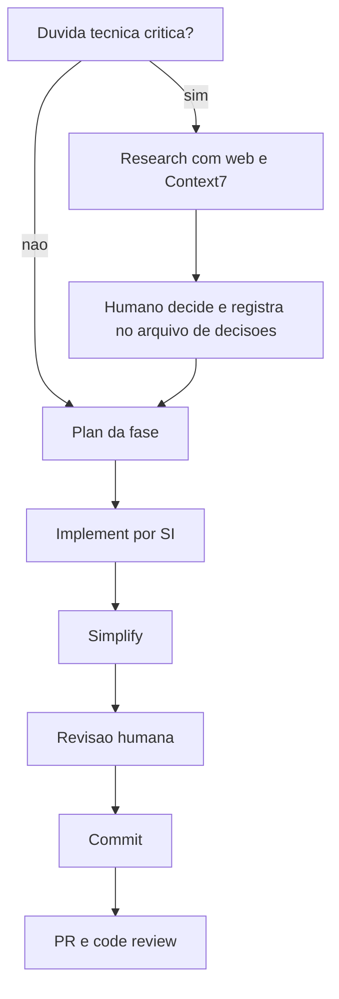
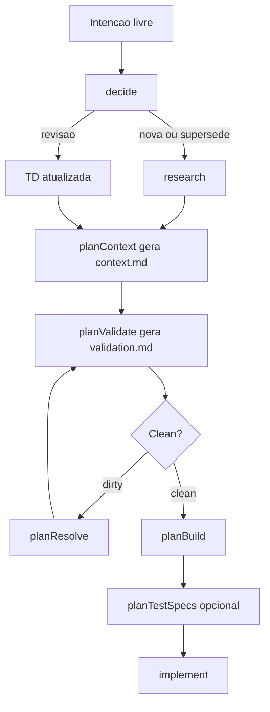

# Workflow RPI Research Plan Implement

> [!summary] TL;DR
> - RPI = Research (investigar o indefinido, opcional) -> Plan (transformar decisões em plano da fase) -> Implement (executar a partir de insumo maduro), seguido de simplificação, revisão humana e commit.
> - O esforço principal sai da implementação e vai para o planejamento: com escopo, decisões e critérios definidos, implementar vira etapa operacional ("implementação vira commodity").
> - Cada etapa é uma skill do time com estrutura fixa, porque o plan mode cru gera um formato diferente a cada execução e não captura domínio, trade-offs nem contratos.
> - Na versão expandida, o planejamento monolítico vira um pipeline de skills pequenas: decide, research, planContext, planValidate, planResolve, planBuild, planTestSpecs opcional e /implement unificado.
> - Artefatos versionados (decisões técnicas, context.md, validation.md, plano, progress.md) são a memória do projeto entre sessões e modelos.

## Conceitos-chave

- **Limitação do plan mode cru**: funciona em tarefa simples, mas trata o planejamento como etapa genérica; "mil vezes, planos totalmente diferentes"; não gera contrato da API, casos de uso nem entidades. Ver [[Plan Mode]].
- **Velocidade não é critério de qualidade**: dias de implementação manual viram ~25 min com IA; ganho de tempo só vira ganho de engenharia se o processo melhorar. A primeira versão gerada é rascunho técnico e não chega a 100% mesmo com pesquisa, plano e simplificação.
- **Zoom in**: o planejamento do projeto (`project-plan.md`) define fases em nível amplo; cada fase é refinada com mais granularidade antes de executar, separando decisões arquiteturais da decomposição de tarefas.
- **Research orientado por incerteza**: só quando há dúvida técnica crítica (arquitetura, segurança, persistência); senão vai direto ao plan. Detalhado em [[Skill de Research e Decisões Técnicas]].
- **Trade-off explícito**: o que se ganha e o que se perde (simplicidade vs segurança, menos infra vs mais controle). Ex: auth stateless simplifica (sem banco/cache); stateful exige persistência, controle de sessão e rotação. Decidir antes de quebrar a fase em tarefas.
- **Arquivo de decisões técnicas**: memória do projeto, versionado, contexto explícito para as próximas etapas.
- **Plan**: plano estruturado com etapas e questões cruciais definidas, esqueleto estável e padronizado. Ver [[Planejamento de Fases com plan-phase]].
- **Implement**: Claude Code gera a primeira versão a partir do plano; precisa de contrato de execução próprio. Ver [[Implementação de Fases com implement-phase]].
- **Pós-implementação**: simplificação por agente, revisão humana e commit; depois PR, code review, revisão assistida por IA e merge (CI/DevOps fora do escopo). Ver [[Higiene do Workflow com IA]].
- **Mesma lógica do SDD**: planejamento/especificação não é burocracia; "desacelerar antes de codificar". Ver [[Spec Driven Development]] e [[Workflow de Desenvolvimento com IA]].
- **Greenfield**: projeto sem restrições herdadas, decisões anteriores ou código estabelecido.
- **Brownfield**: evolução sobre base existente; o planejamento passa a considerar compatibilidade, continuidade e impacto. O front-end do StreamTube entra como Brownfield sobre back-end com auth, design system e Figma prontos.
- **Por que expandir o plan-phase**: uma skill concentrava contexto, validação, pesquisa, decomposição em SIs, ações técnicas e testes numa única passagem; o raciocínio intermediário ficava comprimido, só o resultado final podia ser revisado, a janela de contexto sofria com mais fases/decisões, a skill era "casada" com back-end e não aceitava tarefas fora de fase.
- **Funil de refinamento**: etapas sucessivas reduzem ambiguidade até um plano final mais assertivo; cada etapa tem responsabilidade clara e pode ser alterada sem mexer no resto.
- **Trade-off da granularidade**: menos contexto por execução e mais pontos de revisão, mas custo total agregado maior (revalidação, consolidação, mais interações); vale quando o ganho de controle compensa.
- **Tarefas esporádicas (task ad hoc)**: refatorações, ajustes pontuais e pequenas evoluções fora de fase usam o mesmo pipeline em modo task. Ver [[Subagentes e Tasks Ad Hoc]].
- **Decide**: triagem de intenção livre: criar nova Technical Decision, revisar uma existente ou marcar como superseded (evita a IA consultar documento obsoleto). Decisão nova volta para /research.
- **planContext**: gera `context.md` a partir das decisões técnicas e restrições; contexto operacional, não resumo genérico. Faz o project plan deixar de ser lido continuamente.
- **planValidate**: gera `validation.md` com veredito binário clean ou dirty; funciona como gate.
- **planResolve**: quando dirty, pergunta ao usuário, ajusta decisões, `context.md` e `validation.md`; loop validar/resolver até clean; gera `library-refs.md`.
- **planBuild**: gera o documento de implementação (SIs, technical actions, modelagem, contratos) a partir do pipeline validado.
- **planTestSpecs** (opcional): cria `.plan.md` nos subprojetos com cenários E2E próximos dos critérios de aceitação. Ver [[Testes E2E com Playwright CLI]].
- **/implement unificado**: substitui o implement-phase, opera sobre fase ou task; muda o escopo do artefato, não o mecanismo.
- **Skill de inventário de telas**: entra no pipeline para escopo com UI. Ver [[Inventário de Telas]].
- **Scope type**: cada decisão técnica declara `phase` ou `ad-hoc` e a relação com uma ou mais fases.
- **Convivência**: plan-phase e implement-phase continuam válidas ao lado das novas skills e da pasta de agents.

## Fluxograma / Processo

Workflow base (back-end):



Workflow expandido (fase ou task):



## Erros comuns / Cuidados

- Deixar a ansiedade de ver o processo em tempo real guiar a avaliação; o critério é o resultado revisado.
- Não existe "skill mágica" que resolva todo o desenvolvimento; acumular responsabilidades numa skill a torna difícil de modificar, revisar e estender.
- Cada execução do plan mode gera formato diferente: padronizar via skill do time, não delegar a estrutura do plano ao agente.
- "Nenhuma sigla (SDD, RPI...) resolve sozinha": o resultado vem de planejamento mais forma de execução.

## Materiais complementares

### Conteúdo extra

**Diagrama do workflow base do repositório** (`docs/diagrams/skills-workflow.mermaid`, literal):

````text
%%{init: {'theme': 'dark'}}%%
flowchart LR
    plan["📋<br/>project-plan.md"]

    research["🔍<br/>/research"]
    tdocs["📄<br/>technical-decisions.md"]
    user["👤<br/>User"]

    planphase["📋<br/>/plan-phase"]
    phase["📄<br/>phase-NN.md"]
    implement["⚙️<br/>Implementar"]

    plan --> research
    research --> tdocs
    tdocs --> user
    user --> planphase
    planphase --> phase
    phase --> implement

    plan -.-> planphase

    style research fill:#FF7043,stroke:#E64A19,color:#FFF,stroke-width:3px
    style planphase fill:#FF7043,stroke:#E64A19,color:#FFF,stroke-width:3px
    style implement fill:#66BB6A,stroke:#43A047,color:#FFF,stroke-width:3px
    style tdocs fill:#42A5F5,stroke:#1E88E5,color:#FFF
    style plan fill:#7C4DFF,stroke:#651FFF,color:#FFF
    style phase fill:#42A5F5,stroke:#1E88E5,color:#FFF
    style user fill:#37474F,stroke:#78909C,color:#ECEFF1
````

**Skill plan-pipeline: visão geral, modos, responsabilidades e layout** (`.claude/skills/plan-pipeline/SKILL.md`, linhas 1-93 literais; slug discovery, subagentes, read strategy, slicing e frontmatter nas linhas seguintes do mesmo arquivo):

````markdown
---
name: plan-pipeline
description: "Entry point and shared conventions for the plan pipeline (phase and task modes). Invoke directly when the user asks about planning without specifying a stage - this skill orients them to the pipeline stages (context → validate → resolve → build → specs [optional]). For actual work, use the stage skills: plan-context, plan-validate, plan-resolve, plan-build, plan-test-specs."
disable-model-invocation: true
---

# Plan Pipeline Overview

Planning is a pipeline of up to **five stages** that works for both project phases and ad-hoc tasks. Each stage is a separate skill with one responsibility and one artifact. Stages 1-4 (context → validate → resolve → build) are the canonical happy path; Stage 5 (`/plan-test-specs`) is optional and only fires when the build emitted spec placeholders. The stages share the conventions defined below - every stage skill references this document instead of repeating them.

```
/research [opcional em task mode]       → docs/decisions/technical-decisions-{slug}.md
/plan-context <NN | slug | "prose">     → docs/{phases|tasks}/{dir}/context.md
/plan-validate <NN | slug>              → docs/{phases|tasks}/{dir}/validation.md
/plan-resolve <NN | slug>               → edits decisions doc + context.md + validation.md + library-refs.md
/plan-validate <NN | slug>              → re-run until status: clean
/plan-build <NN | slug>                 → docs/{phases|tasks}/{dir}/{name}.md
/plan-test-specs <NN | slug>                 → <subproject>/specs/<scenario>.plan.md
```

When the user asks generically to "plan phase NN" or "plan this task", direct them to `/plan-context <arg>` first. Each stage aborts with an explicit next-command when a precondition is missing, so the pipeline self-guides once started.

**Alternative front-door - `/decide`.** When the user input is a free-text need rather than a structured pipeline argument (e.g., "quero mudar X", "tem decisão sobre Y?"), route them to `/decide "<need>"` instead. `/decide` triages against existing `docs/decisions/*.md`, then either applies an inline Revision OR directs the user back to `/research` (Supersede / Greenfield) or to specific pipeline stages via its impact report. The pipeline stages above are the right entry when the input is already shape-matched (phase NN, slice slug, task slug); `/decide` is the right entry when shape detection is the user's question.

**`/plan-build` append-mode.** When `/plan-build <scope>` is invoked and a plan file already exists in the scope dir, the skill defaults to **append-mode** (incremental delta processing - see `plan-build/SKILL.md` § "Phase C - Append-mode"). To force the legacy fresh-rebuild behavior, pass `--rebuild`. Append-mode requires `progress.md` to exist (created automatically on first build).

## Mode detection

Every stage skill detects the mode from the argument format. Phase slicing means ≥2 `scope_type: phase` decisions docs may exist for the same `NN`; the integer shortcut still works but now aborts when ambiguous, and **slug is the pipeline's primary key** (Decisão 2.3).

- **Integer arg `NN`** → **phase mode shortcut** - see "Slug discovery → Phase mode integer arg" below for the resolution algorithm.
- **String arg `{slug}`** → **unified slug lookup**. Resolve via `docs/decisions/technical-decisions-{slug}.md`:
  - Exists with `scope_type: phase` → **phase mode** (slice). Extract `NN` from `related_phases[0]`; target dir is `docs/phases/phase-NN-{slug}/`.
  - Exists with `scope_type: ad-hoc` AND `docs/tasks/task-{slug}/` exists → **task mode**.
  - Doc does not exist → **task mode bootstrap** (treat arg as slug if it matches `^[a-z0-9-]+$`; otherwise treat as prose and auto-derive a slug, kebab-case, max 40 chars, confirming with the user before creating `docs/tasks/task-{slug}/`).

**Canonical abort messages** (downstream skills MUST use these verbatim so the same condition produces the same message everywhere):

- **0-match (integer arg):** `"Run /research phase NN first"`
- **≥2-match (integer arg):** `"Phase NN has multiple slices: <list>. Pass an explicit slice slug."`

Phase and task modes share every artifact shape (`context.md`, `validation.md`, `library-refs.md`, `{name}.md`, `progress.md`), differing only in sources of input, one section (`## Capability Coverage` - phase-only), and a few validate checks. Only `plan-context` in task mode may bootstrap the `docs/tasks/task-{slug}/` directory; all later stages assume it already exists.

## Stage responsibilities (one-line each)

- **plan-context** - consolidates sources (project-plan, decisions docs tied to the phase, prior phases, testing guide) into a lean `context.md`. Pure consolidator; **does not detect issues**; aborts on hard violations (missing/duplicate phase-scope doc).
- **plan-validate** - reads `context.md` + the decisions doc, regenerates `validation.md` with issues by category and a `status: clean|dirty` verdict.
- **plan-resolve** - reads `validation.md`, asks the user (batched), applies decisions to the decisions doc + patches `context.md` + marks issues resolved. Writes `library-refs.md` when a new library is decided.
- **plan-build** - reads `context.md` (lean) and `library-refs.md`, emits the final `phase-NN-{slug}.md` artifact. Hard-blocks when validation.md is not `clean`.
- **plan-test-specs** - *(optional, post-build)* reads the plan artifact, derives `<subproject>/specs/<scenario>.plan.md` files for screen-wiring / controller-wiring / cross-layer SIs (in Microsoft spec-driven format). Frontend specs are consumed by `/implement` Step 3a (which loads the `playwright-cli` Skill for Playwright pattern reference, then LLM-authors the `.spec.ts`); backend specs guide LLM-authoring of E2E tests using the backend subproject's testing conventions (no external Skill load at 3a - the `testing-guide-{subproject}` Skill loaded earlier at Step 2 informs what-to-test and best practices per artifact). Skippable when the plan is legacy (no `test_specs_aware: true` frontmatter) or has no SI carrying `**Test Specs:**` field.

## Stage 5 - Test Specs (optional)

Stage 5 is **opt-in** and runs only when the plan satisfies all three triggers:

1. The plan file already exists in the scope dir (Stages 1-4 ran).
2. The plan frontmatter declares `test_specs_aware: true` (modern build - emitted by `plan-build/phase-a.md` post-migration).
3. At least one SI carries a `**Test Specs:**` field (i.e. the plan has screen-wiring / controller-wiring / cross-layer SIs that warrant external scenario authoring).

When any trigger fails the skill exits with an actionable message - see `plan-test-specs/SKILL.md` § "Preflight" for the full decision table. Backend-pure phases without server-connected UI legitimately skip this stage; legacy plans (built before this migration) skip it indefinitely without forcing migration.

`/plan-test-specs` is also the **canonical re-stamp pass** after `/plan-build` append-mode (Phase C). C5 refreshes `sources_mtime` on the plan, which makes `mtime(plan) > Last sync(spec)` for every PRESERVED scenario; running `/plan-test-specs` re-stamps `Last sync` per scenario so `/implement`'s preflight does not falsely abort STALE. See `plan-test-specs/SKILL.md` § "Lifecycle states" for details.

## Directory layout

```
docs/
├── project-plan.md                          # source for phase capabilities
├── decisions/
│   └── technical-decisions-{slug}.md        # owned by research; mutated by resolve
├── inventories/
│   ├── screen-inventory-phase-NN-{slug}.md           # owned by screen-inventory; read-only to plan-*
│   └── screen-inventory-phase-NN-{slug}.progress.md  # owned by screen-inventory
├── phases/
│   ├── phase-NN-{slug-a}/                  # slice A of phase NN (≥1 per NN; slicing model)
│   │   ├── context.md                       # owned by plan-context
│   │   ├── validation.md                    # owned by plan-validate
│   │   ├── library-refs.md                  # owned by plan-resolve (optional)
│   │   ├── progress.md                      # owned by implement (optional)
│   │   └── phase-NN-{slug-a}.md             # owned by plan-build
│   └── phase-NN-{slug-b}/                  # additional slices (optional - monolithic phases have 1)
└── tasks/
    └── task-{slug}/
        ├── context.md                       # owned by plan-context
        ├── validation.md                    # owned by plan-validate
        ├── library-refs.md                  # owned by plan-resolve (optional)
        ├── inventory.md                     # owned by screen-inventory (optional); read-only to plan-*
        ├── inventory.progress.md            # owned by screen-inventory (optional)
        ├── progress.md                      # owned by implement (optional)
        └── task-{slug}.md                   # owned by plan-build
```

Every artifact is **owned by exactly one stage**. Other stages may read or patch it (e.g., resolve patches context.md), but never recreate it from scratch.
````

**Convenções compartilhadas do pipeline: staleness, gate clean/dirty, IDs de issue e abort-with-command** (`.claude/skills/plan-pipeline/SKILL.md`, linhas 127-192 literais):

````markdown
## Shared convention - Staleness via `sources_mtime`

Every artifact (`context.md`, `validation.md`, `library-refs.md`) carries a `sources_mtime:` dict in its frontmatter listing every upstream file it was built from, with the source's mtime at build time.

**Before any stage reads a prior artifact, it checks `sources_mtime`:**

- For each key, `stat` the file and compare mtime against the recorded value.
- If **any** source has a newer mtime than recorded → abort with:
  `"{artifact} is stale relative to {source} (recorded: X, current: Y). Run /plan-context NN to regenerate context before proceeding."`

**Never auto-regenerate.** Staleness always aborts with an explicit next-command. This keeps every regeneration user-triggered and predictable - the user's original pain was silent re-reads; this rule prevents them.

Populate `sources_mtime` by running `stat -c '%y' <file>` (or `ls -l --time=full`) when building each artifact and recording ISO-8601 timestamps.

## Shared convention - `status: clean|dirty` gate

`validation.md` frontmatter carries `status: clean | dirty`:

- `clean` - every issue in `issues:` has `status: resolved`; `## Findings` sections are empty.
- `dirty` - at least one issue is open.

`plan-build` hard-blocks on `status != clean` with:
`"validation.md has N open issues. Run /plan-resolve NN, then /plan-validate NN, then retry build."`

## Shared convention - Issue IDs

`validation.md` issues use per-section stable IDs:

| Section | ID prefix | Meaning |
|---------|-----------|---------|
| Inconsistencies | `IC-N` | Contradictions between documents |
| Ambiguities | `AMB-N` | Capability or scope described too vaguely |
| Missing Decisions | `MD-N` | Decision required but no TD exists |
| Dependency Gaps | `DG-N` | Missing prerequisite from prior phase (phase mode only) |
| Inherited Constraint Conflicts | `ICC-N` | Current-phase decision conflicts with inherited TD |
| Unresolved Open Questions | `OQ-N` | Questions surfaced by research or earlier work |
| UI Coverage Gaps | `UIG-N` | Capability has TD coverage but no covering verb in screen inventory (fires only when `## UI Inventory` is populated) |
| Missing Capability (cross-slice) | `MC-cross-N` | Phase capability not covered by any slice's `covers_capabilities`. Phase mode only, fires only when ≥2 phase-scope docs per NN. Advisory in plan-validate (does not flip status to dirty); hard-error in plan-build on last slice. |
| Capability Consistency | `CC-N` | A `covers_capabilities` entry does not match any bullet in `project-plan.md` verbatim. Phase mode only (slicing). Hard-error - flips status to dirty. Surfaced early (before cross-slice advisory) to catch typos and stale bullets. |

IDs are sequential within their section, never reused. Resolved issues keep their ID and move to `## Resolved Issues` at the end of `validation.md` with `resolved_by:` pointing to the TD (or action) that closed them.

Frontmatter mirrors this:

```yaml
status: dirty
issue_count: 1          # number of issues with status: open
issues:
  - id: AMB-1
    status: open
    summary: "<≤80-char headline>"
  - id: MD-1
    status: resolved
    summary: "<≤80-char headline>"
    resolved_by: auth/TD-11
```

## Shared convention - Abort-with-command protocol

When a stage cannot proceed, it **aborts with an explicit command the user can copy-paste**. Always of the form:

```
{one-sentence explanation of what's missing/wrong}. Run {command} {args} first.
```

Never guess, never auto-recover, never partially proceed. The pipeline is deterministic and observable - every state transition is a command, every failure points to the next one.
````

- Repositório da disciplina: `devfullcycle/mba-ia-greenfield-project` (diagramas em `docs/diagrams/`, skills em `.claude/skills/`, sessões reais em `_claude-sessions/`).

## Tags de busca

`#dev-software-ia` `#workflow-rpi` `#plan-pipeline` `#greenfield-brownfield`
