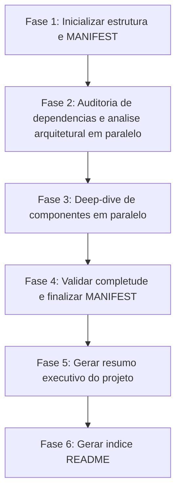

# Análise Arquitetural Automatizada

> [!summary] TL;DR
> - O plugin Project Analyzer oferece análise arquitetural, dependência e componente sem modificar código.
> - Três agentes especializados cobrem arquitetura geral, componentes individuais e saúde de dependências.
> - O relatório completo roda em fases paralelas e gera um MANIFEST como registro de execução.
> - Todos os agentes são somente leitura: não modificam, refatoram nem sugerem tempo de correção.
> - Complementa [[ADR (Architecture Decision Record)]] ao apontar decisões que merecem virar ADR.

## Conceitos-chave
- **Architectural Analyzer**: mapeia arquitetura completa do sistema, componentes críticos, acoplamento aferente/eferente, pontos de integração, riscos arquiteturais e stack tecnológica.
- **Component Deep Analyzer**: análise técnica profunda de um componente individual: regras de negócio, dependências internas/externas, endpoints, padrões de design, dívida técnica e cobertura de testes.
- **Dependency Auditor**: identifica dependências desatualizadas, depreciadas ou legadas, verifica vulnerabilidades via CVE, avalia compatibilidade de licenças e aponta pontos únicos de falha.
- **Comando `/generate-architectural-report`**: executa o workflow completo (auditoria de dependências, análise arquitetural e deep-dive de componentes) e gera um índice MANIFEST.md rastreando tudo que foi produzido.
- **Comando `/run-dependency-audit`**: roda isoladamente a auditoria de dependências, útil como checagem rápida sem o relatório completo.
- **Read-only por design**: os agentes nunca modificam ou refatoram código; entregam achados, não recomendações nem estimativas de tempo.

## Fluxograma / Processo

## Erros comuns / Cuidados
- O auditor de dependências cataloga apenas dependências diretas, ignorando transitivas.
- Análise focada em componentes arquiteturalmente significativos, não em cada arquivo do projeto.
- Sem arquivos de gerenciamento de pacotes (package.json, requirements.txt etc.), a auditoria de dependências não consegue rodar.

## Materiais complementares
### Conteúdo extra
- Repositório: https://github.com/devfullcycle/claude-mkt-place/tree/main/plugins/project-analizer
- Fluxo de integração sugerido: `/generate-architectural-report` para achar decisões relevantes, depois `/adr-map` e `/adr-identify` para documentá-las como [[ADR (Architecture Decision Record)]].

## Tags de busca
`#design-docs-ia` `#analise-arquitetural` `#auditoria-dependencias` `#claude-code-plugins`
