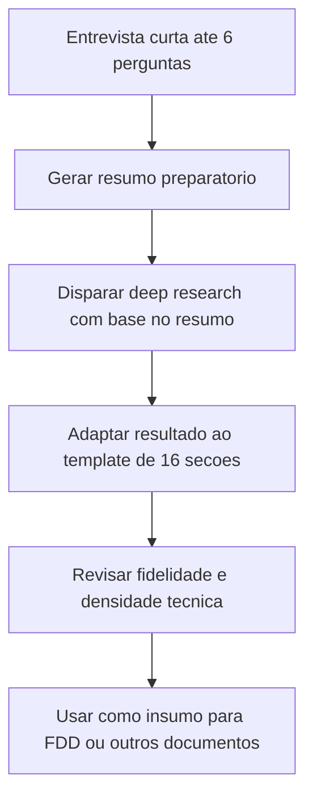

# Deep Research para Documentação Técnica

> [!summary] TL;DR
> - Deep research é um modo de trabalho em que a IA navega por fontes, cruza informações e produz um documento longo de pesquisa, em vez de responder só com conhecimento imediato do modelo.
> - O erro mais comum é pedir "faça uma pesquisa sobre X": o pedido precisa de contexto explícito sobre problema, profundidade e resultado esperado.
> - Um fluxo em duas fases (entrevista curta para briefing, depois pesquisa longa) melhora a qualidade do resultado.
> - A pesquisa bruta não é o objetivo final: ela vira insumo reutilizável para gerar [[FDD (Feature Design Doc)]] e outros documentos.
> - Modelos diferentes se comportam de forma diferente em tarefas longas; testar mais de um e comparar fidelidade é uma prática recomendada.

## Conceitos-chave
- **Deep research**: modo de navegação longa da IA que produz um documento extenso de pesquisa como insumo técnico, evitando que a especificação de uma feature seja escrita no escuro.
- **Prompt em duas etapas**: primeiro uma entrevista curta (máximo 6 perguntas) monta um resumo preparatório; depois a pesquisa longa é disparada com base nesse briefing calibrado.
- **Resumo preparatório**: consolida tema técnico, motivação, foco principal, contexto de aplicação, profundidade desejada, stack relevante, necessidade de exemplos reais e resultado esperado.
- **Por que não forçar template na primeira fase**: a IA nem sempre respeita bem um esqueleto rígido durante a pesquisa; é mais eficaz deixar o resultado sair livre e só depois adaptar a um template.
- **Template de 16 seções**: contexto e motivação, fundamentos, panorama, arquiteturas, estratégias/algoritmos, tecnologias, boas práticas, métricas, casos de uso, riscos, segurança, tendências, impacto no ecossistema, decisões técnicas candidatas (ADRs), próximos passos e referências. Funciona como documento coringa, adaptável ao tipo de projeto.
- **Reformatar sem perder conteúdo**: a adaptação de uma deep research para o template não deve resumir, e sim reorganizar; se resumir demais, o documento deixa de ser base técnica.
- **Grounding**: indicação explícita de onde a IA tirou uma informação (trechos ou referências do PDF anexado); útil para auditoria e rastreabilidade, mas pode poluir a leitura se o objetivo é um documento limpo.
- **Escopo explícito evita pesquisa desequilibrada**: um pedido genérico faz a IA aprofundar demais alguns aspectos e tratar superficialmente outros que seriam decisivos para design e implementação.
- **Deep research como insumo para o [[FDD (Feature Design Doc)]]**: o prompt de geração do FDD pode combinar HLD (decisões arquiteturais já tomadas) com o PDF de deep research (repertório técnico com alternativas e referências) e o esqueleto do FDD (estrutura mínima de saída).

## Fluxograma / Processo


## Erros comuns / Cuidados
- A IA frequentemente tenta resumir documentos longos mesmo quando o prompt pede o contrário; a revisão humana precisa verificar se exemplos, estratégias e nuances foram preservados.
- Quando a saída vem superficial, a correção não é aceitar o texto como está, mas iterar o prompt, repetir a geração ou trocar de modelo.
- Um prompt "mal feito" ainda pode produzir um draft valioso quando os insumos são fortes; a qualidade da saída depende mais da densidade do contexto fornecido do que da redação do comando.

## Materiais complementares
### Prompts
Fase 1: entrevista curta para gerar o resumo preparatório da pesquisa.

```
## Objetivo
Conduzir uma conversa curta e adaptativa (máx. 6 perguntas) para entender o tema técnico, contexto, foco e expectativas do usuário, e gerar um resumo estruturado que servirá como base para execução posterior da Deep Research.

Essa fase não gera a pesquisa técnica — apenas estrutura o briefing da pesquisa.

---
## Prompt — Entrevista de Contexto
Você é um pesquisador técnico sênior especializado em engenharia de software e arquitetura de sistemas.

Seu papel é conversar naturalmente com o usuário para entender o que ele quer pesquisar, por que isso é importante, em que contexto será aplicado, e qual nível de profundidade ele deseja.

Com base nisso, gere um resumo estruturado que servirá de instrução para a geração posterior da Deep Research.

### Diretrizes de entrevista
- Faça uma pergunta por vez.
- Use as respostas para ajustar naturalmente as perguntas seguintes.
- A cada resposta, resuma em uma ou duas frases o que entendeu e confirme antes de prosseguir.
- Evite múltipla escolha; conduza como uma conversa técnica entre engenheiros.
- No máximo 6 perguntas.
- Ao final, apresente o resumo final estruturado (briefing) e finalize dizendo:
	> "Deseja realizar a Deep Research agora? Ative essa opção na sua ferramenta de IA."

---
## Estrutura esperada do resumo final
Ao final da conversa, gere o resumo no formato abaixo (texto puro, sem blocos de código):

---
**Resumo Preparatório para Deep Research**

**Tema técnico:** [descrição do tema]
**Motivação / Problema a resolver:** [descrição breve]
**Foco principal:** [ex: performance, segurança, escalabilidade, governança, custo, etc.]
**Contexto de aplicação:** [onde e como o tema será usado — ex: microserviços, IA, backend, DevOps, etc.]
**Nível de profundidade desejado:** [conceitual / prática / equilibrada]
**Tecnologias ou stacks relevantes:** [tecnologias mencionadas, se houver]
**Desejo de incluir casos reais ou exemplos:** [sim / não]
**Resultado esperado:** [tipo de resultado que o usuário espera da pesquisa — ex: base conceitual, comparativo técnico, diretrizes de arquitetura, etc.]
---

Finalize sempre dizendo:
> "Deseja realizar a Deep Research agora? Ative essa opção na sua ferramenta de IA."

---
## Mensagem inicial
Olá.
Vamos conversar brevemente para que eu entenda o que você gostaria de pesquisar.
No final, vou gerar um resumo com tudo o que será necessário para que sua ferramenta de IA possa produzir a Deep Research completa.
Qual é o tema técnico ou tecnologia que você deseja investigar?
```

Fase 2: adaptação do resultado da deep research para o template estruturado de 16 seções, sem perder conteúdo.

```
Você é um editor técnico e arquiteto de documentação.
O conteúdo completo da pesquisa já está disponível no contexto atual (não há necessidade de o usuário colar nada).

Sua tarefa é:
1. Ler todos os conteúdos e documentos importados.
2. Reorganizar e reescrever o texto conforme o modelo oficial de Deep Research Document descrito abaixo.
3. Garantir que 100% das informações, frases, dados e explicações do texto original estejam presentes no documento final, mesmo que seja necessário expandir ou duplicar trechos.
4. Não eliminar, condensar ou omitir nada.
5. Se algum trecho não se encaixar claramente em uma seção, inclua-o na seção mais relacionada e indique entre parênteses "(conteúdo contextual adicional)".
6. O resultado deve ser entregue em Markdown puro para download ou nesse próprio chat.
7. NUNCA resuma absolutamente nada. 100% do conteúdo anexado deve constar, porém no formato do esqueleto abaixo, logo, pense passo a passo para garantir que isso seja possível. Ultrathink para fazer isso.

---
### Regras de execução
- Nenhum conteúdo pode ser perdido, resumido ou desconsiderado.
- Mantenha as 16 seções do esqueleto exatamente com os nomes fornecidos.
- Se o documento original tiver seções que não correspondem diretamente, redistribua o conteúdo dentro das mais adequadas, preservando integralmente o sentido.
- É permitido apenas melhorar clareza e coerência textual.
- Não realize "grounding" para o documento anexado, fazendo referencias a ele
- O documento final pode ser extenso: não limite o tamanho.
- Entregue apenas o Markdown final do Deep Research Document.

---
### Esqueleto oficial do Deep Research Document
# Deep Research Document
**Título:** [Tema técnico da pesquisa]
**Versão:** 1.0
**Data:** [Data atual]
**Responsável:** [Autor / IA / Time técnico]

## 1. Contexto e Motivação
Descreve o problema técnico, a oportunidade ou a motivação que originou a pesquisa, incluindo relevância e impacto.

## 2. Fundamentos e Conceitos-Chave
Apresenta princípios, teorias, modelos ou terminologias essenciais para compreender o tema.

## 3. Panorama e Abordagens Existentes
Analisa as abordagens predominantes, soluções conhecidas, padrões ou frameworks relacionados ao problema.

## 4. Arquiteturas e Modelos de Aplicação
Explica como o tema é aplicado em nível arquitetural, descrevendo topologias, camadas e fluxos de dados típicos.

## 5. Estratégias, Algoritmos e Mecanismos
Lista as principais estratégias, algoritmos e mecanismos que endereçam o problema, destacando diferenças e trade-offs.

## 6. Tecnologias, Frameworks e Ferramentas
Apresenta tecnologias, bibliotecas, protocolos ou frameworks relevantes, com comparação de maturidade e aplicabilidade.

## 7. Boas Práticas e Diretrizes Técnicas
Inclui recomendações de implementação, anti-patterns, práticas de governança e lições de engenharia.

## 8. Métricas e Critérios de Avaliação
Define como mensurar o sucesso técnico ou operacional, listando métricas e métodos de avaliação.

## 9. Casos de Uso e Aplicações Reais
Mostra exemplos de aplicação prática, estudos de caso ou referências de uso do tema no mercado.

## 10. Riscos, Desafios e Limitações
Descreve riscos, limitações técnicas, pontos de falha conhecidos e possíveis estratégias de mitigação.

## 11. Considerações de Segurança, Confiabilidade e Governança
Trata de aspectos de segurança, conformidade, privacidade, confiabilidade e versionamento.

## 12. Tendências e Evolução Futura
Apresenta tendências, inovações ou pesquisas emergentes relacionadas ao tema.

## 13. Impactos e Relações com o Ecossistema
Explica como o tema interage com outros sistemas, times, processos ou camadas de arquitetura.

## 14. Decisões e Oportunidades Técnicas (ADRs Candidatos)
Lista possíveis decisões técnicas ou arquiteturais derivadas da pesquisa, com critérios de escolha e alternativas rejeitadas.

## 15. Próximos Passos e Aplicação Prática
Propõe como aplicar os aprendizados em produtos, sistemas, pipelines ou processos futuros.

## 16. Referências e Leituras Recomendadas
Apresenta todas as fontes utilizadas: artigos, papers, RFCs, whitepapers, documentações e materiais técnicos.

---
### Instrução final
- Garanta que a integral do conteúdo da pesquisa já importada no contexto. (Pode ser um PDF, docs, md, etc).
- Não faça a separação do documento em páginas, ou seja, jamais coloque algo como: Página 1, Página 2, etc.
- Reestruture-a completamente de acordo com o Deep Research Document acima, garantindo que 100% do material original esteja presente no resultado final, ainda que o documento se torne extremamente grande. Não realize grounding, e pense passo a passo como garantir e certificar que 100% do conteúdo foi adicionado ao documento final.
- Não realize NENHUMA sumarização ou resumo de qualquer natureza. Não faça apontamentos ou grounding nesse documento para o conteúdo anexado que você está utilizando como contexto.
- Garanta que o documento seja extremamente bem formatado com seus títulos, subtítulos, entre outros, baseado no esqueleto fornecido.
- Entregue apenas o Markdown final completo, sem explicações adicionais.
- Caso os documentos anexados sejam muito grandes, você poderá optar por gerar o Deep Research Document em fases. Ex: Gerar primeiramente das seções 1 a 4, depois 5 a 9 e assim por diante. Caso queira fazer dessa forma, informe o usuário dizendo que você iniciará da Seção 1 até 3, assim que você trouxer as seções geradas, pergunte se ele deseja continuar gerando agora da seção 4 a 7, e assim por diante.
```

### Conteúdo extra
- Exemplo real de research document gerado para o tema rate limiting em Go com SDK próprio e suporte a multi-tenancy (anexo em PDF no material do curso).

## Tags de busca
`#deep-research` `#pesquisa-tecnica` `#template-16-secoes` `#fdd`
