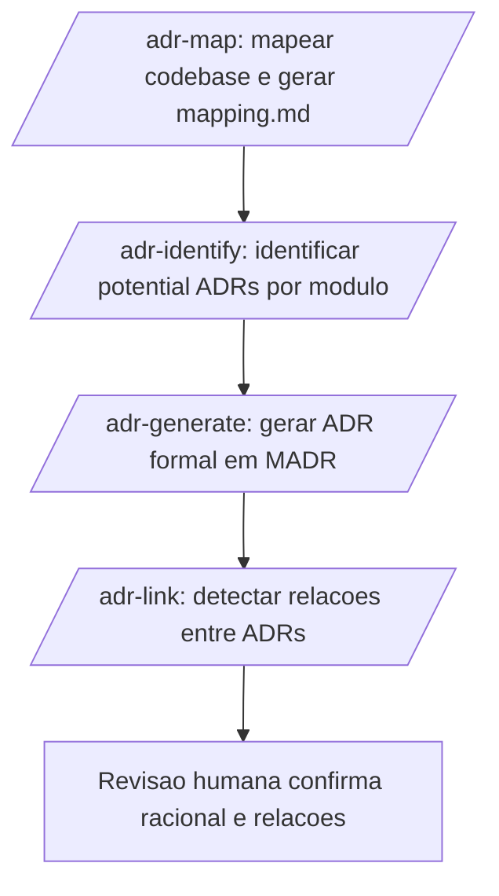

# ADR (Architecture Decision Record)

> [!summary] TL;DR
> - ADR registra uma decisão arquitetural relevante junto com o motivo de ela ter sido tomada, funcionando como memória técnica explícita.
> - MADR padroniza o ADR em Markdown com metadados (`status`, `supersedes`, `amends`, `dependsOn`) legíveis por pessoas e por máquina.
> - Regra dos 3 Es filtra candidatos: a decisão precisa ser Estrutural, Evidente e Estável para justificar um ADR.
> - Um pipeline de IA (mapear codebase, identificar candidatos, gerar ADR formal, linkar relações) reconstrói decisões mesmo em sistemas legados.
> - "Documentacite" (documentar tudo por impulso) piora a qualidade da memória arquitetural tanto para humanos quanto para IA.

## Conceitos-chave
- **ADR**: documento que registra uma decisão arquitetural já tomada, com sua justificativa e contexto; diferente da RFC (que é deliberativa e antecede a decisão), ver [[Taxonomia e Classificação de Documentos]].
- **Timeline arquitetural**: histórico de ADRs funciona como sequência de escolhas em resposta a necessidades concretas, não como fotografia estática da arquitetura.
- **Critério central de elegibilidade**: a decisão precisa ter impacto arquitetural, tender a permanecer por bastante tempo e ter um motivo que deixará de ser óbvio no futuro.
- **Template clássico (Michael Nygard)**: identificador numérico e título, contexto, decisão, alternativas e trade-offs, consequências, referências entre documentos.
- **MADR**: formato padronizado em Markdown com metadados estruturados (`status`, `date`, `tags`, `supersedes`, `amends`, `superseded by`) e seções como Context and Problem Statement, Decision Drivers, Considered Options, Decision Outcome.
- **Relações entre ADRs**: `supersedes`/`superseded by` (substituição), `amends` (ajuste parcial sem substituir), `relatesTo` (relação técnica sem dependência), `dependsOn` (a decisão só existe porque outra a sustenta).
- **Status do ciclo de vida**: Draft, Proposal, Accepted, Rejected, Withdrawn, Deprecated, Superseded; `Rejected` é negativa deliberada, `Withdrawn` é interrupção do processo sem julgamento técnico.
- **Regra dos 3 Es**: a decisão deve ser Estrutural (afeta construção/integração), Evidente (outros precisarão entender o racional no futuro) e Estável (expectativa de durar meses ou anos).
- **"Documentacite"**: impulso de documentar tudo só porque parece sempre benéfico; produz efeito oposto, reduzindo a confiança no acervo e piorando a recuperação de contexto por IA.
- **Contratos públicos como critério de elevação**: decisões de design pequenas (Strategy, Adapter) não viram ADR automaticamente, a menos que a interface passe a ser consumida por outros sistemas, APIs ou SDKs.

## Quando ADR é recomendável
- Tecnologias-base de longa duração: banco de dados principal, linguagem, framework central, mensageria.
- Padrões de comunicação: REST, gRPC, eventos, GraphQL, MCP, A2A.
- Estratégias de persistência, autenticação/autorização (JWT, OAuth2, OpenID Connect), observabilidade/telemetria, deploy e infraestrutura, resiliência (circuit breaker, retry, timeout), versionamento de API, lock-in técnico, substituição de componentes críticos.

## Quando ADR é opcional ou dispensável
- Padrão arquitetural já institucionalizado no boilerplate da empresa não justifica ADR; ruptura de paradigma (ex.: migrar de MVC para Clean Architecture com eventos) já justifica.
- Organização de pastas cabe melhor em `README` ou `CONTRIBUTING.md`, a menos que expresse uma nova separação de responsabilidades.
- ADR não é log operacional: commits, PRs, issues e changelog já cobrem alterações operacionais.
- Decisões temporárias (provas de conceito, spikes) são anti-caso clássico: registrar como ADR congela prematuramente algo que pode nem sobreviver às próximas semanas.
- Bugs, hotfixes e incidentes pertencem a changelog, issue ou postmortem; o ADR só entra se o incidente revelar necessidade de mudança arquitetural estável.

## Pipeline de mapeamento e geração com IA
- **ADR Analyzer**: mapeia o codebase em `mapping.md` (stack, módulos, padrões, dependências) e depois identifica ADRs potenciais por categorias com impacto arquitetural (infraestrutura, framework, data layer, APIs, autenticação).
- **Red flags**: modelagem de domínio, entidades de negócio, workflows operacionais e configurações triviais são desqualificados como candidatos, salvo quando representam estilo estrutural explícito.
- **Pontuação**: separa candidatos entre `must document` (evidência forte) e `consider` (zona cinzenta que exige julgamento humano).
- **Potential ADR**: artefato intermediário com evidências de código, timeline via Git e perguntas abertas, preparando o julgamento humano antes da formalização.
- **ADR Generator**: transforma o Potential ADR em documento formal no formato MADR; usa o marcador `Needs Input` quando não consegue sustentar parte do racional (ex.: restrições contratuais, decisões executivas) com evidência técnica.
- **ADR Linker**: analisa o acervo de ADRs já geradas e infere relações (`dependsOn`, `relatesTo`, `supersedes`, substituição parcial), transformando a pasta de arquivos em um grafo histórico navegável.

## Fluxograma / Processo

## Erros comuns / Cuidados
- Documentação errada pode ser pior que ausência: um agente de IA tende a usar o texto disponível como contexto válido e propagar o erro.
- Não reescrever o passado: quando surge nova escolha, cria-se um novo ADR e ajusta-se o status do anterior, em vez de editar retroativamente o documento antigo.
- ADR desatualizada precisa ser marcada como `superseded`, nunca deixada ambígua ou apagada.
- Usar `Deprecated` quando na verdade houve substituição explícita por outro ADR é um erro comum; nesse caso o status correto é `Superseded` com referência cruzada.

## Materiais complementares
### Conteúdo extra
- Plugin GitHub `adrs-management` (workflow de 4 comandos: `/adr-map`, `/adr-identify`, `/adr-generate`, `/adr-link`): https://github.com/devfullcycle/claude-mkt-place/tree/main/plugins/adrs-management
- Scoring do `/adr-identify`: 3 dimensões (escopo+impacto, custo de mudança, conhecimento do time) somando 150 pontos; limiar de 100+ pontos vira `must-document`, 75-99 vira `consider`, abaixo de 75 é descartado (apenas ~5% dos achados viram ADR).
- `/adr-generate` suporta múltiplos idiomas (en, pt-BR, es, fr, de) e usa numeração provisória `XXX` até renumeração manual.

## Tags de busca
`#adr` `#madr` `#memoria-arquitetural` `#regra-dos-3-es`
