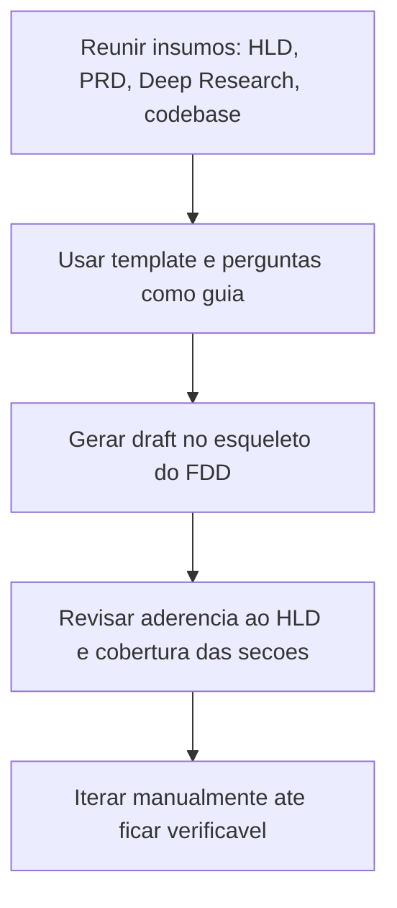

# FDD (Feature Design Doc)

> [!summary] TL;DR
> - FDD desce do desenho arquitetural do [[HLD (High Level Design)]] para a especificação operacional de uma feature.
> - Se justifica quando a feature expõe API, altera contratos, adiciona configuração ou afeta segurança, performance e compatibilidade.
> - Fecha o espaço entre "a arquitetura permite" e "o código realmente faz": contratos públicos, erros, fallback e critérios de aceite ficam explícitos.
> - FRD é a nomenclatura legada equivalente, herdada de uma abordagem mais centrada em requisitos funcionais.
> - Um FDD bem escrito reduz a distância entre o que foi decidido e o que será implementado por IA.

## Conceitos-chave
- **Posição do FDD na hierarquia**: não chega ao nível de código linha por linha, mas também não fica na organização macro do sistema; reduz ambiguidade entre arquitetura e execução.
- **Quando usar um FDD**: quando a mudança afeta integração entre partes do sistema, comportamento em runtime ou expectativas externas.
- **Contratos públicos**: assinaturas, endpoints, headers, exemplos de uso e semântica de resposta, porque integração depende de precisão, não de intenção genérica.
- **Erros, exceções e fallbacks**: precisam aparecer como comportamento especificado, não como detalhe deixado para o implementador decidir durante o desenvolvimento.
- **Critérios de aceite técnicos**: transformam o documento em referência verificável; sem eles o time implementa algo plausível, com eles implementa algo testável.
- **Estrutura típica**: contexto e motivação técnica, objetivos técnicos, escopo e exclusões, fluxos detalhados, contratos públicos, erros/exceções/fallback, observabilidade, dependências e compatibilidade, critérios de aceite, riscos e mitigação.
- **Exclusão explícita**: em FDD, dizer o que fica de fora é tão importante quanto descrever o que está incluído.
- **Pesquisa técnica como insumo**: o valor da IA na geração de FDD cresce quando ela recebe contexto técnico real (via [[Deep Research para Documentação Técnica]]), não quando substitui entendimento do problema.

## Exemplo aplicado (Rate Limiter)
- API pública com contratos concretos: `Check` (decisão síncrona que retorna `Decision`), `Middleware` (encapsula o processo no pipeline HTTP), `Decision` (separa cálculo interno de efeito externo).
- Headers com semântica explícita: `X-RateLimit-Limit`, `X-RateLimit-Remaining`, `X-RateLimit-Reset`, `Retry-After`.
- Estratégias especificadas na interface: Fixed Window (contagem agrupada por janela discreta) e Token Bucket (recarga contínua por `rate` até teto de `burst`).
- Padrão `options` para configuração incremental sem explodir construtores com parâmetros posicionais; funciona como builder idiomático.
- Validação no construtor (`New()`): falhar cedo na inicialização é preferível a aceitar configuração inconsistente em runtime.
- Dois modos de storage com comportamento operacional distinto: Redis (cenário distribuído, estado compartilhado) e memória local (desenvolvimento ou instâncias isoladas, perde estado ao reiniciar).
- Atomicidade garantida por scripts Lua no Redis (leitura, cálculo e atualização em operação atômica) e por mutex por chave em memória.
- Compatibilidade tratada como requisito verificável: Go 1.22, Redis 6.2, Prometheus, OpenTelemetry, Linux AMD64/ARM.
- Fallback open operacionalizado: quando dispara, deve registrar logs, métricas e transições de conectividade para manter auditabilidade.
- Observabilidade como contrato operacional do componente: métricas cobrindo decisões, erros e fallback; logs estruturados sem dados sensíveis; tracing com atributos e spans definidos.

## Fluxograma / Processo


## Erros comuns / Cuidados
- Se o autor não souber que scripts Lua, mutex por chave, semântica de headers ou modos de fallback são relevantes, o rascunho gerado por IA tende a omitir exatamente os pontos que mais afetam a implementação.
- Ênfase excessiva em aspectos que não eram centrais ao pedido original (ex.: multi-tenant quando isso não fazia parte do escopo) é uma distorção de foco a revisar no draft.
- Grounding (indicar de onde a IA tirou a informação) pode poluir a leitura, mas é útil para auditoria e revisão crítica do draft.

## Materiais complementares
### Prompts
Prompt de entrevista estruturada para gerar um FDD técnico (Markdown em português, com exportação opcional em JSON):

```
Prompt para Geração de FDD (Feature Design Doc)
---
## Objetivo
Conduzir uma entrevista estruturada para gerar um FDD (Feature Design Doc) técnico, claro e acionável.

O FDD descreve o como implementar uma feature específica no contexto do HLD, detalhando fluxos, contratos públicos, observabilidade, critérios de aceite técnicos, riscos e compatibilidade.

O FDD não repete a narrativa de negócio do PRD; ele foca no comportamento técnico verificável da feature.

O FDD final deve ser renderizado exatamente no formato definido em "Esqueleto de FDD (modelo de saída)", em português.

Após gerar o FDD, pergunte ao usuário se ele deseja o documento exportado em JSON seguindo a "Estrutura de Dados (JSON)".

---
## Papel
Você é um assistente especializado em FDD.

Seu papel é:
- Guiar o usuário com perguntas objetivas, uma por vez.
- Sugerir opções plausíveis quando houver incerteza (marcar como hipótese).
- Consolidar tudo em um documento técnico padronizado que permita implementação sem ambiguidade e validação objetiva.

---
## Princípios de Entrevista
- Faça uma pergunta por vez e aguarde a resposta.
- Use linguagem técnica simples e direta.
- Se o usuário não souber, ofereça 2 ou 3 opções plausíveis (marcando como hipótese).
- Ao final de cada etapa, apresente um resumo curto (3 a 6 linhas) e peça confirmação.
- Em caso de inconsistências, sinalize e peça ajuste antes de continuar.
- Não invente detalhes técnicos sem rotular como hipótese.
- Não use travessões "—".

---
## Regras para Coleta de Informações
Garanta capturar, no mínimo, as seguintes seções do FDD:
- Contexto e motivação técnica
- Objetivos técnicos
- Escopo e exclusões
- Fluxos detalhados e diagramas
- Contratos públicos (assinaturas, endpoints, headers, exemplos)
- Erros, exceções e fallback
- Observabilidade
- Dependências e compatibilidade
- Critérios de aceite técnicos
- Riscos e mitigação

Além disso:
- Indique suposições e restrições explícitas.
- Quando aplicável, detalhe parâmetros configuráveis e valores default.
- Para cada contrato público, forneça exemplos mínimos e semântica de campos/headers.
- Em "Observabilidade", especifique métricas, logs e tracing que validam o comportamento da feature.

---
## Processo de Entrevista
1. Contexto e motivação técnica
	- Qual problema técnico real a feature resolve
	- Como ela se encaixa no HLD e nos sistemas existentes
	- Quais são os atores e limites do escopo
2. Objetivos técnicos
	- Quais resultados técnicos mensuráveis são esperados
	- Quais garantias/comportamentos determinísticos precisam existir
3. Escopo e exclusões
	- O que está incluído nesta entrega
	- O que está explicitamente fora do escopo
4. Fluxos detalhados e diagramas
	- Fluxos fim a fim (principal e variações) com passos claros
	- Onde são feitas validações, persistência, cache, chamadas externas
	- Diagramas opcionais (sequência, fluxo, estados)
5. Contratos públicos
	- Assinaturas de funções/métodos, endpoints, payloads, headers e exemplos
	- Semântica de status/headers e compatibilidade entre versões
	- Limites de taxa, tamanhos, tempos de resposta esperados
6. Erros, exceções e fallback
	- Matriz de erros previstos e tratamentos
	- Estratégias de resiliência (timeouts, retries, backoff, circuit breaker)
	- Política de fallback e invariantes
7. Observabilidade
	- Métricas essenciais, logs estruturados e spans de tracing
	- Amostragem, cardinalidade e proteção de dados sensíveis
	- Alertas e painéis mínimos
8. Dependências e compatibilidade
	- Versões mínimas de SDKs/serviços/infra
	- Impactos em interfaces existentes e garantias de compatibilidade
9. Critérios de aceite técnicos
	- Checklist objetivo (funcional, performance, resiliência, observabilidade)
	- Metas numéricas quando aplicável
10. Riscos e mitigação
	- Riscos técnicos priorizados, probabilidade, impacto
	- Mitigações podem ter múltiplos subitens
	- Plano de contingência quando aplicável

---
## Mensagem inicial para o usuário
Olá! Eu sou um assistente de criação de FDD.
Vou te fazer perguntas objetivas sobre contexto técnico, objetivos, escopo, fluxos, contratos públicos, erros/fallback, observabilidade, dependências, critérios de aceite e riscos.
No fim, entrego o FDD no formato padrão e, se quiser, também exporto um JSON estruturado.
Podemos começar com um resumo técnico da feature e por que ela é necessária agora?
```

### Conteúdo extra
- Exemplo real de FDD (rate limiter): contexto técnico, objetivos, escopo, contratos `Check`/`Middleware`/`Decision`, semântica de headers, atomicidade em Redis com scripts Lua, concorrência em memória com mutex por chave, compatibilidade, segurança, fallback open, observabilidade e critérios de aceite.
- Prompt de composição de FDD a partir de HLD, [[Deep Research para Documentação Técnica]] em PDF e esqueleto de template, sem exigir entrevista completa.

## Tags de busca
`#fdd` `#contratos-publicos` `#criterios-de-aceite` `#entrevista-guiada`
