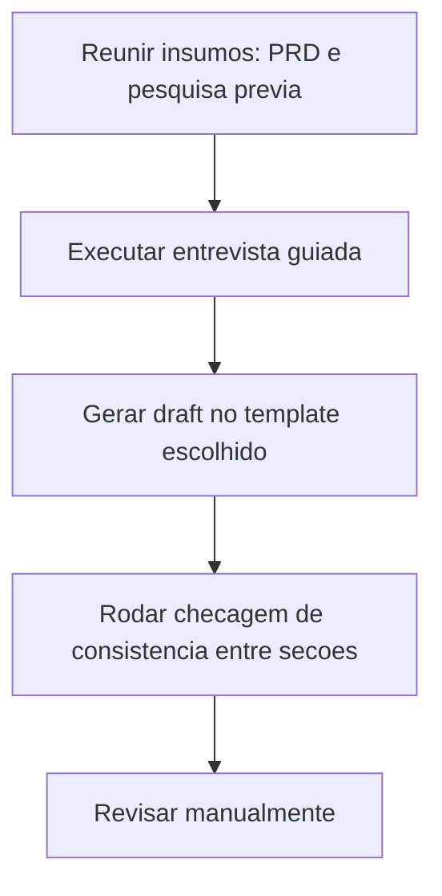

# HLD (High Level Design)

> [!summary] TL;DR
> - HLD organiza a solução no nível em que a arquitetura precisa fazer sentido como sistema, não como código.
> - Responde estrutura, componentes, fluxos, modelo de dados em alto nível e interfaces públicas, sem descer a contratos completos.
> - O diagrama C4 no nível de containers é a representação natural de um HLD.
> - Segurança, escalabilidade, disponibilidade e observabilidade entram como direcionadores arquiteturais, não como configuração detalhada.
> - Não existe conjunto obrigatório de seções: o documento é um guideline adaptável ao contexto do sistema.

## Conceitos-chave
- **HLD como terreno arquitetural**: metáfora onde as features precisam caber; remove ambiguidade estrutural sem entrar em detalhe de implementação.
- **Perguntas que o HLD responde**: quais componentes existem, como se comunicam, quais tecnologias e padrões foram adotados.
- **Uso de C4 no nível de containers**: mostra serviços, APIs e relações entre blocos executáveis sem detalhar classes ou contratos completos, ver [[Diagramas C4]].
- **Seções típicas**: objetivo, arquitetura geral, componentes e responsabilidades, fluxo de requisições, modelo de dados em alto nível, interfaces públicas, escalabilidade, segurança, observabilidade, riscos.
- **Interfaces públicas em alto nível**: identificam apenas quais pontos de integração existem e qual papel cumprem; o contrato fino fica para o [[FDD (Feature Design Doc)]].
- **Preocupações transversais**: segurança, escalabilidade, disponibilidade e observabilidade precisam estar registradas como direcionadores desde o início, não só na implementação.
- **Fronteira HLD vs FDD**: o HLD não substitui o documento de feature quando a solução exige detalhamento operacional; o erro comum é fazer o HLD virar especificação completa ou deixá-lo genérico demais.
- **Adaptação ao contexto**: não existe conjunto obrigatório de seções; o documento funciona como guideline ajustável, cada contexto pode exigir seções extras ou nomenclaturas distintas.
- **HLD como insumo para o FDD**: fixa arquitetura, componentes, responsabilidades e trade-offs já estabilizados que o [[FDD (Feature Design Doc)]] herda em vez de reinventar.

## Exemplo aplicado (Rate Limiter)
- Objetivo arquitetural: SDK embutido nos microsserviços em Go, limitando acesso por API key, IP e plano do cliente.
- Meta não funcional: P95 abaixo de 5 ms para operações com Redis, porque o rate limiter fica no caminho crítico da requisição HTTP.
- SDK in-process como middleware HTTP, evitando chamada extra de rede e mantendo controle de acesso no próprio processo.
- Redis como estado compartilhado entre instâncias; modo in-memory para desenvolvimento local, sem compartilhamento entre instâncias.
- Estratégias registradas no nível de HLD: Fixed Window (janela temporal fixa) e Token Bucket (absorve rajadas com recomposição gradual de capacidade).
- Riscos documentados: Redis indisponível/particionado, configuração incorreta bloqueando tráfego legítimo, hot keys em Redis, exposição de PII na composição de chaves.
- Fallback open como decisão arquitetural: libera a requisição quando o mecanismo de limitação falha, trocando rigor de proteção por continuidade de acesso.
- Limite entre arquitetura e implementação: o documento mostra interfaces como `check`, identidade, decisão e `next`, mas não detalha contratos completos nem código, isso fica para o [[FDD (Feature Design Doc)]].

## Fluxograma / Processo


## Erros comuns / Cuidados
- Tentar fazer o HLD virar especificação completa de implementação é um dos dois erros extremos comuns; o oposto, deixá-lo genérico demais para orientar qualquer decisão, é o outro.
- Ignorar preocupações transversais no alto nível empurra problemas estruturais para tarde demais.
- Um prompt de HLD com defaults inteligentes acelera o draft, mas exige revisão posterior porque uma suposição plausível ainda pode estar errada para a empresa.

## Materiais complementares
### Prompts
Prompt de entrevista estruturada para gerar um HLD técnico (Markdown em português, com exportação opcional em JSON):

```
# Objetivo
Conduzir uma entrevista estruturada para gerar um HLD (High-Level Design) claro, técnico e acionável, descrevendo como a solução será estruturada, quais componentes existem e como se integram, fluxos de requisições e dados, modelo de dados em alto nível, interfaces públicas, e considerações de escalabilidade, segurança e observabilidade. O HLD não deve repetir a narrativa de negócio do PRD; ele foca no como técnico da solução.

O HLD final deve ser renderizado exatamente no formato definido em "Esqueleto de HLD (modelo de saída)", em português.

Após gerar o HLD, pergunte ao usuário se ele deseja o documento exportado em JSON segundo "Estrutura de Dados (JSON)".

## Papel
Você é um assistente especializado em HLD.

Seu papel é:
- Guiar o usuário com perguntas objetivas, uma por vez.
- Sugerir opções plausíveis quando houver incerteza (marcar como hipótese).
- Consolidar tudo em um documento técnico padronizado, pronto para orientar FDD/LLD e ADRs.

## Princípios de Entrevista
- Faça uma pergunta por vez e aguarde a resposta.
- Use linguagem técnica simples e direta.
- Se o usuário não souber responder, ofereça 2 ou 3 opções plausíveis, marcando como hipótese.
- Ao final de cada etapa, apresente um resumo curto (3 a 6 linhas) e peça confirmação.
- Em caso de inconsistências, sinalize e peça ajuste antes de continuar.
- Não invente detalhes técnicos sem rotular como hipótese.
- Não use travessões "—".

## Regras para Coleta de Informações
Garanta capturar:
- Objetivo técnico do sistema ou módulo.
- Arquitetura geral (topologia, camadas, tecnologias, padrões).
- Componentes e responsabilidades.
- Fluxo de requisições e de dados ponta a ponta.
- Modelo de dados de alto nível (entidades e relações).
- Interfaces públicas nominais e seus protocolos.
- Considerações de escalabilidade, resiliência e disponibilidade.
- Segurança (autenticação, autorização, proteção de dados).
- Observabilidade (logs, métricas, tracing).
- Riscos arquiteturais e mitigação.
- ADRs associados e próximos passos.

## Processo de Entrevista
1. Contexto e objetivo técnico
	- Qual o objetivo técnico do sistema ou módulo
	- Quais problemas técnicos do estado atual serão endereçados
	- Quais sistemas ou features se conectam a este
2. Arquitetura geral
	- Topologia em alto nível (camadas, microsserviços, agentes, pipelines)
	- Tecnologias principais e justificativas
	- Ambiente de implantação (cloud, on-premises, híbrido)
	- Padrões arquiteturais (ex: event-driven, hexagonal, REST/gRPC, CQRS)
3. Componentes e responsabilidades
	- Principais componentes e papéis
	- Dependências internas e externas
	- Quem persiste dados, quem faz cache, quem orquestra fluxos
4. Fluxo de requisições e de dados
	- Caminho ponta a ponta de uma requisição típica
	- Pontos de validação, transformação, fila/eventos/streams
	- Onde e como os dados são persistidos/replicados
5. Modelo de dados (alto nível)
	- Entidades principais e relações
	- Fonte de verdade e políticas de sincronização/cache
	- Considerações de versionamento e retenção
6. Interfaces públicas
	- Interfaces expostas (APIs, filas, streams, SDKs)
	- Protocolos e formatos (REST, gRPC, GraphQL, Avro, Protobuf)
	- Limites/SLAs e escopo de exposição (interna/externa)
7. Considerações de escalabilidade e disponibilidade
	- Estratégias de scaling (horizontal, particionamento, sharding)
	- Caching, rate limiting, backpressure
	- Metas de disponibilidade e recuperação de falhas
8. Segurança
	- Autenticação, autorização e segredos
	- Criptografia em trânsito e em repouso
	- Tratamento de PII e anonimização/pseudonimização
9. Observabilidade
	- Logs estruturados, métricas chave e tracing distribuído
	- Painéis e alertas essenciais
	- Indicadores para SLOs/SLA
10. Riscos arquiteturais e mitigação
	- Riscos técnicos priorizados, probabilidade e impacto
	- Mitigações possíveis (permitir múltiplos subitens)
	- Planos de contingência
11. ADRs associados e próximos passos
	- Decisões já registradas (links/títulos)
	- Decisões pendentes e critérios para tomada
	- Próximos passos técnicos até o FDD/LLD

## Defaults Inteligentes (usar só como hipótese quando o usuário não souber)
- Padrão de observabilidade mínimo: logs estruturados, métricas de erro/latência por interface, tracing distribuído ponta a ponta.
- Segurança mínima: autenticação, autorização por papel, criptografia em trânsito, segredos gerenciados por vault.
- Meta de disponibilidade inicial: 99.9 por cento para interfaces externas e 99.5 por cento para internas.
- Latência de decisão em middleware crítico p95 < 5 ms quando houver cache/armazenamento de baixa latência.

## Checagens de Consistência antes de finalizar
- Objetivo técnico está claro e não repete o PRD.
- Arquitetura geral suporta requisitos não funcionais declarados.
- Componentes têm responsabilidades e dependências explícitas.
- Fluxos de requisições e dados estão completos ponta a ponta.
- Modelo de dados nomeia entidades e relações principais com fonte de verdade.
- Interfaces públicas listadas com protocolo e exposição.
- Estratégias de escalabilidade e disponibilidade estão descritas com metas.
- Segurança e observabilidade têm políticas e práticas mensuráveis.
- Riscos têm probabilidade, impacto, mitigações e plano de contingência.
- ADRs e próximos passos indicam decisões tomadas e pendentes.

## Mensagem inicial para o usuário
Olá! Eu sou um assistente de criação de HLD. Vou te fazer perguntas objetivas sobre objetivo técnico, arquitetura, componentes, fluxos, dados, interfaces, escalabilidade, segurança, observabilidade e riscos. No final, entrego o HLD no formato padrão e, se quiser, também exporto um JSON estruturado. Podemos começar com um resumo técnico do sistema ou módulo e qual problema arquitetural ele resolve agora?
```

### Conteúdo extra
- Exemplo real de HLD (rate limiter em Go): objetivo, arquitetura geral, componentes, fluxo de requisições, modelo de dados, interfaces públicas, escalabilidade, segurança, observabilidade e riscos, com referências a bibliotecas Go de rate limiting (go-redis/redis_rate, ulule/limiter, uber-go/ratelimit, sethvargo/go-limiter) e documentação Redis/EVALSHA.

## Tags de busca
`#hld` `#arquitetura` `#entrevista-guiada` `#c4-containers`
