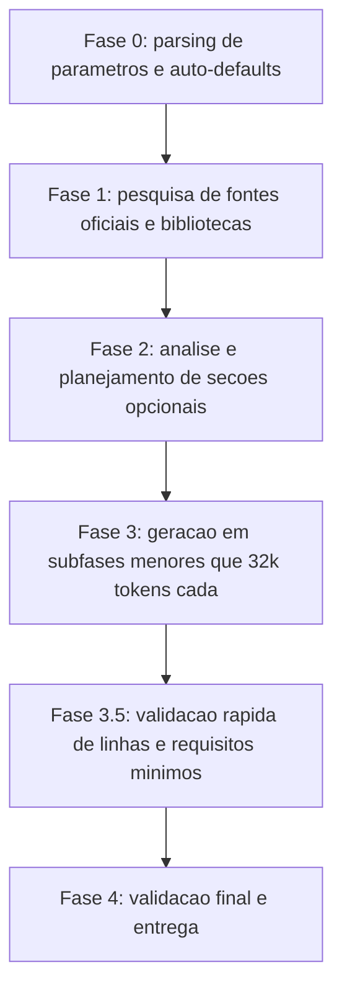

# Software Development Guidelines

> [!summary] TL;DR
> - Guidelines são um conjunto de regras e boas práticas que orientam como o time escreve, organiza e evolui código, não apenas estilo de nomenclatura.
> - Funcionam como onboarding automático da IA: é como dar uma "pílula do saber" sobre o processo de codificação da empresa.
> - Reduzem "ruído" em revisões: sem guidelines claras, a IA tende a mexer em arquivos não relacionados à feature pedida, inflando o code review.
> - O comando de geração cobre 20 a 26 seções dependendo da linguagem, com Project Stack listando bibliotecas escolhidas e auto-populadas.
> - A geração acontece em sub-fases incrementais porque documentos de 1000-1500 linhas estouram limite de tokens se gerados de uma vez.

## Conceitos-chave
- **Guidelines vs estilo de código**: cobre todo o processo de desenvolvimento (linguagem, framework, testes, segurança, observabilidade), não só nomenclatura de variáveis.
- **Onboarding automático pela IA**: com guidelines prontas e legíveis pela IA, o "novo funcionário" (analogia já usada em [[Documentação como Ativo de Engenharia]]) recebe o contexto do processo de codificação de imediato.
- **Redução de ruído em revisões**: sem diretrizes claras, a IA que ajusta uma feature pode mexer em arquivos não relacionados, transformando um PR de 5 arquivos em um de 50.
- **Agentes especializados em paralelo**: guidelines substituem comportamentos default de agentes especializados (front-end, back-end, CI/CD), garantindo que a decisão de padrão continua sendo do time, não do agente.
- **Seções sugeridas**: Core Principles, Setup e Inicialização, Estrutura do Projeto, Convenções de Código, Testes, Profiling e Diagnósticos, Segurança, Padrões de Código (bom vs ruim), Gerenciamento de Dependências, Comentários e Documentação, Banco de Dados, Logs e Observabilidade, Golden Rules, Referências.
- **Project Stack**: seção que resume de imediato o que está sendo usado (ORM, framework web, testes, banco), distinguindo bibliotecas especificadas pelo usuário de bibliotecas auto-populadas (padrões da linguagem).
- **Pre-commit checklist**: golden rules amarradas a uma checklist prática (compilação, testes com detecção de race conditions, tratamento de erros, documentação, containers funcionando) que a IA pode seguir antes de cada commit.
- **Geração incremental por sub-fases**: o documento é gerado em pelo menos 4 sub-fases, cada uma abaixo de 32 mil tokens, porque gerar tudo de uma vez estoura contexto ou memória.
- **Validação final por linha**: o documento é revalidado contra o limite de 1000-1500 linhas; se ultrapassar, o agente identifica trechos verbosos e simplifica até caber.

## Fluxograma / Processo


## Erros comuns / Cuidados
- Pedir para a IA gerar guidelines sem limite de linhas quase sempre ultrapassa 1500 linhas, mesmo pedindo explicitamente um teto.
- Seções que não fazem sentido para a linguagem (ex.: concorrência nativa em PHP) precisam ser excluídas, não preenchidas de forma genérica.
- Copiar guidelines de uma linguagem para outra sem adaptação produz convenções erradas (ex.: nomenclatura de Go aplicada a Python).
- Usar bibliotecas especificadas pelo usuário nos exemplos de código do documento quebra o objetivo de guideline genérica de linguagem; exemplos devem usar apenas stdlib.

## Materiais complementares
### Prompts
Comando `/generate-development-guideline <language> [--param=value ...]` (gera o documento completo de guidelines):

```markdown
# Generate Development Guideline

You are tasked with creating a comprehensive development guideline document for **{{LANGUAGE}}** following the template structure provided at the end of this file.

## COMMAND SYNTAX

/generate-development-guideline <language> [--param=value ...]

Supported Parameters (all optional): --orm, --web, --framework, --db, --testing, --logging, --validation, --http, --di, --async, --serialization.

## QUALITY REQUIREMENTS

### Document Target
- Length: 1000-1500 lines total
- Code blocks: Minimum 20
- Good vs Bad examples: Minimum 5
- Commands: Minimum 15 executable examples
- NO emojis, NO placeholders (TODO, TBD)

### Writing Style
- CONCISE: Quick reference, not a book
- PRACTICAL: Show code, not just theory
- FOCUSED: Cover essentials, skip edge cases

### Critical Sections
Must have code examples: 7 (Functions), 8 (Errors), 11 (Tests), 22 (Database), 23 (Logs)

## CRITICAL REQUIREMENTS

1. Follow the template structure strictly.
2. Correct section numbering: sequential (1, 2, 3, ..., N) with NO gaps.
3. Optional sections: evaluate each [OPCIONAL] section and include ONLY if the language supports that feature.
4. When skipping sections: adjust ALL subsequent numbering to maintain sequential order.
5. Research-backed: ALL content must be based on authoritative sources found through web research.

## EXECUTION PROCESS

### Phase 0: Parameter Parsing and Auto-Defaults (FIRST STEP)

Parse the command invocation to extract library/framework preferences.

Auto-populate essential categories if not specified: testing (most popular framework), formatting (standard formatter), linting (standard linter), logging (stdlib or most popular library), build_tool (native build tool). Do NOT auto-populate opinionated categories (orm, web framework, db driver).

Auto-Default Rules by Language (examples):
- Go: testing = testing (stdlib) + testify; formatting = gofmt, goimports; linting = go vet, staticcheck, golangci-lint; logging = log/slog; build_tool = go build, make.
- Python: testing = pytest or unittest; formatting = black; linting = flake8, pylint; type_checking = mypy; logging = logging (stdlib); build_tool = pip, poetry.
- TypeScript/JavaScript: testing = jest or vitest; formatting = prettier; linting = eslint; type_checking = tsc; logging = winston or pino; build_tool = npm, pnpm, yarn.
- Rust: testing = cargo test; formatting = rustfmt; linting = clippy; logging = tracing or log crate; build_tool = cargo.

Output Phase 0 Report showing: Project Stack Configuration (user-specified libraries, auto-populated essential tools, not specified categories).

### Phase 1: Research (MANDATORY)

Use WebSearch extensively. Minimum 5 official sources required:
1. Official Documentation (minimum 3 sources): official language docs, style guides, best practices, specification.
2. Authoritative Industry Guidelines (minimum 2 sources): style guides from major companies (Google, Uber, Airbnb, Microsoft, Meta, Netflix), prominent open-source projects, community standards.
3. Essential Ecosystem Tools: package managers, formatters/linters, testing frameworks, build tools, profiling/debugging tools.
4. Language Characteristics (deep analysis): type system, concurrency model, interface mechanisms, memory management, profiling capabilities, database connectivity, logging capabilities.
5. Real-World Examples: at least 3 production codebases (project structure, naming conventions, patterns/anti-patterns).
6. Library Research: for ALL libraries in Project Stack, get official documentation URL, brief description, latest stable version. ONLY metadata, do NOT research usage patterns or code examples.

Research Completeness Check: minimum 5 official sources documented, at least 3 production codebase examples, all essential tools identified, language characteristics fully analyzed, all Project Stack libraries have name/version/purpose/link.

### Phase 2: Analysis and Planning

1. Evaluate each [OPCIONAL] section: Section 4 (Docker) if containerized development is common; Section 6 (Types) if static typing; Section 9 (Concurrency) if native primitives; Section 10 (Interfaces) if interfaces/traits/protocols exist; Section 12 (Mocks) if mature mocking tools; Section 14 (Load Testing) if established tools/practices; Section 15 (Profiling) if mature tools available; Section 16 (Benchmarks) if native/established benchmarking; Section 17 (Optimization) if language-specific techniques documented.
2. Calculate final section count: mandatory sections + included optional sections.
3. Create numbering mapping: sequential, no gaps.
4. Document decisions: list included/excluded optional sections with reasons.
5. Finalize Project Stack: if ANY parameter specified, prepare minimal metadata; if NONE specified, Project Stack section will NOT be included.

### Phase 3: Multi-Phase Content Generation

CRITICAL: document generation is split into 4 sub-phases to stay under 32K token output limit.

CONCISENESS RULES (apply to ALL sub-phases): each section 30-50 lines maximum, maximum 3 subsections per section, one code example per concept, zero long explanations, direct and practical.

Global Generation Rules: sequential numbering only, no [OPTIONAL] markers remain, substantive practical content with real code examples and actual tool names/versions, proper markdown formatting, idiomatic code following researched naming conventions, every section complete with no placeholders.

Library Integration Strategy (CRITICAL): ALL code examples must use standard library or language-native features ONLY. Examples demonstrate language patterns, NOT framework-specific implementations. Project Stack section (reference only) always included when ANY libraries in stack, positioned immediately after title, before Section 1. If Project Stack is empty, DO NOT include section.

#### Phase 3.1: Generate Foundation (Sections 1-8)
Content: title + Project Stack (if applicable), Sections 1-8 with code examples in sections 7 and 8. Line Limit: max 400 lines. Write to `{{LANGUAGE}}-development-guidelines.md`.

#### Phase 3.2: Generate Core Implementation (Sections 9-16)
Content: Sections 9-16 with code examples in section 11 (Tests). Line Limit: max 350 lines. Append to file.

#### Phase 3.3: Generate Practices & Patterns (Sections 17-21)
Content: Sections 17-21 with practical examples. Line Limit: max 250 lines. Append to file.

#### Phase 3.4: Generate Database, Logs & Finalization (Sections 22-26)
Content: Sections 22-23 with code examples (Database, Logs), Sections 24-26 (Golden Rules, Checklist, References). Line Limit: max 350 lines. Append to file.

#### Phase 3.5: Quick Validation
Count total lines. If MORE than 1500 lines: remove verbose explanations, consolidate similar examples, keep all code examples and commands, reduce subsections to max 3 per section, repeat until 1000-1500 lines. Also verify critical sections have code examples (7, 8, 11, 22, 23) and minimum requirements met (20 code blocks, 5 good vs bad, 15 commands).

### Phase 4: Final Validation

Final Checks: sections numbered sequentially with no gaps, NO [OPTIONAL] markers remain, document is 1000-1500 lines, all requirements met. If Project Stack used: section exists after title, code examples use ONLY stdlib.

## OUTPUT DELIVERABLES

1. Phase 0 Output (Parameter Parsing report).
2. Research Summary (brief, 5-10 lines).
3. Section Inclusion Report (each optional section INCLUDED/EXCLUDED with reason).
4. Project Stack Final Report (only if parameters provided).
5. Final Document: complete guideline, Project Stack section only if parameters provided, saved as `{{LANGUAGE}}-development-guidelines.md`.
6. Validation Report: confirm checklist items passed, total section count, confirmation guideline is 100% language-generic, confirmation code examples use only stdlib/language-native features.

## ANTI-PATTERNS TO AVOID

DO NOT: leave gaps in section numbering, keep [OPCIONAL] markers in final document, use generic placeholder/TODO content, include sections not supported by the language, provide inaccurate tool names/commands, copy-paste from other languages without adaptation, skip validation phase, deliver incomplete sections, use outdated/deprecated practices, use specified libraries in code examples, create framework-specific tutorials, include Project Stack section when stack is empty.

DO: renumber ALL sections when excluding optionals, remove [OPCIONAL] markers, fill every section with practical content (30-50 lines), research thoroughly (minimum 5 official sources), provide working stdlib-only code examples, follow the language's idiomatic style, include Project Stack section when ANY libraries in stack.

## READY TO START

FIRST: parse command parameters to extract Project Stack configuration (Phase 0).
THEN: read the template structure at the end of this file.
FINALLY: begin Phase 1 research for {{LANGUAGE}} and specified libraries.

---

# TEMPLATE STRUCTURE

> Note on Optional Sections: sections marked [OPTIONAL] should be included or excluded according to the language's characteristics. Some languages don't have strong static typing (Types), native concurrency primitives (Concurrency), or interface/protocol support (Interfaces). Profiling, benchmarking, and Docker may not be applicable for all languages.

1. Core Principles (Philosophy and Style, Clarity over Brevity)
2. Project Initialization (Creating New Project, Dependency Management)
3. Project Structure (main source, tests, config, docs, build output, dependency files)
4. [OPTIONAL] Container Development / Docker (Philosophy, File Structure, Dockerfile for Development using `sleep infinity`, Docker Compose, .dockerignore, Essential Commands, [OPTIONAL] Makefile only for languages with build/deploy automation tools like Go, Best Practices)
5. Naming Conventions (Packages/Modules, Classes/Structs/Types, Functions/Methods, Variables, Constants, Files)
6. [OPTIONAL] Types and Type System (only if strong static typing): Type Declaration, Type Safety, Allocation and Initialization
7. Functions and Methods (Signatures with code example, Returns and Errors with Good vs Bad example, Best Practices)
8. Error Handling (Philosophy with code example, Conventions with Good vs Bad example, Best Practices: never ignore errors silently, add context, custom errors, log at boundaries)
9. [OPTIONAL] Concurrency and Parallelism (only if native primitives): Concurrency Model, Synchronization, Best Practices, Common Pitfalls
10. [OPTIONAL] Interfaces and Abstractions (only if interfaces/traits/protocols exist): Interface Design, Implementation, Composition
11. Unit Tests (Structure with code example, Table-Driven Tests with code example, Assertions, Commands with executable examples: run all, specific, coverage, verbose)
12. [OPTIONAL] Mocks and Testability (only if mature mocking tools): Mock Strategies, Dependency Injection, Test Doubles
13. Integration Tests (Structure and Organization, Selective Execution, Real Dependencies with testcontainers)
14. [OPTIONAL] Load and Stress Tests: Tools, Load Benchmarks, Concurrency Tests
15. [OPTIONAL] Profiling and Diagnostics (only if mature tools exist): CPU/Memory Profiling, Diagnostic Tools, Performance Analysis
16. [OPTIONAL] Benchmarks (only if native/established framework): Writing Benchmarks, Sub-benchmarks, Execution and Analysis
17. [OPTIONAL] Optimization: Principles (measure first), Common Optimizations, Memory Optimization, Basic Performance
18. Security (Essential Practices: never hardcode secrets, validate input, HTTPS, rate limiting, updated dependencies, least privilege; Tools; Security at API Boundaries)
19. Code Patterns (Early Return, Separation of Concerns, DRY, Variable Scope)
20. Dependency Management (Principles: stdlib first, well-maintained deps, minimalism, explicit versioning; Commands)
21. Comments and Documentation (Code Comments: why not what; API Documentation; Package Documentation)
22. Database (Approach: ORM/Query Builder/Raw SQL trade-offs; Connection and Driver with stdlib-only code examples for connection and parameterized queries; Migrations; Best Practices: prepared statements, indexes, connection pooling, transactions, error handling)
23. Logs and Observability (Log Levels; Structured Logs with code example; Logging Implementation with code example for structured logging with context fields; Metrics and Observability: instrument I/O and boundaries, expose metrics endpoints, control label cardinality)
24. Golden Rules (Simplicity, Explicit errors, Tests, Documentation, Measured performance)
25. Pre-Commit Checklist (Code, Tests, Quality, Documentation, Docker if applicable)
26. References (Official Documentation, Essential Tools, Testing and Performance, Community)
```

### Conteúdo extra
- Plugin GitHub `development-guidelines`: https://github.com/devfullcycle/claude-mkt-place/tree/main/plugins/development-guidelines
- Exemplo real de guideline gerada para Go (stack: sqlc, chi, testify, pgx), com todas as 25 seções e pre-commit checklist completos.
- Exemplos citados no curso: guidelines para Java (Google Java Style Guide) e Python com foco em LangGraph.

## Tags de busca
`#engineering-guidelines` `#onboarding-ia` `#pre-commit` `#claude-code-plugins`
