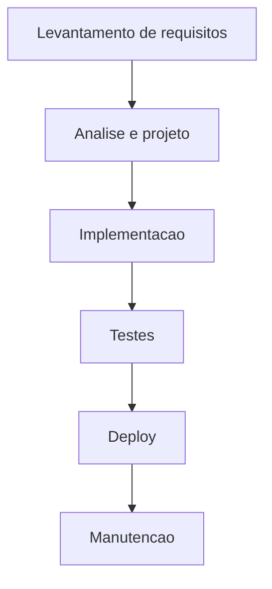
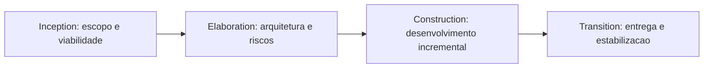

# Evolução dos Processos de Desenvolvimento e Documentação

> [!summary] TL;DR
> - Processos sequenciais (waterfall) tentam reduzir incerteza definindo tudo antecipadamente, o que trava adaptação a mudanças.
> - No waterfall, a documentação funcionava como contrato: decisões formalizadas antes da implementação, caras de alterar depois.
> - O RUP introduziu iteração (Inception, Elaboration, Construction, Transition) mantendo forte disciplina documental.
> - O Manifesto Ágil não aboliu documentação, apenas tirou dela o papel de produto principal do processo.
> - A IA é uma nova camada de transformação: documentos úteis também viram contexto operacional para ferramentas.

## Conceitos-chave
- **Processos sequenciais**: organizam o trabalho em etapas rígidas e ordem fixa, reduzindo incerteza via planejamento antecipado, ao custo de baixa adaptação.
- **Waterfall**: cada fase (requisitos, análise/projeto, implementação, testes, deploy, manutenção) precisa terminar antes da próxima começar.
- **Documentação como contrato**: no waterfall, decisões eram formalizadas antes da implementação, aumentando controle mas encarecendo mudanças.
- **RUP (Rational Unified Process)**: processo iterativo criado pela Rational Software (depois IBM); reorganiza a documentação em ciclos menores com pontos de revisão mais frequentes.
- **Fases do RUP**: Inception (escopo e viabilidade), Elaboration (arquitetura e riscos), Construction (desenvolvimento incremental sobre arquitetura aprovada), Transition (entrega, treinamento, estabilização).
- **Caso de uso no RUP**: eixo de modelagem de requisitos a partir da interação do usuário com o sistema; um caso de uso pronto entrega um pedaço funcional do sistema.
- **Manifesto Ágil (2001)**: reação à insatisfação com processos pesados; recoloca a entrega de valor no centro sem proibir documentação.
- **"Software em funcionamento" mais importante que documentação abrangente**: estabelece prioridade, não proibição; documentação só faz sentido se sustenta entendimento e evolução do sistema.
- **Documentacão com propósito**: critério passa a ser proporcionalidade (cada registro justifica seu custo pela utilidade), não maximizar volume, tema retomado em [[Documentação como Ativo de Engenharia]].
- **Risco dos extremos**: times presos ao excesso de formalização de um lado, interpretação equivocada de que documentação é sempre desperdício do outro.

## Fluxograma / Processo

## Erros comuns / Cuidados
- Tratar documentação como pré-condição rígida para avançar controla o ritmo do projeto e adiciona fricção desnecessária.
- Decidir cedo demais congela premissas que podem não sobreviver ao tempo real do projeto.
- No waterfall, o cliente só vê o software perto da entrega, atrasando a descoberta de erros de entendimento.
- Interpretar o Manifesto Ágil como "parar de documentar" é um erro; a crítica era ao excesso sem propósito, não ao registro técnico útil.

## Tags de busca
`#waterfall` `#rup` `#manifesto-agil` `#historia-processos`
