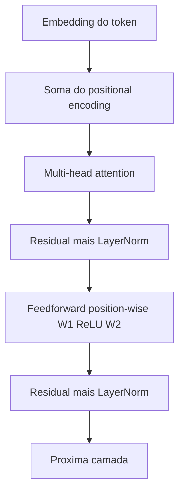

# Componentes do Transformer

> [!summary] TL;DR
> - Position-wise feedforward: após a atenção, transforma cada token individualmente com os mesmos pesos: FFN(x) = max(0, xW1 + b1)W2 + b2.
> - Positional encoding soma ao embedding um vetor de posição, porque o processamento paralelo não tem ordem embutida.
> - Codificação fixa usa seno e cosseno; embeddings posicionais aprendidos se adaptam ao domínio, mas custam mais dados e parâmetros.
> - Conexões residuais (output = x + f(x)) preservam informação e criam atalho para o gradiente; LayerNorm estabiliza a escala das ativações.
> - Residual e LayerNorm juntas são a base para empilhar camadas e escalar Transformers em LLMs.

## Conceitos-chave

- **Position-wise feedforward**: aplicada após a [[Transformers e Self-Attention|atenção]], transforma cada token individualmente com o mesmo bloco de pesos para todas as posições; não mistura posições e é paralelizável.
- **Intuição atenção vs feedforward**: atenção é a conversa entre tokens; feedforward é a reflexão individual. A atenção identifica de onde vem a informação, a feedforward decide como transformá-la dentro de cada token.
- **W1 e b1**: primeira projeção (filtros aprendidos + viés) que cria um vetor intermediário.
- **ReLU max(0, ·)**: zera negativos e introduz não linearidade; sem ela, transformações lineares empilhadas equivaleriam a uma só.
- **W2 e b2**: condensam o vetor intermediário na representação final enviada à próxima camada.
- **Problema da ordem**: o Transformer processa tokens em paralelo, sem ordem embutida ("eu comi antes de dormir" perderia estrutura; "o cachorro mordeu o homem" vs "o homem mordeu o cachorro").
- **Positional encoding**: vetor de posição somado ao embedding, combinando "o que é" com "onde está" (embeddings em [[Embeddings e Similaridade]]).
- **Codificação fixa seno/cosseno**: versão do paper "Attention Is All You Need", padrões gerados por regra, não aprendidos; funções periódicas dão um padrão distinto a cada posição.
- **pos**: posição do token (0, 1, 2...).
- **i**: índice da dimensão.
- **d_model**: tamanho do embedding (ex: 512, 768).
- **Múltiplas escalas**: primeiras dimensões com alta frequência, últimas com baixa; as ondas em várias escalas permitem comparar distâncias relativas.
- **Valores suaves**: seno e cosseno ficam entre -1 e 1, geometria útil para a atenção.
- **Embeddings posicionais aprendidos**: vetores de posição ajustados no treino; adaptam-se ao domínio, custam mais dados e parâmetros.
- **Residual connection**: output = x + f(x); a camada aprende modificações sobre o sinal original, preserva informação e cria um atalho aditivo para o gradiente no backpropagation (convergência mais rápida).
- **LayerNorm (layer normalization)**: reescala as ativações por exemplo e estabiliza distribuição e escala entre camadas (estabilidade numérica no treino profundo).
- **Problema que resolvem**: Transformers profundos sofrem explosão de gradiente e degradação do sinal entre layers.
- **Papel conjunto**: a residual transporta informação na profundidade; a LayerNorm estabiliza como ela chega à próxima etapa.
- **No decoder-only**: o bloco combina multi-head attention com máscara causal, feedforward position-wise, layer norm e conexões residuais (ver [[Encoder-only vs Decoder-only]]).

## Fluxograma / Processo

## Erros comuns / Cuidados

- Escolha da codificação posicional: fixa para cenários generalistas, dados variados e extrapolação para sequências longas (tradução, geração aberta, GPT, BERT); aprendida para domínios fechados e recorrentes (documentos jurídicos, geração de código).
- Positional encoding ajuda, mas não resolve sozinho a coerência em sequências longas (parágrafos, livros, vídeos).

## Materiais complementares

### Conteúdo extra

- Fórmulas citadas:
  - FFN(x) = max(0, xW1 + b1)W2 + b2
  - PE(pos, 2i) = sin(pos / 10000^(2i/d_model))
  - PE(pos, 2i+1) = cos(pos / 10000^(2i/d_model))

## Tags de busca

`#fundamentos-ia-generativa` `#transformers` `#positional-encoding` `#layernorm` `#feedforward`
