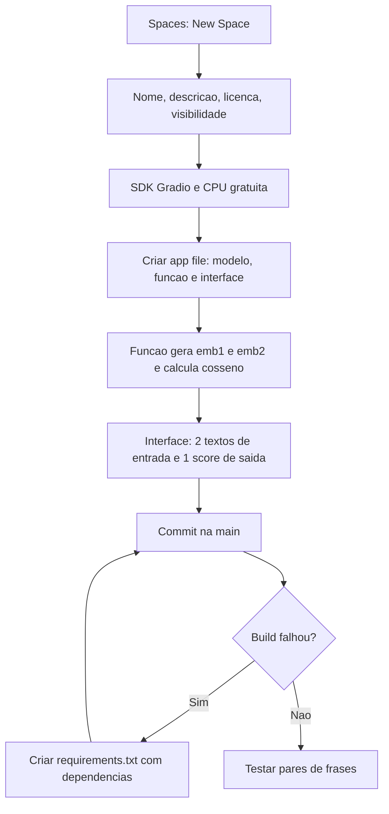

# Embeddings e Similaridade

> [!summary] TL;DR
> - Embedding converte palavras, frases, imagens ou código em vetores densos num espaço onde proximidade indica semelhança de sentido.
> - Importa a posição relativa entre vetores, não cada valor isolado.
> - Similaridade por cosseno mede o alinhamento (direção) entre vetores, independente da magnitude.
> - Embeddings medem semelhança semântica sem exigir palavras idênticas e sustentam busca semântica e RAG.
> - Score alto não é entendimento: negação ou mudança sutil de sentido pode manter o score alto.

## Conceitos-chave

- **Embedding**: conversão de palavras, imagens ou código em vetores numéricos num espaço onde relações podem ser medidas.
- **Word embeddings**: vetores de alta dimensão em espaço contínuo (ex: array = [0.25, -0.14, 0.88, ...]); surgiram com as [[Redes Neurais Profundas e RNNs|redes neurais profundas]].
- **Similaridade semântica**: termos usados em contextos parecidos ficam próximos ("rei" perto de "rainha", longe de "cachorro"), como coordenadas geográficas de significado.
- **Vetores densos**: proximidade indica semelhança; a posição relativa no espaço carrega o significado.
- **Similaridade por cosseno**: mede a direção entre dois vetores, independente da magnitude.
- **Embeddings de sentenças**: "como fazer um bolo" fica próximo de "receita para preparar um bolo"; papel típico de modelos encoder-only (ver [[Encoder-only vs Decoder-only]]).
- **Pipeline do modelo**: token, embedding, atenção, probabilidade da próxima saída (ver [[Tokens e Tokenização]] e [[Transformers e Self-Attention]]); o embedding recebe a soma do positional encoding (ver [[Componentes do Transformer]]).
- **Uso no RAG**: a query vira embedding e o retriever faz busca semântica na base vetorial de trechos já embedados ("acesso remoto seguro" recupera "VPN corporativa"); fluxo em [[Prompt Engineering vs RAG vs Fine-Tuning]].
- **Space no Hugging Face**: app hospedada com interface, código e configuração versionados.
- **Gradio**: expõe uma função Python como formulário interativo.

## Fluxograma / Processo

Hands on: Space de similaridade no Hugging Face.

- A interface tem título, descrição, dois campos de texto de entrada e um campo numérico de saída com o score.
- Build e start são lentos no free tier.

## Erros comuns / Cuidados

- Sem requirements.txt o build falha mesmo com código correto.
- Lentidão de build não é travamento.
- Frases longas dão resultados mais informativos que palavras isoladas.
- Trocar "gato" por "cachorro" aumenta o score; trocar por "avião" reduz.
- Negação ou mudança sutil de sentido pode continuar com score alto: score não é entendimento.
- Proximidade vetorial não captura ordem: "o cachorro mordeu o homem" e "o homem mordeu o cachorro" ficam com palavras próximas no espaço.

## Materiais complementares

### Conteúdo extra

- Ferramentas do hands on: Hugging Face Spaces, Gradio, requirements.txt, modelo de embeddings Transformer, similaridade por cosseno.

## Tags de busca

`#fundamentos-ia-generativa` `#embeddings` `#similaridade-cosseno` `#busca-semantica` `#hugging-face`
