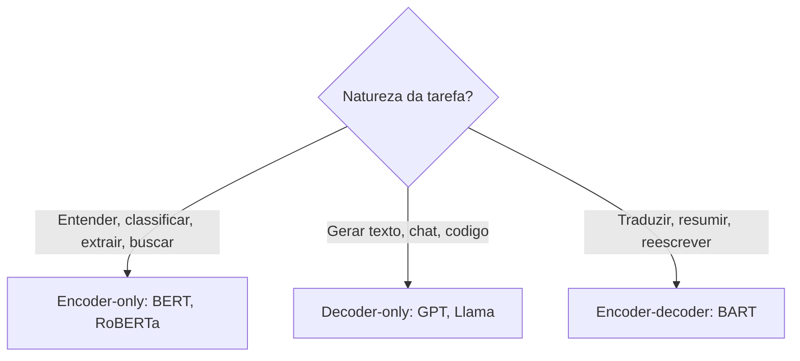

# Encoder-only vs Decoder-only

> [!summary] TL;DR
> - Três famílias Transformer: encoder-only (compreensão), decoder-only (geração) e encoder-decoder (transformação de texto, mais caro e complexo).
> - Encoder-only (BERT, RoBERTa) usa atenção bidirecional e é treinado com MLM: classificação, extração, NER, embeddings e busca.
> - Decoder-only (GPT-4, Llama) usa causal self-attention com máscara triangular e gera token a token: chat, geração aberta, código.
> - Encoder-decoder (BART) serve para tradução, sumarização e reescrita.
> - Escolher a arquitetura pela natureza da tarefa, não por fama.

## Conceitos-chave

- **Três famílias**: encoder-only, decoder-only e encoder-decoder; o [[Transformers e Self-Attention|Transformer]] completo é mais caro e complexo.
- **Encoder-only**: só o bloco de codificação; gera representação contextualizada da entrada inteira; mais leve, rápido e barato.
- **Usos do encoder-only**: compreensão, classificação (tema, sentimento positivo/negativo/neutro, feedbacks), extração, Q&A, vetores para busca.
- **BERT (Bidirectional Encoder Representations from Transformers)**: marco da família encoder-only (2018), com grande impacto em representação e compreensão de linguagem.
- **Atenção bidirecional**: cada token considera os tokens à esquerda e à direita.
- **Pipeline do encoder**: tokenização, vetores + posição, camadas que refinam o contexto (ver [[Tokens e Tokenização]] e [[Componentes do Transformer]]).
- **MLM no encoder**: ocultar palavras e inferi-las pelo contexto global; objetivo de treino detalhado em [[Pré-treinamento de LLMs]].
- **NER**: "Steve Jobs fundou a Apple em Cupertino" identifica pessoa, organização e local.
- **Embeddings de sentenças**: "como fazer um bolo" fica próximo de "receita para preparar um bolo" (ver [[Embeddings e Similaridade]]).
- **Família BERT**: RoBERTa (mais treino e dados, representações mais fortes); DistilBERT (compactado, menor latência e custo); ALBERT (compartilha parâmetros, menor e mais rápido).
- **Decoder-only**: especializado em geração autoregressiva token a token, usando só o histórico.
- **GPT (Generative Pretrained Transformer)**: autoregressivo, unidirecional, forte em geração, respostas abertas e storytelling (ChatGPT, GitHub Copilot, Jasper); treinado com CLM.
- **Causal self-attention**: cada posição atende só a si mesma e às anteriores.
- **Máscara triangular inferior**: aplicada à matriz de atenção; em "o cachorro correu rápido", "correu" vê "o" e "cachorro", não "rápido". A matriz opera sobre vetores, não sobre palavras literais.
- **Sem trapaça**: a máscara impede olhar o futuro tanto no treino quanto na inferência (analogia: na prova, a questão 6 só consulta as questões 1 a 5).
- **Ordem sem RNN**: a posição vem da ordenação e a máscara impõe direção, mantendo o paralelismo.
- **Bloco decoder**: multi-head attention com máscara causal (várias leituras do passado: sintática, semântica, padrões locais), feedforward position-wise, layer norm e conexões residuais.
- **Encoder-decoder (BART)**: tradução, sumarização e reescrita.

| Aspecto | Encoder-only | Decoder-only |
|---|---|---|
| Atenção | Bidirecional | Causal, só passado |
| Pré-treino | MLM | CLM |
| Forte em | Compreensão, classificação, busca | Geração, chat, código |
| Exemplos | BERT, RoBERTa, DistilBERT, ALBERT | GPT-4, Llama |
| Custo | Mais leve, rápido e barato | Geração token a token |

## Fluxograma / Processo

## Erros comuns / Cuidados

- BERT usa MLM e não é escolha natural para chatbot gerativo: é forte em compreensão e fraco em geração livre.
- Escolher arquitetura por fama em vez da natureza da tarefa é erro.

## Tags de busca

`#fundamentos-ia-generativa` `#encoder-only` `#decoder-only` `#bert` `#gpt`
