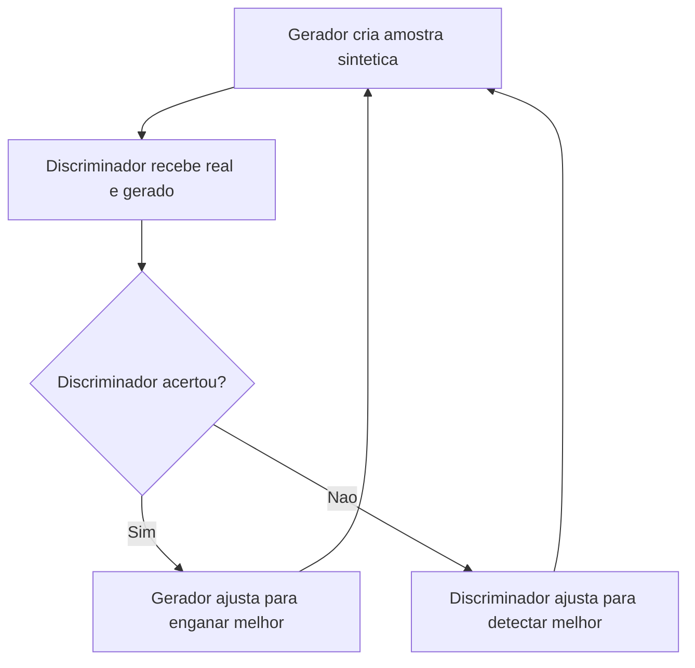

# GANs e VAEs

> [!summary] TL;DR
> - Imagem exige arquiteturas diferentes de LLMs: coerência espacial, não leitura linear de próximo token.
> - GAN: um gerador cria amostras sintéticas e um discriminador separa real de gerado, num jogo adversarial de refinamento mútuo.
> - VAE: encoder comprime a entrada num espaço latente e decoder reconstrói; manipular variáveis latentes controla atributos.
> - Trade-off: GAN entrega realismo competitivo; VAE é mais estável matematicamente e dá mais controle.
> - Ambos aprendem distribuições e levam a geração além do texto.

## Conceitos-chave

- **Por que outra arquitetura**: imagem depende de coerência espacial, diferente da geração autoregressiva de próximo token dos [[Encoder-only vs Decoder-only|decoders]].
- **GAN (Generative Adversarial Network)**: gerador produz amostras sintéticas; discriminador distingue real de gerado; os dois se refinam de forma competitiva.
- **Exemplo das notas de 10 reais**: o gerador produz notas, o discriminador julga, e os erros viram sinal de ajuste para ambos.
- **Força das GANs**: realismo perceptual (rostos, cenários, moda, arte digital, ativos de jogos).
- **VAE (Variational Autoencoder)**: modelo probabilístico com encoder (comprime em espaço latente) e decoder (reconstrói).
- **Controle de atributos**: manipular variáveis latentes permite pedir características específicas ("homem sorrindo, cabelo curto e bigode").
- **Usos do VAE**: imagem e também som e voz.
- **Aprendizado de distribuições**: GANs e VAEs aprendem a distribuição dos dados, a mesma ideia geral da [[IA Generativa vs IA Tradicional|IA generativa]].
- **Lugar na história**: as GANs ampliaram a geração antes de os Transformers consolidarem contexto em escala (ver [[História da IA]]).
- **Multimodalidade**: texto, imagem, áudio e vídeo; ex: roteirizar com LLM e gerar o vídeo com modelo multimodal, deslocando valor para direção criativa, curadoria, edição e estratégia.

| Aspecto | GAN | VAE |
|---|---|---|
| Mecanismo | Gerador vs discriminador | Encoder, espaço latente, decoder |
| Ponto forte | Realismo competitivo | Estabilidade matemática e controle |
| Usos | Rostos, moda, arte digital, jogos | Imagem com atributos controlados, som, voz |

## Fluxograma / Processo

## Erros comuns / Cuidados

- Imagens geradas ainda mostram texto com acentuação errada, proporções estranhas e anatomia inconsistente; vídeo mostra artefatos de movimento, finalização e consistência.
- Guardrails bloqueiam imagens enganosas ou com pessoas reais em contextos problemáticos.

## Tags de busca

`#fundamentos-ia-generativa` `#gan` `#vae` `#geracao-de-imagem` `#multimodalidade`
