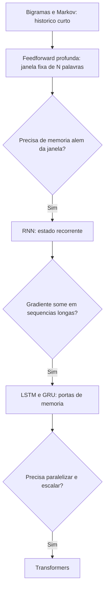

# Redes Neurais Profundas e RNNs

> [!summary] TL;DR
> - Redes neurais profundas voltaram com mais dados e mais computação (GPUs) e usam word embeddings para representar palavras como vetores.
> - Redes feedforward preveem a próxima palavra a partir de uma janela fixa de N palavras, sem memória além dela e com problema de ordem.
> - RNNs carregam um estado interno recorrente entre os passos, mas sofrem com desvanecimento e explosão de gradiente.
> - LSTM e GRU usam portas para mitigar o esquecimento, sem eliminar a sequencialidade que impede a paralelização.
> - Essas limitações de ordem, memória, contexto longo e escala motivaram os [[Transformers e Self-Attention]].

## Conceitos-chave

- **Retomada da IA**: Deep Learning a partir de 2010 destravado por GPUs, Big Data e infraestrutura, com resultados em tradução e fala (contexto em [[História da IA]]).
- **Rede "profunda"**: muitas camadas entre entrada e saída; representa padrões complexos, mas é menos transparente.
- **Word embeddings**: vetores de alta dimensão em espaço contínuo onde similaridade semântica vira proximidade (ex: array = [0.25, -0.14, 0.88, ...]); importa a posição relativa, não cada valor isolado. Detalhes em [[Embeddings e Similaridade]].
- **Feedforward**: fluxo unidirecional; os embeddings da sequência são propagados para prever a próxima palavra.
- **Janela de contexto fixa**: a rede usa as N palavras anteriores ("o cachorro está no" prevê "jardim"); conceito que reaparece em [[Context Window em LLMs]].
- **Rede de Hopfield**: rede com realimentação (a saída dos neurônios alimenta a rede, inclusive a si mesma), com estado interno e memória associativa: um padrão incompleto converge para a configuração aprendida.
- **RNN (Recurrent Neural Network)**: processa sequências (texto, áudio, séries temporais, vídeo) com estado interno recorrente; a saída depende da entrada atual somada ao estado acumulado.
- **Aplicações de RNN**: tradução, geração de texto, reconhecimento de fala, análise de sentimento.
- **Desvanecimento de gradiente**: gradientes encolhem ao propagar por muitos passos e a rede esquece contexto distante (erra a concordância entre sujeito no início e verbo no fim).
- **Explosão de gradiente**: gradientes crescem demais e o treino fica instável.
- **LSTM (Long Short-Term Memory)**: portas de entrada, esquecimento e saída controlam o que entra, o que é esquecido e o que segue adiante.
- **GRU (Gated Recurrent Unit)**: versão enxuta da LSTM, com menos portas e parâmetros, treino mais rápido e desempenho frequentemente comparável.

## Fluxograma / Processo

## Erros comuns / Cuidados

- Problema da ordem na feedforward: "o cachorro mordeu o homem" e "o homem mordeu o cachorro" ficam com palavras próximas no espaço vetorial.
- Feedforward não tem memória além da janela e perde dependências entre frases e parágrafos, o que prejudica tradução, diálogo e resumo.
- RNN processa passo a passo, o que impede paralelização: baixo throughput e difícil escalar.
- LSTM e GRU mitigam o esquecimento, mas não eliminam a sequencialidade nem o problema de contexto muito longo.
- RNN tem memória sequencial, mas sofre com contexto distante e com escala; os Transformers relacionam partes distantes diretamente e são paralelizáveis.

## Tags de busca

`#fundamentos-ia-generativa` `#redes-neurais` `#rnn` `#lstm` `#deep-learning`
