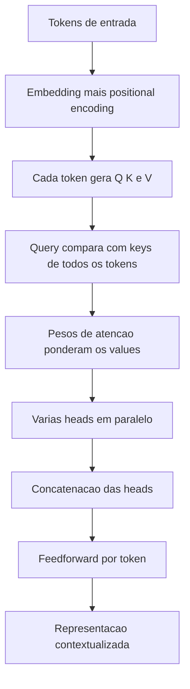

# Transformers e Self-Attention

> [!summary] TL;DR
> - O Transformer (paper "Attention Is All You Need") abandona a recorrência e resolve dependências longas e paralelização que LSTM e GRU não resolveram.
> - Self-attention: cada token se compara a todos os outros da própria sequência e pondera quais importam mais para a próxima saída.
> - Q, K e V: a query é o que o token procura, a key é a identidade usada na correspondência e o value é o conteúdo propagado.
> - Multi-head attention roda várias atenções em paralelo; cada head aprende um padrão de forma emergente no treino.
> - Paralelização casa com GPUs e TPUs e permite escalar para bilhões de parâmetros, base de todos os LLMs.

## Conceitos-chave

- **Transformer**: arquitetura sem recorrência, que relaciona partes distantes diretamente; superou as limitações de [[Redes Neurais Profundas e RNNs]] e é uma das três convergências que viabilizaram a IA generativa (com GPUs e dados abundantes), como em [[IA Generativa vs IA Tradicional]].
- **Attention**: atribui pesos diferentes a partes da sequência conforme o contexto; decide quais partes importam para a próxima saída e desambigua sentidos ("assado" como comida vs pele queimada).
- **Self-attention**: cada token compara-se a todos os outros da mesma sequência e mantém vínculos distantes (personagem do início retomado depois), com foco seletivo.
- **Exemplos de vínculo**: "O livro que o João leu ontem era interessante" liga João, leu e livro; em "O cachorro que o menino viu estava latindo", "latindo" liga a "cachorro", não a "menino".
- **Representação contextualizada**: a camada de atenção produz, para cada token, um vetor que já incorpora o contexto relevante.
- **Single-head attention**: uma única perspectiva de relação por vez, leitura contextual estreita.
- **Q (query)**: o que o token procura.
- **K (key)**: identidade contextual usada para a correspondência.
- **V (value)**: conteúdo propagado quando há correspondência. Ex: para "ela", a query é "quem é ela?", a key localiza a entidade e o value entrega a informação.
- **Multi-head attention**: várias atenções em paralelo, com vetores divididos em subespaços; cada head aprende um padrão (concordância gramatical, relação semântica, referência pronominal, atenção temporal, hierarquia sintática, causa/efeito, sujeito/ação, tom implícito).
- **Especialização emergente**: o papel de cada head surge no treino, não é regra programada.
- **Concatenação**: as saídas das heads são concatenadas e enviadas à feedforward, detalhada em [[Componentes do Transformer]].
- **Divisão de papéis**: a atenção decide "com quem" cada token se relaciona; a MLP decide "como" refinar a representação.
- **Positional encoding**: sinal de posição somado ao embedding para preservar a ordem mesmo com processamento paralelo (ver [[Componentes do Transformer]]).
- **Paralelização**: casa com GPUs e TPUs, acelera treino e experimentação.
- **Gradiente mais estável**: dependências longas sem cadeia de estados ocultos reduzem a degradação de gradiente.
- **Escala**: chega a bilhões de parâmetros com treino distribuído; LLMs estendem o Transformer refinando a atenção (ver [[Pré-treinamento de LLMs]]).
- **Pipeline de geração**: token, embedding, atenção, probabilidade da próxima saída (ver [[Tokens e Tokenização]] e [[Parâmetros de Geração]]).
- **Custo da atenção**: cresce de forma quadrática com o tamanho do contexto, ponto central em [[Context Window em LLMs]].

## Fluxograma / Processo

## Erros comuns / Cuidados

- Geração de texto depende de estrutura linguística (referência, tempo, função sintática, semântica); a atenção captura isso estatisticamente, não por regras.
- Coerência em sequências muito longas (parágrafos, livros, vídeos) continua difícil mesmo com atenção e codificação posicional.

## Materiais complementares

### Conteúdo extra

- Paper "Attention Is All You Need": origem do Transformer.
- Modelos da linha: BERT, GPT, T5, PaLM, Llama; ViT (visão); multimodais (texto, imagem, áudio); usos em bioinformática, finanças e recomendação.

## Tags de busca

`#fundamentos-ia-generativa` `#transformers` `#self-attention` `#multi-head-attention` `#llm`
