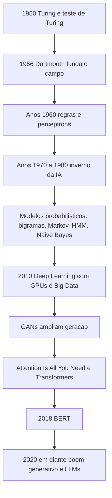

# História da IA

> [!summary] TL;DR
> - IA nasce como pergunta sobre simular capacidades humanas: Turing (1950) e a Conferência de Dartmouth (1956) consolidam o campo.
> - Anos 1960: IA baseada em regras e perceptrons, travados por hardware, dados e incapacidade de lidar com o imprevisto.
> - Inverno da IA (anos 1970 a 1980): promessa superou execução e o investimento caiu; a virada foi de regras determinísticas para modelos probabilísticos (bigramas, Markov, HMM, Naive Bayes).
> - A partir de 2010, GPUs e Big Data destravam Deep Learning; GANs ampliam a geração e "Attention Is All You Need" consolida contexto em escala, levando ao boom generativo a partir de 2020.
> - Cada geração resolve a limitação da anterior: memória, ordem e dependências longas são o fio condutor até os LLMs.

## Conceitos-chave

### Origens

- **Mitologia grega**: já tinha seres artificiais autônomos; IA começa como pergunta sobre simular capacidades humanas.
- **Alan Turing (1950)**: pergunta "máquinas podem pensar?" e desloca o foco da automação mecânica para a simulação cognitiva.
- **Teste de Turing**: experimento mental que mede se a interação é indistinguível da humana; critério operacional, não mede consciência.
- **Conferência de Dartmouth (1956)**: consolida a IA como campo (John McCarthy, Marvin Minsky, Herbert Simon) com a hipótese de simular inteligência computacionalmente.
- **Perceptrons**: primeiras redes neurais, inspiradas em neurônios, aprendem a partir de exemplos.
- **IA baseada em regras (anos 1960)**: lógica "se... então", árvores de decisão, conhecimento codificado por especialistas.
- **Tensão central**: codificar conhecimento vs aprender com exemplos.

### Inverno da IA

- **Inverno da IA (anos 1970 a 1980)**: promessa superou execução; faltavam processamento, dados e métodos para linguagem, imagem e som; expectativas infladas sem resultado reduziram o investimento.
- **John Hopfield**: rede com realimentação (saída dos neurônios alimenta a rede, inclusive a si mesma), com estado interno e memória associativa: um padrão incompleto converge para a configuração aprendida.
- **RNNs**: processam sequências (texto, áudio, séries temporais) carregando informação dos passos anteriores; limitadas em dependências longas e em escala (ver [[Redes Neurais Profundas e RNNs]]).

### Virada probabilística

- **De regras para probabilidade**: em vez de regra determinística, atribuir maior probabilidade à interpretação mais consistente (exemplo do "boneco de neve").
- **Reconhecimento de fala estatístico**: compara o sinal com padrões prováveis.
- **Naive Bayes**: classificador por probabilidade condicional, emblemático no filtro de spam, onde substituiu listas rígidas de regras.
- **Cadeias de Markov**: próximo estado depende do atual ou de uma janela limitada; usadas em próxima palavra, jogos e música; baratas, mas sem contexto longo.

### Bigramas (2-gramas)

- **Bigrama**: prevê a próxima palavra só pela anterior, por frequência ("bom" seguido de "dia"); estatística simples e barata.
- **Dependências de longo prazo**: relações entre partes distantes que precisam se manter conectadas; o bigrama não as captura.
- **Sem memória e sem projeção global**: não há plano de frase nem tópico.
- **Coerência local vs global**: pares plausíveis vs texto inteiro que sustenta um raciocínio; semântica não é só estatística local.

### Hidden Markov Model (HMM)

- **HMM**: vai além dos bigramas e supõe um estado interno do sistema que gera as observações.
- **Estado oculto**: variável interna não observada que governa o comportamento.
- **Observação/output**: sinal visível gerado pelo estado.
- **Exemplo clima**: estados sol/chuva/nublado; observações céu limpo/vento forte/guarda-chuva aberto.
- **Matriz de transição**: probabilidade de mudar de um estado para outro.
- **Matriz de emissão**: probabilidade de cada estado gerar certas observações.
- **Hipótese de Markov**: a próxima observação depende só do estado atual, e este só do anterior.

| Algoritmo | O que resolve |
|---|---|
| Forward-backward | Probabilidade de uma sequência observada (compatibilidade dados/modelo) |
| Viterbi | Sequência de estados ocultos mais provável |
| Baum-Welch (associado a EM) | Ajusta parâmetros (transições e emissões) a partir dos dados |

| Aplicação | Estados | Observações |
|---|---|---|
| Reconhecimento de fala | Sons fonéticos | Áudio |
| POS tagging | Classes gramaticais | Palavras |

- **Biologia computacional**: identificação de regiões em DNA.

### Era do Deep Learning e generativa

- **Deep Learning (a partir de 2010)**: GPUs, Big Data e infraestrutura destravam redes profundas para tradução e fala.
- **GANs**: gerador produz amostras sintéticas e discriminador distingue real de gerado num jogo adversarial (rostos, cenários); detalhado em [[GANs e VAEs]].
- **"Attention Is All You Need"**: atenção substitui a dependência sequencial estrita e relaciona partes distantes com eficiência, de forma paralelizável; base dos LLMs (ver [[Transformers e Self-Attention]]).
- **BERT (2018)**: impacto em representação e compreensão de linguagem (ver [[Encoder-only vs Decoder-only]]).
- **Boom generativo (a partir de 2020)**: Transformers em escala viabilizam a IA generativa atual (ver [[IA Generativa vs IA Tradicional]]).

### Evolução dos modelos de linguagem

| Modelo | Como prevê | Limitação que motivou o próximo |
|---|---|---|
| Regras | Lógica "se... então" codificada | Não se adapta ao imprevisto, não escala |
| Bigrama | Só a palavra anterior | Sem memória, repetição, sem coerência global |
| Cadeia de Markov / HMM | Estado atual com histórico limitado | Dependências curtas, depende de rótulos |
| Rede neural feedforward | Janela fixa de N palavras | Sem memória além da janela, problema da ordem |
| RNN / LSTM / GRU | Memória sequencial | Contexto distante e escala |
| Transformer | Atenção sobre toda a sequência | Base dos LLMs |

## Fluxograma / Processo

## Erros comuns / Cuidados

- Primeiros modelos neurais travaram por limite estrutural: hardware, processamento e falta de dados.
- Sistemas de regras só operam dentro do que foi especificado e não se adaptam a situações não previstas.
- Expectativa maior que a tecnologia gera o ciclo entusiasmo/frustração que levou ao inverno da IA; vale para o momento atual também: evitar tratar GenAI como solução universal.
- Bigramas geram fragmentação e repetição/looping por preferência estatística ("o gato preto dorme no sofá, gato preto...") e frases localmente plausíveis mas globalmente desconexas.
- HMM é bom para dependências curtas e ruim para longas e interações cruzadas; estrutura linear sem retroalimentação; depende de dados rotulados (caros e demorados); não serve para geração livre de texto longo como LLMs.
- A falta de memória, a repetição e a perda de coerência desses modelos são exatamente o que os LLMs vieram superar, conectando partes distantes da sequência (ver [[Context Window em LLMs]] para o limite que persiste).

## Materiais complementares

### Conteúdo extra

- Slides do módulo (Google Drive): https://drive.google.com/file/d/1jnRiqGAAa2bXmnLlg-XWecg2GF5KSTcy/view

## Tags de busca

`#fundamentos-ia-generativa` `#historia-da-ia` `#inverno-da-ia` `#cadeias-de-markov` `#bigramas`
