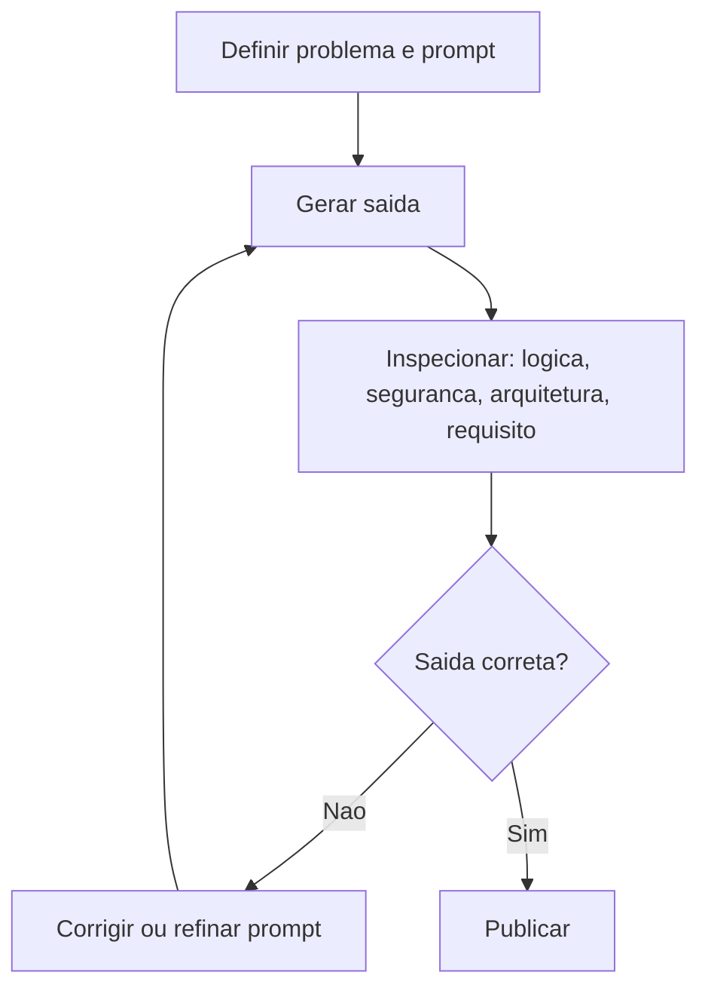

# IA Generativa vs IA Tradicional

> [!summary] TL;DR
> - IA tradicional responde "qual rótulo atribuir?": classifica, ranqueia ou prevê dentro de um espaço de respostas delimitado, a partir de dados rotulados.
> - IA generativa responde "qual saída posso compor?": aprende distribuições de probabilidade sobre padrões e sequências e sintetiza saída nova condicionada ao prompt.
> - Viabilidade da Gen AI veio da convergência de GPUs, dados digitais abundantes e arquiteturas melhores (Transformers).
> - Saída generativa é rascunho probabilístico: plausível não é correto, o fluxo é gerar, inspecionar, corrigir.
> - Não existe modelo ideal: qualidade, custo, latência e especialização são trade-offs avaliados por critério de engenharia, não por hype.

## Conceitos-chave

### Hierarquia de conceitos

- **Hierarquia**: aplicação (chatbot) > LLM (família de modelo, classe dentro de IA generativa) > IA generativa > Machine Learning / Deep Learning (nível de treinamento e representação).
- **Modelo generativo**: aprende padrões dos dados e produz saídas novas coerentes com eles.
- **Deep Learning**: aprende representações complexas de grandes volumes de dados sem regras explícitas (ver [[Redes Neurais Profundas e RNNs]]).
- **Fundamentos vs ferramenta**: entender o mecanismo dos modelos permite avaliar limitações, escolher tecnologia com critério e não depender de um produto específico.

### IA tradicional

- **Entradas e saídas predefinidas**: aprende relações entre entrada e saída esperada para estimar a resposta provável sobre dados conhecidos (ex: recomendar vinho em dia frio, cerveja na sexta).
- **Dados rotulados**: cada exemplo vem com a categoria ou valor esperado (aprendizado supervisionado).
- **Classificação**: prevê categorias discretas (spam ou legítimo, fraude ou normal, sobreviveu ou não).
- **Regressão**: prevê valor contínuo (tráfego, demanda, número de pessoas indo à praia).
- **Exemplo Titanic**: atributos (idade, classe, cabine) mapeados a sobreviveu/morreu para prever novos casos.
- **Score de risco**: em fraude bancária, sinaliza desvio do comportamento usual do cliente.
- **Limitação**: identifica, classifica, ranqueia ou prevê, mas não sintetiza conteúdo novo.

### IA generativa

- **Síntese**: compõe saída nova a partir de padrões aprendidos; a saída é montada dinamicamente, não escolhida de uma lista.
- **Mapa probabilístico**: aprende distribuições sobre padrões e sequências, formando um mapa do que faz sentido em cada contexto.
- **Padrões subjacentes**: estruturas implícitas não rotuladas (linguagem, estilo, associação, continuidade) capturadas no treino; melhor treino gera mais coerência e menos [[Alucinação em LLMs]].
- **Menor dependência de rotulagem manual**: aprende estrutura, sequência e contexto direto de grandes volumes de dados (ver [[Pré-treinamento de LLMs]]).
- **Geração não é cópia**: originalidade estatística e composicional, análoga à criação humana que reorganiza referências.
- **Prompt**: especificação de entrada que orienta o que gerar, o estilo e as restrições; transforma intenção humana em instrução operacional (ver [[Prompt Engineering vs RAG vs Fine-Tuning]]).
- **Modelo autoregressivo**: gera token a token, cada saída vira contexto da próxima (ver [[Tokens e Tokenização]]); explica a fluidez e também o desvio quando a cadeia segue um caminho plausível mas incorreto.
- **Self-attention**: pondera quais tokens anteriores importam mais para o próximo, mantém vínculos distantes (personagem do início retomado depois) e desambigua sentidos ("assado" comida vs pele queimada); detalhado em [[Transformers e Self-Attention]].
- **Contexto longo**: o Transformer sustenta dependências distantes, o que viabiliza diálogo, tradução e texto extenso.
- **Embeddings**: convertem palavras, imagens ou código em vetores num espaço onde termos de contextos parecidos ficam próximos ("rei" perto de "rainha", longe de "cachorro"), como coordenadas geográficas de significado (ver [[Embeddings e Similaridade]]).
- **Multimodalidade**: geração de texto, imagem, áudio e vídeo; GANs e VAEs estendem a geração além do texto (ver [[GANs e VAEs]]).
- **Aplicações**: escrita, imagem, código, tradução em tempo real, wearables (óculos inteligentes, smart rings).

### Comparação direta

| Aspecto | IA tradicional | IA generativa |
|---|---|---|
| Pergunta central | Qual rótulo atribuir? | Qual saída posso compor? |
| Dados | Rotulados, supervisionados | Grandes volumes, pouca rotulagem manual |
| O que aprende | Mapeamento entrada para saída esperada | Distribuição de probabilidade de padrões e sequências |
| Saída | Escolhida num espaço delimitado | Composta dinamicamente, condicionada ao prompt |
| Analogia | Aluno de prova de múltipla escolha | Escritor |

### Analogias

- **Artista**: internaliza estilos e recombina sem copiar.
- **Cartógrafo**: aprende a lógica do terreno e infere elementos novos coerentes ("cidade ilusória").
- **Escritor**: cada palavra escrita condiciona a próxima (geração autoregressiva).

### Por que agora

- **Convergência**: poder computacional (GPUs no treino), dados digitais abundantes e organizados, arquiteturas melhores (Transformers); a trajetória está em [[História da IA]].
- **Não é modismo**: há investimento, competição, interesse governamental, produto, infraestrutura e adoção real.
- **Tendência de produto**: interação conversacional e agents, menos telas rígidas, mais texto, consulta e automação contextual.

### Papel do desenvolvedor

- **Valor migra**: código deixou de ser diferencial isolado; o valor está em definir o problema, avaliar a saída e combinar arquitetura com prompting.
- **IA amplifica competência**: não corrige deficiência (entrada ruim, saída ruim).
- **Analogia de abstração**: adoção de IA equivale à passagem de linguagens de baixo para alto nível, abstrai o trabalho operacional.
- **Fazer diferente > fazer mais rápido**: redesenhar produto, fluxo, interface e suporte, não só acelerar tarefas locais.
- **Liderança técnica**: orquestra humanos e IA; o time fica com decisão, validação e desenho de solução, a IA com o esforço operacional, mantendo qualidade e governança (ver [[Workflow de Desenvolvimento com IA]]).
- **Objetivo**: sair de usuário para construtor de sistemas com IA como componente.
- **Ganho real**: velocidade, escala e apoio cognitivo; GenAI é assistente forte, não inteligência geral, e não substitui julgamento humano.
- **Criação de conteúdo**: valor se desloca para direção criativa, curadoria, edição e estratégia (ex: roteirizar com LLM e gerar vídeo com modelo multimodal).
- **Debate filosófico**: inteligência inferida operacionalmente (aprender, aplicar padrões, responder adequadamente ao contexto); o útil é delimitar que tipo de inteligência é, não negá-la.

### Critérios para escolher modelo

- **Critérios de engenharia**: custo operacional, latência, capacidade de especialização, qualidade de saída, aderência ao caso de uso.
- **Trade-off**: qualidade sobe custo e latência; velocidade pode custar precisão; especializar para um domínio pode valer mais que o modelo mais geral (ver [[Otimização de Grandes Modelos]] e [[Fine-Tuning e RLHF]]).
- **Critérios estáveis**: o ecossistema muda em ciclos semanais ou diários; avaliar por novidade, maturidade e utilidade em vez de decorar produtos.
- **Uso estratégico**: aplicar com base em objetivo, risco, custo e impacto; confiança em GenAI é contextual (tipo de tarefa, impacto do erro, mecanismos de controle).
- **Ciclo de vida**: adaptar modelo só quando melhora o resultado de forma compatível com custo e manutenção.

## Fluxograma / Processo

## Erros comuns / Cuidados

- Gerar e publicar sem revisão: o fluxo correto é gerar, inspecionar, corrigir; revisão humana valida lógica, segurança, arquitetura e aderência ao requisito.
- Código gerado (Copilot, Devin) sem revisão é risco operacional: quem não sabe programar pede errado e aceita solução errada.
- Falhas típicas por mídia: imagem com texto de acentuação errada, proporções estranhas e anatomia inconsistente; vídeo com artefatos de movimento, finalização e consistência; texto e código com respostas plausíveis porém erradas.
- Rótulos errados (cachorro marcado como humano) ensinam associação errada na IA tradicional, e o modelo não corrige a semântica sozinho.
- Modelo ótimo em benchmark pode ser inviável em produção por custo ou latência.
- Escolher modelo por hype ou fama em vez da natureza da tarefa.
- Dependência cega de Copilot, GPT ou Manus prende ao comportamento atual da plataforma.
- Acompanhar novidades exige triagem, não consumo indiscriminado.
- Evitar extremos: GenAI não é solução universal nem ameaça apocalíptica; erra, alucina e precisa de supervisão.
- Engenharia de prompt e aplicação prática de IA tendem a virar requisito básico; a vantagem está em aprender antes da normalização.
- Guardrails dos provedores bloqueiam imagens enganosas ou com pessoas reais em contextos problemáticos.

## Materiais complementares

### Conteúdo extra

- Slides do módulo (Google Drive): https://drive.google.com/file/d/1jnRiqGAAa2bXmnLlg-XWecg2GF5KSTcy/view

## Tags de busca

`#fundamentos-ia-generativa` `#ia-generativa` `#ia-tradicional` `#aprendizado-supervisionado` `#escolha-de-modelo`
