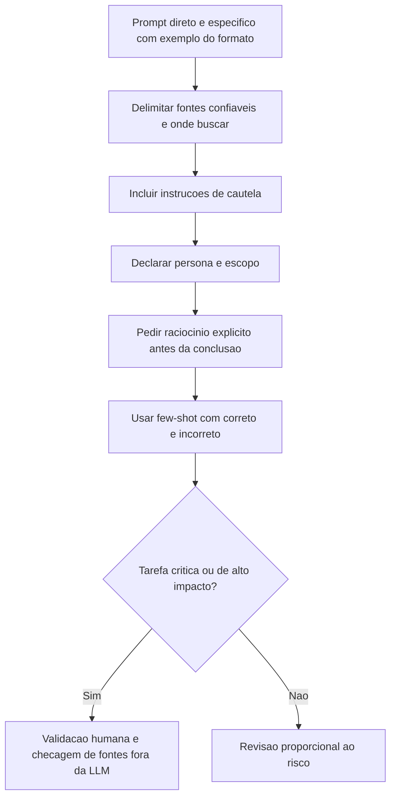

# Alucinação em LLMs

> [!summary] TL;DR
> - Alucinação é resposta linguisticamente plausível sem ancoragem factual: o LLM prevê sequências prováveis, não checa verdade.
> - Tipos: factual, de fonte/citação, estrutural e contextual.
> - Restringir o espaço de resposta reduz alucinação: fontes delimitadas, instruções de cautela, raciocínio explícito, persona e few-shot.
> - Saída é rascunho probabilístico: validação humana proporcional ao risco, obrigatória em código para produção, cálculo, medicina e jurídico.

## Conceitos-chave

- **Alucinação**: resposta plausível mas incorreta, porque o modelo gera token a token de forma autoregressiva ([[Pré-treinamento de LLMs]]) e escolhe o provável, não o verdadeiro. Vale para texto e código (respostas plausíveis porém erradas).
- **Factual**: fato errado (Marie Curie com três Nobel, eram dois).
- **De fonte/citação**: inventa artigos, frases atribuídas e referências inexistentes; piora com pedidos indutivos para "comprovar" premissa falsa.
- **Estrutural**: fórmulas inexistentes, código com APIs erradas ou elementos inexistentes.
- **Contextual**: começa coerente e degrada em interações longas (também em imagem); ligada à perda de atenção em [[Context Window em LLMs]], onde ultrapassar a janela faz o modelo esquecer o início e aumenta alucinação.
- **Causas**:
  - falta de conhecimento específico no treino;
  - inferências que o modelo não sustenta;
  - prompt que induz preencher lacunas;
  - ajuste para interação natural prefere soar convincente a admitir incerteza;
  - conhecimento congelado após o treino vira alucinação em fatos recentes ([[Raciocínio Simbólico e Conhecimento em Tempo Real]]);
  - mais liberdade de amostragem (temperatura alta) aumenta deriva ([[Parâmetros de Geração]]).
- **Qualidade do treino**: melhor treino gera mais coerência e menos alucinação; modelo alinhado por RLHF admite não saber, segue instruções e bajula menos ([[Fine-Tuning e RLHF]]).
- **Chain of Truth Proofing**: pedir o passo a passo antes da conclusão para expor a estrutura lógica e detectar saltos (exemplo da Amazônia: afirmação extrema sem base sinaliza alucinação).
- **Persona/escopo persistente**: definir papel e limites (só usa dados até certo ano, não prevê o futuro) no contexto da conversa, pasta ou instruções persistentes (ChatGPT, Copilot, Gemini, Llama, Manus).
- **Few-shot Prompting**: exemplos de correto e incorreto calibram o nível de inferência tolerado e reduzem ambiguidade; custo é preparar os exemplos e gastar mais tokens ([[Prompt Engineering vs RAG vs Fine-Tuning]]).
- **RAG**: recuperar contexto de bases confiáveis reduz lacunas em fatos recentes e dados internos, diminuindo a dependência da memória paramétrica.

## Fluxograma / Processo



- Pedir fontes, autores e estudos e delimitar onde buscar (jornais específicos, publicações acadêmicas).
- Manter a mesma ferramenta em tarefas recorrentes: o contexto acumulado dá consistência.
- Tratar a IA como pair programming ou estagiário: acelera, mas exige revisão.

## Erros comuns / Cuidados

- "Se parece certo, está certo" é falso.
- Quem não domina o assunto não deve reutilizar a resposta como conhecimento validado.
- Prompt excessivamente social ou com rodeios leva o modelo a priorizar agradabilidade; prompt direto com critérios explícitos reduz prolixidade e invenção.
- Casos jurídicos com citações e precedentes inventados geraram retratação formal, multas, dano reputacional e impacto financeiro milionário.
- Em domínios regulados, plausibilidade sem verificabilidade não vale nada.
- O raciocínio exposto por chain of thought também precisa ser validado.
- Exemplos ruins no few-shot ensinam padrão ruim.
- Dano sistêmico da alucinação é a erosão de confiança.

## Materiais complementares

### Prompts

**Instruções de cautela para reduzir invenção (narrado na aula)**
```text
Se não tiver certeza, diga que não sabe.
Não invente informações ausentes.
```

## Tags de busca

`#fundamentos-ia-generativa` `#alucinacao` `#mitigacao` `#few-shot` `#validacao-humana`
