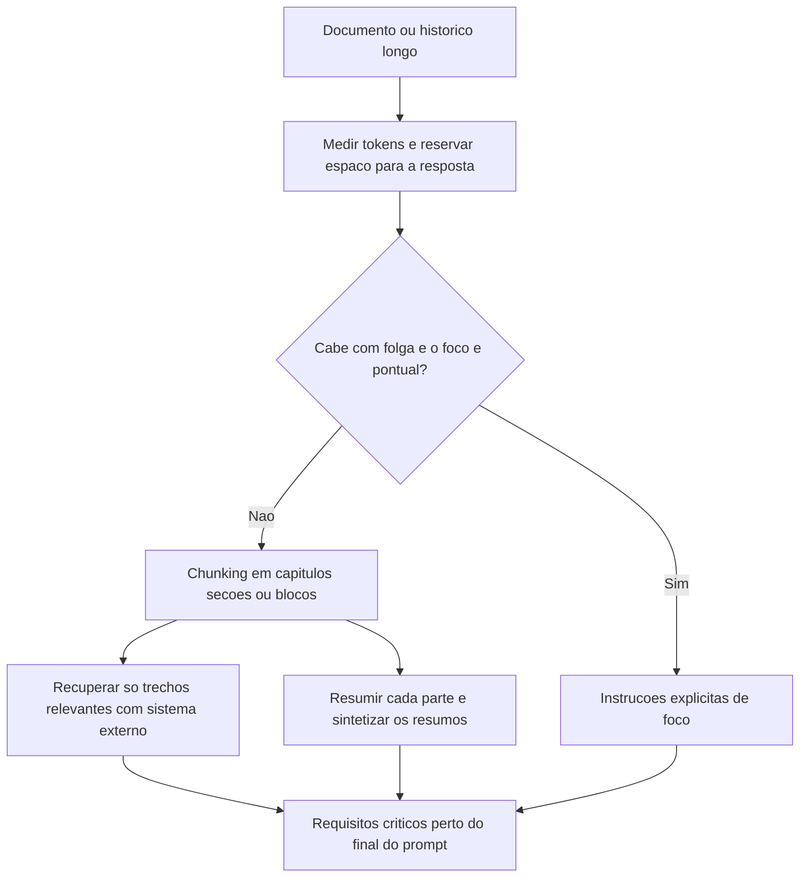

# Context Window em LLMs

> [!summary] TL;DR
> - Janela de contexto é o máximo de tokens considerados ao mesmo tempo: instruções + histórico + documentos + resposta.
> - Janela maior melhora alcance e coerência, não uniformidade de atenção: "caber na janela" não significa receber atenção.
> - Problemas: diluição de relevância, viés para o fim, custo quadrático da atenção e truncamento quando o limite é excedido.
> - Mitigação: chunking, recuperação só dos trechos relevantes, resumos hierárquicos, instruções de foco e um chat por tarefa.

## Conceitos-chave

- **Janela de contexto**: limite de tokens de entrada + saída, medido em tokens e não em palavras ([[Tokens e Tokenização]]); exemplos citados: 8.000 ou 32.000 tokens; Gemini 2.5 Pro e GPT 4.1 chegam a até 1 milhão.
- **Memória da conversa**: o que o modelo "lembra" numa conversa vem da janela, e se perde ao ultrapassá-la ([[Raciocínio Simbólico e Conhecimento em Tempo Real]]).
- **Sliding window**: tokens recentes empurram os antigos; ao ultrapassar o limite o modelo esquece o início, perde coerência e alucina mais ([[Alucinação em LLMs]]). Crítico em modo agêntico.
- **Truncamento**: excedido o limite, instruções e histórico são cortados; do lado da saída, o parâmetro max tokens interrompe a resposta no meio ([[Parâmetros de Geração]]).
- **Diluição de relevância**: muitos tokens competem por atenção ([[Transformers e Self-Attention]]), gerando resposta genérica, perda de detalhes e instruções descumpridas.
- **Viés para o fim**: tokens recentes pesam mais; instruções no final do prompt têm mais peso.
- **Custo quadrático**: o custo da atenção cresce de forma quadrática com o contexto (mais caro e mais lento).
- **Instruções antigas perdem força**: rules e memórias (CLAUDE.md, GEMINI.md) enfraquecem ao longo da sessão antes mesmo de bater o limite; memória é influência, não garantia; sumarização condensa o histórico ([[Workflow de Desenvolvimento com IA]]).
- **Trade-off documentos de contexto vs janela**: documentos de contexto consomem tokens; otimizar instruindo a IA a consultar só os documentos relevantes.

## Fluxograma / Processo

- Recuperar trechos antes de enviar separa busca e geração (base do RAG em [[Prompt Engineering vs RAG vs Fine-Tuning]]).
- Exemplos de instrução de foco: ignorar a segunda metade do documento, desconsiderar os últimos mil tokens.
- Um chat por tarefa ou subtarefa.

## Erros comuns / Cuidados

- PDF de 200 páginas com pedido "resumir a cláusula de confidencialidade da página 13": mesmo cabendo na janela, a resposta sai vaga ou misturada.
- Em prompts longos, colocar requisitos críticos perto do final ou reforçá-los.
- Contar palavras não aproxima custo nem contexto: prompt curto pode consumir muitos tokens, e a mesma frase consome tokens diferentes conforme idioma e termos raros.
- Rules podem ser ignoradas ao longo da sessão: revisão, checkpoints e reancoragem de instruções continuam necessários.

## Tags de busca

`#fundamentos-ia-generativa` `#context-window` `#chunking` `#truncamento` `#tokens`
