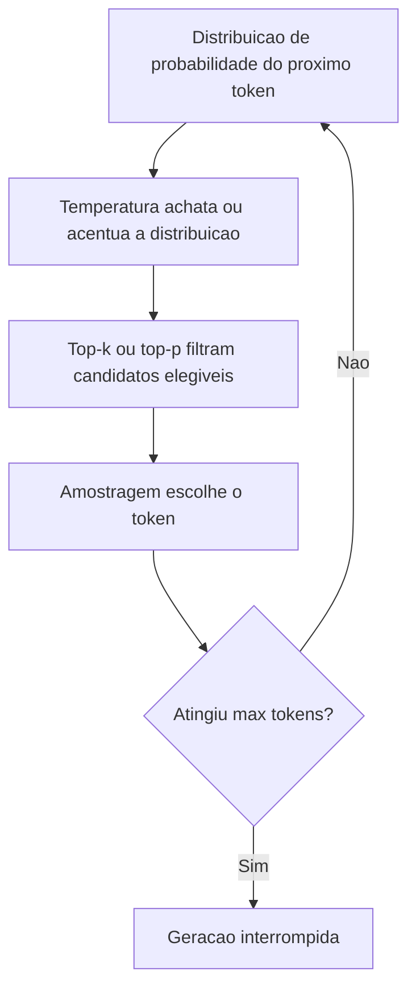
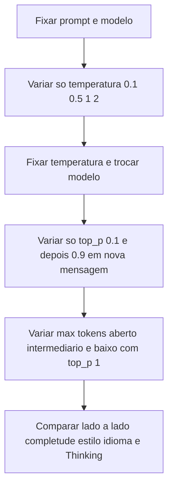

# Parâmetros de Geração

> [!summary] TL;DR
> - Geração é uma sequência de escolhas locais do próximo token; pequenas mudanças no prompt ou nos parâmetros alteram muito a saída.
> - Temperatura muda a forma da distribuição de probabilidade; top-k e top-p decidem quais tokens continuam elegíveis; max tokens decide quanto texto sai.
> - Parâmetros deslocam a distribuição sem mudar pesos e não adicionam conhecimento.
> - Faixa operacional recomendada de temperatura: 0,1 a 1; acima de 1 a saída degrada.
> - Configuração ideal depende da tarefa (resumo, código, e-mail, chatbot); mais liberdade aumenta risco de deriva e alucinação.

## Conceitos-chave

- **Próximo token**: palavra, parte de palavra ou símbolo escolhido a partir de um ranking probabilístico (ex: "O cachorro hoje latiu no..."). A unidade é a de [[Tokens e Tokenização]], não a palavra.
- **Controle de estilo**: estilo de saída (factual, criativo, resumido, técnico, informal, empático, direto) vem de prompt + parâmetros; o prompt define a direção semântica ([[Prompt Engineering vs RAG vs Fine-Tuning]]), os parâmetros ajustam o comportamento probabilístico.
- **Temperatura**: altera o grau de aleatoriedade, achatando ou acentuando a distribuição antes da escolha.
  - Baixa (0,1 a 0,3): privilegia tokens mais prováveis; saída previsível, técnica, conservadora (textos jurídicos, precisão).
  - Alta (0,7 a 1,0): abre espaço a tokens improváveis; diversidade lexical e estrutural (brainstorm, poesia, música), menos previsibilidade e pior qualidade factual.
  - Metáfora da biblioteca: com temperatura baixa o especialista vai direto ao Vade Mecum; com alta traz livros pouco relacionados (literatura infantil, fantasia).
  - Só muda o quanto o modelo se afasta do caminho mais provável.
- **Top-k sampling**: mantém só os k tokens mais prováveis (k=2, k=5); os demais são descartados mesmo com probabilidade não nula. Rígido em quantidade, variável em cobertura.
- **Top-p (nucleus sampling)**: ordena os tokens e soma probabilidades até atingir p; o tamanho do conjunto varia conforme o formato da distribuição. Rígido em cobertura, variável em quantidade, mais adaptativo à incerteza do modelo.
- **Massa acumulada**: soma progressiva das probabilidades ordenadas, usada pelo top-p para cortar a cauda.
- **Por que top-k/top-p existem**: evitar escolha gulosa (repetição mecânica) e evitar tokens muito improváveis.
- **Ordem de atuação**: temperatura altera a forma da distribuição antes; top-k/top-p filtram os candidatos depois.
- **Max tokens**: limite que interrompe a geração ao atingir o valor configurado; limite baixo trunca a resposta no meio da frase (ex: 512 tokens no prompt de buracos negros). Cada token processado ou gerado consome recursos, então limitar saída reduz latência e gasto. Relação com o limite total em [[Context Window em LLMs]].
- **Três decisões separadas**: variedade (temperatura), candidatos na amostragem (top-p), quanto texto (max tokens).
- **Campo Thinking**: mostra o planejamento intermediário do modelo (simplificar termos, escolher analogias, organizar tópicos); ausência indica falta de visibilidade, não falta de raciocínio.

### Exemplo numérico de top-k e top-p

"o sol está brilhando no ...":

| Token | Probabilidade | Acumulado |
|---|---|---|
| céu | 0,35 | 0,35 |
| horizonte | 0,25 | 0,60 |
| mar | 0,15 | 0,75 |
| campo | 0,10 | 0,83 |
| deserto | 0,08 | 0,90 |
| luz | 0,04 | 0,94 |

- Top-k=5: os cinco primeiros ficam elegíveis.
- Top-p=0,9: corta em deserto; luz fica fora.

### Efeito observado da temperatura (prompt "explicar buracos negros")

- **0,1**: analogias consistentes (ralo de pia cósmico, cachoeira para horizonte de eventos), previsível e organizado.
- **0,5**: estrutura mantida, mais flexibilidade lexical, equilíbrio entre didatismo e criatividade.
- **1**: introduz elementos não pedidos (curiosidades, "pipoca queimada", dilatação do tempo), mais risco de exagero e imprecisão.
- **2**: degradação, mistura de idiomas, trechos desconexos.

### Efeito observado do top-p

- Efeito mais sutil que o da temperatura: atua em nuances (escolha de termos, variações locais).
- top_p=0.9 inclui várias opções; valor baixo (0.6) pode deixar só o token dominante.

### Comparação de modelos com mesmo prompt e temperatura

- DeepSeek: respostas longas, com Thinking.
- Minimax: respondeu em inglês.
- Gemini: mais curto.
- Mistral: sem Thinking.

## Fluxograma / Processo

Escolha do próximo token:

Experimento controlado no Hugging Face Playground:

- Acesso ao Playground: abrir huggingface.com/playground; criar conta (usuário, senha, username) ou logar; confirmar e-mail; em huggingface.com/settings/tokens criar token, copiar e colar no Playground; controles ficam no painel lateral (modelo, provider, parâmetros).
- Múltiplas mensagens no Playground preservam a execução anterior, permitindo comparação lado a lado.
- No teste de max tokens, observar completude, não só tamanho.

## Erros comuns / Cuidados

- Resposta que termina abruptamente não é falta de conhecimento do modelo, é restrição operacional da chamada (importante no debugging).
- Se a resposta trunca, muitas vezes é melhor reescrever o prompt (menos itens, formato compacto) do que só aumentar o limite.
- Max tokens em zero ou muito baixo faz a execução falhar ou truncar e contamina o teste de outros parâmetros.
- Diferença pequena com top-p não significa que o parâmetro "não fez nada".
- Comparar modelos sem fixar prompt e contexto de execução gera conclusões fracas.
- Alguns modelos ou rotas exigem plano pago (pop-up de cobrança): trocar modelo ou provider.
- Falha no botão de execução costuma ser provider instável ou sobrecarregado: fechar e reexecutar ou trocar provider; não confundir erro de infraestrutura com comportamento do modelo.
- Mais liberdade de geração aumenta risco de deriva e [[Alucinação em LLMs]].

## Materiais complementares

### Conteúdo extra

- Hugging Face Playground: huggingface.com/playground (testar modelos e parâmetros sem código); tokens de acesso em huggingface.com/settings/tokens.
- OpenAI Tokenizer: https://platform.openai.com/tokenizer (visualiza a quebra em tokens por modelo, sem login; útil para prever custo e depurar prompts).
- Ecossistema Hugging Face: Docs (documentação, bibliotecas, integrações como AWS), Community (artigos), Models (catálogo com metadados, downloads, snippets), Datasets, Spaces (apps da comunidade, qualidade variável, bons para exploração e não para produção), Daily Papers (publicações recentes com filtros por período e tema).

## Tags de busca

`#fundamentos-ia-generativa` `#temperatura` `#top-k-top-p` `#max-tokens` `#hugging-face`
