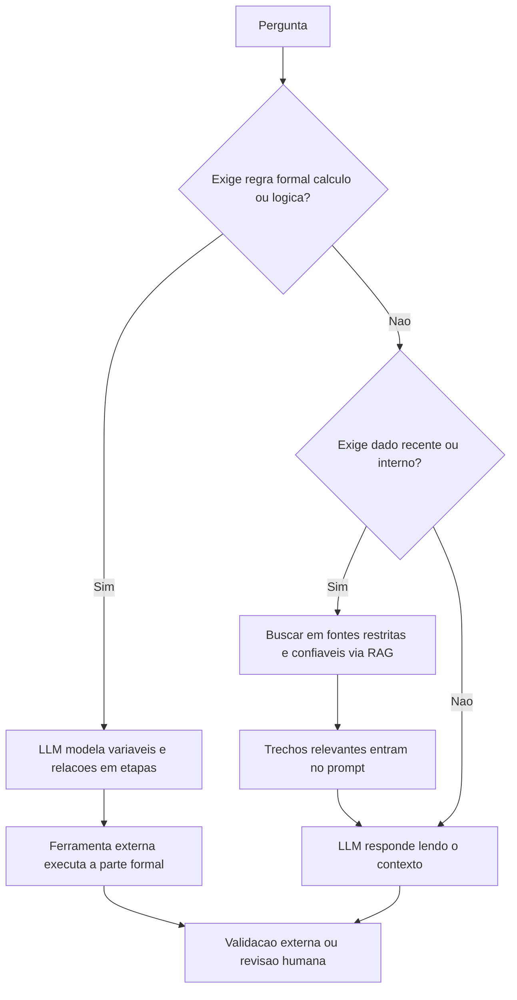

# Raciocínio Simbólico e Conhecimento em Tempo Real

> [!summary] TL;DR
> - Fluência textual não é raciocínio simbólico: o LLM escolhe tokens por probabilidade condicional e não valida cada passo, então erra com fluidez e confiança.
> - Mitigação do raciocínio: chain of thought, raciocínio híbrido com ferramentas formais (Python, calculadoras, motores simbólicos) e validação externa.
> - Conhecimento do modelo fica congelado após o treino; interações do usuário não retreinam o modelo.
> - Dados atuais vêm de fora dos pesos: memória auxiliar, busca em fontes restritas e RAG; retreino é caro e lento para tempo real.

## Conceitos-chave

### Raciocínio simbólico

- **Raciocínio simbólico**: manipular símbolos por regras explícitas (álgebra, lógica, programação).
- **Inferência lógica por correlação**: "todos os A são B", "X é A" logo "X é B" pode sair certo por correlação estatística, sem compreensão estrutural.
- **Limite do Transformer**: não funciona como compilador, provador ou resolvedor algébrico; não mantém prova simbólica nem memória simbólica verificável ([[Transformers e Self-Attention]]).
- **Erro acumulado**: em tarefas multi-etapa o erro se propaga e a resposta continua confiante.
- **Chain of Thought Prompting**: expor o raciocínio em etapas (definir variáveis, montar relações, aplicar condição, concluir); bom para lógica, cálculo e depuração, mas deixa a resposta mais longa e cara ([[Prompt Engineering vs RAG vs Fine-Tuning]]).
- **Raciocínio híbrido**: LLM organiza, ferramenta externa executa a parte formal (Python, calculadoras, APIs, motores simbólicos; LangChain, AutoGPT).
- **Modelos neurossimbólicos**: Deep Learning + lógica simbólica, em evolução.
- **Exemplo**: "João tem o dobro da idade de Maria e, daqui a 5 anos, a soma das idades será 45": modelar J = 2M e (J+5)+(M+5) = 45 antes de resolver.

### Conhecimento em tempo real

- **Conhecimento congelado**: após o treinamento ([[Pré-treinamento de LLMs]]), eventos recentes, preços, decisões judiciais novas e dados operacionais ficam desatualizados ou viram [[Alucinação em LLMs]].
- **Inferência não é treinamento**: interações do usuário não retreinam o modelo; logs só valeriam num novo ciclo explícito de treino.
- **Sem mente coletiva**: instâncias de inferência em GPUs distintas não compartilham estado nem aprendizado.
- **Lembrar na conversa**: vem da [[Context Window em LLMs]] e se perde ao ultrapassá-la.
- **Memória ativada**: armazenamento auxiliar externo (nome, estilo, interesses), como bloco de notas, sem recalcular pesos.
- **RAG**: a pergunta dispara busca em documentos recentes, os trechos relevantes entram no prompt e o modelo responde lendo, sem alterar pesos; analogia de consultar um livro antes de responder, não de aprender. Arquitetura completa em [[Prompt Engineering vs RAG vs Fine-Tuning]].
- **Separação de responsabilidades**: capacidade linguística fica no modelo; atualização factual fica nos dados.

## Fluxograma / Processo



- Instruir o sistema a consultar fontes específicas antes de responder (ex: restringir a publicações do MIT ou de Stanford).
- Na busca web, restringir onde buscar e pedir referências, porque as fontes podem ser ruins.

## Erros comuns / Cuidados

- Dificuldade com negação, dupla negação, inversão de quantificadores ("todo X é Y" não equivale a "todo Y é X") e contradições; mitigar com prompts diretos, validação manual e ferramentas formais.
- O raciocínio exposto por chain of thought também precisa ser validado.
- Domínios voláteis (medicina, jurídico, catálogo de produtos, dados corporativos, financeiro do dia) não podem depender do conhecimento congelado.
- Retreinamento ou [[Fine-Tuning e RLHF]] é caro e lento, não é solução para tempo real.
- RAG não faz a LLM "aprender em tempo real", faz responder com contexto recuperado em tempo real.

## Materiais complementares

### Prompts

**Gatilho de chain of thought (exemplo das maçãs, João termina com 5 maçãs; enunciado completo narrado na aula)**
```text
pense passo a passo
```

## Tags de busca

`#fundamentos-ia-generativa` `#raciocinio-simbolico` `#chain-of-thought` `#conhecimento-congelado` `#rag`
