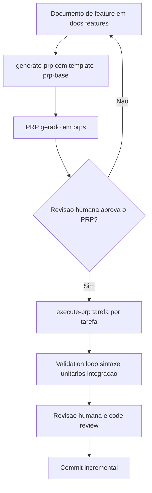

# PRP (Product Requirements Prompt)

> [!summary] TL;DR
> - PRP = PRD + inteligência de base de código curada + agente/runbook: o pacote mínimo viável para a IA gerar código pronto para produção na primeira tentativa.
> - É um prompt que gera prompt: compila o documento de feature num plano de implementação detalhado e reutilizável (contexto, critérios de sucesso, tarefas, validação).
> - Entrega um recorte vertical de software funcional, nada mais, nada menos.
> - Fluxo: documento de feature, generate-prp, revisão humana do PRP, execute-prp, validação por testes e code review.
> - Confidence score é heurística de triagem, nunca garantia; revisão humana é obrigatória.

## Conceitos-chave

- **Origem**: metodologia criada no verão de 2024, com foco em context engineering (ver [[Workflow de Desenvolvimento com IA]]); projeto de referência Wirasm/PRPs-agentic-eng, com README passo a passo.
- **Metaprompt**: o PRP é um prompt que gera/refina prompt; repositórios-base de PRP devem ser adaptados ao time, não copiados.
- **Template prp-base**: molde com objetivo, escopo, arquivos relevantes, critérios de sucesso, riscos e validação.
- **Pastas**: `templates/` guarda os moldes (ex: `templates/prp-base`); `prps/` guarda as instâncias (`prps/<feature>.md`).
- **Documento de feature**: entrada do processo (ex: `docs/features/components-refactoring.md`), com contexto, objetivo, mudanças esperadas, exemplos e cautelas (como contexto desatualizado). Feature vaga gera PRP vago.
- **generate-prp**: slash command customizado, um "shell script em Markdown"; recebe o caminho da feature e gera o arquivo em `prps/`.
- **Implementation blueprint**: modelo de dados, lista de tarefas ordenada, pseudocódigo por tarefa, pontos de integração e sequência de validação.
- **Tree atual vs tree futura**: mostra arquivos criados, movidos e removidos, com a responsabilidade de cada um.
- **Contexto para implementação**: arquivos e URLs a ler e por quê (seção "MUST READ").
- **Gotchas, library quirks e anti-patterns**: transformam conhecimento tácito em restrição explícita (ex: formato de filtro do Pinecone, valores de K baseados em dados reais).
- **Validation loop em níveis**: Level 1 sintaxe e estilo, Level 2 testes unitários, Level 3 teste de integração, mais checklist final.
- **Confidence/quality score**: heurística de triagem para decidir onde revisar, nunca garantia.
- **execute-prp**: lê o PRP, aprofunda o raciocínio (ex: "ultrathink"), executa tarefa por tarefa, valida e registra a referência do PRP.
- **Revisão humana obrigatória**: arquivo por arquivo, testes e áreas de risco; agente de code review complementa, não substitui.
- **Automação graduada**: leitura e planejamento automáticos, bloquear escrita antes de revisão, restringir tipos de arquivo, commits incrementais.
- **Integração com tickets**: tarefas do Jira/Confluence via MCP viram insumo para o PRP.

## Fluxograma / Processo



- Features grandes devem ser quebradas em escopos menores antes de gerar o PRP.

## Erros comuns / Cuidados

- Documento de feature vago produz PRP vago.
- Tratar o confidence score como garantia de correção.
- Pular a revisão humana do PRP antes do execute-prp.
- Deixar o agente escrever livremente sem checkpoints; preferir commits incrementais.
- Copiar repositórios-base de PRP sem adaptar ao modo de trabalhar do time.

## Materiais complementares

### Prompts

**PRP completo gerado na aula (generate-prp), usado no execute-prp para finalizar a refatoração de um RAG em Python com Pinecone e Google Drive via Strategy Pattern**
```text
Components Refactoring - RAG Strategy Pattern Enhancement

Purpose
Finalize the modular refactoring of the RAG system to ensure complete separation of retrieval strategies, remove unused legacy code, standardize naming conventions, and establish proper documentation while maintaining backward compatibility.

Core Principles
SOLID Adherence: Single Responsibility and Dependency Inversion principles
Strategy Pattern: Separate filters/retrievers for each document type
Factory Pattern: Centralized strategy creation and management
Backward Compatibility: Maintain existing API interfaces
Global rules: Follow all rules in CLAUDE.md

Goal
Complete the refactoring of the RAG system to eliminate hardcoded business logic scattered throughout the codebase, establishing a clean modular architecture where each document type has its own specialized strategy with proper naming conventions and comprehensive documentation.

Why
Maintainability: Current system mixes business logic making it hard to maintain and extend
Extensibility: Need to easily add new document types and search strategies
Consistency: Standardize naming and implementation patterns across strategies
Debugging: Easier to trace and debug specific document type behaviors
Team Productivity: Clear separation of concerns allows parallel development

What
Enhance the existing modular architecture by completing the refactoring process, removing legacy code, standardizing interfaces, and establishing comprehensive documentation.

Success Criteria
All unused legacy methods removed from agent.py
Consistent naming conventions across all strategy components
Complete documentation in docs/system-architecture.md
All tests updated and passing
No breaking changes to public API
Script check_document_types.py works without errors

All Needed Context
Documentation & References
# MUST READ - Include these in your context window
- url: https://refactoring.guru/design-patterns/strategy/python/example
  why: Strategy pattern implementation best practices in Python
- url: https://refactoring.guru/design-patterns/factory-method/python/example
  why: Factory pattern for creating strategy instances
- url: https://realpython.com/factory-method-python/
  why: Advanced factory pattern techniques for complex systems
- url: https://www.digitalocean.com/community/conceptual-articles/s-o-l-i-d-the-first-five-principles-of-object-oriented-design
  why: SOLID principles for maintainable code architecture
- file: src/agents/rag/strategies/disciplina_strategy.py
  why: Example of well-implemented strategy with hybrid approach and query analysis
- file: src/agents/rag/strategies/base_strategy.py
  why: Abstract base class defining strategy interface and common functionality
- file: src/agents/rag/strategies/strategy_factory.py
  why: Current factory implementation pattern for strategy creation
- file: tests/agents/rag/test_agent.py
  why: Existing test patterns for agent functionality

Current Codebase tree
src/agents/rag/
├── __init__.py
├── agent.py # Main orchestrator - NEEDS CLEANUP
├── agent_original.py # Legacy backup - TO REMOVE
├── config.py # Configuration
├── course/ # Course management components
│   ├── __init__.py
│   ├── availability_checker.py
│   ├── catalog_manager.py
│   └── document_optimizer.py
├── drive_manager.py # Google Drive integration
├── ingestion/ # Document ingestion components
│   ├── __init__.py
│   ├── cleanup_manager.py
│   ├── document_ingester.py
│   └── sync_processor.py
├── retrievers/ # Retrieval implementations
│   ├── __init__.py
│   ├── fallback_retriever.py
│   ├── hybrid_retriever.py
│   ├── name_based_retriever.py
│   └── progressive_retriever.py
├── strategies/ # Document type strategies
│   ├── __init__.py
│   ├── base_strategy.py
│   ├── comparative_strategy.py
│   ├── disciplina_strategy.py
│   ├── faq_strategy.py
│   ├── overview_strategy.py
│   ├── participacoes_strategy.py
│   ├── professores_strategy.py
│   └── strategy_factory.py
├── utils/ # Utility components
│   ├── __init__.py
│   ├── filter_builder.py
│   ├── performance_monitor.py
│   └── statistics_tracker.py
└── vector_manager.py # Pinecone vector operations

Desired Codebase tree with files to be added and responsibility of file
src/agents/rag/
├── agent.py # CLEANED - Pure orchestrator with delegation only
├── config.py # Configuration (unchanged)
├── course/ # Course management (unchanged)
├── drive_manager.py # Google Drive integration (unchanged)
├── ingestion/ # Document ingestion (unchanged)
├── retrievers/ # Retrieval implementations (cleaned naming)
├── strategies/ # ENHANCED - All strategies standardized
│   ├── base_strategy.py # ENHANCED - Better interface documentation
│   ├── comparative_strategy.py # CLEANED - Consistent with base pattern
│   ├── disciplina_strategy.py # REFERENCE - Already well implemented
│   ├── faq_strategy.py # CLEANED - Standardized implementation
│   ├── overview_strategy.py # CLEANED - Standardized implementation
│   ├── participacoes_strategy.py # CLEANED - Standardized implementation
│   ├── professores_strategy.py # CLEANED - Standardized implementation
│   └── strategy_factory.py # ENHANCED - Better error handling
├── utils/ # Utility components (unchanged)
└── vector_manager.py # Pinecone operations (unchanged)
docs/
└── system-architecture.md # NEW - Complete architecture documentation

Known Gotchas of our codebase & Library Quirks
# CRITICAL: Pinecone requires online mode for accurate document counts
# Always use pinecone_only_mode=False when checking document availability
# CRITICAL: Strategy factory caches strategy instances
# Clear cache when configuration changes during testing
# CRITICAL: Filter dict format for Pinecone
# Use {'curso_id': course_id, 'tipo': doc_type} format
# For multiple types: {'curso_id': course_id, 'tipo': {'$in': ['type1', 'type2']}}
# CRITICAL: K_OPTIMAL values are based on real data analysis
# disciplina: 23-30 (159 total chunks, avg 26.5 per course)
# overview: 8 (74 total chunks)
# faq: 1 (4 total chunks)
# GOTCHA: Current check_document_types.py script has API compatibility issue
# Uses old filter_dict parameter instead of search_kwargs format
# PATTERN: All strategies must implement get_optimal_k() method
# Return type: int, not Optional[int]
# PATTERN: Hybrid retrievers combine multiple document types
# Use $in operator for multiple tipos in filter_dict

Implementation Blueprint
Data models and structure
Current strategy interface is well-defined in base_strategy.py:
# Abstract base class provides:
# - get_retriever(course_id, query, k) -> retriever
# - get_optimal_k(default_k) -> int
# - supports_fallback() -> bool
# - get_fallback_types() -> List[str]
# - check_document_availability(course_id, doc_type) -> bool
# - _create_retriever(filter_dict, k) -> retriever
# Each strategy implements specialized logic for:
# - Query analysis (listing vs content queries)
# - Filter construction (single type vs hybrid)
# - K value optimization based on document distribution
# - Fallback type configuration

List of tasks to be completed to fulfill the PRP in the order they should be completed
Task 1 - Audit and Clean Agent.py:
ANALYZE src/agents/rag/agent.py:
  - IDENTIFY unused legacy methods in RetrievalAgent class
  - FIND methods that don't follow delegation pattern
  - DOCUMENT methods that need to be removed vs standardized
  - CHECK backward compatibility requirements
Task 2 - Remove Legacy Code:
MODIFY src/agents/rag/agent.py:
  - REMOVE agent_original.py backup file
  - DELETE unused legacy methods from RetrievalAgent
  - PRESERVE all public API methods for backward compatibility
  - CLEAN up comments and unused imports
Task 3 - Standardize Strategy Implementations:
ANALYZE all files in src/agents/rag/strategies/:
  - COMPARE implementations against disciplina_strategy.py reference
  - IDENTIFY inconsistent naming patterns
  - DOCUMENT missing methods or incorrect signatures
  - CHECK K_OPTIMAL values alignment with real data
Task 4 - Enhance Strategy Factory:
MODIFY src/agents/rag/strategies/strategy_factory.py:
  - ADD better error handling for unsupported document types
  - IMPROVE logging and debugging information
  - ADD validation for strategy interface compliance
  - ENSURE proper cache management
Task 5 - Fix Script Compatibility:
MODIFY scripts/check_document_types.py:
  - FIX filter_dict parameter compatibility issue
  - UPDATE to use search_kwargs format from current API
  - TEST against all document types to ensure functionality
  - VALIDATE retriever creation works correctly
Task 6 - Update Test Suite:
MODIFY tests/agents/rag/test_agent.py:
  - ADD tests for each strategy type
  - UPDATE tests for cleaned agent methods
  - ADD integration tests for strategy factory
  - ENSURE all legacy method removal doesn't break tests
Task 7 - Create Architecture Documentation:
CREATE docs/system-architecture.md:
  - DOCUMENT overall system architecture and components
  - EXPLAIN strategy pattern implementation
  - DESCRIBE each document type strategy and its purpose
  - PROVIDE examples of adding new strategies
  - INCLUDE troubleshooting guide for common issues
Task 8 - Validate Complete System:
RUN comprehensive validation:
  - EXECUTE all tests and ensure they pass
  - RUN check_document_types.py script successfully
  - TEST demo_ask_question.py for each document type
  - VERIFY no breaking changes to public API

Per task pseudocode as needed added to each task
# Task 1 - Audit Agent.py
def audit_agent_methods():
    # Pattern: Check each method in RetrievalAgent
    for method in RetrievalAgent.__dict__:
        if method.startswith('_build_filter'):
            # Legacy filter building methods - can be removed
            # Replaced by FilterBuilder component
        elif method.startswith('get_') and 'retriever' in method:
            # Core retriever methods - must keep for API compatibility
            # Should delegate to appropriate component
        elif method.startswith('_legacy_'):
            # Obvious legacy methods - mark for removal

# Task 3 - Standardize Strategies
class StandardizedStrategy(DocumentSearchStrategy):
    def get_retriever(self, course_id: str, query: str = "", k: Optional[int] = None) -> Any:
        # PATTERN: Always start with K optimization
        k = k or self.get_optimal_k()
        # PATTERN: Log strategy decisions
        self.logger.info(f"[STRATEGY-{self.__class__.__name__.upper()}] Processing query for course '{course_id}'")
        # PATTERN: Apply query analysis if needed
        if self._requires_special_handling(query):
            return self._get_specialized_retriever(course_id, query, k)
        else:
            return self._get_standard_retriever(course_id, k)

    def get_optimal_k(self, default_k: int = 10) -> int:
        # PATTERN: Return optimized K based on data analysis
        # Each strategy should return specific K value, not default_k
        return self.OPTIMAL_K_VALUE

# Task 5 - Fix Script Compatibility
def create_retriever_fixed(agent, doc_type, course_id=None):
    # OLD (broken): agent.get_retriever(filter_dict={...})
    # NEW (working): agent.get_retriever(course_id=course_id, doc_type=doc_type)
    try:
        retriever = agent.get_retriever(course_id=course_id, doc_type=doc_type)
        return retriever
    except Exception as e:
        logger.error(f"Failed to create retriever for {doc_type}: {e}")
        return None

Integration Points
DOCUMENTATION:
  - create: docs/system-architecture.md
  - pattern: "Follow structure from docs/context.md for consistency"
TESTING:
  - update: tests/agents/rag/test_agent.py
  - pattern: "Add test methods following existing test_agent_initialization pattern"
SCRIPTS:
  - fix: scripts/check_document_types.py
  - pattern: "Use agent.get_retriever(course_id, doc_type) instead of filter_dict"
STRATEGIES:
  - standardize: All files in src/agents/rag/strategies/
  - pattern: "Follow disciplina_strategy.py as reference implementation"

Validation Loop
Level 1: Syntax & Style
# Run these FIRST - fix any errors before proceeding
python -m pytest tests/agents/rag/test_agent.py -v # Core agent tests
python scripts/check_document_types.py # Script functionality
python scripts/demo_ask_question.py # Manual integration test
# Expected: All tests pass, scripts run without errors

Level 2: Unit Tests for each enhanced component
# ADD to tests/agents/rag/test_agent.py:
def test_strategy_factory_all_types():
    """Test that factory can create all supported strategy types"""
    agent = RetrievalAgent(mock_config, pinecone_only_mode=True)
    for doc_type in ['overview', 'disciplina', 'faq', 'professores', 'participacoes', 'comparative']:
        strategy = agent.strategy_factory.get_strategy(doc_type)
        assert strategy is not None
        assert hasattr(strategy, 'get_retriever')
        assert hasattr(strategy, 'get_optimal_k')

def test_cleaned_agent_no_legacy_methods():
    """Verify legacy methods are removed"""
    agent = RetrievalAgent(mock_config, pinecone_only_mode=True)
    legacy_methods = ['_build_filter_cached', '_get_optimized_filter'] # Add all removed methods
    for method in legacy_methods:
        assert not hasattr(agent, method), f"Legacy method {method} should be removed"

def test_document_types_script_compatibility():
    """Test that check_document_types.py works correctly"""
    # This should run without the filter_dict error
    import subprocess
    result = subprocess.run(['python', 'scripts/check_document_types.py'], capture_output=True, text=True)
    assert result.returncode == 0
    assert "filter_dict" not in result.stderr # Should not have compatibility errors

# Run and iterate until passing:
python -m pytest tests/agents/rag/test_agent.py -v
# If failing: Read error, understand root cause, fix code, re-run

Level 3: Integration Test
# Test each document type retrieval
python scripts/demo_ask_question.py
# Try questions like:
# - "Quais são as disciplinas do mba-ia?" (disciplina strategy)
# - "O que é o curso mba-ia?" (overview strategy)
# - "Quem são os professores?" (professores strategy)
# Expected: Each question type routes to correct strategy and returns relevant results
# Check logs to confirm strategy selection: [STRATEGY-DISCIPLINA], [STRATEGY-OVERVIEW], etc.

Final validation Checklist
All tests pass: python -m pytest tests/ -v
check_document_types.py runs without errors
demo_ask_question.py works for all document types
No legacy methods remain in agent.py
All strategies follow consistent naming patterns
Strategy factory handles all supported document types
Architecture documentation is complete and accurate
No breaking changes to public agent API

Anti-Patterns to Avoid
Don't remove public API methods used by ConversationalAgent
Don't break backward compatibility for existing scripts
Don't hardcode document types - use strategy factory
Don't skip testing individual strategies
Don't ignore the existing K_OPTIMAL data-driven values
Don't create new patterns when existing strategy pattern works
Don't mix business logic back into the main agent class

Confidence Score: 9/10
This PRP provides comprehensive context about the existing modular architecture and specific areas that need completion. The system is already 70% refactored, so this PRP focuses on finishing the work rather than starting from scratch. All necessary documentation, examples, and validation steps are included for successful one-pass implementation.
```

### Conteúdo extra

- Projeto PRPs agentic engineering: https://github.com/Wirasm/PRPs-agentic-eng
- Referências citadas no PRP: https://refactoring.guru/design-patterns/strategy/python/example ; https://refactoring.guru/design-patterns/factory-method/python/example ; https://realpython.com/factory-method-python/ ; https://www.digitalocean.com/community/conceptual-articles/s-o-l-i-d-the-first-five-principles-of-object-oriented-design

## Tags de busca

`#fundamentos-ia-generativa` `#prp` `#context-engineering` `#slash-commands`
