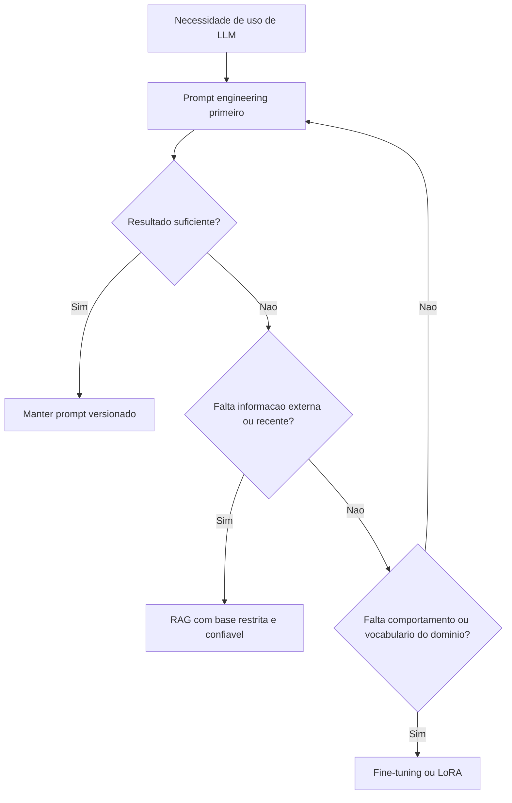
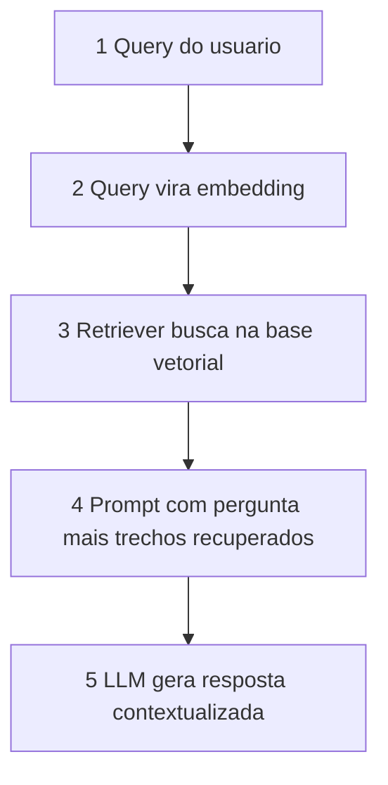

# Prompt Engineering vs RAG vs Fine-Tuning

> [!summary] TL;DR
> - Escolha guiada pelo trade-off custo, eficiência e controle.
> - Prompt engineering é a primeira opção: menor custo e tempo, sem alterar pesos nem pipeline.
> - RAG traz informação externa ao prompt em tempo de resposta; não faz a LLM aprender, faz responder com contexto recuperado.
> - Fine-tuning é adaptação profunda quando instruções não bastam, com maior custo e complexidade.
> - Prompt engineering e RAG reduzem a dependência da memória paramétrica do modelo.

## Conceitos-chave

- **Prompt engineering**: instruções deliberadas com contexto, formato, restrições e intenção. Controle por especificação: "parágrafo sobre o clima" vs "parágrafo informativo, linguagem jornalística, impacto do El Niño no Brasil em 2023".
- **Prompt vs parâmetros**: os [[Parâmetros de Geração]] ajustam o comportamento probabilístico; o prompt define a direção semântica.
- **Precisão e custo**: especificidade importa em tarefas críticas (código, atendimento); perguntas abertas geram retrabalho e consomem mais [[Tokens e Tokenização|tokens]].
- **Prompt como artefato de engenharia**: versionado, comparado, com testes A/B de estilo, tom, detalhe e restrição (ver governança em [[Workflow de Desenvolvimento com IA]]).
- **Zero-shot**: só instrução, sem exemplos. Barato e rápido, depende da clareza; bom para tarefas conhecidas (sentimento) ou exploração.
- **Few-shot**: exemplos input/output antes da consulta (ex: frases rotuladas como positivo, negativo e neutro, seguidas de uma quarta para classificar). Mais controle de estilo e formato, reduz ambiguidade e [[Alucinação em LLMs|alucinação]]; custa mais tokens; exemplos ruins ensinam padrão ruim.
- **Chain-of-thought (CoT)**: raciocínio passo a passo antes da resposta. Bom para lógica, múltiplas etapas, cálculo e depuração; resposta mais longa e cara, às vezes exige segundo prompt para condensar; o raciocínio exposto também precisa ser validado (ver [[Raciocínio Simbólico e Conhecimento em Tempo Real]]).
- **Role-based**: o modelo assume um papel (advogado, médico, cientista de dados, persona da empresa); induz vocabulário, profundidade e prioridades. Exige iteração e mais tokens; persona mal especificada fica artificial ou estreita.
- **Instruction tuning via prompt**: comandos explícitos de conteúdo, estilo, restrições e tamanho, sem alterar pesos.
- **Escolha da técnica de prompt**: zero-shot para rapidez e economia; few-shot para aderência por demonstração; CoT para inspeção do raciocínio; role-based para domínio; instruction tuning para padronização.
- **RAG (Retrieval-Augmented Generation)**: LLM + fonte externa de conhecimento. LLM pura nasce defasada (conhecimento congelado) e retreino contínuo é caro e inviável; sem recuperação surgem lacunas ou alucinações em fatos recentes e dados internos. Analogia: consultar um livro antes de responder, não aprender.
- **Fontes do RAG**: a web é possível, mas bases restritas e confiáveis são melhores: documentos em S3, APIs internas, e-mails, chats, relatórios, FAQs, bases acadêmicas. Controlar de onde vem o contexto é tão importante quanto escolher a LLM.
- **Retriever**: faz busca semântica na base vetorial usando [[Embeddings e Similaridade|embeddings]]; "acesso remoto seguro" recupera "VPN corporativa" por proximidade de sentido.
- **Fine-tuning**: adapta pesos quando o prompt não carrega o contexto de forma confiável, em tarefa estreita, domínio técnico ou dados privados; detalhes, custos e riscos em [[Fine-Tuning e RLHF]] e alternativas baratas (LoRA, quantização) em [[Otimização de Grandes Modelos]]. Não é solução para tempo real: especialização envelhece em domínios que mudam.
- **Critério de adaptação**: adaptar o modelo só quando melhora o resultado de forma compatível com custo e manutenção, pensando no ciclo de vida.

## Fluxograma / Processo

Escolha da estratégia:



As 5 camadas do RAG:



- Na camada 3, os documentos já foram previamente quebrados em trechos e embedados.
- Exemplos de query: "quais são as políticas de backup da empresa?", "o que diz a cláusula 7 do contrato?". Exemplo de trechos montados no prompt: uso obrigatório de VPN, registro por log, atualização de dispositivos móveis.

## Erros comuns / Cuidados

- Prompt genérico ("me ajude com o resumo") gera saída vaga e retrabalho.
- Qualidade da resposta do RAG depende da relevância do contexto montado.
- Busca aberta na internet inteira traz ruído: restringir a sites, revistas, faculdades ou bases internas e pedir referências.
- Few-shot com exemplos ruins ensina padrão ruim; CoT exposto não é garantia de raciocínio correto.

## Materiais complementares

### Prompts

**Prompt genérico (pouco otimizado)**
```text
me ajude com o resumo
```

**Contraste de especificidade (versão vaga)**
```text
escreva um parágrafo sobre o clima
```

**Zero-shot de classificação de sentimento**
```text
classifique o sentimento da frase: estou muito feliz com o produto que acabei de comprar
```

**Gatilho de CoT (exemplo das maçãs, João termina com 5 maçãs; enunciado completo narrado na aula)**
```text
pense passo a passo
```

**Role-based**
```text
você é um advogado trabalhista experiente; explique de forma clara os direitos de um trabalhador segundo a CLT
```

**Instruction tuning via prompt**
```text
explique inflação em linguagem simples, com até três parágrafos curtos
```

## Tags de busca

`#fundamentos-ia-generativa` `#prompt-engineering` `#rag` `#fine-tuning` `#few-shot`
