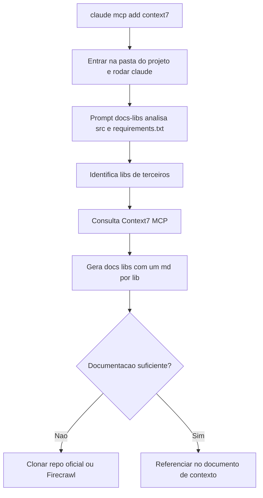

# Workflow de Desenvolvimento com IA

> [!summary] TL;DR
> - Workflow com IA = sequência de passos, nível de automação e ordem entre testes, arquivos, comandos e revisão; adaptar a IA ao próprio processo, não copiar fluxo alheio.
> - Resultado melhor não vem de modelo melhor: prompt interno, gerenciamento de contexto, tools e orquestração mudam o resultado.
> - Cada novo chat é um novo funcionário sem onboarding: documentos de contexto, guidelines, docs de libs e state.md resolvem isso.
> - Context7 (via MCP), clone do repositório oficial e Firecrawl trazem documentação atualizada das libs na versão usada.
> - Adoção madura: ferramenta homologada, contexto projetado, prompts versionados, integração corporativa e checkpoints.

## Conceitos-chave

### Ferramentas

- **Quick win**: mudança pequena, aplicável imediatamente, que melhora o trabalho no dia seguinte, sem depender de agentes complexos.
- **IDEs nascidas com IA**: Cursor e Windsurf, que evoluíram de chat/autocomplete para comportamento agêntico, com experiência nativa de IDE agêntica.
- **Ferramentas tradicionais com agentes**: VS Code, JetBrains, GitHub Copilot (forte no ecossistema Microsoft/GitHub, expandiu para além da IDE).
- **CLIs agênticos**: Claude Code, Gemini CLI, Codex CLI, acoplados à IDE como janela. Claude Code tem melhor execução prática mesmo com modelos semelhantes; Gemini CLI tem custo muito baixo ou quase nulo.
- **Evolução**: de "perguntar no chat, copiar e colar" para agentes operando no workspace; mais velocidade, mais risco de perda de controle, exige workflow disciplinado.
- **Comparação empírica**: mesmo software, mesmos prompts, ambientes diferentes.

### Rules, memórias e janela de contexto

- **Rules/memories**: documentos usados por IDEs e agentes para aplicar regras e lembrar comportamentos (CLAUDE.md, GEMINI.md, equivalentes). Cursor guarda vários arquivos de rules em `.cursor/rules` e também tem memories; Claude Code trata memories como instruções lidas do CLAUDE.md. A diferença semântica rules vs memories depende da ferramenta.
- **Memória é influência, não garantia**: rules são ponto de partida, não contrato; o agente pode comentar código mesmo com rule "não comentar" por conta do próprio raciocínio.
- **Janela de contexto**: instruções antigas perdem força antes mesmo do limite; funciona como sliding window (tokens recentes empurram os antigos), crítico em modo agêntico; sumarização condensa histórico. Detalhes em [[Context Window em LLMs]].
- **Um chat por tarefa ou subtarefa**: documentos de contexto consomem [[Tokens e Tokenização|tokens]] (trade-off contexto vs janela); otimizar instruindo a IA a consultar só os documentos relevantes. Gemini 2.5 Pro e GPT 4.1 têm janelas de até 1 milhão de tokens.

### Context engineering

- **Definição**: construção de sistemas e workflows que fornecem as informações e ferramentas corretas, no formato ideal, para a LLM (documentação, MCP, RAG, APIs externas, estado do projeto), incluindo fontes dinâmicas.
- **Prompt engineering vs context engineering**: prompt engineering são instruções textuais estáticas; context engineering soma contextos dinâmicos, múltiplas fontes e formatação apropriada (ver [[Prompt Engineering vs RAG vs Fine-Tuning]]).
- **Causa de falhas**: a maioria das falhas em sistemas com LLM vem de contexto, instruções ou ferramentas mal fornecidos, não do modelo.
- **Linguagem natural como camada de programação**: português/inglês via Markdown (rules, memórias, guidelines).

### Documentos de contexto

- **Ativo de longo prazo**: como testes automatizados e baixo acoplamento, documentação contém o aumento de complexidade e é acumulável; a IA só ajuda com contexto.
- **Novo chat = novo desenvolvedor**: não sabe produto, decisões, libs, estratégia de testes, convenção de commit, restrições. Evitar novo chat por medo de reexplicar é sintoma de documentação insuficiente.
- **Documento de contexto geral**: o que o projeto é, por que existe, organização técnica e de produto; em projetos grandes aponta para contextos por módulo.
- **Tipos essenciais**:
  - Produto: informações do produto/feature.
  - Técnica: tecnologias, metodologias, guidelines.
  - Guidelines: formatação, documentação, desenvolvimento, testes; stack, libs autorizadas, convenções (comentários, indentação, TypeScript, ferramenta de testes).
  - README: como subir e executar o projeto. README cobre entrada, guidelines cobrem como trabalhar.
  - Índice com caminho para toda a documentação.
  - ADR: por que arquitetura, componente ou ferramenta foi escolhida; reduz o risco da IA usar libs fora do escopo (ex: Redis só para cache de catálogo de produtos, não espalhar para checkout).
  - Plano de ação: passo a passo do que será desenvolvido, com TODO list própria do dev mesmo que o Claude Code tenha a sua. Contexto não substitui tarefa + plano de ação.
  - State: snapshot narrativo do projeto (o que já faz, features implementadas, bugs abertos, limitações, onde o desenvolvimento parou, o que falta).
- **state.local.md e rules locais**: por dev, no `.gitignore`; cada branch/tarefa tem estado próprio e não deve poluir o repositório compartilhado.
- **Idioma**: instruções em português, código e comentários em inglês; clareza vale mais que economia de tokens.

### Documentação de libs

- **Docs de libs na versão usada**: evitam versão antiga, Stack Overflow desatualizado, troca de lib ou implementação inventada ([[Alucinação em LLMs]]).
- **Context7**: base consultável de documentação oficial de linguagens, frameworks e libs, com servidor MCP (Claude Code, Cursor, VS Code com Gemini); qualidade depende da atualização do acervo.
- **docs-libs**: um Markdown por dependência gerado pelo agente (ex: `docs/libs/LANGCHAIN.md`, `PINECONE.md`); reforçar no prompt qual MCP usar quando precisar garantir.
- **Quando o Context7 não basta**: clonar o repositório oficial na versão usada e pedir docs, snippets e pontos principais orientados ao caso de uso (ex: servidor MCP em Streamable HTTP).
- **Firecrawl (via MCP)**: scraping recursivo da árvore de links da documentação, muito mais completo que fetch simples. **Playwright**: quando a doc exige login ou interação. Critério: a ferramenta menos complexa que acessa o conteúdo com confiabilidade.
- **Atualização assistida de versão**: comparar versão instalada vs atual, identificar breaking changes, localizar impactos, montar plano de ação, abrir branch e executar.
- **Plan Mode vs edição automática**: Plan Mode expõe a estratégia para revisão antes de executar; usar em tarefas de risco. O risco real está em insistir no mesmo chat, não em detalhar o pedido.

### Governança e operação

- **Governança enterprise**: fornecedor homologado, contrato corporativo, plano enterprise, proibir contas pessoais, bloquear alternativas não aprovadas. Maior risco é vazamento informal (login errado, chat pessoal).
- **Plano enterprise**: negocia retenção, treinamento, isolamento de dados, filtros, conformidade (ex: regras europeias de privacidade); a mesma ferramenta tem políticas diferentes entre plano pessoal e empresarial.
- **Modelo para gerar documentação**: prompt + janela de contexto importam mais que "modelo mais inteligente"; priorizar janela grande para leitura ampla de repositório.
- **Prompt como ativo versionável**: tratado como código (evoluído, comparado, revisado); mudança de modelo, contexto ou instrução degrada o sistema sem mudar código.
- **CI/CD para prompts**: executar o prompt em casos controlados para detectar regressão de instrução.
- **Metaprompt**: prompt que gera ou refina prompt, captura o modo de trabalhar do time (base do [[PRP (Product Requirements Prompt)]]).
- **Integração Jira/Confluence via MCP**: tarefas nascem nos tickets e viram insumo para PRP e execução.
- **Testes com IA**: testes gerados sem contexto criam falsa segurança (getter/setter, validações rasas), pior que não ter testes. Risco do ciclo gerar teste, executar, corrigir código sem limites (teste ou código podem estar errados). Descrever o procedimento humano de teste como prompt operacional com critérios de parada, escopo de modificação e condições de revisão.
- **Commits incrementais como guardrail**: commit padronizado sempre que um critério de aceitação passa, os testes validam e o humano aprova.
- **Papel do dev**: esforço desloca de digitação para supervisão e desenho de processo.

## Fluxograma / Processo

Gerar documentação de libs com Context7 no Claude Code:



1. Adicionar o servidor MCP: `claude mcp add --transport http context7 https://mcp.context7.com/mcp`
2. Entrar na pasta do projeto e iniciar: `cd ~/Project` e `claude`
3. Rodar o prompt de geração de `/docs/libs` (abaixo).

## Erros comuns / Cuidados

- Rules podem ser ignoradas ao longo da sessão: revisão, checkpoints e reancoragem de instruções continuam necessários.
- Pedido vago de testes ("crie testes para essa classe") gera testes superficiais.
- Agente corrigindo código para passar em teste errado.
- "prompt 1, prompt 2, prompt 3" sem rastreabilidade.
- Ultrapassar a janela faz o modelo esquecer o início, perder coerência e alucinar mais.
- Copiar o workflow de outra pessoa em vez de adaptar a IA ao próprio processo.

## Materiais complementares

### Prompts

**Gerar documentação das libs em /docs/libs com Context7**
```text
Analise o codebase do projeto, focando na pasta src e no arquivo requirements.txt e identifique todas as bibliotecas de terceiros usadas. Use o Context7 MCP Server para buscar a documentação relevante de cada uma biblioteca. Crie arquivos markdown (*.md) na pasta /docs/libs com tais documentações (por exemplo: LANGCHAIN.md, PINECONE.md). GARANTA que você utilizará o Context7 MCP.
```

**Pedido ao Firecrawl (narrado na aula)**
```text
entre nessa documentação, percorra os links relevantes e organize um resumo estruturado
```

**Exemplo de memory do Cursor**
```text
Todas as vezes que criar uma função pública, deve-se fazer sua documentação como comentário logo acima da função.
```

**Prompt fraco que gera testes superficiais (contraexemplo)**
```text
crie testes para essa classe
```

### Conteúdo extra

- Diagrama da aula (Excalidraw): https://link.excalidraw.com/readonly/o0p0jhaHnLDKZV1bdgv8
- Ferramentas: Cursor (https://cursor.com/), Windsurf (https://windsurf.com/), VS Code + GitHub Copilot (https://code.visualstudio.com/docs/copilot/getting-started), JetBrains (https://www.jetbrains.com/), Claude Code (https://www.anthropic.com/claude-code), Gemini CLI (https://blog.google/technology/developers/introducing-gemini-cli-open-source-ai-agent/), Codex CLI (https://help.openai.com/en/articles/11096431-openai-codex-cli-getting-started).
- GPTs assistentes: ADR Generator (https://chatgpt.com/g/g-67b8030765cc81919232eb75ba5312d6-promptgo), Context Generator (https://chatgpt.com/g/g-67fd6d81ec6c8191a3a04adfc22d6fc5-context-generator).
- Vídeo sobre plano de ação: https://www.youtube.com/watch?v=9QONsyOEqa8
- Context7: https://context7.com/ ; Firecrawl: https://www.firecrawl.dev/
- The rise of context engineering: https://blog.langchain.com/the-rise-of-context-engineering/
- Model Context Protocol: https://www.anthropic.com/news/model-context-protocol

## Tags de busca

`#fundamentos-ia-generativa` `#context-engineering` `#documentos-de-contexto` `#context7` `#governanca-ia`
