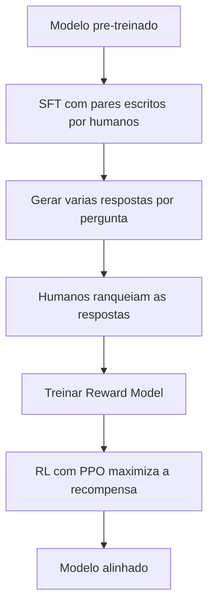

# Fine-Tuning e RLHF

> [!summary] TL;DR
> - Fine-tuning supervisionado adapta um modelo pré-treinado a uma tarefa com pares rotulados de entrada e saída, mais barato que treinar do zero.
> - Usa o mesmo mecanismo do pré-treino: backpropagation + cross entropy contra a resposta-alvo.
> - O ganho vem de comportamento, vocabulário e critérios do domínio, mais do que de "saber mais fatos".
> - RLHF alinha a saída a preferências humanas em três etapas: SFT, Reward Model e RL com PPO.
> - Riscos: overfitting, rótulos errados, custo alto, especialização que envelhece e vieses dos avaliadores.

## Conceitos-chave

- **Fine-tuning supervisionado**: especializa a base generalista do [[Pré-treinamento de LLMs]] em dúvidas médicas, tradução, código, resumo de notícias, QA especializado, resumo jurídico. Analogia: quem já sabe português aprende a linguagem operacional de um hospital.
- **Dataset**: pares entrada/saída (pergunta e resposta, código incompleto e completo).
- **Fine-tuning completo**: atualiza todos os parâmetros. Para domínio muito distante; caro.
- **Fine-tuning parcial**: atualiza só parte dos parâmetros e preserva conhecimento (ex: modelo em inglês aprendendo contratos jurídicos em português).
- **LoRA e PEFT**: adaptam poucos parâmetros sem reescrever a base, permitindo ajustes incrementais (ex: atualizar modelo médico com os últimos seis meses). Detalhes em [[Otimização de Grandes Modelos]].
- **Prefix Tuning e Prompt Tuning**: treinam um prefixo/prompt interno persistente que orienta a inferência; úteis em modelos muito grandes.
- **RLHF (Reinforcement Learning with Human Feedback)**: fine-tuning + feedback humano para alinhar a saída ao que é útil, seguro e apropriado. Trabalha com preferências, não só com pares fixos.
- **SFT (Supervised Fine-Tuning)**: pares escritos por humanos ("explique a teoria da relatividade como se eu fosse uma criança"). Ensina formato, nível de detalhe e tom, mas só imita.
- **Reward Model**: humanos ranqueiam várias saídas da mesma pergunta (A > C > B); o ranking vira sinal numérico de qualidade (clareza, utilidade, segurança).
- **PPO (Proximal Policy Optimization)**: algoritmo de RL que otimiza a política de geração para maximizar a recompensa sem mudanças instáveis.
- **Instruction Tuning**: treina o modelo a responder grande variedade de instruções (carta de demissão em tom amigável, roteiro sobre IA), antes ou junto do RLHF. Também pode ser imitado via prompt sem alterar pesos ([[Prompt Engineering vs RAG vs Fine-Tuning]]).
- **Efeito do alinhamento**: sem ele há vieses, prolixidade e conteúdo ofensivo; o modelo alinhado admite não saber, segue instruções, alucina menos ([[Alucinação em LLMs]]) e bajula menos.

## Fluxograma / Processo

**Quando usar fine-tuning:**

- Tarefa estreita que exige alto desempenho (chatbot corporativo da Magalu: catálogo, atendimento, tom de voz, sem física quântica).
- Domínios técnicos: medicina, jurídico, tecnologia.
- Quando prompts não carregam o contexto de forma confiável.
- Dados privados: conversas históricas de atendentes, documentos internos.
- Moldar tom e restrições com exemplos corretos e incorretos (chatbot do Nubank sugerindo empréstimo no Bradesco é marcado como inadequado). Guardrails são uma camada adicional.
- Só quando a melhora compensa custo e manutenção ao longo do ciclo de vida.

## Erros comuns / Cuidados

- Dataset pequeno, pouco diverso ou repetitivo causa overfitting: saída mecânica e repetitiva.
- Rótulos errados reforçam comportamento errado.
- Custo computacional alto.
- Domínios que mudam (medicina) exigem retreino recorrente: a especialização envelhece. Para atualização factual, prefira RAG.
- RLHF é subjetivo (preferência de estilo), caro e herda vieses dos avaliadores.
- Prompt excessivamente social ou com rodeios leva o modelo alinhado a priorizar agradabilidade; prompt direto com critérios explícitos reduz prolixidade e invenção.

## Tags de busca

`#fundamentos-ia-generativa` `#fine-tuning` `#rlhf` `#alinhamento`
