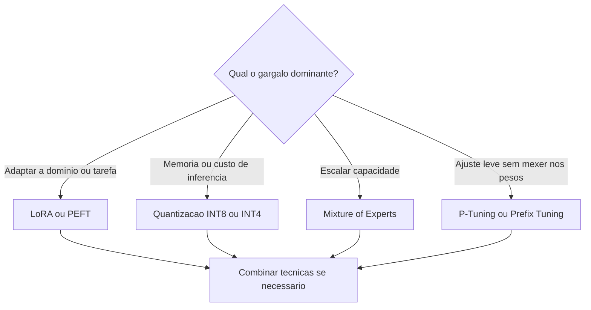

# Otimização de Grandes Modelos

> [!summary] TL;DR
> - Escalar e personalizar LLMs é caro em parâmetros, memória e processamento; a pergunta passa a ser como adaptar sem refazer tudo.
> - LoRA ataca o custo de fine-tuning; quantização ataca memória e inferência; MoE dá eficiência estrutural; P-Tuning adapta sem mexer em pesos.
> - Escolher pelo gargalo dominante; as técnicas podem ser combinadas.
> - Modelos quantizados rodam localmente com Ollama e LM Studio.

## Conceitos-chave

- **LoRA (Low-Rank Adaptation)**: pesos originais congelados; injeta e treina matrizes de baixo rank entre as camadas, como um "plugin" treinável. Reduz custo, memória e sobreajuste do [[Fine-Tuning e RLHF|fine-tuning]] (ex: Llama 2 para atendimento jurídico em português).
- **PEFT (Parameter-Efficient Fine-Tuning)**: família de técnicas que adaptam poucos parâmetros, disponível no Hugging Face. LoRA faz parte dela.
- **Quantização**: guarda os pesos em formatos de menor precisão (de 32 bits para INT8 ou INT4). Menos memória, banda e processamento, mais velocidade, com pequena perda de qualidade (ex: Mistral 7B cai de ~13 GB para ~4 GB em INT4). Viabiliza execução em laptop e dispositivos embarcados.
- **MoE (Mixture of Experts)**: vários especialistas internos; um roteador ativa só os relevantes para cada entrada, como um middleware de roteamento (ex: Switch Transformer). Economiza tempo, energia e computação mantendo alta capacidade total.
- **P-Tuning e Prefix Tuning**: injetam vetores/tokens aprendidos na entrada sem alterar os pesos, funcionando como engenharia de prompt aprendida ([[Prompt Engineering vs RAG vs Fine-Tuning]]).

| Técnica | Gargalo que ataca | Como age |
|---|---|---|
| LoRA | custo de fine-tuning, adaptar a domínio sem retreino completo | treina matrizes extras, base congelada |
| Quantização | memória, custo de inferência, hardware limitado | reduz precisão dos pesos, perde parte da qualidade |
| MoE | escalar capacidade em modelos enormes | ativa só alguns especialistas por entrada |
| P-Tuning / Prefix Tuning | adaptação leve | vetores aprendidos na entrada, pesos intactos |

## Fluxograma / Processo

## Materiais complementares

### Conteúdo extra

- Ollama e LM Studio: ferramentas para rodar modelos quantizados localmente.

## Tags de busca

`#fundamentos-ia-generativa` `#lora` `#quantizacao` `#mixture-of-experts`
