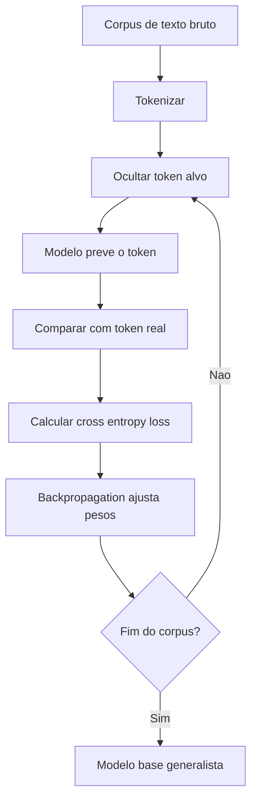

# Pré-treinamento de LLMs

> [!summary] TL;DR
> - Pré-treinamento é a exposição massiva a texto bruto (livros, sites, artigos, código, fóruns) para gerar um modelo geral.
> - É autossupervisionado: o próprio texto fornece o alvo, sem rotulagem manual, o que escala para bilhões de tokens.
> - CLM prevê o próximo token só com o passado (família GPT); MLM reconstrói tokens mascarados com contexto bidirecional (BERT).
> - O erro é medido com Cross Entropy Loss e corrigido por backpropagation, repetido em escala.
> - O resultado é fluência e padrões textuais, não compreensão explícita nem alinhamento.

## Conceitos-chave

- **LLM**: modelo de linguagem treinado em larga escala (bilhões de parâmetros e de tokens). É estratégia de modelagem, não produto (GPT, BERT, LLaMA, Gemini). Empilha autoatenção, embeddings e feedforward ([[Componentes do Transformer]]).
- **Pré-treinamento**: absorve sintaxe, semântica, estilo e estrutura. O valor está no volume e na diversidade dos dados.
- **Dados como ativo estratégico**: a web já foi tokenizada; a disputa agora é por novas fontes, além de computação. Parte dos dados de treino é controversa do ponto de vista autoral.
- **Aprendizado sem rótulos**: dispensa classes como "jurídico" ou "código Python". Rotular ("Este produto é ótimo" = positivo, "O atendimento foi horrível" = negativo) é caro, por isso o ganho de escala em relação à [[IA Generativa vs IA Tradicional|IA tradicional supervisionada]].
- **CLM (Causal Language Modeling)**: prever o próximo token ("O cachorro latiu ontem"). Usado por GPT-2, GPT-3, GPT-4, Llama, Mistral, Phi. Unidirecional, base do [[Encoder-only vs Decoder-only|decoder-only]].
- **Máscara causal**: bloqueia a atenção a posições futuras, então o modelo só usa tokens à esquerda.
- **Ciclo de treino**: oculta o token correto, o modelo prevê, compara (previu "portão", esperado "parque"), mede o erro e corrige.
- **Backpropagation**: redistribui o erro ajustando pesos e vieses da rede.
- **Cross Entropy Loss**: distância entre a distribuição prevista e a resposta correta. Mede calibração, não só acerto binário.
- **MLM (Masked Language Modeling)**: mascara tokens no meio da sequência e treina para reconstruí-los ("O [MASK] hoje está muito azul"). Mascara aleatoriamente cerca de 20% das palavras.
- **Contexto bidirecional**: o MLM usa tokens antes e depois da máscara. Intuição: leitura seletiva por palavras-chave espalhadas no texto.
- **CLM vs MLM**: CLM é forte em geração; MLM é forte em compreensão (classificação, busca semântica) e fraco em geração livre, porque o objetivo não coincide com geração autoregressiva. Por isso BERT não é escolha natural para chatbot gerativo.
- **Capacidades emergentes**: com escala surgem raciocínio em múltiplas etapas, problemas lógicos, few-shot e zero-shot. Mais dados melhoraram o desempenho de GPT-3 para GPT-3.5 e GPT-4.
- **Limite do pré-treino**: dá fluência, mas não garante lógica, concisão, segurança nem obediência a instruções; isso vem de [[Fine-Tuning e RLHF]]. Também não elimina erros e vieses dos dados.
- **Conhecimento congelado**: o que o modelo sabe para na data do treino ([[Raciocínio Simbólico e Conhecimento em Tempo Real]]).

## Fluxograma / Processo

## Erros comuns / Cuidados

- O modelo aprende padrões textuais, não compreensão explícita; por isso "inteligência" é termo controverso.
- Treinar com grandes volumes não elimina erros nem vieses presentes nos dados.

## Tags de busca

`#fundamentos-ia-generativa` `#pre-treinamento` `#clm` `#mlm`
