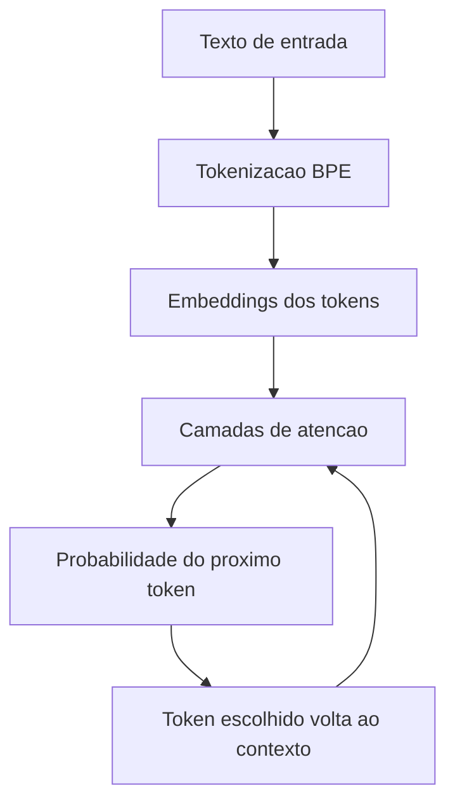

# Tokens e Tokenização

> [!summary] TL;DR
> - Token é a unidade real que o modelo processa: pode ser letra, fragmento, palavra inteira, pontuação ou espaço + palavra.
> - A família GPT usa BPE, que agrupa combinações de alta coocorrência no corpus; a lógica é estatística, não semântica.
> - O vocabulário de tokens é fixado no treinamento e cada modelo tokeniza de forma diferente.
> - Custo, [[Context Window em LLMs|janela de contexto]] e coerência são medidos em tokens, não em palavras.
> - O OpenAI Tokenizer mostra a quebra por modelo e ajuda a prever custo e depurar prompts.

## Conceitos-chave

- **Token**: unidade processada pelo modelo, sem tamanho fixo. Permite lidar com neologismos, erros de grafia, vários idiomas e termos raros.
- **BPE (Byte Pair Encoding)**: parte de unidades mínimas e agrupa as combinações que mais coocorrem no corpus. Usado pela família GPT.
- **Exemplos de quebra**: "sol" = 1 token; "interessante" = 2 ou mais; "desenvolvimento" = 2 ou 3; "artificial" pode ficar inteira; "cache" pode virar um token; "cachorro" pode gerar grupos como CA, CH, OR; "GPT-4 é poderoso" vira GPT, 4, é, poder, oso.
- **Palavras comuns vs raras**: palavras frequentes viram tokens compactos; raras são fragmentadas ("paralelepípedo").
- **Diferença entre modelos**: GPT-4, GPT-3.5 e Legacy quebram "cachorro", "praça" e "paralelepípedo" de formas diferentes.
- **Vocabulário fixo**: definido no [[Pré-treinamento de LLMs|treinamento]], não muda a cada conversa.
- **Pipeline**: token, depois [[Embeddings e Similaridade|embedding]], depois atenção ([[Transformers e Self-Attention]]), depois probabilidade da próxima saída.
- **Fragmentação e custo**: mais fragmentação = mais tokens = mais custo e mais janela consumida. Provedores cobram por volume de tokens.
- **Janela em tokens**: limites como 8.000 ou 32.000 tokens (e até 1 milhão no Gemini 2.5 Pro e GPT 4.1) contam tokens de entrada + saída.
- **Limite de saída**: o máximo de tokens gerados é um dos [[Parâmetros de Geração]]; resposta cortada no meio é restrição da chamada, não falta de conhecimento.

## Fluxograma / Processo

## Erros comuns / Cuidados

- Contar palavras não aproxima custo nem consumo de contexto: um prompt curto pode consumir muitos tokens.
- A mesma frase consome quantidades diferentes de tokens conforme idioma e presença de termos raros.
- Trocar de modelo muda a tokenização, então a estimativa de custo e janela precisa ser refeita.

## Materiais complementares

### Conteúdo extra

- OpenAI Tokenizer: https://platform.openai.com/tokenizer (visualiza a quebra em tokens por modelo, sem login).

## Tags de busca

`#fundamentos-ia-generativa` `#tokens` `#bpe` `#custo-de-tokens`
