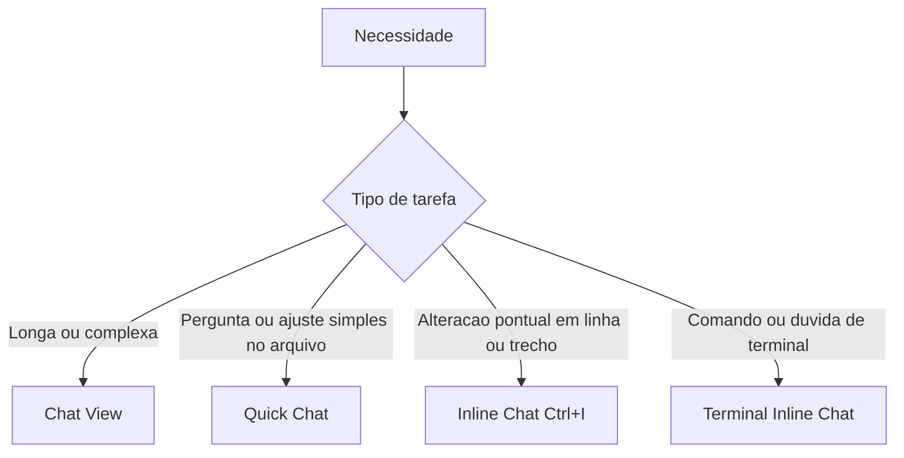

# Tipos de Chat do Copilot

> [!summary] TL;DR
> - Chat View: conversa longa, todos os modos (agent, ask, edit, plan), modelos e tools MCP, com histórico.
> - Quick Chat: janela rápida no topo para perguntas e mudanças simples no arquivo aberto.
> - Inline Chat (`Ctrl+I`): alteração pontual na linha ou trecho selecionado; não responde perguntas.
> - Terminal Inline Chat (`Ctrl+I` no terminal): gera e explica comandos.
> - Regra: algo longo ou complexo vai para o Chat View.

## Conceitos-chave

- **Chat View**: chat tradicional. Histórico guardado em [[Sessions do Copilot]].
- **Modo agent**: o mais avançado, executa qualquer tipo de tarefa.
- **Modo ask**: perguntas. **Modo edit**: só edições. **Modo plan**: planejamento antes de executar.
- **Quick Chat**: comando "Chat: Open Quick Chat". Contexto padrão é o arquivo aberto; dá para adicionar arquivos e pastas e escolher modelo. Sem modo de planejamento. Resposta pode ser inserida no terminal, no cursor ou copiada.
- **Inline Chat**: cursor na linha ou trecho selecionado, `Ctrl+I`, descrever a mudança. Aceitar com Keep, desfazer com Undo. Permite escolher contexto e modelo.
- **Limite do Inline Chat**: pedir explicação faz o Copilot mandar para o Chat View ou Quick Chat.
- **Terminal Inline Chat**: terminal focado, `Ctrl+I`. Gera comandos para rodar ou inserir e responde perguntas com `#terminalSelection`. Ver [[Context Mentions e Tools]].

## Fluxograma / Processo



## Erros comuns / Cuidados

- Dar contexto (selecionar o trecho certo) aumenta a assertividade do Inline Chat.
- Quick Chat e chat de terminal não servem para conversa de longa duração.

## Materiais complementares

### Prompts

**Quick Chat: pergunta sobre o arquivo**
```text
Qual é o método que lista os dados?
```

**Inline Chat: alteração pontual**
```text
Adicionar um segundo parâmetro para lançar uma exceção caso o dado não exista.
```

**Terminal Inline Chat: gerar comando**
```text
Eu quero um comando para buscar o termo payment no arquivo payment service.
```

**Terminal Inline Chat: explicar seleção**
```text
#terminalSelection quero saber o que este comando faz
```

## Tags de busca

`#github-copilot` `#chat` `#inline-chat` `#terminal`
