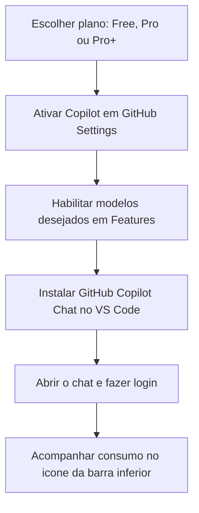

# Instalação e Planos do GitHub Copilot

> [!summary] TL;DR
> - Assistente de programação com IA que roda no VS Code e em qualquer fork dele (ex: Cursor). Exige conta no GitHub.
> - Plano Free é limitado (50 solicitações de agente/chat, 2 mil conclusões por mês, poucos modelos). Recomendado Pro ou Pro+.
> - Ativação e escolha de modelos em GitHub > Settings > Copilot > Features.
> - Extensão a usar: GitHub Copilot Chat. A extensão "GitHub Copilot" antiga está sendo descontinuada.
> - Copilot é um serviço do ecossistema GitHub: issues, pull requests e chat no próprio site.

## Conceitos-chave

- **Escopo**: vai além de completar código. Planeja funcionalidades, debuga, gera testes, revisa código, usa agentes e MCP servers.
- **Free**: só para testar. 50 solicitações do modo agente ou chat e 2 mil conclusões por mês.
- **Pro**: plano mais popular. **Pro+**: muito mais premium requests para modelos avançados.
- **Features na conta**: a lista de opções em Settings > Copilot define principalmente quais modelos aparecem no VS Code e o comportamento do Copilot no GitHub e na IDE.
- **Copilot no GitHub**: ícone no topo do site para conversar sobre repositório, issues e PRs; atribuir issue ao Copilot; delegar revisão de PR. Ver [[Coding Agent do Copilot]].
- **Extensões no VS Code**: "GitHub Copilot" (antiga, desativada) e "GitHub Copilot Chat" (atual, unifica as funcionalidades). Setting de unificação habilitada.
- **Login**: pedido na primeira interação com o chat; libera modos e modelos.
- **Painel de uso (ícone do Copilot na barra inferior)**: percentual de premium requests do mês (renova mensalmente), inline suggestions, chat messages, status de indexação do projeto, arquivos com sugestões ativas, Next Edit Suggestions e snooze.
- **Indexação**: o Copilot cria índice dos arquivos do projeto para usar como contexto.

## Fluxograma / Processo

## Erros comuns / Cuidados

- Não habilitar a extensão "GitHub Copilot" antiga; tudo deve rodar pela extensão Chat.
- Premium requests acabam no mês; monitorar pelo painel.

## Tags de busca

`#github-copilot` `#instalacao` `#planos` `#vscode`
