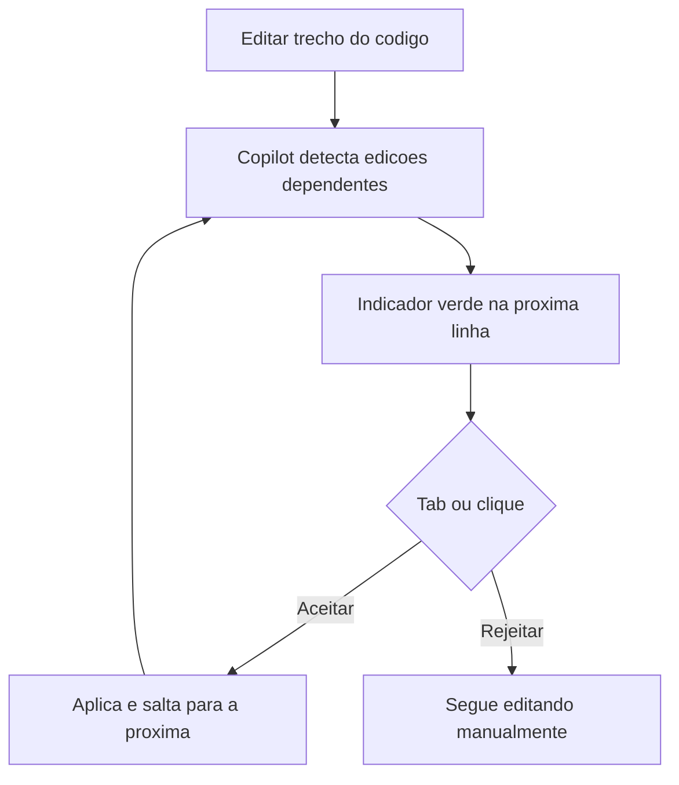

# Next Edit Suggestions

> [!summary] TL;DR
> - NES: uma edição no código desencadeia sugestões das próximas mudanças necessárias, em cascata.
> - Ex: renomear variável e o Copilot sugerir a troca em cada uso abaixo.
> - `Tab` navega até a próxima edição e aceita; também dá para clicar no indicador verde.
> - Funciona em código de qualquer linguagem e em Markdown.

## Conceitos-chave

- **`github.copilot.nextEditSuggestions.enabled`**: setting principal que liga o recurso.
- **Allow whitespace only changes**: permite sugerir mudanças só de indentação e espaços (formatação).
- **NES Fixes**: oferece sugestões para consertar problemas no código.
- **Range estendido**: permite sugerir edição longe do cursor (mudança no início do arquivo afetando o final).
- **Indicador verde**: aparece na linha sugerida com opções de aceitar, rejeitar e alternativas.
- **Contexto**: mesmo mecanismo não determinístico das [[Inline Suggestions e Ghost Text]].

## Fluxograma / Processo

## Tags de busca

`#github-copilot` `#next-edit-suggestions` `#refatoracao` `#atalhos`
