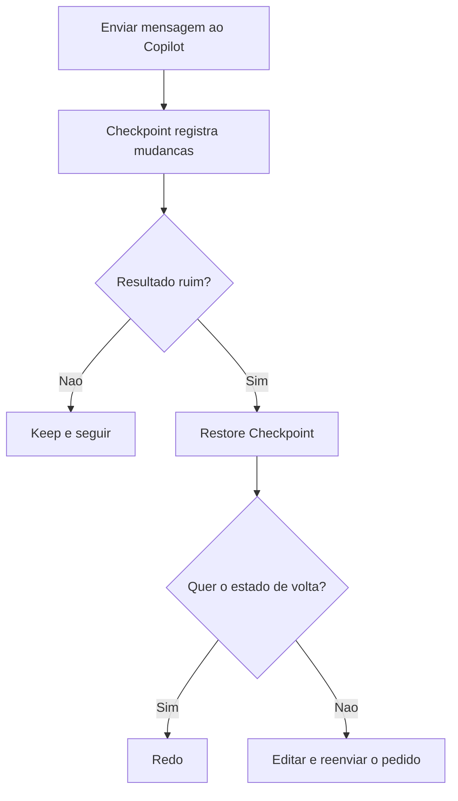

# Checkpoints do Copilot

> [!summary] TL;DR
> - Checkpoint é o estado dos arquivos gerado a partir de cada mensagem enviada na sessão.
> - Restore Checkpoint volta ao estado antes da mensagem; Redo reaplica.
> - `chat.checkpoints.showFileChanges: true` mostra os arquivos alterados por mensagem.
> - Restaurar a primeira mensagem zera tudo da sessão, sem volta.
> - Git com commits frequentes continua sendo o melhor controle de versão.

## Conceitos-chave

- **Estado por mensagem**: cada pedido gera criação, adição e remoção de linhas; o checkpoint guarda esse estado.
- **Restore Checkpoint**: descarta mudanças posteriores àquela mensagem. Também pelo botão "Restore to Last Checkpoint".
- **Redo**: refaz as mudanças até um estágio mais à frente.
- **Changed Files**: com a opção habilitada, cada mensagem lista os arquivos alterados e mostra só aquele diff.
- **Edit request**: editar uma mensagem antiga equivale a regredir até ela; o que está acima é mantido. Ver [[Configurações do GitHub Copilot]].
- **Keep e Undo**: confirmam ou desfazem as edições pendentes; após confirmar, o diff não aparece mais no arquivo.
- **Sessão**: checkpoints vivem dentro de [[Sessions do Copilot]].

## Fluxograma / Processo



## Erros comuns / Cuidados

- Regredir a primeira mensagem perde todas as mudanças e não volta ao estágio anterior.
- Após restaurar, fazer Keep ou Undo para sair do estado pendente e evitar confusão no que foi alterado.
- Arquivos como `package.json` podem não voltar totalmente; conferir.

## Materiais complementares

### Conteúdo extra

```json
{
  "chat.checkpoints.showFileChanges": true
}
```

## Tags de busca

`#github-copilot` `#checkpoint` `#git` `#historico`
