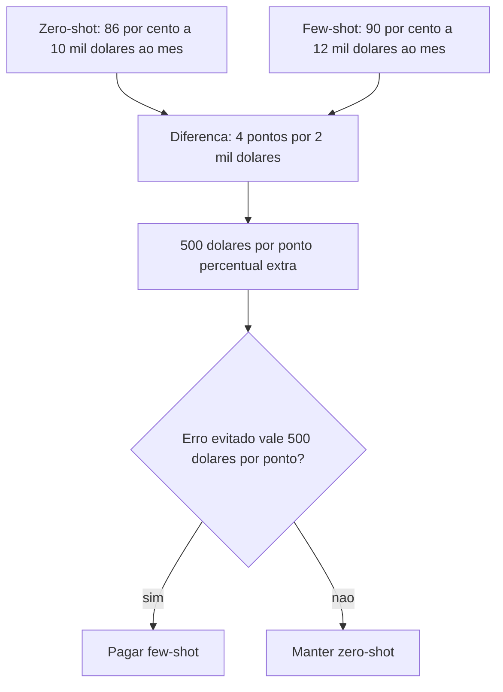

# Custo, Latência e Escala de Prompts

> [!summary] TL;DR
> - Uso pontual (dev, exploração) maximiza entendimento; a restrição principal é não estourar a janela de contexto.
> - Em produção em larga escala, economia de tokens é requisito de viabilidade: tokens de entrada e saída multiplicam pelo volume.
> - Na API por token o prompt vira unidade de custo; buscar qualidade suficiente, não máxima.
> - Decidir técnica é conta: custo por ponto percentual de assertividade (ex: US$ 500 por p.p. extra).
> - Decisão de produto, finanças e operação, não só de engenharia.

## Conceitos-chave

- **Uso pontual vs produção**: exploração tolera prompts pesados e pesquisa em código/internet por ser esporádica; produção multiplica cada token pelo volume de requisições.
- **Desenvolvimento não economiza tokens**: código é interdependente, contexto vale mais que economia (ver [[Estrutura de Prompts]]).
- **Modelo de cobrança define o custo**: IDEs e assistentes cobram por plano, assinatura ou limite, não por token visível; API pode ficar cara em uso intensivo, plano fixo dá previsibilidade; opções gratuitas servem para validar o fluxo antes de escalar; comparar custo, limite e qualidade para o time no momento.
- **API por token**: cobrança por milhão de tokens de entrada e saída torna o custo explícito; o prompt vira unidade de custo ([[Tokens e Tokenização]]).
- **Latência**: cresce com prompts longos e instruções como "pense passo a passo" ou revisar etapas, afetando tempo de resposta, throughput e infraestrutura ([[Chain of Thought e Self-Consistency]]).
- **Trade-off custo x latência x qualidade**: ganho marginal de assertividade pode não compensar milhares de dólares/mês.
- **Zero-shot como padrão**: tarefas simples, genéricas e de alto volume (validar JSON, identificar elementos de frase, resumir texto curto) com menos tokens, custo e latência ([[Zero-shot, One-shot e Few-shot]]).
- **Few-shot quando necessário**: domínio específico ou formato moldado ("dado X, retorne Y"); o exemplo codifica o padrão de resposta, mas custa tokens, tempo e processamento.
- **Criticidade**: se há mitigação, aceitar mais erro pode ser racional; em tarefas sensíveis até 90% de assertividade pode ser insuficiente.
- **Custo oculto de modelos reasoning**: GPT-5 nano gasta mais de uma centena de tokens de reasoning para responder "Brasília" a uma pergunta trivial; modelo com reasoning pode ser economicamente inadequado para tarefas triviais e massivas.
- **Token como trabalho computacional recorrente**: o modelo reprocessa a sequência acumulada a cada token gerado; objetivo é a melhor resposta com o menor número de tokens necessário ([[Gestão de Context Window em Prompts]]).
- **Modelo certo para a tarefa certa**: evitar superdimensionar o modelo como se evita superdimensionar infraestrutura; em [[Prompt Chaining]], modelo mais simples para extração mecânica e mais forte para código.
- **Número de chamadas**: primeira coisa a pensar é quantas chamadas ao modelo serão feitas; APIs tradicionais respondem em 10 a 150 ms, enriquecimento com LLM leva 3 a 5 s e resposta final até 60 s ([[Query Reformulation e Prompt Enrichment]]).
- **Tokens de saída costumam custar mais que entrada**: limitar a saída explicitamente e estimar teto por chamada ([[Prompt Caching e Batch Prompting]]).
- **Menor prompt que preserva o comportamento**: perguntar "qual é o menor prompt que preserva o mesmo comportamento com custo aceitável?"; cada exemplo tem utilidade marginal.
- **Avaliar além do acerto**: aderência ao formato, estilo, tempo de resposta e custo ([[Fundamentos de Prompt Evaluation]]).

## Fluxograma / Processo

Cálculo de custo por ponto percentual:

## Erros comuns / Cuidados

- Levar para produção o prompt longo que funcionava bem no apoio ao desenvolvimento.
- Usar CoT, reasoning ou few-shot por padrão em tarefa trivial de alto volume.
- Olhar só a assertividade e ignorar custo mensal e latência.

## Tags de busca

`#prompt-engineering` `#custo-de-tokens` `#latencia` `#trade-offs`
