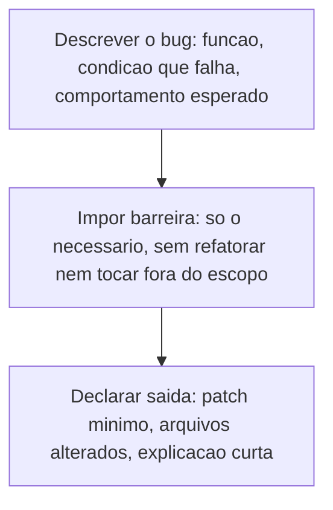
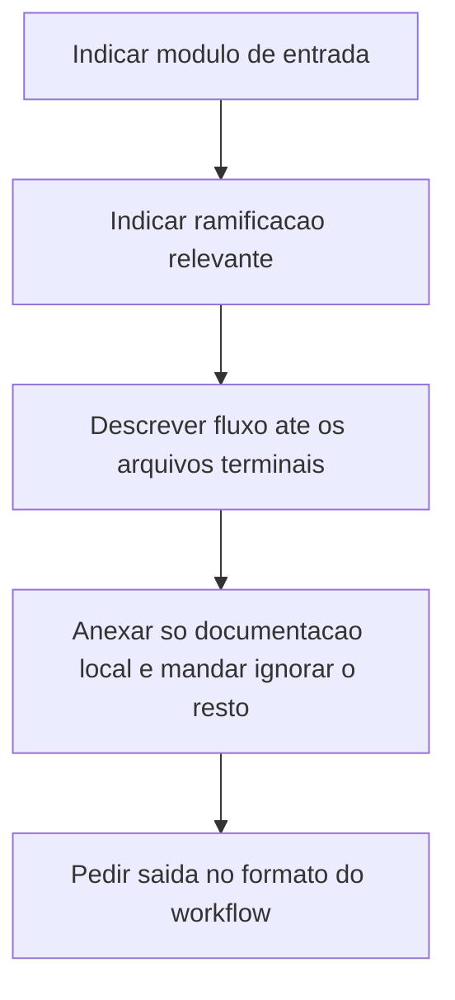
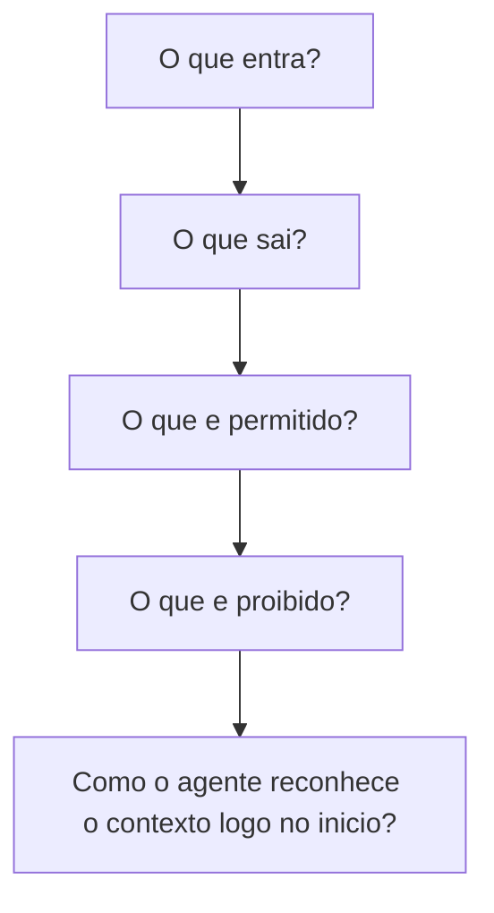

# Estrutura de Prompts

> [!summary] TL;DR
> - Prompt é artefato projetado para induzir comportamento específico; a qualidade vem de explicitar intenção, contexto e formato, não de "escrever bonito".
> - Blocos essenciais: persona e escopo, objetivo, entradas separadas e mínimas, formato de saída, critérios, ambiguidades/pressupostos, instruções negativas, tratamento de erro.
> - Barreira de comportamento impede proatividade excessiva: o modelo lê espaço aberto como permissão.
> - Saída ruim é insumo: mapear falhas concretas e convertê-las em guidelines permanentes.
> - Não existe estrutura coringa; o caso de uso determina a estrutura, e as regras de ouro são checklist, não template rígido.

## Conceitos-chave

- **Caso de uso determina a estrutura**:
  - workflow de dev privilegia etapas, critérios e continuidade;
  - agente de atendimento ao cliente privilegia robustez a entradas variadas e consistência;
  - exploração de arquitetura abre espaço para comparação e análise;
  - geração de documento prioriza formato, seções e completude.
- **Seções reduzem mistura de intenções**: objetivo, contexto, tarefa e saída esperada separados; ambiguidade surge quando o prompt mistura exploração, análise e geração sem prioridade.
- **Cada bloco reduz um tipo de incerteza**: quem executa (persona), limite (escopo), resultado (objetivo, saída), dados (entrada), restrições (critérios, negativas).
- **Pedido genérico**: gera resposta superficial e inconsistente entre execuções (ex: auditoria de dependências sem estrutura); a estrutura vale também fora de dev, como agente corporativo executando atividade interna. Prompt completo do auditor em [[Prompts de Agentes Especialistas]].
- **Reconhecer padrões em prompts prontos**: serve para diagnosticar e reorganizar, não para copiar.
- **Exemplo estruturado (testes com Jest), seção a seção**:
  - Persona and Scope: "agente especializado em Node.js e testes com Jest", proibido refatorar o código original;
  - objetivo direto: "escreva testes unitários para a função abaixo usando Jest, cobrindo entradas válidas e inválidas" em vez de "escreva testes para o código abaixo";
  - entrada mínima em bloco visualmente separado (a função alvo);
  - formato de saída: JSON com `testFile` e `coverageNotes`;
  - critérios de qualidade: rodar com `npm test` sem ajustes, cobrir válidos e inválidos, nenhuma biblioteca além de Jest;
  - ambiguidades/pressupostos: sem versão do Node informada, assumir Node 18 e registrar no campo `assumptions`;
  - instruções negativas: nenhuma explicação ou comentário fora do JSON;
  - tratamento de erro: retornar JSON com `statusError` e explicação.
- **Reutilização como ativo**: o custo inicial de estruturar compra reaproveitamento.
- **Proatividade excessiva**: o modelo corrige o bug mas também refatora, reescreve testes, documenta e aplica padrões fora do objetivo; a PR que deveria validar troca de `>` por `>=` vira revisão extensa e atrasa bugfix urgente.
- **Ambiguidade operacional**: "valide a função, entenda o problema e faça a correção" dá intenção mas não fronteira.
- **Barreira de comportamento**: parte do prompt que restringe o que pode e não pode (corrigir só o bug, não refatorar, não alterar arquivos fora do escopo, não reescrever testes além do necessário); limites definidos antes da execução (nº de arquivos, tipo de mudança, proibição de melhorias oportunistas, foco na causa).
- **Saída como contrato de entrega**: patch mínimo, arquivos alterados, justificativa, nada além; utilidade em dev é a menor alteração correta, não maximizar mudanças positivas.
- **Variação entre versões de modelo**: o mesmo prompt pode gerar um modelo "centrado" ou agressivo.
- **Saída ruim como insumo**: fazer code review da saída e mapear falhas concretas (bibliotecas antigas, arquivos grandes demais, funções desnecessárias, implementação abandonada no meio, quebra de padrões); converter reclamação em especificação.
- **Metáfora do funcionário novo**: cada chat novo é o primeiro dia, desconhece regras locais, versões e limites.
- **Documentar erros como instrução permanente**: import errado vs import certo, exigir consulta à documentação antes de escolher biblioteca daquela família, verificação obrigatória de redundância após cada implementação.
- **Guidelines**: regras curtas, acionáveis e reutilizáveis (limitar tamanho de arquivo, funções limpas, reaproveitar código existente, retomar contexto após interrupção).
- **Técnicas como ferramentas de estrutura**:
  - few-shot com pares concretos certo/errado para imitar ([[Zero-shot, One-shot e Few-shot]]);
  - chain of thought como encadeamento de verificação: implementar, revisar, comparar com o existente, só então manter ([[Chain of Thought e Self-Consistency]]);
  - skeleton of thought como esqueleto explícito da resposta para previsibilidade estrutural ([[Tree of Thought e Skeleton of Thought]]).
- **Limites de comportamento cumulativos**: terminar o arquivo atual antes de mudar de direção, ou corrigir e retomar do ponto onde parou.
- **Base de prompts como ativo do projeto**: reduz dependência de memória individual e acelera onboarding de chats; precisa de organização como testes automatizados, senão vira bagunça e gera ambiguidade ([[Versionamento de Prompts em Equipe]], [[Prompt Registry e Testes Automatizados]]).
- **Contexto em desenvolvimento**: não economizar tokens, porque código é interdependente; o critério é "contexto suficiente para a tarefa" (trade-off de escala em [[Custo, Latência e Escala de Prompts]]).
- **Branches e leafs**: codebase como árvore; branches são caminhos/agrupamentos, leafs são pontos terminais com implementação concreta; mandar a IA seguir uma ramificação até os leafs relevantes em vez de expor o codebase inteiro.
- **Modularização restringe contexto**: módulo desacoplado vira "bolha"; documentação local e instruções por módulo (fluxo esperado, limites, convenções, pontos de integração) em vez de prompt central gigante.
- **Previsibilidade**: contexto suficiente + fronteiras explícitas de navegação.
- **Regras de ouro**: checklist mental de revisão antes de executar; a ausência de um bloco deve ser intencional; proibições entram quando há risco real de desvio; "mínimo" e "adequado" são relativos (batch pode exigir entradas maiores e saída menos simples, ver [[Prompt Caching e Batch Prompting]]).
- **Estrutura nos agentes do repositório**: Persona & Scope, Objective, Inputs, Output Format, Criteria, Ambiguity & Assumptions, Negative Instructions, Error Handling, Workflow (detalhes em [[Prompts de Agentes Especialistas]] e [[Workflow e Role Specification]]); prompt de requisitos estruturado também em [[PRP (Product Requirements Prompt)]].

## Fluxograma / Processo

Correção de bug com barreira de comportamento:



Pedido de alteração em codebase:



Checklist das regras de ouro antes de rodar:



## Erros comuns / Cuidados

- Resposta "boa demais" tem custo alto no pipeline (PR grande, revisão longa).
- Prompt que funcionava numa versão de modelo pode falhar em outra.
- Copiar prompt pronto sem entender os blocos.
- Misturar exploração, análise e geração sem prioridade.
- Base de prompts sem organização vira fonte de ambiguidade.

## Materiais complementares

### Prompts

**Instrução de verificação de redundância (citada no resumo da aula)**
```text
após criar qualquer função, revise se ela realmente é necessária
```

## Tags de busca

`#prompt-engineering` `#estrutura-de-prompt` `#barreira-de-comportamento` `#guidelines`
