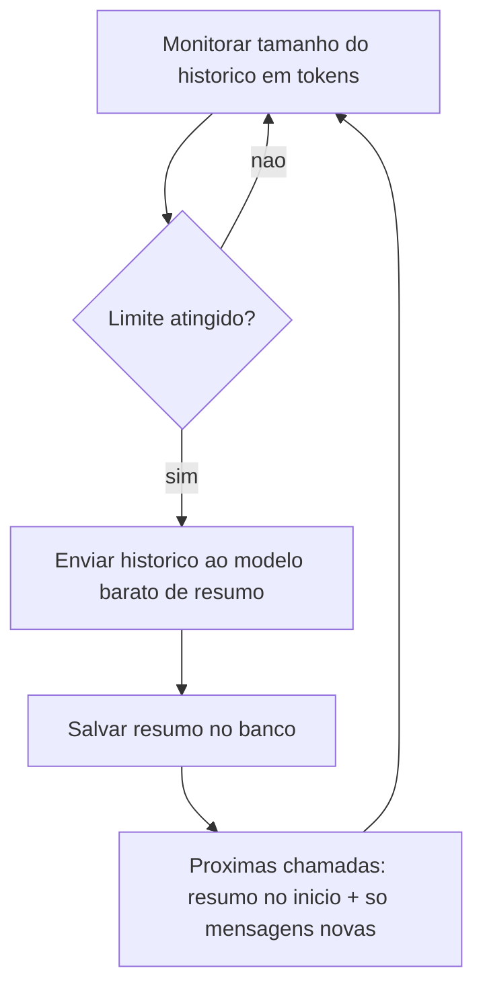
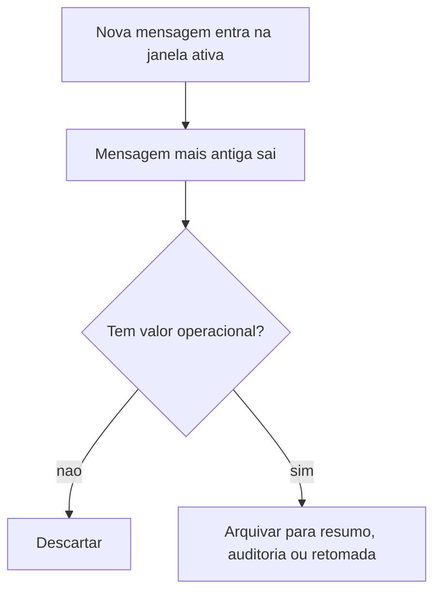

# Gestão de Context Window em Prompts

> [!summary] TL;DR
> - Janela de contexto é o orçamento finito de tokens de uma chamada: system, user, respostas anteriores, trechos recuperados e código competem pelo mesmo espaço.
> - Mais contexto custa memória, dinheiro e latência (custo pode crescer na ordem de O(n²)); "cada token usado precisa justificar sua presença".
> - Janela de contexto e parâmetros são independentes (GPT-3: 175 bilhões de parâmetros, 2.048 tokens).
> - Três estratégias: truncamento (corte), sumarização (compressão semântica) e sliding window (janela móvel); podem coexistir.

## Conceitos-chave

- **Janela de contexto**: quantidade máxima de conversa, documento ou código considerada de uma vez; o limite é a soma de tudo, não de uma mensagem (base em [[Context Window em LLMs]]).
- **Ao exceder**: mensagens antigas ficam de fora, só parte do documento cabe, funções relevantes não entram e a resposta fica menos consistente.
- **Tamanho não é qualidade**: GPT-3 tinha 2.048 tokens e modelos atuais têm ordens de grandeza a mais, mas janela maior não torna o modelo melhor; modelo menor e barato pode bastar para interações curtas, contexto controlado ou execução local.
- **Gerenciamento de espaço escasso**: a arquitetura decide continuamente o que enviar e o que deixar de fora (ordem, prioridade, volume).
- **Reprocessamento iterativo**: a cada token gerado o modelo reconsidera a sequência acumulada (ex: "Go é..." gera "rápida", depois "eficiente" com contexto crescente).
- **Custo computacional**: pode crescer na ordem de O(n²) em relação ao tamanho do contexto (mais relações entre tokens); mais contexto = mais memória, custo por chamada e latência ([[Custo, Latência e Escala de Prompts]]).
- **Cache interno e cache miss**: sequências já processadas são reaproveitadas; sequências novas ou levemente diferentes geram cache miss, então pequenas variações no prompt ou histórico reduzem o reaproveitamento ([[Prompt Caching e Batch Prompting]]).
- **Parâmetros**: pesos internos ajustados no treinamento, a "memória adquirida" (correlações entre palavras, estruturas, código; ex: sentidos diferentes de "go"); ligados ao que o modelo sabe, não a quanto lê de uma vez.
- **Modelo estático em inferência**: pesos só mudam com novo treinamento ou fine-tuning ([[Prompt Engineering vs RAG vs Fine-Tuning]]).
- **Mais parâmetros**: mais capacidade potencial de representar nuances, com mais custo de memória, treino e operação, sem garantia de resultado; modelo com muitos parâmetros mal treinado continua ruim; parte das limitações vem da capacidade aprendida, não do prompt ou da janela.
- **Truncamento**: corte literal de partes do contexto para caber no limite, sem reorganizar nem reinterpretar.
  - vantagem: simplicidade e custo previsível;
  - caso comum: remover mensagens mais antigas;
  - ponto de corte não é fixo: preservar trechos iniciais críticos (instruções, políticas, restrições), ex: reservar os primeiros 1.000 tokens que nunca são removidos e disputar o resto com o histórico variável;
  - pode remover mensagens inteiras ou cortar no meio de um bloco.
- **Sumarização**: compressão semântica do histórico para liberar janela sem descarte literal.
  - preserva estrutura geral e continuidade com menos tokens, mas perde nuances, exceções e detalhes;
  - reduz respostas desconectadas, não elimina [[Alucinação em LLMs]];
  - usar um modelo mais barato só para resumir (decisão arquitetural de custo);
  - rotina interna monitora crescimento (tokens, tamanho do histórico) e dispara a sumarização;
  - resumo persistido no banco e reinjetado no início das próximas interações, substituindo o histórico antigo;
  - o prompt de sumarização é uma "política de retenção semântica" e varia por domínio (livro vs histórico de codificação têm relevância, granularidade e fidelidade diferentes).
- **Sliding window**: histórico como janela móvel que mantém só a parte mais recente ativa; padrão clássico de computação (algoritmos tipo LeetCode, rate limiting); política contínua que privilegia o presente.
  - mensagem que sai pode ser descartada (sem valor operacional) ou arquivada (sumarização futura, auditoria, retomada de sessão, revisão de decisões) em armazenamento de curto ou longo prazo;
  - separar contexto ativo de histórico persistido.
- **Relação entre as três**: truncamento define o corte, sumarização reaproveita comprimido o que saiu, sliding window é o movimento contínuo.
- **Contexto restrito por navegação**: em codebase, indicar ramificação e leafs relevantes em vez de expor tudo ([[Estrutura de Prompts]]).
- **Sessões novas**: reiniciar a conversa entre etapas evita que JSONs anteriores contaminem decisões ([[Prompt Caching e Batch Prompting]]).

## Fluxograma / Processo

Sumarização com reinjeção:



Sliding window com arquivamento:



## Erros comuns / Cuidados

- Truncamento quebra a cadeia causal: resposta incoerente, repetitiva ou sem noção do estado; ruim quando o histórico antigo tem dependências importantes.
- Caber na janela não garante manter relevância.
- Cortar instruções e políticas iniciais junto com o histórico.
- Assumir que janela maior resolve qualidade.

## Materiais complementares

### Prompts

**Disparo de sumarização do histórico (narrado na aula)**
```text
pegue todo o histórico até este ponto e crie um resumo
```

## Tags de busca

`#prompt-engineering` `#context-window` `#sumarizacao` `#sliding-window` `#truncamento`
