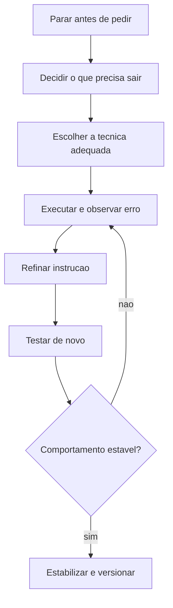

# O que é Prompt Engineering

> [!summary] TL;DR
> - Prompt Engineering é projetar instruções de forma deliberada: o prompt é artefato de engenharia, no mesmo espaço de decisão do código e da arquitetura.
> - Uso intencional explicita objetivo, escopo, profundidade e critério de saída; uso ingênuo deixa o modelo preencher lacunas com algo plausível e pouco acionável.
> - O prompt compõe o comportamento observável do sistema e afeta custo, latência, previsibilidade, escopo e segurança.
> - Escolher técnica por critério: "qual técnica atende esta tarefa com o menor overhead aceitável".
> - Muitas falhas atribuídas ao modelo são falhas de especificação.

## Conceitos-chave

- **Prompt como artefato**: compõe o comportamento observável do sistema (manutenção, previsibilidade, evolução); pequenas mudanças alteram comportamento, por isso precisa de armazenamento e versionamento ([[Versionamento de Prompts em Equipe]]) para auditoria, rollback, comparação e saber qual versão estava em produção.
- **Escrita profissional**: explicitar contexto, tarefa, formato esperado e critérios de qualidade, organizados em blocos como em [[Estrutura de Prompts]].
- **Uso ingênuo vs intencional**: instrução vaga gera resposta plausível mas pouco acionável; a diferença entre "funciona mal" e "muda completamente" está mais na instrução que no modelo.
- **Observabilidade**: registrar execuções, respostas e custos (LangSmith, PromptLayer); ver [[LangSmith Prompt Hub]].
- **Testabilidade**: comparar vários prompts para a mesma tarefa ou o mesmo prompt em modelos diferentes (qualidade, aderência, estabilidade); base de [[Fundamentos de Prompt Evaluation]].
- **Prática transversal ao ciclo de engenharia**: tarefas repetitivas, dúvidas pontuais, problemas complexos com raciocínio guiado, até confiabilidade antes de produção.
- **Aplicações no dev**:
  - design docs: finalidade, recorte técnico, nível de detalhe e público;
  - code review: direcionar para legibilidade, risco, aderência a padrões e regressões, evitando comentários genéricos;
  - commits: mensagens claras para histórico e rastreabilidade;
  - brainstorming: a qualidade da instrução decide se vem só o óbvio;
  - agentes de codificação precisam ser "pilotados" com objetivo, limites, contexto do repositório e expectativa de saída.
- **Dois contextos de uso**: (1) usar IA para ajudar a desenvolver, onde prompts longos e muito contexto são aceitáveis; (2) desenvolver software cujo comportamento depende de prompts (agentes, assistentes, multiagente), onde o prompt governa o produto e pesa em [[Custo, Latência e Escala de Prompts]].
- **Escopo**: o prompt delimita até onde o sistema vai e que ações pode tomar (crítico em cálculo, recomendação, transações sensíveis).
- **Proatividade**: grau de iniciativa do agente além do pedido literal (só esclarecer, sugerir, planejar ou agir), controlado no prompt.
- **Dados externos**: o prompt define o que pode ser usado, com que finalidade e com que restrições.
- **Prompt como superfície de ataque**: vazamento de dados, acesso indevido, ações fora do escopo; mitigar com limites explícitos, contexto mínimo necessário e restrições compatíveis com o risco (ver jailbreak e prompt injection em [[System, User e Assistant Prompts]]).
- **Fragilidade de modelos pequenos e agentes especializados**: uma palavra pode quebrar o comportamento; tratar o prompt como interface crítica (claro, estável, testável).
- **"Nova linguagem de programação"**: parte da lógica sai de if/else determinístico para modelo probabilístico.
- **Usuário final**: ChatGPT, Gemini e Claude com modo agente, deep research, conectores e tools só geram valor com pedido bem formulado (ex: conector HubSpot).
- **Mais contexto nem sempre é melhor**: excesso introduz ruído, ambiguidade e restrições desnecessárias; estrutura relevante vale mais que volume (ver [[Gestão de Context Window em Prompts]]).
- **Técnicas**: existem porque tarefas diferentes exigem formas diferentes de orientar o modelo (papers, benchmarks, comparações entre modelos); a primeira estudada é [[Role Prompting]].
- **Prompt como decisão experimental**: executar prompts em código ou no ChatGPT e comparar variações pequenas para inferir comportamento.
- **Formato como contrato**: quando a saída é consumida por outro modelo, parser, agente ou sistema, o formato vira contrato.
- **Passo a passo só com necessidade real**: auditabilidade, depuração, comparação de alternativas ou redução de erro em tarefas complexas ([[Chain of Thought e Self-Consistency]]).
- **Auditabilidade**: pode ser só saída estruturada verificável ou técnica que expõe etapas ([[ReAct]] em troubleshooting).
- **Casos centrais**:
  - documentação: esqueleto antes de expandir ([[Tree of Thought e Skeleton of Thought]]);
  - debugging: restringir hipóteses e evitar [[Alucinação em LLMs]];
  - agentes: decisão, ferramentas, custo e comportamento desgovernado ([[Prompts de Agentes Especialistas]]).
- **Princípio de complexidade**: aplicar o mínimo de complexidade que dá o máximo de confiabilidade necessária; prompts são "ferramentas cognitivas" iteráveis e versionáveis.
- **Guia de seleção de técnicas (AGENTS.md do repositório)**:

| Técnica | Quando usar |
|---|---|
| [[Role Prompting]] | qualquer tarefa, baixa complexidade, contexto e tom |
| Zero-shot ([[Zero-shot, One-shot e Few-shot]]) | tarefas simples e bem definidas |
| Few-shot | formato específico (classificação, saída estruturada) |
| CoT | raciocínio multi-etapas (matemática, lógica, análise) |
| CoT Self-Consistency | decisões críticas |
| ToT | exploração complexa (estratégia, planejamento), alta complexidade |
| SoT | conteúdo longo (ensaios, documentação) |
| [[ReAct]] | agentes com tools (APIs, buscas, ações) |
| [[Prompt Chaining]] | workflows multi-estágio |
| Least-to-Most | problemas decomponíveis (algorítmicos), parecido com programação dinâmica |

- Boas práticas: começar simples (zero-shot) e só adicionar complexidade se precisar; few-shot para formato; CoT para lógica; chaining para multi-estágio; temperatura 0 para consistência, maior para criatividade.

## Fluxograma / Processo

## Erros comuns / Cuidados

- Estratégia boa para apoiar programação (prompt longo) nem sempre serve para sistema em produção.
- Agente proativo demais pode sair implementando quando o usuário só queria explicação.
- Escolher técnica por hábito em vez de critério (contexto da tarefa, formato de saída, nível de detalhe, quanto o processo precisa ser auditável).

## Materiais complementares

### Conteúdo extra

- Repositório da disciplina: https://github.com/devfullcycle/mba-ia-prompt-engineering (pastas auto-contidas: `1-tipos-de-prompts/`, `4-prompts-e-workflow-de-agentes/`, `5-gerenciamento-e-versionamento-de-prompts/`, `6-prompt-enriquecido/`, `7-evaluation/`).
- Setup: `python -m venv venv`; `source venv/bin/activate` (Windows: `venv\Scripts\activate`); `pip install -r requirements.txt`; `cp .env.example .env` e definir `OPENAI_API_KEY`.
- Notion da disciplina: https://devfullcycle.notion.site/Disciplina-Prompt-Engineering-25a1423c0388808480a9c47b418b4132
- Referência de técnicas: https://www.promptingguide.ai/
- Ferramentas de observabilidade citadas: LangSmith, PromptLayer.
- Comparação com outras abordagens: [[Prompt Engineering vs RAG vs Fine-Tuning]].

## Tags de busca

`#prompt-engineering` `#prompt-como-artefato` `#escolha-de-tecnica` `#seguranca-de-prompt`
