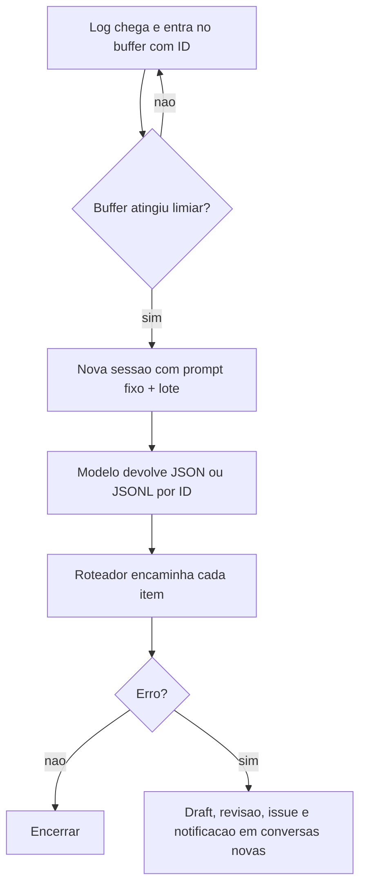

# Prompt Caching e Batch Prompting

> [!summary] TL;DR
> - Prompt caching: o provider reaproveita partes repetidas do prompt (prefixos, instruções fixas, documentos recorrentes) para não reprocessar tokens.
> - OpenAI faz caching automático (manter texto fixo e estável no início); Gemini usa cache explícito por API, com ID, TTL e custo de criação/armazenamento.
> - Batch prompting: várias solicitações semelhantes numa única operação lógica, com o system prompt fixo aparecendo uma vez para o lote.
> - Batch exige homogeneidade de intenção e formato e mapeamento de cada resposta ao item de origem por ID.
> - Ambos ajudam a escalar com menor custo, mas não substituem bom desenho de prompt.

## Conceitos-chave

- **Prompt caching vs cache de aplicação**: Redis guarda respostas e estado no backend; prompt caching evita reprocessar contexto no lado do modelo (ver cache miss em [[Gestão de Context Window em Prompts]]).
- **OpenAI**: automático e transparente, o provider decide o que e por quanto tempo; estratégia é manter o máximo de texto fixo no início e estável entre chamadas, senão o desconto some (system estável, ver [[System, User e Assistant Prompts]]).
- **Gemini**: cache explícito por API; o conteúdo recebe um ID e chamadas futuras enviam pergunta + ID (ex: PDF consultado várias vezes: upload uma vez, criar cache, guardar ID, perguntar).
- **TTL (Time To Live)**: tempo de disponibilidade do cache.
- **Quando vale cachear**: o mesmo conteúdo consultado várias vezes; pesar frequência, tamanho e mecanismo do provider.
- **Batch prompting**: system fixo (ex: formatar texto em JSON) aparece uma vez para o lote em vez de repetir por item; complementa caching.
- **Menos overhead**: 10 itens numa chamada vs 10 chamadas, relevante em centenas de milhares ou milhões de itens ([[Custo, Latência e Escala de Prompts]]).
- **Consistência**: contexto compartilhado aumenta a consistência de formato entre saídas.
- **Homogeneidade**: não misturar intenções (receita culinária com geração de testes).
- **Mapeamento**: a aplicação precisa ligar cada resposta ao item de origem (IDs, ordem estável, indexação explícita).
- **Cenário de logs**: logs do servidor alimentam workflow de agentes (recebe log, classifica, refina issue, publica no GitHub, notifica), como em [[Prompts de Agentes Especialistas]].
  - solução ingênua: uma chamada por log, funciona mas escala mal em custo e latência;
  - vários logs na mesma sessão acumulam histórico e reprocessam contexto inútil;
  - redesenho: nova sessão a cada X logs; buffer acumula até um limiar (ex: 100) e dispara o lote, desacoplando a chegada de eventos da frequência de chamadas;
  - ID por log para rotear o resultado (encerrar, draft, revisão, notificar);
  - saída em JSON ou JSONL com campos mínimos (id, classificação, conteúdo para a próxima etapa); JSONL facilita parsing incremental;
  - agente seguinte roteia: log informativo ou health check encerra, erro segue para draft, revisão, refinamento, issue e notificação;
  - etapas seguintes em conversas novas para JSONs anteriores não contaminarem decisões.
- **Menor prompt possível**: perguntar "qual é o menor prompt que preserva o mesmo comportamento com custo aceitável?"; menos exemplos pode ser melhor pela utilidade marginal de cada um ([[Zero-shot, One-shot e Few-shot]]).
- **Batch + caching**: combinar quando o prefixo é estável e irredutível.
- **Limitar saída**: tokens de saída costumam custar mais que entrada; limitar explicitamente o tamanho por item.
- **Estimativa de custo**: ex: 10 logs por chamada x até 100 tokens de saída por item dá o teto por chamada; multiplicar pelo volume diário para prever gasto e comparar arquiteturas.
- **Decisão arquitetural**: sessões, lotes, agentes, formato de saída e reaproveitamento de contexto fazem parte do Prompt Engineering.
- **Batch e estrutura**: batch pode exigir entradas maiores e saída menos simples que o "mínimo" das regras de ouro ([[Estrutura de Prompts]]).

## Fluxograma / Processo



## Erros comuns / Cuidados

- Criar cache explícito para conteúdo de uso único (paga criação e retenção sem retorno).
- Chamadas que mudam demais no início derrubam o reaproveitamento do cache.
- Usar batch quando cada item precisa de instruções muito diferentes.
- Batch sem mapeamento por ID: ganho de escala vira erro de integração.
- Manter vários lotes na mesma sessão, acumulando histórico inútil.

## Materiais complementares

### Prompts

**System fixo de um lote (narrado na aula)**
```text
você é um especialista em prompt engineering, formate esse texto em JSON
```

**Limite explícito de saída por item (narrado na aula)**
```text
responda com no máximo 100 tokens
```

**Pergunta enviada junto com o ID do cache explícito no Gemini (narrado na aula)**
```text
qual é o assunto principal deste PDF?
```

## Tags de busca

`#prompt-engineering` `#prompt-caching` `#batch-prompting` `#custo-de-tokens`
