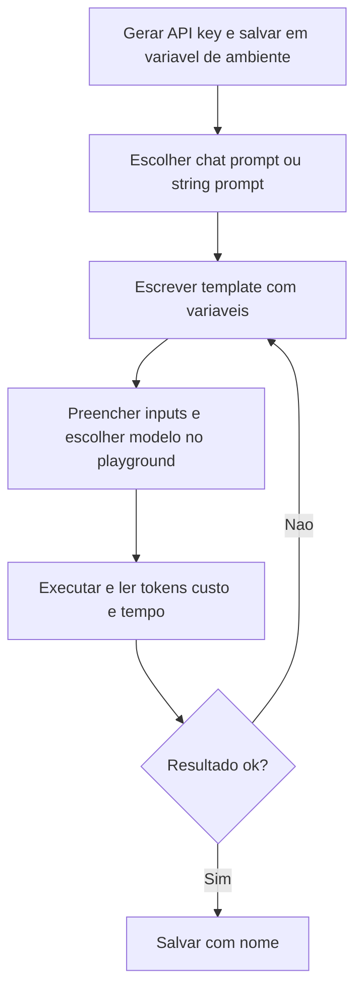
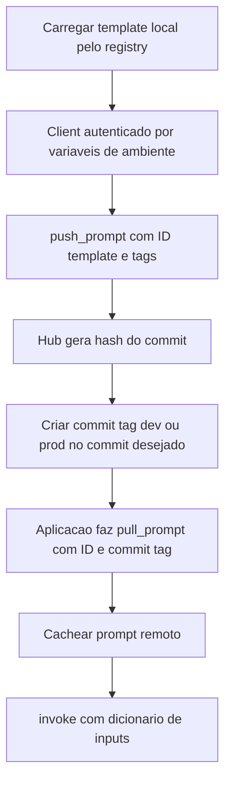

# LangSmith Prompt Hub

> [!summary] TL;DR
> - Plataformas de terceiros (LangSmith, LangFuse, PromptLayer) tratam prompts como CMS: editar, revisar, validar e promover entre ambientes com permissões, sem exigir Git.
> - Prompt Hub é o "GitHub de prompts" do LangSmith: repositório remoto com histórico de commits, README, fork e acesso público ou privado.
> - `push_prompt` publica e gera um hash de commit; `pull_prompt` consome em runtime por ID + commit tag (ou hash).
> - Prompt tag classifica (busca e indexação); commit tag versiona operacionalmente (`dev`, `prod`, `v1-0-0`).
> - Cachear o prompt remoto evita chamada à plataforma a cada execução, mas não substitui versionamento.

## Conceitos-chave

- **Governança organizacional**: quando produto, prompt engineering e operação alteram prompts, custo, qualidade e aderência ao modelo passam a ser geridos fora do repositório.
- **Gestão como CMS**: editar, revisar, validar e promover entre desenvolvimento, homologação e produção, com permissões e registro de quem autorizou cada promoção.
- **Git nem sempre serve**: clone, branch e merge não são interface adequada para outras áreas.
- **Teste A/B de variantes**: compara qualidade percebida, custo, taxa de acerto e aderência. Comparação offline entre versões é feita com [[Pairwise Evaluation e LLM-as-Judge]].
- **Consumo remoto via SDK**: a aplicação busca a versão publicada em runtime; o registry remoto substitui o filesystem com contrato de consumo estável (versão local em [[Prompt Registry e Testes Automatizados]]).
- **Plataformas**: LangSmith, LangFuse, PromptLayer (gestão + evaluation, observabilidade, tracing).
- **LangChain/LangGraph vs LangSmith**: LangChain e LangGraph constroem fluxo e lógica (agentes, grafos com múltiplos passos e estados); LangSmith é a camada operacional (observabilidade, debugging, testes, acompanhamento em equipe, evaluation). Prompt Hub é só uma das funções; tem plano gratuito.
- **Observabilidade em LLM**: registra chamadas, entradas, saídas, custo, falhas e tempo de resposta.
- **Tracing**: caminho da execução (onde decidiu, onde errou, quanto cada etapa consumiu).
- **Monitoramento**: visão contínua de volume e gasto; o prompt vira componente monitorado.
- **Prompt Hub**: vitrine e repositório remoto (publicação, descoberta, documentação, histórico, download), com README por prompt (uso, entradas, problema que resolve).
- **Chat prompt vs string prompt**: chat prompt tem mensagens por papel (system, human, mensagens extras, ferramentas, esquema de saída) para fluxos conversacionais, ver [[System, User e Assistant Prompts]]; string prompt (`StringPromptTemplate`) é instrução textual única com template e variáveis de entrada.
- **Fork**: deriva um prompt existente sem alterar o original.
- **Público vs privado**: privado para comportamento interno, acesso por API key.
- **API key**: gerada em Settings > API Keys e guardada em variável de ambiente para integração.
- **Playground**: edita, preenche inputs e executa antes de salvar; mostra tempo, status, input tokens, output tokens e custo estimado ([[Custo, Latência e Escala de Prompts]]). O resultado depende do modelo selecionado (exemplo trocou para GPT-4o mini).
- **Salvar**: com nome (ex.: "a soma") gera artefato listado com tipo e último commit. Produto e outras áreas editam sem mexer no Git; o dev cuida da integração em runtime. É alternativa de autoria, não substitui a organização local.
- **Push programático**: carregar template local (ex.: `registry.getPrompt` do agente de pull request), instanciar `Client` autenticado por variáveis de ambiente e chamar `push_prompt` com ID (nome único reservado no hub), template e tags (ex.: `v1.0.0`, `model:gpt-5-nano`, descrição). O template pode vir de qualquer origem.
- **Fonte da verdade**: com sincronização local e remoto, decidir qual lado manda.
- **Hash de commit**: identificador real do estado do prompt. Reenviar o mesmo conteúdo dá erro (mesmo hash, sem commit redundante); só conteúdo diferente gera novo commit (1.0.0 para 1.0.1 gerou dois commits). O hub mostra tipo, template, commits, autor e comentários.
- **Pull**: `pull_prompt` traz o prompt remoto (ex.: `agent-pull-request-creator`) e encadeia com o modelo via `invoke` com dicionário de inputs.
- **Sem versão explícita**: o SDK pega o estado mais recente, arriscado em produção (sem reprodutibilidade nem rollback).
- **Prompt tag**: metadado de catalogação; não seleciona versão (`:1.0.0` criado como prompt tag gera erro "commit não encontrado").
- **Commit tag**: rótulo de um commit específico usado pelo SDK para resolver a revisão; sem ela, referenciar o hash. A plataforma não aceita pontos: usar `v1-0-0`, `dev`, `prod`.
- **Promoção e rollback**: `dev` num commit antigo e `prod` no mais recente representa promoção entre ambientes; rollback é reposicionar a commit tag, sem editar a aplicação.
- **Cache do prompt remoto**: reduz latência, custo e dependência da plataforma em escala ([[Prompt Caching e Batch Prompting]] trata do cache do lado do modelo).
- **Uso em evaluation**: os experimentos pairwise fazem `pull prompt` das variantes A e B no LangSmith; commits do mesmo prompt (Security Expert V1 para V2) viram trilha de auditoria da melhoria ([[Evaluators e Datasets]]).
- **LangFuse**: alternativa open-source MIT, auto-hospedada (Docker) ou cloud.

## Fluxograma / Processo





## Erros comuns / Cuidados

- Falha de push começa por credenciais ausentes, inválidas ou ambiente errado.
- Push do mesmo conteúdo dá erro por hash idêntico.
- Usar prompt tag como se fosse versão: o pull falha com "commit não encontrado".
- Commit tag com ponto (`1.0.0`) não é aceita; usar `v1-0-0`.
- Pull sem versão em produção pega sempre o último commit, sem reprodutibilidade.
- Buscar o prompt remoto a cada execução sem cache aumenta latência, custo e dependência da plataforma.

## Materiais complementares

### Prompts

**Template de exemplo criado no playground (variáveis x e y)**
```text
quanto é x mais y?
```

O prompt publicado nesse fluxo é o `agent-pull-request-creator`, cujo YAML completo está em [[Prompt Registry e Testes Automatizados]].

### Conteúdo extra

- Push para o LangSmith (trecho do repositório, capítulo 5):
```python
Client().push_prompt(nome, object=..., tags=[f"v{version}", f"model: {model}"], description=...)
```
- Pull por commit tag de ambiente (trecho do repositório, capítulo 5):
```python
client.pull_prompt("agent-pull-request-creator:dev")
```

- Variáveis de ambiente opcionais do capítulo 5: `LANGCHAIN_TRACING_V2`, `LANGCHAIN_ENDPOINT=https://api.smith.langchain.com`, `LANGCHAIN_API_KEY`, `LANGCHAIN_PROJECT=prompt-management-system`.
- LangSmith: https://smith.langchain.com/
- LangFuse: https://langfuse.com/docs

## Tags de busca

`#prompt-engineering` `#langsmith` `#prompt-hub` `#versionamento` `#commit-tag`
